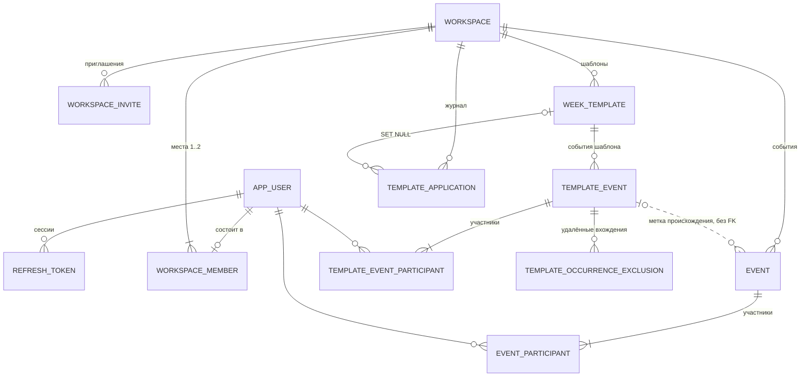
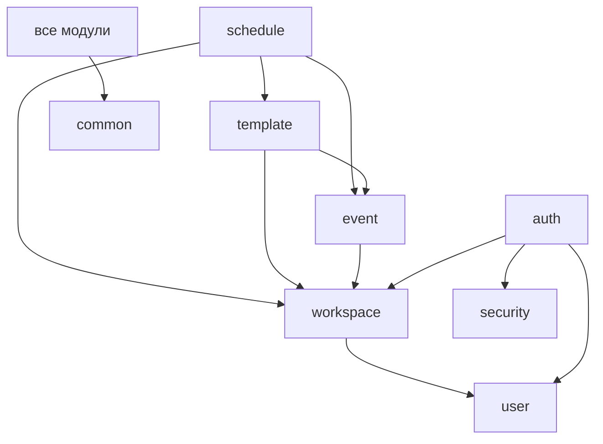

# Together Planner — спецификация backend v2 (MVP)

Заменяет `backend-spec.md` (v1). Что и почему изменено — в `backend-audit-report.md` (ссылки вида **A-01**).
Порядок реализации — в `backend-implementation-roadmap.md`.

**Ревизия 2026-11-13:** внесены решения по открытым вопросам Q-1…Q-6 (audit §6): правило занятого дня для FILL, подтверждение восстановления в REPLACE, обязательная версия при DELETE, один origin, Spring Boot 4.1.2, события только в поясе пространства.

---

## 0. Как читать документ

- **Бизнес-правило** — то, что требует продукт. Помечено **[БП]**.
- **Техническое решение** — как это реализовано. Помечено **[ТР]**.
- **Допущение** — решение, принятое без явного требования. Помечено **[Д]**, сведено в §2.2. Если допущение поменяется, меняется только указанный раздел.
- Код в документе — фрагменты, поясняющие контракт. Это не готовая реализация.

---

## 1. Стек и версии

| Компонент | Версия | Как подключается |
|---|---|---|
| Java | 21 (LTS) | JDK 21 (Temurin или JBR 21) |
| Spring Boot | **4.1.2** | `spring-boot-starter-parent` |
| Spring Framework / Security | 7.0.10 / 7.1.2 | через BOM Boot |
| Spring Data | 2026.0.2 | через BOM Boot |
| Hibernate ORM | 7.4.13.Final | через BOM Boot |
| Flyway | 12.4.0 (`spring-boot-starter-flyway` + `flyway-database-postgresql`) | через BOM Boot |
| PostgreSQL JDBC | 42.7.14 | через BOM Boot |
| Jackson | 3.1.7 (пакеты `tools.jackson.*`; аннотации — `com.fasterxml.jackson.annotation`) | через BOM Boot |
| JUnit Jupiter / Mockito | версия из BOM Boot (на момент проверки — 6.0.3 / 5.23.0) | через BOM Boot, версия не фиксируется вручную |
| Testcontainers | 2.0.5 | через BOM Boot |
| Lombok | 1.18.48 | через BOM Boot |
| springdoc-openapi | **3.2.0** | версия указывается явно (BOM Boot её не знает) |
| PostgreSQL | **18** (`postgres:18-alpine`) | Docker Compose и Testcontainers — один образ |
| Maven | wrapper (`mvnw`) | в репозитории |

**Почему 4.1, а не 4.0 или 3.5** (решение Q-5):

| Ветка | Бесплатная поддержка до | Вывод |
|---|---|---|
| 3.5 | 2026-06-30 — **уже закончилась** | Не подходит для нового проекта |
| 4.0 | 2026-12-31 — меньше двух месяцев | Через месяц придётся обновляться |
| **4.1** | 2027-07-31 | **Выбрана.** Переход на 4.x после MVP не нужен |

**Проверка совместимости** (BOM `spring-boot-dependencies:4.1.2`, артефакты на Maven Central, 2026-11-13):

| Компонент | Результат |
|---|---|
| springdoc 3.2.0 | Собран против `spring-boot-starter-parent:4.1.2` — совместим |
| Hibernate 7.4 | `UuidGenerator.Style.VERSION_7` есть (§5.0); `ConstraintViolationException#getConstraintName()` на месте (§7.3) |
| Spring Security 7.1 | `NimbusJwtEncoder.withSecretKey`, `NimbusJwtDecoder.withSecretKey`, `JwtTimestampValidator#setClock`, `JwtIssuerValidator` на месте (§10.3) |
| Flyway 12.4 | PostgreSQL 18 — последняя официально поддерживаемая версия, без предупреждений |
| Testcontainers 2.0.5 | Новые артефакты `testcontainers-postgresql`, `testcontainers-junit-jupiter`; класс `org.testcontainers.postgresql.PostgreSQLContainer`. `@ServiceConnection` работает с любым `JdbcDatabaseContainer` |
| Тестовые срезы Boot 4 | Модульные: `@AutoConfigureMockMvc` лежит в `org.springframework.boot.webmvc.test.autoconfigure` и требует `spring-boot-starter-webmvc-test` |
| JUnit | Boot 4 управляет версией **JUnit Jupiter** через BOM (её не фиксируем вручную). API — тот же `org.junit.jupiter.*`, тесты пишутся без изменений |

Существенных несовместимостей не найдено. Java 21 поддерживается всеми компонентами.

---

## 2. Требования и допущения

### 2.1. Бизнес-требования, которые покрывает backend

| # | Требование | Где |
|---|---|---|
| R-1 | Регистрация, вход, выход, текущий пользователь | §8.3 |
| R-2 | Пространство на двоих: создание, приглашение по коду, участники | §8.4, §9.6 |
| R-3 | Недельное расписание двух человек | §8.5 |
| R-4 | CRUD событий; событие одному или обоим; через полночь | §8.6, §9.7 |
| R-5 | Будущие события существуют независимо от недели | §4 (нет `WeeklySchedule`), §8.6 |
| R-6 | Шаблоны недель: CRUD | §8.7, §9.8 |
| R-7 | Применение шаблона к неделе; правка шаблона не меняет недели; не удалять события случайно; без дублей; понятное поведение для непустой недели | §8.8, §9 |
| R-8 | Доступ только к своему пространству | §9.0, §10 |

### 2.2. Допущения

| # | Допущение | Раздел |
|---|---|---|
| D-1 | **[решение Q-6]** Оба участника живут в одном часовом поясе. Все события создаются и показываются в IANA-поясе пространства; собственного пояса у события нет | §3 |
| D-2 | Пользователь состоит максимум в одном пространстве; в пространстве максимум 2 участника; выйти из пространства нельзя (MVP) | §4, §9.6 |
| D-3 | Удалить пользователя или пространство нельзя (MVP), эндпоинтов для этого нет | §4.3 |
| D-4 | **[решение Q-1]** День занят для FILL, если событие участника пересекает интервал `[день 12:00; следующий день 00:00)`. Порог задан одной константой `BusyDayRule.BUSY_FROM` | §9.1 |
| D-5 | **[решение Q-2]** REPLACE — полная синхронизация недели с шаблоном. Он восстанавливает вхождения, удалённые пользователем, но только после показа в предпросмотре и явного подтверждения | §9.1, §9.5 |
| D-6 | **[решение Q-3]** DELETE версионируемого ресурса (событие, шаблон) требует ожидаемую версию `?version=` | §8.0, §8.6, §8.7 |
| D-7 | **[решение Q-4]** Один origin через nginx: frontend — `/`, API — `/api`. CORS не нужен; CSRF-защита описана отдельно | §10.5, §10.6 |
| D-8 | Пересечения событий разрешены (параллельные события — требование), применение шаблона только предупреждает о них | §9.1 |
| D-9 | Точность времени — минута | §3 |

---

## 3. Модель времени

| Понятие | Как хранится | Java | Правило |
|---|---|---|---|
| **Время расписания** (начало и конец события) | `timestamp` (без пояса) | `LocalDateTime` | **Источник правды.** Местные часы пространства |
| **Часовой пояс** | `workspace.time_zone` | `ZoneId` | Только region-id из `ZoneId.getAvailableZoneIds()` (`Asia/Almaty`). Фиксированные смещения (`+05:00`) запрещены: у них нет правил перехода и истории (A-18) |
| **Абсолютный момент** | **не хранится** | `Instant` | При необходимости: `ZonedDateTime.of(local, zone).toInstant()`. В MVP не используется |
| **Технические метки** (`created_at` и др.) | `timestamptz` | `Instant` | UTC |

Правила:

0. **Смысл времени [Д D-1].** Время `2026-11-20T08:00` означает «08:00 по часам пространства», а не фиксированный абсолютный момент. Собственного пояса у события нет.
1. **Минутная точность [Д D-9].** Входное время обрезается: `t.truncatedTo(ChronoUnit.MINUTES)`.
2. **Переходы на летнее и зимнее время.** Каждое время (начало, конец, вхождение шаблона) нормализуется одной функцией: `TimeRules.normalize(t, zone) = ZonedDateTime.of(t, zone).toLocalDateTime()`.

   | Случай | Пример (`Europe/Berlin`) | Что сохраняется |
   |---|---|---|
   | **Несуществующее время** (часы переводят вперёд) | `2026-03-29T02:30` — такого времени нет | Сдвиг вперёд на длину разрыва: `03:30` |
   | **Неоднозначное время** (час повторяется) | `2026-10-25T02:30` — бывает дважды | Без изменений: `02:30`. При переводе в абсолютный момент берётся **первое** (более раннее) смещение |

   - Ответ API содержит уже нормализованное время, по нему frontend видит сдвиг. Отдельного флага нет.
   - Длительность и все проверки (`end > start`, ≤ 31 дня, вхождения шаблона `start + durationMinutes`) считаются **по местным часам**. В ночь перевода реально прошедшее время отличается на час — для расписания это ожидаемо.
   - Конец вхождения шаблона тоже нормализуется: `end = normalize(start.plusMinutes(durationMinutes), zone)`.
   - Событие, которое начинается во втором из повторяющихся 02:30 и заканчивается раньше по местным часам, не выражается. Это ограничение модели.
   - В `Asia/Almaty` переходов нет, но код корректен для любого поддерживаемого пояса.
3. **Через полночь.** `end` просто на следующей дате. Ограничения: `end > start` и `end − start ≤ 31 день`.
4. **Интервалы полуоткрытые** `[start; end)`. Пересечение: `a.start < b.end && a.end > b.start`. Соприкосновение (09:00–10:00 и 10:00–11:00) пересечением не считается.
5. **Неделя** — с понедельника 00:00 до следующего понедельника 00:00 по местному времени. `weekStart(d) = d.with(previousOrSame(MONDAY))`.
6. **Событие относится к неделе**, если пересекает её интервал. Событие «вс 23:00 – пн 07:00» относится к обеим неделям.
7. **«Начинается в неделе»** — `start ∈ [пн 00:00; след. пн 00:00)`. Используется в REPLACE.
8. **«Сейчас»** — только через бин `Clock`: `LocalDateTime.now(clock.withZone(zone))`.
9. **Смена пояса пространства (W3)** — поведение уже созданных данных:

   | Что | Поведение |
   |---|---|
   | Даты и время событий | **Не меняются.** «Работа 09:00» остаётся 09:00 по часам нового пояса. Данные не мигрируются |
   | Абсолютный момент события | Меняется (09:00 в Алматы ≠ 09:00 в Берлине). В MVP абсолютные моменты не хранятся и не используются, поэтому последствий нет |
   | Принадлежность события неделе | Не меняется: неделя считается по местным датам |
   | «Сейчас» (E2 `upcoming`, «сегодня» в S1) | Считается в новом поясе с момента изменения |
   | Шаблоны и журнал применений | Не меняются |
   | Время, которое не существует в новом поясе | Не нормализуется задним числом. Нормализация применяется при следующем сохранении события |

10. **Поездки [Д D-1].** Время вводится в поясе пространства, даже если человек физически в другом городе.

---

## 4. Модель данных

### 4.1. Обзор



**Почему нет таблицы `WeeklySchedule`.** Неделя полностью вычисляется из событий по датам (§3, правило 6). Таблица дала бы второй источник правды («к какой неделе относится событие») и заставила бы создавать неделю заранее ради будущих событий, что противоречит R-5. Информацию «какие шаблоны применены к неделе» хранит журнал `template_application`.

### 4.2. Таблицы

| Таблица | Модуль | Назначение | PK | FK (ON DELETE) | UNIQUE | CHECK | Индексы |
|---|---|---|---|---|---|---|---|
| `app_user` | user | Учётная запись | `id` | — | `email` | `email = lower(email)` | (уникальный) |
| `refresh_token` | auth | Сессии (хеш refresh-токена) | `id` | `user_id → app_user` (CASCADE) | `token_hash` | `revoke_reason` из списка; `revoked_at` и `revoke_reason` заданы оба или ни одного | `user_id WHERE revoked_at IS NULL`; `expires_at` |
| `workspace` | workspace | Пространство на двоих | `id` | — | — | — | — |
| `workspace_member` | workspace | Участник и его место | `id` | `workspace_id → workspace` (CASCADE); `user_id → app_user` (NO ACTION) | `(workspace_id, user_id)`; `(workspace_id, seat)`; `user_id` | `role` из списка; `seat IN (1, 2)` | (уникальные) |
| `workspace_invite` | workspace | Одноразовый код приглашения | `id` | `workspace_id → workspace` (CASCADE); `created_by`, `used_by → app_user` | `code` | `used_by` и `used_at` заданы оба или ни одного | `workspace_id` |
| `event` | event | Событие (самостоятельное) | `id` | `workspace_id → workspace` (CASCADE); `created_by`, `updated_by → app_user` | частичный `(workspace_id, source_template_event_id, source_week_start)` | непустой `title`; `end > start`; длительность ≤ 31 дня; `category`/`color` из списка; поля происхождения заданы все или ни одного; `source_week_start` — понедельник | `(workspace_id, start_local)` |
| `event_participant` | event | Участники события | `(event_id, user_id)` | `event_id → event` (CASCADE); `user_id → app_user` | — | — | `user_id` |
| `week_template` | template | Шаблон недели | `id` | `workspace_id → workspace` (CASCADE); `created_by → app_user` | `(workspace_id, lower(name))` | непустой `name` | (уникальный) |
| `template_event` | template | Событие шаблона | `id` | `template_id → week_template` (CASCADE) | — | `day_of_week` 1..7; длительность 1..10080 мин; `category`/`color` из списка | `template_id` |
| `template_event_participant` | template | Участники события шаблона | `(template_event_id, user_id)` | `template_event_id → template_event` (CASCADE); `user_id → app_user` | — | — | — |
| `template_application` | template | Журнал применений (снимок имени) | `id` | `workspace_id → workspace` (CASCADE); `template_id → week_template` (**SET NULL**); `applied_by → app_user` | — | `mode` из списка; `week_start` — понедельник | `(workspace_id, week_start)`; `(template_id, applied_at DESC)` |
| `template_occurrence_exclusion` | template | Вхождение шаблона, удалённое пользователем (A-04) | `(template_event_id, week_start)` | `template_event_id → template_event` (CASCADE); `created_by → app_user` | (PK) | `week_start` — понедельник | (PK) |

Все таблицы нужны:
- `template_application` — история в интерфейсе и снимок имени шаблона;
- `template_occurrence_exclusion` — без неё повторное применение восстанавливает удалённое;
- `workspace_invite` — у кода есть срок жизни и одноразовость.

### 4.3. Что обеспечивает БД, а что сервис

| Правило | БД | Сервис | Почему так |
|---|---|---|---|
| Email уникален без учёта регистра | `UNIQUE` + `CHECK lower` | нормализация `trim().toLowerCase(ROOT)` | Гонка регистраций разрешается БД |
| Максимум 2 участника | `seat IN (1,2)` + `UNIQUE (workspace_id, seat)` | быстрая проверка → понятная ошибка | Гонка join разрешается БД без блокировки (A-11) |
| Одно пространство на пользователя [Д D-2] | `UNIQUE (user_id)` | быстрая проверка | |
| Событие принадлежит пространству | FK `workspace_id` | поиск всегда `ByIdAndWorkspaceId` | |
| Участник события — участник того же пространства | — | `EventValidator` по `memberIds(wsId)` | Чтобы закрепить в БД, нужен составной FK `(workspace_id, user_id) → workspace_member` и отдельная сущность участника вместо `@ElementCollection`. Состав участников в MVP неизменен (D-2), поэтому риск — только ошибка в коде, и её ловят тесты |
| Участник события шаблона — участник пространства | — | `TemplateService` | То же |
| Нет дублей одного вхождения шаблона | частичный `UNIQUE` | поиск дублей в планировщике | БД — последний рубеж в гонке |
| Имя шаблона уникально в пространстве | `UNIQUE (workspace_id, lower(name))` | `trim` + быстрая проверка | |
| `end > start`, длительность, категории | `CHECK` | Bean Validation + `EventValidator` | Понятная ошибка от сервиса, гарантия от БД |
| Приглашение одноразово | `CHECK` + условный UPDATE | проверка срока | Гонка двух join по одному коду (§9.6) |
| Версия при изменении | колонка `version` | явное сравнение + `@Version` | §11 |
| Удаление пользователя или пространства [Д D-3] | FK на `app_user` без CASCADE (кроме `refresh_token`) блокируют удаление пользователя с данными; каскады от `workspace` очистят всё пространство | эндпоинтов нет | Удаление аккаунта — отдельная будущая функция |

---

## 5. SQL-миграции и JPA

### 5.0. Общие правила

- Схему меняет только Flyway: `spring.jpa.hibernate.ddl-auto: validate`. Применённую миграцию **никогда** не редактировать — только новая `V5__...`.
- Имена: `snake_case`. Префиксы ограничений: `pk_`, `fk_`, `uq_`, `ck_`, `ix_`. Имена ограничений — часть контракта: на них опирается `ConstraintErrorMapper` (§7.3).
- **ID — UUID v7**, генерирует Hibernate: `@Id @UuidGenerator(style = UuidGenerator.Style.VERSION_7) private UUID id;`.
  - UUID v7 упорядочен по времени, поэтому новые строки попадают в конец индекса B-tree, а не в случайное место.
  - `Style.VERSION_7` есть в Hibernate 7.4 (проверено); в Hibernate 6.6 его не было (A-12).
  - **Не присваивайте id вручную** (например, `UUID.randomUUID()` в конструкторе). Spring Data `save()` решает «новая сущность или нет» по `id == null`. Сущность с готовым id пойдёт через `merge` — это лишний SELECT и неожиданное поведение.
- `created_at` / `updated_at` — `@CreationTimestamp` / `@UpdateTimestamp`. Это время JVM, а не бина `Clock`; бизнес-логика на эти поля не опирается. Сроки (токены, приглашения) ставятся явно из `Clock`.

### 5.1. `V1__users_and_auth.sql`

```sql
CREATE TABLE app_user (
    id            uuid         NOT NULL,
    email         varchar(254) NOT NULL,
    display_name  varchar(50)  NOT NULL,
    password_hash varchar(100) NOT NULL,
    created_at    timestamptz  NOT NULL,
    updated_at    timestamptz  NOT NULL,
    CONSTRAINT pk_app_user PRIMARY KEY (id),
    CONSTRAINT uq_app_user_email UNIQUE (email),
    CONSTRAINT ck_app_user_email_lower CHECK (email = lower(email))
);

CREATE TABLE refresh_token (
    id            uuid        NOT NULL,
    user_id       uuid        NOT NULL,
    token_hash    char(64)    NOT NULL,          -- SHA-256 (hex); сам токен не хранится
    created_at    timestamptz NOT NULL,
    expires_at    timestamptz NOT NULL,
    revoked_at    timestamptz,
    revoke_reason varchar(16),
    CONSTRAINT pk_refresh_token PRIMARY KEY (id),
    CONSTRAINT uq_refresh_token_hash UNIQUE (token_hash),
    CONSTRAINT fk_refresh_token_user FOREIGN KEY (user_id) REFERENCES app_user (id) ON DELETE CASCADE,
    CONSTRAINT ck_refresh_token_revoke CHECK ((revoked_at IS NULL) = (revoke_reason IS NULL)),
    CONSTRAINT ck_refresh_token_reason CHECK (revoke_reason IS NULL OR
        revoke_reason IN ('ROTATED', 'LOGOUT', 'LOGOUT_ALL', 'REUSE_DETECTED'))
);
CREATE INDEX ix_refresh_token_user_active ON refresh_token (user_id) WHERE revoked_at IS NULL;
CREATE INDEX ix_refresh_token_expires ON refresh_token (expires_at);
```

### 5.2. `V2__workspaces.sql`

```sql
CREATE TABLE workspace (
    id         uuid        NOT NULL,
    name       varchar(60) NOT NULL,
    time_zone  varchar(64) NOT NULL,
    created_at timestamptz NOT NULL,
    updated_at timestamptz NOT NULL,
    CONSTRAINT pk_workspace PRIMARY KEY (id),
    CONSTRAINT ck_workspace_name CHECK (length(btrim(name)) > 0)
);

CREATE TABLE workspace_member (
    id           uuid        NOT NULL,
    workspace_id uuid        NOT NULL,
    user_id      uuid        NOT NULL,
    role         varchar(16) NOT NULL,
    seat         smallint    NOT NULL,         -- 1 = левая панель (создатель), 2 = правая
    joined_at    timestamptz NOT NULL,
    CONSTRAINT pk_workspace_member PRIMARY KEY (id),
    CONSTRAINT fk_member_workspace FOREIGN KEY (workspace_id) REFERENCES workspace (id) ON DELETE CASCADE,
    CONSTRAINT fk_member_user FOREIGN KEY (user_id) REFERENCES app_user (id),
    CONSTRAINT uq_member_workspace_user UNIQUE (workspace_id, user_id),
    CONSTRAINT uq_member_workspace_seat UNIQUE (workspace_id, seat),    -- не больше 2 участников
    CONSTRAINT uq_member_user UNIQUE (user_id),                         -- MVP: одно пространство на человека
    CONSTRAINT ck_member_role CHECK (role IN ('OWNER', 'MEMBER')),
    CONSTRAINT ck_member_seat CHECK (seat IN (1, 2))
);

CREATE TABLE workspace_invite (
    id           uuid        NOT NULL,
    workspace_id uuid        NOT NULL,
    code         varchar(16) NOT NULL,         -- без дефиса, UPPER CASE
    created_by   uuid        NOT NULL,
    created_at   timestamptz NOT NULL,
    expires_at   timestamptz NOT NULL,
    used_by      uuid,
    used_at      timestamptz,
    CONSTRAINT pk_workspace_invite PRIMARY KEY (id),
    CONSTRAINT uq_invite_code UNIQUE (code),
    CONSTRAINT fk_invite_workspace FOREIGN KEY (workspace_id) REFERENCES workspace (id) ON DELETE CASCADE,
    CONSTRAINT fk_invite_created_by FOREIGN KEY (created_by) REFERENCES app_user (id),
    CONSTRAINT fk_invite_used_by FOREIGN KEY (used_by) REFERENCES app_user (id),
    CONSTRAINT ck_invite_used CHECK ((used_by IS NULL) = (used_at IS NULL))
);
CREATE INDEX ix_invite_workspace ON workspace_invite (workspace_id);
```

`role` и `seat` разные по смыслу: `role` — права (сейчас одинаковые, на будущее), `seat` — место в интерфейсе и ёмкость пространства. Создатель получает `OWNER` и место 1, присоединившийся — `MEMBER` и место 2.

### 5.3. `V3__events.sql`

```sql
CREATE TABLE event (
    id                       uuid          NOT NULL,
    workspace_id             uuid          NOT NULL,
    title                    varchar(100)  NOT NULL,
    description              varchar(2000),
    start_local              timestamp     NOT NULL,
    end_local                timestamp     NOT NULL,
    category                 varchar(16)   NOT NULL,
    color                    varchar(16),                  -- NULL = цвет категории
    source_template_event_id uuid,                         -- метка происхождения, БЕЗ FK
    source_week_start        date,
    source_template_name     varchar(60),                  -- снимок имени шаблона
    created_by               uuid          NOT NULL,
    updated_by               uuid          NOT NULL,
    created_at               timestamptz   NOT NULL,
    updated_at               timestamptz   NOT NULL,
    version                  bigint        NOT NULL DEFAULT 0,
    CONSTRAINT pk_event PRIMARY KEY (id),
    CONSTRAINT fk_event_workspace FOREIGN KEY (workspace_id) REFERENCES workspace (id) ON DELETE CASCADE,
    CONSTRAINT fk_event_created_by FOREIGN KEY (created_by) REFERENCES app_user (id),
    CONSTRAINT fk_event_updated_by FOREIGN KEY (updated_by) REFERENCES app_user (id),
    CONSTRAINT ck_event_title CHECK (length(btrim(title)) > 0),
    CONSTRAINT ck_event_time CHECK (end_local > start_local),
    CONSTRAINT ck_event_max_duration CHECK (end_local - start_local <= interval '31 days'),
    CONSTRAINT ck_event_category CHECK (category IN
        ('WORK','SLEEP','FOOD','COMMUTE','SPORT','REST','TOGETHER','TRIP','OTHER')),
    CONSTRAINT ck_event_color CHECK (color IS NULL OR color IN
        ('WORK','SLEEP','FOOD','COMMUTE','SPORT','REST','TOGETHER','TRIP','OTHER')),
    CONSTRAINT ck_event_source CHECK (
        (source_template_event_id IS NULL AND source_week_start IS NULL AND source_template_name IS NULL) OR
        (source_template_event_id IS NOT NULL AND source_week_start IS NOT NULL AND source_template_name IS NOT NULL)),
    CONSTRAINT ck_event_source_monday CHECK (source_week_start IS NULL OR extract(isodow FROM source_week_start) = 1)
);

CREATE INDEX ix_event_workspace_start ON event (workspace_id, start_local);

CREATE UNIQUE INDEX uq_event_template_source
    ON event (workspace_id, source_template_event_id, source_week_start)
    WHERE source_template_event_id IS NOT NULL;

CREATE TABLE event_participant (
    event_id uuid NOT NULL,
    user_id  uuid NOT NULL,
    CONSTRAINT pk_event_participant PRIMARY KEY (event_id, user_id),
    CONSTRAINT fk_event_participant_event FOREIGN KEY (event_id) REFERENCES event (id) ON DELETE CASCADE,
    CONSTRAINT fk_event_participant_user FOREIGN KEY (user_id) REFERENCES app_user (id)
);
CREATE INDEX ix_event_participant_user ON event_participant (user_id);
```

**Почему у метки происхождения нет FK.** Событие — независимая копия (R-7: правка шаблона не меняет недели). Шаблон и его события можно менять и удалять, событие при этом не трогается. Метка нужна для поиска дублей, режима REPLACE и исключений.

**Зачем ограничение в 31 день.** Пересечение `start < :to AND end > :from` плохо использует индекс по `start_local`. Раз событие не длиннее 31 дня, добавляем `start_local >= :from − 31 день`, и поиск становится диапазонным.

**Цвет** — ключ палитры (как в прототипе: «цвет как у категории X»). Палитру хранит frontend.

### 5.4. `V4__templates.sql`

```sql
CREATE TABLE week_template (
    id           uuid         NOT NULL,
    workspace_id uuid         NOT NULL,
    name         varchar(60)  NOT NULL,
    description  varchar(500),
    created_by   uuid         NOT NULL,
    created_at   timestamptz  NOT NULL,
    updated_at   timestamptz  NOT NULL,
    version      bigint       NOT NULL DEFAULT 0,
    CONSTRAINT pk_week_template PRIMARY KEY (id),
    CONSTRAINT fk_template_workspace FOREIGN KEY (workspace_id) REFERENCES workspace (id) ON DELETE CASCADE,
    CONSTRAINT fk_template_created_by FOREIGN KEY (created_by) REFERENCES app_user (id),
    CONSTRAINT ck_template_name CHECK (length(btrim(name)) > 0)
);
CREATE UNIQUE INDEX uq_template_workspace_name ON week_template (workspace_id, lower(name));

CREATE TABLE template_event (
    id               uuid          NOT NULL,
    template_id      uuid          NOT NULL,
    title            varchar(100)  NOT NULL,
    description      varchar(2000),
    day_of_week      smallint      NOT NULL,      -- ISO: 1 = пн … 7 = вс
    start_time       time          NOT NULL,
    duration_minutes integer       NOT NULL,      -- «Сон 23:00 + 480 мин»
    category         varchar(16)   NOT NULL,
    color            varchar(16),
    CONSTRAINT pk_template_event PRIMARY KEY (id),
    CONSTRAINT fk_template_event_template FOREIGN KEY (template_id) REFERENCES week_template (id) ON DELETE CASCADE,
    CONSTRAINT ck_template_event_title CHECK (length(btrim(title)) > 0),
    CONSTRAINT ck_template_event_dow CHECK (day_of_week BETWEEN 1 AND 7),
    CONSTRAINT ck_template_event_duration CHECK (duration_minutes BETWEEN 1 AND 10080),
    CONSTRAINT ck_template_event_category CHECK (category IN
        ('WORK','SLEEP','FOOD','COMMUTE','SPORT','REST','TOGETHER','TRIP','OTHER')),
    CONSTRAINT ck_template_event_color CHECK (color IS NULL OR color IN
        ('WORK','SLEEP','FOOD','COMMUTE','SPORT','REST','TOGETHER','TRIP','OTHER'))
);
CREATE INDEX ix_template_event_template ON template_event (template_id);

CREATE TABLE template_event_participant (
    template_event_id uuid NOT NULL,
    user_id           uuid NOT NULL,
    CONSTRAINT pk_template_event_participant PRIMARY KEY (template_event_id, user_id),
    CONSTRAINT fk_tep_template_event FOREIGN KEY (template_event_id) REFERENCES template_event (id) ON DELETE CASCADE,
    CONSTRAINT fk_tep_user FOREIGN KEY (user_id) REFERENCES app_user (id)
);

CREATE TABLE template_application (
    id            uuid        NOT NULL,
    workspace_id  uuid        NOT NULL,
    template_id   uuid,                         -- NULL после удаления шаблона
    template_name varchar(60) NOT NULL,         -- снимок имени
    week_start    date        NOT NULL,
    mode          varchar(8)  NOT NULL,
    created_count integer     NOT NULL,
    skipped_count integer     NOT NULL,
    deleted_count integer     NOT NULL,
    applied_by    uuid        NOT NULL,
    applied_at    timestamptz NOT NULL,
    CONSTRAINT pk_template_application PRIMARY KEY (id),
    CONSTRAINT fk_application_workspace FOREIGN KEY (workspace_id) REFERENCES workspace (id) ON DELETE CASCADE,
    CONSTRAINT fk_application_template FOREIGN KEY (template_id) REFERENCES week_template (id) ON DELETE SET NULL,
    CONSTRAINT fk_application_applied_by FOREIGN KEY (applied_by) REFERENCES app_user (id),
    CONSTRAINT ck_application_mode CHECK (mode IN ('MERGE', 'FILL', 'REPLACE')),
    CONSTRAINT ck_application_monday CHECK (extract(isodow FROM week_start) = 1),
    CONSTRAINT ck_application_counts CHECK (created_count >= 0 AND skipped_count >= 0 AND deleted_count >= 0)
);
CREATE INDEX ix_application_workspace_week ON template_application (workspace_id, week_start);
CREATE INDEX ix_application_template ON template_application (template_id, applied_at DESC);

CREATE TABLE template_occurrence_exclusion (
    template_event_id uuid        NOT NULL,
    week_start        date        NOT NULL,
    created_by        uuid        NOT NULL,
    created_at        timestamptz NOT NULL,
    CONSTRAINT pk_template_occurrence_exclusion PRIMARY KEY (template_event_id, week_start),
    CONSTRAINT fk_exclusion_template_event FOREIGN KEY (template_event_id) REFERENCES template_event (id) ON DELETE CASCADE,
    CONSTRAINT fk_exclusion_created_by FOREIGN KEY (created_by) REFERENCES app_user (id),
    CONSTRAINT ck_exclusion_monday CHECK (extract(isodow FROM week_start) = 1)
);
```

Удаление события шаблона (через PUT шаблона) или всего шаблона каскадом удаляет исключения: удалённое из шаблона больше никогда не будет применено, и исключение теряет смысл.

### 5.5. JPA-сущности

**Правила для всех сущностей:**
- Lombok — только `@Getter`, `@Setter`, `@NoArgsConstructor(access = PROTECTED)`. Никогда `@Data`, `@EqualsAndHashCode`, `@ToString` с коллекциями.
- `equals` — по `id` с проверкой на `null`. `hashCode` возвращает `getClass().hashCode()`: стандартный приём для сгенерированного id, при котором хеш не меняется после persist.
- Между модулями — `UUID`, а не `@ManyToOne` (§6.2). Связи сущностей — только внутри модуля.
- Enum-ы — `@Enumerated(EnumType.STRING)`.

| Сущность | Модуль | Поля и маппинг |
|---|---|---|
| `User` | user | `id`, `email`, `displayName`, `passwordHash`, `createdAt`, `updatedAt` |
| `RefreshToken` | auth | `id`, `UUID userId`, `tokenHash`, `createdAt`, `expiresAt`, `revokedAt`, `RevokeReason revokeReason` |
| `Workspace` | workspace | `id`, `name`, `String timeZone` (getter `ZoneId zoneId()` — `ZoneId.of(timeZone)`), `createdAt`, `updatedAt` |
| `WorkspaceMember` | workspace | `id`, `UUID workspaceId`, `UUID userId`, `WorkspaceRole role`, `short seat`, `joinedAt` |
| `WorkspaceInvite` | workspace | `id`, `UUID workspaceId`, `code`, `UUID createdBy`, `createdAt`, `expiresAt`, `UUID usedBy`, `usedAt` |
| `Event` | event | `id`, `UUID workspaceId`, `title`, `description`, `LocalDateTime startLocal`, `endLocal`, `EventCategory category`, `EventColor color`, `@Embedded EventSource source` (null для ручных), `Set<UUID> participantIds` (ниже), `UUID createdBy`, `updatedBy`, `createdAt`, `updatedAt`, `@Version long version` |
| `EventSource` | event | `@Embeddable`: `UUID templateEventId` (`source_template_event_id`), `LocalDate weekStart`, `String templateName`. Если все колонки NULL, Hibernate загрузит `source = null` |
| `WeekTemplate` | template | `id`, `UUID workspaceId`, `name`, `description`, `UUID createdBy`, `createdAt`, `updatedAt`, `@Version long version`, `@OneToMany(mappedBy = "template", cascade = ALL, orphanRemoval = true) List<TemplateEvent> events` |
| `TemplateEvent` | template | `id`, `@ManyToOne(fetch = LAZY) WeekTemplate template`, `title`, `description`, `DayOfWeek dayOfWeek` (`@Convert` → `smallint` через `getValue()` / `DayOfWeek.of()`), `LocalTime startTime`, `int durationMinutes`, `category`, `color`, `Set<UUID> participantIds` |
| `TemplateApplication` | template | `id`, `UUID workspaceId`, `UUID templateId`, `templateName`, `LocalDate weekStart`, `ApplyMode mode`, `createdCount`, `skippedCount`, `deletedCount`, `UUID appliedBy`, `appliedAt` |
| `OccurrenceExclusion` | template | `@EmbeddedId OccurrenceExclusionId` (класс `templateEventId` + `weekStart`, `Serializable`, `equals`/`hashCode`), `UUID createdBy`, `createdAt` |

Участники — множество UUID, без загрузки `User`:

```java
@ElementCollection
@CollectionTable(name = "event_participant", joinColumns = @JoinColumn(name = "event_id"))
@Column(name = "user_id", nullable = false)
private Set<UUID> participantIds = new HashSet<>();
```

**N+1 и пакетная загрузка.** `hibernate.default_batch_fetch_size: 50`: участники N событий загружаются пачками. `JOIN FETCH` коллекции вместе с пагинацией не используем: Hibernate выполнит пагинацию в памяти (HHH90003004).

### 5.6. Enum-ы

```java
public enum WorkspaceRole { OWNER, MEMBER }
public enum EventCategory { WORK, SLEEP, FOOD, COMMUTE, SPORT, REST, TOGETHER, TRIP, OTHER }
public enum EventColor    { WORK, SLEEP, FOOD, COMMUTE, SPORT, REST, TOGETHER, TRIP, OTHER }
public enum ApplyMode     { MERGE, FILL, REPLACE }
public enum RevokeReason  { ROTATED, LOGOUT, LOGOUT_ALL, REUSE_DETECTED }
```

Новая категория = значение в двух enum + миграция, которая пересоздаёт четыре `CHECK` (`ck_event_category`, `ck_event_color`, `ck_template_event_category`, `ck_template_event_color`).

---

## 6. Архитектура backend

### 6.1. Пакеты и классы

```
com.togetherplanner
├── TogetherPlannerApplication
├── common
│   ├── error   ErrorCode, ApiException, GlobalExceptionHandler, ConstraintErrorMapper
│   ├── web     PageResponse<T>
│   └── time    TimeRules (static: weekStart, normalize, overlaps, isValidRegionZone),
│               TimeService (бин, «сейчас» через Clock)
├── config      ClockConfig, OpenApiConfig, SchedulingConfig
├── security    SecurityConfig, SecurityProperties, JwtConfig, JwtService, IssuedAccessToken,
│               AuthCsrfHeaderFilter, ProblemAuthenticationEntryPoint, ProblemAccessDeniedHandler,
│               ProblemResponseWriter
├── user        entity/User · repository/UserRepository · service/UserService
│               dto/UserResponse, UserCredentials · mapper/UserMapper
├── auth        controller/AuthController
│               service/AuthService, RefreshTokenService, RefreshCookieFactory, RefreshTokenCleanupJob
│               repository/RefreshTokenRepository · entity/RefreshToken, RevokeReason
│               dto/RegisterRequest, LoginRequest, AuthResponse, MeResponse, IssuedTokens
├── workspace   controller/WorkspaceController
│               service/WorkspaceService, InviteService, WorkspaceAccessService, InviteCodeGenerator
│               repository/WorkspaceRepository, WorkspaceMemberRepository, WorkspaceInviteRepository
│               entity/Workspace, WorkspaceMember, WorkspaceInvite, WorkspaceRole
│               dto/CreateWorkspaceRequest, UpdateWorkspaceRequest, JoinWorkspaceRequest,
│                   WorkspaceResponse, MemberResponse, InviteResponse
│               mapper/WorkspaceMapper
├── event       controller/EventController
│               service/EventService, EventValidator
│               repository/EventRepository · entity/Event, EventSource, EventCategory, EventColor
│               dto/EventRequest, EventResponse, EventSourceResponse, NewTemplateEvent,
│                   TemplateOccurrenceDeletedEvent
│               mapper/EventMapper
├── template    controller/TemplateController, TemplateApplicationController
│               service/TemplateService, TemplateApplyService, ApplyPlanner, BusyDayRule,
│                       OccurrenceExclusionService
│               repository/WeekTemplateRepository, TemplateApplicationRepository, OccurrenceExclusionRepository
│               entity/WeekTemplate, TemplateEvent, TemplateApplication, OccurrenceExclusion,
│                   OccurrenceExclusionId, ApplyMode, DayOfWeekConverter
│               dto/TemplateRequest, TemplateEventRequest, TemplateResponse, TemplateEventResponse,
│                   ApplyTemplateRequest, ApplyPreviewResponse, PlannedEvent, ApplyConflict,
│                   ApplyResultResponse, TemplateApplicationResponse, PlanInput, ApplyPlan
│               mapper/TemplateMapper
└── schedule    controller/WeekController · service/WeekViewService · dto/WeekResponse
```

Слои создаются только там, где нужны. В `schedule` нет репозитория и сущностей: он только собирает данные других модулей.

### 6.2. Зависимости между модулями



Правила:
1. **Циклов нет.** `event` не знает о `template`: о своих удалениях он сообщает событием Spring (§6.3).
2. **Между модулями — только через публичные методы сервисов (§6.4).** Чужие репозитории и сущности не используются. Через границу передаются только DTO.
3. **Между модулями — ссылки по `UUID`.**
4. **Межмодульные методы не проверяют членство**: это сделал вызывающий публичный метод. Проверка выполняется ровно один раз — на входе сценария.
5. Интерфейсы для сервисов не создаём: одна реализация, Mockito мокает классы.

### 6.3. Межмодульное событие

```java
// event.dto
public record TemplateOccurrenceDeletedEvent(UUID workspaceId, UUID templateEventId,
                                             LocalDate weekStart, UUID deletedBy) {}
```

- **Кто публикует.** `EventService.deleteByUser(wsId, eventId, expectedVersion, userId)` — после проверки версии и только если у удаляемого события есть `source`. Публикация через `ApplicationEventPublisher`.
- **Кто слушает.** `OccurrenceExclusionService.on(...)` — обычный **синхронный `@EventListener`**, а не `@TransactionalEventListener(AFTER_COMMIT)`. Исключение должно сохраниться в той же транзакции, что и удаление: удалили событие — появилось исключение, откатилось одно — откатилось и другое.
- **Что делает слушатель.**
  - если `template_event` с таким id уже нет → ничего (шаблон его больше не применит);
  - иначе вставляет исключение, если его ещё нет.
- **Чего не делает.** Удаление при REPLACE (`deleteForTemplateReplace`) событие **не публикует**: это системное удаление, а не решение пользователя.

### 6.4. Публичные методы модулей

| Модуль | Класс | Метод | Кто вызывает |
|---|---|---|---|
| user | `UserService` | `UUID create(String email, String displayName, String passwordHash)` | auth |
| | | `Optional<UserCredentials> findCredentialsByEmail(String email)` — `record UserCredentials(UUID id, String passwordHash)` | auth |
| | | `UserResponse getById(UUID id)` | auth |
| | | `Map<UUID, String> displayNames(Collection<UUID> ids)` | workspace |
| security | `JwtService` | `IssuedAccessToken issue(UUID userId)` — `record IssuedAccessToken(String token, long expiresInSeconds)` | auth |
| workspace | `WorkspaceAccessService` | `void requireMember(UUID wsId, UUID userId)` | event, template, schedule |
| | | `ZoneId zoneOf(UUID wsId)` | event, template, schedule |
| | | `Set<UUID> memberIds(UUID wsId)` | event, template |
| | | `void lockForUpdate(UUID wsId)` | template (только apply) |
| | `WorkspaceService` | `Optional<WorkspaceResponse> findForUser(UUID userId)` | auth (`/me`) |
| | | `List<MemberResponse> members(UUID wsId)` | schedule |
| event | `EventService` | `List<EventResponse> findOverlapping(UUID wsId, LocalDateTime from, LocalDateTime to)` | template, schedule |
| | | `List<EventResponse> findBySourceWeek(UUID wsId, LocalDate weekStart, Collection<UUID> templateEventIds)` | template |
| | | `List<EventResponse> createFromTemplate(UUID wsId, UUID userId, List<NewTemplateEvent> events)` | template |
| | | `void deleteForTemplateReplace(UUID wsId, Collection<UUID> eventIds)` — удаляет и **сразу делает `flush()`** | template |
| template | `TemplateApplyService` | `List<TemplateApplicationResponse> findApplicationsForWeek(UUID wsId, LocalDate weekStart)` | schedule |

```java
// event.dto — команда создания события из шаблона
public record NewTemplateEvent(String title, String description, LocalDateTime start, LocalDateTime end,
                               Set<UUID> participantIds, EventCategory category, EventColor color,
                               UUID templateEventId, LocalDate weekStart, String templateName) {}
```

Внутри модуля `template` используется `EventResponse` (публичный неизменяемый DTO модуля `event`). Отдельный «снимок события» не нужен: в `EventResponse` уже есть id, время, участники и происхождение.

---

## 7. Ошибки

### 7.1. Формат — RFC 9457 `ProblemDetail`

```json
{
  "type": "about:blank",
  "title": "Bad Request",
  "status": 400,
  "detail": "Время окончания должно быть позже времени начала",
  "instance": "/api/v1/workspaces/7f0c…/events",
  "code": "EVENT_END_NOT_AFTER_START",
  "errors": [ { "field": "end", "message": "must be after start" } ]
}
```

`code` есть всегда. `errors` — только для ошибок валидации полей.

### 7.2. Реализация

```java
@Getter @RequiredArgsConstructor
public enum ErrorCode {
    VALIDATION_FAILED(HttpStatus.BAD_REQUEST),
    // … полный список в §7.4
    ;
    private final HttpStatus status;
}

public class ApiException extends RuntimeException {
    private final ErrorCode code;
    public ApiException(ErrorCode code, String detail) { super(detail); this.code = code; }
}
```

`GlobalExceptionHandler extends ResponseEntityExceptionHandler` (`@RestControllerAdvice`):

| Исключение | Ответ |
|---|---|
| `ApiException` | `code.status`, `code` |
| `MethodArgumentNotValidException` (переопределить `handleMethodArgumentNotValid`) | `400 VALIDATION_FAILED` + `errors[]` |
| `HandlerMethodValidationException`, `jakarta.validation.ConstraintViolationException` | `400 VALIDATION_FAILED` |
| `HttpMessageNotReadableException` (кривой JSON, неизвестный enum, неверная дата) | `400 MALFORMED_REQUEST` |
| `MethodArgumentTypeMismatchException`, `MissingServletRequestParameterException` | `400 MALFORMED_REQUEST` |
| `ObjectOptimisticLockingFailureException` | `409 VERSION_CONFLICT` |
| `DataIntegrityViolationException` | через `ConstraintErrorMapper` (§7.3) |
| `Exception` | `500 INTERNAL_ERROR`, без stacktrace в ответе, лог уровня `error` |

`401` и `403` из Spring Security возникают в фильтрах **до** контроллеров. Их пишут `ProblemAuthenticationEntryPoint` и `ProblemAccessDeniedHandler` через общий `ProblemResponseWriter` — в том же формате.

### 7.3. `ConstraintErrorMapper` (A-10)

```java
private static final Map<String, ErrorCode> BY_CONSTRAINT = Map.of(
    "uq_app_user_email",          ErrorCode.EMAIL_ALREADY_REGISTERED,
    "uq_member_user",             ErrorCode.ALREADY_IN_WORKSPACE,
    "uq_member_workspace_user",   ErrorCode.ALREADY_IN_WORKSPACE,
    "uq_member_workspace_seat",   ErrorCode.WORKSPACE_FULL,
    "uq_template_workspace_name", ErrorCode.TEMPLATE_NAME_TAKEN,
    "uq_event_template_source",   ErrorCode.TEMPLATE_APPLY_CONFLICT);
// имя: ((org.hibernate.exception.ConstraintViolationException) ex.getCause()).getConstraintName()
// не нашли или не распознали → DATA_CONFLICT (409), с логом warn
```

- Проверки в сервисах остаются: это быстрый путь и понятное сообщение. Mapper — последний рубеж в гонках.
- PostgreSQL сообщает имя уникального индекса как имя ограничения, поэтому работает и для `CREATE UNIQUE INDEX`.
- После нарушения ограничения транзакция PostgreSQL прервана. «Поймать и повторить» внутри неё нельзя, только ответить ошибкой.

### 7.4. Каталог кодов

| Код | HTTP | Когда |
|---|---|---|
| `VALIDATION_FAILED` | 400 | Bean Validation |
| `MALFORMED_REQUEST` | 400 | Нечитаемый JSON или параметр |
| `INVALID_TIME_ZONE` | 400 | Не region-id |
| `INVALID_DATE_RANGE` | 400 | E1: `to < from` или больше 93 дней |
| `PASSWORD_TOO_LONG` | 400 | Пароль длиннее 72 байт в UTF-8 |
| `EVENT_END_NOT_AFTER_START` | 400 | |
| `EVENT_TOO_LONG` | 400 | Больше 31 дня |
| `EVENT_DATE_OUT_OF_RANGE` | 400 | Год начала вне 2000–2100 |
| `EVENT_PARTICIPANT_NOT_MEMBER` | 400 | Участник не из пространства (события и шаблоны) |
| `VERSION_REQUIRED` | 400 | PUT без `version` в теле или DELETE без `?version=` |
| `WEEK_START_NOT_MONDAY` | 400 | |
| `TEMPLATE_EVENT_NOT_FOUND` | 400 | T4: id события, которого нет в этом шаблоне |
| `REPLACE_CONFIRMATION_REQUIRED` | 400 | T7: REPLACE без `confirmedDeleteIds` или `confirmedRestoredIds` |
| `UNAUTHORIZED` | 401 | Нет access-токена или он неверный / истёк |
| `INVALID_CREDENTIALS` | 401 | Логин |
| `REFRESH_TOKEN_INVALID` | 401 | Refresh невалиден, истёк или отозван |
| `REFRESH_TOKEN_ROTATED` | 401 | Токен только что ротирован параллельным запросом — повторить один раз |
| `FORBIDDEN` | 403 | `AccessDeniedHandler` |
| `CSRF_HEADER_MISSING` | 403 | POST `/auth/**` без `X-Requested-With: XMLHttpRequest` |
| `WORKSPACE_NOT_FOUND` | 404 | Пространства нет или пользователь не участник |
| `INVITE_NOT_FOUND` | 404 | |
| `EVENT_NOT_FOUND` | 404 | |
| `TEMPLATE_NOT_FOUND` | 404 | |
| `EMAIL_ALREADY_REGISTERED` | 409 | |
| `ALREADY_IN_WORKSPACE` | 409 | |
| `WORKSPACE_FULL` | 409 | Оба места заняты |
| `INVITE_EXPIRED` | 409 | |
| `INVITE_ALREADY_USED` | 409 | |
| `TEMPLATE_NAME_TAKEN` | 409 | |
| `VERSION_CONFLICT` | 409 | Версия от клиента не совпадает с текущей, или ресурс изменён параллельно (PUT, DELETE) |
| `TEMPLATE_APPLY_CONFLICT` | 409 | Сработал `uq_event_template_source` |
| `APPLY_PLAN_OUTDATED` | 409 | T7 REPLACE: набор на удаление или на восстановление отличается от подтверждённого в предпросмотре |
| `DATA_CONFLICT` | 409 | Прочие нарушения ограничений |
| `INTERNAL_ERROR` | 500 | |

---

## 8. REST API

### 8.0. Соглашения

- Базовый путь `/api/v1`, JSON, UTF-8. Entity наружу не отдаются никогда — только DTO-`record`.
- Аутентификация: `Authorization: Bearer <accessToken>`. Refresh-токен — cookie `tp_refresh` (§10.4).
- Все POST на `/api/v1/auth/**` требуют заголовок `X-Requested-With: XMLHttpRequest` (§10.5).
- Форматы:

| Java | JSON | Пример |
|---|---|---|
| `LocalDate` | `yyyy-MM-dd` | `"2026-11-20"` |
| `LocalTime` | `HH:mm:ss` (на входе можно `HH:mm`) | `"08:00:00"` |
| `LocalDateTime` | ISO local, без смещения (на входе можно без секунд) | `"2026-11-20T08:00:00"` |
| `Instant` | ISO UTC | `"2026-11-12T09:15:30Z"` |
| `DayOfWeek` | имя enum | `"MONDAY"` |

- Создание → `201` + `Location`. Удаление → `204`. Чужой или несуществующий ресурс → `404`, никогда `403`.
- **Версии [Д D-6].** У событий и шаблонов есть `version`. Любое изменение передаёт версию, которую видел клиент:
  - PUT — поле `version` в теле;
  - DELETE — обязательный параметр `?version=` (у DELETE нет тела);
  - нет версии → `400 VERSION_REQUIRED`, не совпадает → `409 VERSION_CONFLICT`.

  **Почему не `If-Match`.** Для единообразия пришлось бы отдавать `ETag` во всех GET и хранить версию в двух местах (тело и заголовок). Числовой параметр проще для клиента и повторяет поле `version` из ответа.
- Пагинация: `?page=0&size=20` (`size` 1..100), ответ `PageResponse<T>`. Spring `Page` наружу не отдаём.
- **Доступ:** *public* — без токена; *bearer* — любой залогиненный; *member* — участник `{wsId}`, иначе `404 WORKSPACE_NOT_FOUND`.

### 8.1. Сводка (27 эндпоинтов)

| # | Метод | Путь | Доступ | Запрос | Ответ |
|---|---|---|---|---|---|
| A1 | POST | `/auth/register` | public | `RegisterRequest` | `201 AuthResponse` + cookie |
| A2 | POST | `/auth/login` | public | `LoginRequest` | `200 AuthResponse` + cookie |
| A3 | POST | `/auth/refresh` | cookie | — | `200 AuthResponse` + новая cookie |
| A4 | POST | `/auth/logout` | cookie | — | `204` + очистка cookie |
| A5 | POST | `/auth/logout-all` | bearer | — | `204` + очистка cookie |
| A6 | GET | `/auth/me` | bearer | — | `200 MeResponse` |
| W1 | POST | `/workspaces` | bearer | `CreateWorkspaceRequest` | `201 WorkspaceResponse` |
| W2 | GET | `/workspaces/current` | bearer | — | `200 WorkspaceResponse` |
| W3 | PATCH | `/workspaces/{wsId}` | member | `UpdateWorkspaceRequest` | `200 WorkspaceResponse` |
| W4 | GET | `/workspaces/{wsId}/members` | member | — | `200 List<MemberResponse>` |
| W5 | POST | `/workspaces/{wsId}/invites` | member | — | `201 InviteResponse` |
| W6 | POST | `/workspaces/join` | bearer | `JoinWorkspaceRequest` | `200 WorkspaceResponse` |
| S1 | GET | `/workspaces/{wsId}/week?date=` | member | — | `200 WeekResponse` |
| E1 | GET | `/workspaces/{wsId}/events?from=&to=` | member | — | `200 List<EventResponse>` |
| E2 | GET | `/workspaces/{wsId}/events/upcoming?page=&size=` | member | — | `200 PageResponse<EventResponse>` |
| E3 | POST | `/workspaces/{wsId}/events` | member | `EventRequest` | `201 EventResponse` |
| E4 | GET | `/workspaces/{wsId}/events/{eventId}` | member | — | `200 EventResponse` |
| E5 | PUT | `/workspaces/{wsId}/events/{eventId}` | member | `EventRequest` + `version` | `200 EventResponse` |
| E6 | DELETE | `/workspaces/{wsId}/events/{eventId}?version=` | member | — | `204` |
| T1 | GET | `/workspaces/{wsId}/templates` | member | — | `200 List<TemplateResponse>` |
| T2 | POST | `/workspaces/{wsId}/templates` | member | `TemplateRequest` | `201 TemplateResponse` |
| T3 | GET | `/workspaces/{wsId}/templates/{templateId}` | member | — | `200 TemplateResponse` |
| T4 | PUT | `/workspaces/{wsId}/templates/{templateId}` | member | `TemplateRequest` + `version` | `200 TemplateResponse` |
| T5 | DELETE | `/workspaces/{wsId}/templates/{templateId}?version=` | member | — | `204` |
| T6 | POST | `/workspaces/{wsId}/templates/{templateId}/apply/preview` | member | `ApplyTemplateRequest` | `200 ApplyPreviewResponse` |
| T7 | POST | `/workspaces/{wsId}/templates/{templateId}/apply` | member | `ApplyTemplateRequest` | `200 ApplyResultResponse` |
| T8 | GET | `/workspaces/{wsId}/template-applications?page=&size=` | member | — | `200 PageResponse<TemplateApplicationResponse>` |

**Почему T6 — POST, хотя ничего не меняет.** У предпросмотра сложное тело запроса (режим, флаги), его неудобно передавать через query-параметры GET. Идемпотентность от этого не страдает.

### 8.2. Общие DTO

```java
public record PageResponse<T>(List<T> items, int page, int size, long totalElements,
                              int totalPages, boolean hasNext) {
    public static <E, T> PageResponse<T> of(Page<E> page, Function<E, T> mapper) { /* … */ }
}

public record UserResponse(UUID id, String email, String displayName, Instant createdAt) {}

public record MemberResponse(UUID userId, String displayName, WorkspaceRole role,
                             int seat, Instant joinedAt) {}   // всегда сортировка по seat
```

### 8.3. Auth

```java
public record RegisterRequest(
        @NotBlank @Email @Size(max = 254) String email,
        @NotBlank @Size(min = 8, max = 72) String password,   // + проверка ≤ 72 байт в сервисе
        @NotBlank @Size(max = 50) String displayName) {}

public record LoginRequest(@NotBlank @Email String email, @NotBlank String password) {}

public record AuthResponse(String accessToken, String tokenType /* "Bearer" */,
                           long expiresIn /* секунды */, UserResponse user) {}

public record MeResponse(UserResponse user, WorkspaceResponse workspace /* null — нет пространства */) {}
```

| # | Успех | Ошибки | Бизнес-правила |
|---|---|---|---|
| A1 | `201` + cookie | `400 VALIDATION_FAILED`, `400 PASSWORD_TOO_LONG`, `409 EMAIL_ALREADY_REGISTERED`, `403 CSRF_HEADER_MISSING` | Email: `trim` + lower. Пароль → BCrypt. Сразу выдаётся пара токенов |
| A2 | `200` + cookie | `401 INVALID_CREDENTIALS` (одинаково для неверного email и пароля), `403 CSRF_HEADER_MISSING` | Если email не найден, пароль всё равно сравнивается с фиктивным хешем (§10.2) |
| A3 | `200` + новая cookie | `401 REFRESH_TOKEN_INVALID`, `401 REFRESH_TOKEN_ROTATED`, `403 CSRF_HEADER_MISSING` | §10.4 |
| A4 | `204` | `403 CSRF_HEADER_MISSING` | Работает без access-токена. Отзывает токен из cookie (`LOGOUT`), если он активен; очищает cookie. Повторный logout — тоже `204` |
| A5 | `204` | `401 UNAUTHORIZED`, `403 CSRF_HEADER_MISSING` | Отзывает все активные токены пользователя (`LOGOUT_ALL`). Access-токены живут до 15 минут — ограничение stateless-JWT |
| A6 | `200` | `401 UNAUTHORIZED` | `workspace == null` → frontend показывает onboarding |

### 8.4. Workspace

```java
public record CreateWorkspaceRequest(@NotBlank @Size(max = 60) String name,
                                     @NotBlank @Size(max = 64) String timeZone) {}

public record UpdateWorkspaceRequest(@Size(min = 1, max = 60) String name,      // null = не менять
                                     @Size(max = 64) String timeZone) {}       // null = не менять

public record JoinWorkspaceRequest(@NotBlank @Size(max = 20) String code) {}

public record WorkspaceResponse(UUID id, String name, String timeZone,
                                List<MemberResponse> members, Instant createdAt) {}

public record InviteResponse(String code /* "K7QM2XPA" */, String displayCode /* "K7QM-2XPA" */,
                             Instant expiresAt) {}
```

| # | Успех | Ошибки | Бизнес-правила |
|---|---|---|---|
| W1 | `201` | `409 ALREADY_IN_WORKSPACE`, `400 INVALID_TIME_ZONE` | Создатель — `OWNER`, место 1. `name` — `trim` |
| W2 | `200` | `404 WORKSPACE_NOT_FOUND` | Пространство текущего пользователя |
| W3 | `200` | `404`, `400 INVALID_TIME_ZONE`, `400 VALIDATION_FAILED` | Смена пояса не сдвигает события (§3, правило 9) |
| W4 | `200` | `404` | Сортировка по `seat` |
| W5 | `201` | `404`, `409 WORKSPACE_FULL` | Код из 8 символов, живёт 7 дней. Прежние неиспользованные коды пространства удаляются |
| W6 | `200` | `404 INVITE_NOT_FOUND`, `409 INVITE_EXPIRED`, `409 INVITE_ALREADY_USED`, `409 WORKSPACE_FULL`, `409 ALREADY_IN_WORKSPACE` | §9.6. Ссылку `…/join?code=` собирает frontend |

### 8.5. Неделя

`GET /workspaces/{wsId}/week?date=2026-11-11`. `date` необязателен (по умолчанию — «сегодня» в поясе пространства) и приводится к понедельнику.

```java
public record WeekResponse(
        LocalDate weekStart,                                // понедельник
        LocalDate weekEnd,                                  // воскресенье, включительно
        String timeZone,
        List<MemberResponse> members,                       // по seat
        List<EventResponse> events,                         // пересекающие неделю, по (start, id)
        List<TemplateApplicationResponse> appliedTemplates  // с week_start = weekStart, по applied_at
) {}
```

Ошибки: `404 WORKSPACE_NOT_FOUND`, `400 MALFORMED_REQUEST` (кривая дата). Обрезку событий по границам недели и разрез по дням делает frontend.

### 8.6. События

```java
public record EventRequest(
        @NotBlank @Size(max = 100) String title,
        @Size(max = 2000) String description,
        @NotNull LocalDateTime start,
        @NotNull LocalDateTime end,
        @NotEmpty @Size(max = 2) Set<@NotNull UUID> participantIds,
        @NotNull EventCategory category,
        EventColor color,                                   // null = цвет категории
        Long version) {}                                    // обязателен только в PUT

public record EventResponse(
        UUID id, String title, String description,
        LocalDateTime start, LocalDateTime end,
        Set<UUID> participantIds,
        EventCategory category, EventColor color,
        EventSourceResponse source,                         // null — создано вручную
        UUID createdBy, UUID updatedBy,
        Instant createdAt, Instant updatedAt,
        long version) {}

public record EventSourceResponse(UUID templateEventId, LocalDate weekStart, String templateName) {}
```

Один `EventRequest` на POST и PUT: отдельный DTO повторил бы 7 полей, а группы валидации для одной проверки избыточны. В PUT сервис требует `version != null`.

DELETE (E6, T5): в контроллере `@RequestParam(required = false) Long version`. Параметр не обязателен на уровне Spring, чтобы отсутствие версии давало наш код `400 VERSION_REQUIRED` из `requireVersion` (§9.7), а не общий `MissingServletRequestParameterException`.

| # | Успех | Ошибки | Бизнес-правила |
|---|---|---|---|
| E1 | `200`, по `(start, id)` | `400 INVALID_DATE_RANGE`, `404` | `from`, `to` — `LocalDate` включительно → пересечение с `[from 00:00; to+1 00:00)`. Диапазон ≤ 93 дней (календарь на 6 недель) |
| E2 | `200` | `400 VALIDATION_FAILED` (`size` вне 1..100), `404` | `end > now` (now в поясе пространства), по `(start, id)`. Идущие сейчас события включены |
| E3 | `201` + `Location` | `400` (§9.7), `404` | `source = null`, `createdBy = updatedBy = текущий` |
| E4 | `200` | `404 EVENT_NOT_FOUND` | `findByIdAndWorkspaceId` |
| E5 | `200` | `404`, `400 VERSION_REQUIRED`, `409 VERSION_CONFLICT`, `400` (§9.7) | **`source` не меняется**: перенесённое событие из шаблона остаётся «из шаблона», поэтому повторное применение его не продублирует |
| E6 | `204` | `404`, `400 VERSION_REQUIRED`, `409 VERSION_CONFLICT` | Сначала явная проверка `?version=` против текущей версии (§9.7). Затем физическое удаление; `@Version` дополнительно ловит изменение между проверкой и DELETE. Если есть `source` → создаётся исключение (§6.3, §9.2) |

### 8.7. Шаблоны

```java
public record TemplateRequest(
        @NotBlank @Size(max = 60) String name,
        @Size(max = 500) String description,
        @NotNull @Size(max = 300) List<@Valid @NotNull TemplateEventRequest> events,
        Long version) {}                                     // обязателен только в PUT

public record TemplateEventRequest(
        UUID id,                                             // null = новое событие шаблона
        @NotBlank @Size(max = 100) String title,
        @Size(max = 2000) String description,
        @NotNull DayOfWeek dayOfWeek,
        @NotNull LocalTime startTime,
        @Min(1) @Max(10080) int durationMinutes,
        @NotEmpty @Size(max = 2) Set<@NotNull UUID> participantIds,
        @NotNull EventCategory category,
        EventColor color) {}

public record TemplateResponse(
        UUID id, String name, String description,
        List<TemplateEventResponse> events,                  // по (dayOfWeek, startTime)
        TemplateApplicationResponse lastApplication,         // null — не применялся
        Instant createdAt, Instant updatedAt, long version) {}

public record TemplateEventResponse(
        UUID id, String title, String description,
        DayOfWeek dayOfWeek, LocalTime startTime, int durationMinutes,
        Set<UUID> participantIds, EventCategory category, EventColor color) {}
```

| # | Успех | Ошибки | Бизнес-правила |
|---|---|---|---|
| T1 | `200`, по `name` | `404` | Шаблоны отдаются целиком: карточкам нужны мини-превью и счётчики, шаблонов единицы |
| T2 | `201` | `400 VALIDATION_FAILED` (в т. ч. `id != null` в событиях), `400 EVENT_PARTICIPANT_NOT_MEMBER`, `409 TEMPLATE_NAME_TAKEN`, `404` | `name` — `trim` |
| T3 | `200` | `404 TEMPLATE_NOT_FOUND` | |
| T4 | `200` | `404`, `400 VERSION_REQUIRED`, `409 VERSION_CONFLICT`, `409 TEMPLATE_NAME_TAKEN`, `400 TEMPLATE_EVENT_NOT_FOUND`, `400 EVENT_PARTICIPANT_NOT_MEMBER` | Diff по id (§9.8). Созданные из шаблона события **не меняются** (R-7) |
| T5 | `204` | `404`, `400 VERSION_REQUIRED`, `409 VERSION_CONFLICT` | Проверка `?version=` (§9.7). События остаются. В истории `templateId = null`, имя сохраняется. Исключения удаляются каскадом |

### 8.8. Применение шаблона

```java
public record ApplyTemplateRequest(
        @NotNull LocalDate weekStart,                 // понедельник, иначе 400 WEEK_START_NOT_MONDAY
        @NotNull ApplyMode mode,
        boolean includeManual,                        // только REPLACE
        Set<UUID> confirmedDeleteIds,                 // T7 + REPLACE: обязателен (может быть пустым) — id событий из toDelete
        Set<UUID> confirmedRestoredIds) {}            // T7 + REPLACE: обязателен (может быть пустым) — templateEventId из restoredDeleted
                                                      // в T6 и в MERGE/FILL оба поля игнорируются

public record PlannedEvent(UUID templateEventId, String title, String description,
                           LocalDateTime start, LocalDateTime end, Set<UUID> participantIds,
                           EventCategory category, EventColor color) {}

public record ApplyConflict(PlannedEvent planned, EventResponse existing) {}

public record ApplyPreviewResponse(
        LocalDate weekStart,
        ApplyMode mode,
        List<PlannedEvent> toCreate,
        List<PlannedEvent> skippedAlreadyApplied,     // вхождение уже существует (даже если перенесено)
        List<PlannedEvent> skippedDeleted,            // MERGE/FILL: пользователь удалял это вхождение
        List<PlannedEvent> skippedBusy,               // FILL: день занят у участника
        List<PlannedEvent> restoredDeleted,           // REPLACE: подмножество toCreate, восстанавливает удалённое
        List<ApplyConflict> conflicts,                // будут созданы, но пересекаются — предупреждение
        List<EventResponse> toDelete,                 // REPLACE
        int manualEventsInWeek) {}                    // подсказка «ручные события останутся»

public record TemplateApplicationResponse(
        UUID id, UUID templateId /* null — шаблон удалён */, String templateName,
        LocalDate weekStart, ApplyMode mode,
        int createdCount, int skippedCount, int deletedCount,
        UUID appliedBy, Instant appliedAt) {}

public record ApplyResultResponse(TemplateApplicationResponse application, List<EventResponse> createdEvents) {}
```

| # | Успех | Ошибки | Бизнес-правила |
|---|---|---|---|
| T6 | `200`, ничего не меняет | `404 TEMPLATE_NOT_FOUND`, `400 WEEK_START_NOT_MONDAY`, `400 VALIDATION_FAILED` | §9.4 |
| T7 | `200` | те же + `400 REPLACE_CONFIRMATION_REQUIRED`, `409 APPLY_PLAN_OUTDATED`, `409 TEMPLATE_APPLY_CONFLICT` | §9.5. Запись в журнал создаётся всегда, даже если создано 0 событий |

Для REPLACE frontend передаёт в T7 ровно то, что показал пользователю: `confirmedDeleteIds = toDelete[].id`, `confirmedRestoredIds = restoredDeleted[].templateEventId`.

`skippedCount = skippedAlreadyApplied + skippedDeleted + skippedBusy`. `createdCount = toCreate`, включая восстановленные.

### 8.9. История применений

`GET /workspaces/{wsId}/template-applications?page=0&size=20` → `PageResponse<TemplateApplicationResponse>`, сортировка `applied_at DESC`. Ошибки: `404`, `400 VALIDATION_FAILED`.

---

## 9. Бизнес-правила и алгоритмы

### 9.0. Проверка доступа (R-8)

1. Первая строка каждого публичного метода сервиса под `/workspaces/{wsId}` — `workspaceAccess.requireMember(wsId, userId)`. Не участник → `404 WORKSPACE_NOT_FOUND`.
2. Каждый ресурс ищется **вместе с `workspaceId`**: `findByIdAndWorkspaceId(id, wsId)`. Подставить свой `wsId` с чужим `eventId` бесполезно — будет `404`.
3. Каждый `participantId` (событий и шаблонов) ∈ `memberIds(wsId)`.
4. Пользователь берётся только из JWT (`sub`), никогда из тела запроса.

### 9.1. Режимы применения шаблона [БП]

**Вхождение** — событие шаблона, переведённое на конкретную неделю (materialize):

```
start = TimeRules.normalize(weekStart.plusDays(dayOfWeek.getValue() - 1).atTime(startTime), zone)
end   = start.plusMinutes(durationMinutes)
ключ вхождения = (templateEventId, weekStart)
```

Вхождение всегда **начинается** внутри недели, но может закончиться позже: «Сон» вс 23:00 + 480 мин заканчивается в пн следующей недели.

**Общие правила для всех режимов:**

1. **Нет дублей.** Если событие с ключом вхождения существует (где угодно во времени, даже после переноса) → `skippedAlreadyApplied`.
2. **Удалённое не возвращается** (кроме REPLACE). Вхождение с исключением → `skippedDeleted`.
3. **Пересечения разрешены** [Д D-8]. Вхождение, пересекающее существующее событие с общим участником, создаётся и попадает в `conflicts` как предупреждение. Пересечения вхождений одного шаблона между собой не считаются конфликтами: их задал автор шаблона.
4. **Занятость оценивается по состоянию до применения.** Вхождения текущего плана не делают день занятым.
5. Применение **разных** шаблонов к одной неделе разрешено. Их вхождения друг для друга не дубли (разные ключи), пересечения показываются в `conflicts`.

| Режим | Определение |
|---|---|
| **MERGE** «Добавить к существующим» | Добавить все вхождения шаблона, кроме уже существующих (п. 1) и удалённых пользователем (п. 2). Существующие события не меняются |
| **FILL** «Только в свободные дни» | Как MERGE, но вхождение добавляется, только если **ни у одного** его участника этот день не занят. Совместное событие не делится: занят хоть один — пропускается для обоих |
| **REPLACE** «Заменить» | **Полная синхронизация недели с шаблоном** [Д D-5]. 1) Удалить события, **начинающиеся** в неделе и созданные из любого шаблона; при `includeManual` — и ручные. 2) Применить шаблон заново целиком, **включая** вхождения, удалённые пользователем раньше (`restoredDeleted`); их исключения удаляются. 3) Удаление и восстановление выполняются, только если их наборы совпадают с показанными в предпросмотре и подтверждёнными (§9.5, шаг 6). Вхождение этого шаблона, перенесённое пользователем за пределы недели, не удаляется и не дублируется (п. 1) |

**MERGE и FILL никогда не восстанавливают** удалённые вхождения: они попадают в `skippedDeleted`. Вернуть удалённое можно только через REPLACE с подтверждением — или создать событие вручную.

**Занятый день (FILL)** [Д D-4] — единственное определение, класс `template.service.BusyDayRule`:

```java
/** Бизнес-правило FILL: когда день считается занятым для участника. Единственное место, где задан порог. */
public final class BusyDayRule {
    /** День занят, если событие пересекает интервал [день BUSY_FROM; следующий день 00:00). */
    public static final LocalTime BUSY_FROM = LocalTime.NOON;

    public static boolean makesDayBusy(LocalDate day, LocalDateTime start, LocalDateTime end) {
        LocalDateTime from = day.atTime(BUSY_FROM);
        LocalDateTime to   = day.plusDays(1).atStartOfDay();
        return start.isBefore(to) && end.isAfter(from);     // полуоткрытые интервалы (§3, правило 4)
    }
    private BusyDayRule() {}
}
```

День D занят для участника U, если **хотя бы одно** событие U делает его занятым:
- проверяется **пересечение интервала события с календарным днём**, а не дата начала: многодневная поездка занимает каждый день, на который заходит после 12:00;
- событие, которое заканчивается **ровно в 12:00 или раньше**, само по себе день не занимает: утренний «хвост» ночного сна или смены, утренний визит к врачу;
- событие, которое начинается в D и длится после 12:00 (или целиком лежит после 12:00), день занимает;
- учитываются **все** события участника — ручные и созданные из любых шаблонов. Следствие: «Сон» с 23:00 занимает день, в котором начинается;
- число `12:00` нигде, кроме `BusyDayRule.BUSY_FROM`, в коде не встречается. Его используют и `ApplyPlanner`, и тесты.

**Q-1 закрыт (решение подтверждено 2026-11-13) без изменений в правиле:** короткие утренние события, заканчивающиеся до или ровно в 12:00, день не занимают, и FILL может добавить в такой день вхождение шаблона — но это вхождение всё равно проверяется на пересечение по времени с существующими событиями того же участника (шаг «конфликты» в §9.4) и попадает в `conflicts`, если пересекается. День, в котором участник занят до 12:00 этим событием, но свободен после — не блокирует FILL ни для одного участника. Пример — F6 (§14.2): утреннее событие 08:00–12:00 не делает день занятым, но вхождение t1 всё равно показывается с предупреждением о пересечении.

### 9.2. Исключения (удалённые вхождения)

| Событие | Что происходит с исключением |
|---|---|
| Пользователь удалил событие с `source` (E6) | Создаётся `(templateEventId, weekStart)` (§6.3) |
| Пользователь изменил или перенёс событие (E5) | Ничего: событие существует, дубль ловит правило 1 |
| REPLACE удалил событие | Ничего (системное удаление) |
| REPLACE применил шаблон (после подтверждения `restoredDeleted`) | Исключения этого шаблона для этой недели удаляются, вхождения восстанавливаются |
| MERGE или FILL | Исключения не меняются; вхождения остаются в `skippedDeleted` |
| Событие удалено из шаблона (T4) или удалён шаблон (T5) | Каскадное удаление |

### 9.3. Входные данные планировщика

`ApplyPlanner` — **чистый класс** без Spring, репозиториев и `Clock`. Все данные загружает `TemplateApplyService` (после блокировки, §9.5):

```java
public record PlanInput(
        LocalDate weekStart,
        ZoneId zone,
        ApplyMode mode,
        boolean includeManual,
        List<TemplateEventResponse> templateEvents,
        List<EventResponse> windowEvents,         // события, пересекающие [weekStart; weekStart + 14 дней)
        List<EventResponse> sameWeekSourced,      // source.weekStart == weekStart И templateEventId ∈ шаблону — ГДЕ УГОДНО во времени
        Set<UUID> excludedTemplateEventIds) {}    // исключения для weekStart
```

- **Окно `windowEvents` — 14 дней:** неделя плюс максимальная длительность вхождения (10080 мин = 7 дней). Иначе конфликты с событиями следующей недели не находятся (A-07).
- **`sameWeekSourced` — отдельный запрос** по метке происхождения, а не по времени. Иначе перенесённое событие не найдётся, и вставка упадёт на уникальном индексе (A-01).

### 9.4. Алгоритм `ApplyPlanner.plan(PlanInput) → ApplyPlan`

```
weekFrom = weekStart.atStartOfDay();  weekTo = weekFrom.plusDays(7)
planned  = templateEvents.map(materialize).sortedBy(start, templateEventId)

// 1. удаления
toDelete = (mode == REPLACE)
    ? windowEvents.filter(e -> weekFrom ≤ e.start < weekTo && (e.source != null || includeManual))
    : []
deletedIds = ids(toDelete)
remaining  = windowEvents.filter(e -> e.id ∉ deletedIds)             // состояние «до применения»

// 2. какие вхождения уже существуют
existingKeys = sameWeekSourced.filter(e -> e.id ∉ deletedIds).map(e -> e.source.templateEventId)

// 3. решение по каждому вхождению
for p in planned:
    if mode != REPLACE && p.templateEventId ∈ excludedTemplateEventIds -> skippedDeleted;        continue
    if p.templateEventId ∈ existingKeys                                -> skippedAlreadyApplied; continue
    if mode == FILL && p.participants.any(u -> remaining.any(e -> u ∈ e.participants
                                          && BusyDayRule.makesDayBusy(p.start.toLocalDate(), e.start, e.end)))
                                                                       -> skippedBusy;           continue
    for e in remaining where sharesParticipant(e, p) && overlaps(e, p) -> conflicts += (p, e)
    if mode == REPLACE && p.templateEventId ∈ excludedTemplateEventIds -> restoredDeleted += p
    toCreate += p

manualEventsInWeek = windowEvents.count(e -> weekFrom ≤ e.start < weekTo && e.source == null)
```

Порядок проверок задан намеренно: исключение и дубль важнее занятости. Повторный FILL после MERGE показывает «уже применено», а не «занято».

### 9.5. Применение (T7) и предпросмотр (T6)

T6 и T7 используют **один и тот же** `ApplyPlanner` и одинаковую загрузку данных (шаг 4). Поэтому бизнес-правила предпросмотра и применения не могут разойтись. T6 выполняет шаги 1, 2 (без проверки подтверждений), 4 и 5 в транзакции `readOnly` без блокировки и возвращает план как `ApplyPreviewResponse`.

```
@Transactional
T7 apply(wsId, userId, templateId, request):
 1. workspaceAccess.requireMember(wsId, userId)
 2. template = findByIdAndWorkspaceId(templateId, wsId)                     → 404 TEMPLATE_NOT_FOUND
    weekStart понедельник                                                   → иначе 400 WEEK_START_NOT_MONDAY
    mode == REPLACE && (confirmedDeleteIds == null || confirmedRestoredIds == null)
                                                                            → 400 REPLACE_CONFIRMATION_REQUIRED
 3. workspaceAccess.lockForUpdate(wsId)       // SELECT … FOR UPDATE строки workspace — ДО чтения событий
 4. загрузить windowEvents, sameWeekSourced, исключения
 5. plan = applyPlanner.plan(input)
 6. mode == REPLACE && (ids(plan.toDelete) != confirmedDeleteIds
                        || templateEventIds(plan.restoredDeleted) != confirmedRestoredIds)
                                                                            → 409 APPLY_PLAN_OUTDATED
 7. eventService.deleteForTemplateReplace(wsId, ids(plan.toDelete))       // remove + flush()  ← ОБЯЗАТЕЛЬНО
 8. mode == REPLACE: удалить исключения (templateEventIds шаблона, weekStart)
 9. created = eventService.createFromTemplate(wsId, userId, toNewTemplateEvents(plan.toCreate, template.name))
10. сохранить TemplateApplication(created, skipped, deleted)
11. вернуть ApplyResultResponse
```

- **Шаг 3 — блокировка до чтения.** Иначе план строится по устаревшим данным, а Hibernate закеширует их в контексте персистентности. После блокировки каждый запрос в `READ COMMITTED` видит то, что закоммитило предыдущее применение.
- **Шаг 6 — ничего не удаляется и не восстанавливается без показа.** Партнёр мог добавить событие (оно попало бы в удаление при `includeManual`, A-03) или удалить вхождение шаблона (оно попало бы в восстановление) между предпросмотром и подтверждением. Любое расхождение → `409`, frontend заново запрашивает предпросмотр. Обычные добавления не подтверждаются: они ничего не разрушают и видны в ответе.
- **Шаг 7 — flush.** Hibernate выполняет INSERT раньше DELETE. Без `flush()` новое вхождение `(t1, W)` вставится раньше, чем удалится старое, и нарушит `uq_event_template_source` (A-02).
- **Шаг 9.** `createFromTemplate` использует тот же `EventValidator`, что и E3 (длительность, участники). Пакетная вставка — `hibernate.jdbc.batch_size: 50`, `order_inserts: true` (UUID-ключи этому не мешают).
- **Любая ошибка** откатывает всю транзакцию: ни событий, ни удалений, ни записи в журнале. `uq_event_template_source` → `409 TEMPLATE_APPLY_CONFLICT`.
- **Шаблон** читается на шаге 2, до блокировки. Если параллельно идёт PUT шаблона, применится версия, закоммиченная к шагу 2. Это допустимо.

### 9.6. Приглашение и присоединение

**Код:** `SecureRandom`, алфавит `23456789ABCDEFGHJKMNPQRSTVWXYZ` (без похожих 0/O, 1/I/L), 8 символов (~39 бит). Перед вставкой — `existsByCode` (A-14). Нормализация входа: `toUpperCase(ROOT)`, убрать `-` и пробелы.

**W6 — без пессимистической блокировки** (A-11):

```
@Transactional
1. code = normalize(request.code)
2. invite = inviteRepo.findByCode(code)                         → 404 INVITE_NOT_FOUND
3. memberRepo.existsByUserId(userId)                            → 409 ALREADY_IN_WORKSPACE
4. invite.usedAt != null                                        → 409 INVITE_ALREADY_USED
   invite.expiresAt ≤ now                                       → 409 INVITE_EXPIRED
5. memberRepo.countByWorkspaceId(invite.workspaceId) ≥ 2        → 409 WORKSPACE_FULL
6. updated = inviteRepo.markUsed(invite.id, userId, now)        // UPDATE … WHERE id = ? AND used_at IS NULL
   updated == 0                                                 → 409 INVITE_ALREADY_USED
7. memberRepo.saveAndFlush(new WorkspaceMember(ws, user, MEMBER, seat = 2))
   нарушение uq_member_workspace_seat / uq_member_user          → 409 через ConstraintErrorMapper (откат и шага 6)
```

Шаги 3–5 — быстрый путь с понятными ошибками. Шаги 6–7 — гарантия в гонке: условный UPDATE и уникальные индексы.

### 9.7. Правила события (`EventValidator`)

Применяются к E3, E5 и `createFromTemplate`, в этом порядке:

1. `title.trim()` не пустой → иначе `400 VALIDATION_FAILED`.
2. `start`, `end` → `truncatedTo(MINUTES)` → `TimeRules.normalize(…, zone)`.
3. `end > start` → иначе `400 EVENT_END_NOT_AFTER_START`. Через полночь разрешено.
4. `Duration.between(start, end) ≤ 31 дня` → иначе `400 EVENT_TOO_LONG`.
5. Год `start` ∈ [2000; 2100] → иначе `400 EVENT_DATE_OUT_OF_RANGE`.
6. `participantIds ⊆ memberIds(wsId)` → иначе `400 EVENT_PARTICIPANT_NOT_MEMBER`.
7. События в прошлом разрешены. Пересечения с другими событиями разрешены [Д D-8].

**Проверка версии в E5, E6, T4, T5** — общий приём (версия из тела для PUT, из `?version=` для DELETE):

```java
static void requireVersion(Long expected, long actual) {
    if (expected == null) throw new ApiException(VERSION_REQUIRED, "…");
    if (expected != actual) throw new ApiException(VERSION_CONFLICT, "…");
}
```

Почему нужны оба механизма:

| Механизм | От чего защищает |
|---|---|
| Явная проверка версии клиента | Клиент видел версию 3, партнёр за это время сохранил версию 4. Без проверки удаление или правка молча уничтожат изменения, которых пользователь не видел |
| `@Version` | Гонка между нашей проверкой и SQL: Hibernate пишет `… WHERE id = ? AND version = ?`, и если строку изменили между SELECT и UPDATE/DELETE, будет `ObjectOptimisticLockingFailureException` → `409` |

JPA запрещает менять поле `@Version` вручную, поэтому версию от клиента сравниваем сами, а не подставляем в сущность.

### 9.8. Обновление шаблона (T4): diff по id

Список `events` в запросе — полное новое состояние. Применяется как diff:

| В запросе | В шаблоне | Действие |
|---|---|---|
| `id` есть | есть | обновить поля **этой же строки** |
| `id == null` | — | создать |
| нет | есть | удалить (`orphanRemoval`; исключения — каскадом) |
| `id` есть | нет | `400 TEMPLATE_EVENT_NOT_FOUND` |

Почему это критично: id события шаблона — часть ключа вхождения. Пересоздание событий с новыми id сломало бы защиту от дублей и исключения.

---

## 10. Security

### 10.1. Схема

| Элемент | Решение |
|---|---|
| Access-токен | JWT HS256, 15 минут, frontend держит **только в памяти** |
| Refresh-токен | 256 бит `SecureRandom`, base64url, 30 дней, в БД — SHA-256. Cookie `tp_refresh` |
| Сессии сервера | нет (`STATELESS`) |
| Пароли | BCrypt (`PasswordEncoderFactories.createDelegatingPasswordEncoder()`) |
| Размещение | один origin (§10.6) |

### 10.2. Пароли и вход

- Длина: `@Size(min = 8, max = 72)` + в сервисе `password.getBytes(UTF_8).length ≤ 72`, иначе `400 PASSWORD_TOO_LONG`. BCrypt в Spring Security 6.5 бросает исключение на паролях длиннее 72 байт (A-09).
- Вход: если пользователь не найден, всё равно вызвать `passwordEncoder.matches(password, DUMMY_HASH)`. `DUMMY_HASH` вычисляется один раз при старте. Время ответа не выдаёт, существует ли email (A-25).
- Регистрация с занятым email возвращает `409`, то есть раскрывает существование email. Для приложения на двоих это осознанно принятый компромисс.

### 10.3. JWT

```java
// JwtConfig
byte[] keyBytes = Base64.getDecoder().decode(props.jwtSecret());
if (keyBytes.length < 32) throw new IllegalStateException("JWT secret must be ≥ 32 bytes");  // падение на старте
SecretKey key = new SecretKeySpec(keyBytes, "HmacSHA256");

JwtEncoder encoder = NimbusJwtEncoder.withSecretKey(key).build();

NimbusJwtDecoder decoder = NimbusJwtDecoder.withSecretKey(key).macAlgorithm(MacAlgorithm.HS256).build();
JwtTimestampValidator timestamps = new JwtTimestampValidator();
timestamps.setClock(clock);                         // тот же Clock, что и у выдачи (важно для тестов)
decoder.setJwtValidator(new DelegatingOAuth2TokenValidator<>(timestamps, new JwtIssuerValidator("together-planner")));
```

- Claims: `iss = together-planner`, `sub = userId`, `iat`, `exp = iat + 15 мин`. Заголовок `JwsHeader.with(MacAlgorithm.HS256)`.
- **Пространства в токене нет**: членство проверяется по БД на каждом запросе, изменения действуют сразу.
- **Почему `Clock` в валидаторе.** Тесты фиксируют `Clock` на 2026-11-06. Если валидатор проверяет срок по системным часам, все тестовые токены окажутся «истёкшими».
- Текущий пользователь в контроллере: `@AuthenticationPrincipal Jwt jwt` → `UUID.fromString(jwt.getSubject())`.
- Если на permitAll-эндпоинт пришёл заголовок `Authorization` с невалидным токеном, resource server всё равно ответит 401. Frontend не должен слать `Authorization` на `/auth/refresh`.

### 10.4. Refresh-токены

**Выдача:** `raw = base64url(32 байта)` → строка `refresh_token(token_hash = sha256hex(raw), expires_at = now + 30d)` → `raw` в cookie. Высокая энтропия, поэтому быстрый SHA-256 достаточен: медленный BCrypt нужен для паролей, а не для случайных токенов.

**Ротация (A3):**

```
@Transactional(noRollbackFor = ApiException.class)    // массовый отзыв должен сохраниться, несмотря на 401
1. нет cookie                                               → 401 REFRESH_TOKEN_INVALID
2. token = repo.findByTokenHash(sha256hex(cookie))         → нет: 401 REFRESH_TOKEN_INVALID
3. если token.revokedAt != null:
     reason == ROTATED && revokedAt > now − 10 с           → 401 REFRESH_TOKEN_ROTATED   (без побочных эффектов)
     reason == ROTATED                                     → repo.revokeAllActive(userId, REUSE_DETECTED, now);
                                                             401 REFRESH_TOKEN_INVALID
     иначе (LOGOUT, LOGOUT_ALL, REUSE_DETECTED)            → 401 REFRESH_TOKEN_INVALID
4. token.expiresAt ≤ now                                    → 401 REFRESH_TOKEN_INVALID
5. updated = repo.revokeIfActive(token.id, ROTATED, now)   // UPDATE … WHERE id = ? AND revoked_at IS NULL
   updated == 0                                             → 401 REFRESH_TOKEN_ROTATED   (параллельный запрос успел первым)
6. выдать новый refresh + access
```

| Сценарий | Результат |
|---|---|
| Два таба одновременно с одной cookie | Один получает новую пару, второй — `ROTATED`. Frontend повторяет запрос один раз — браузер уже хранит новую cookie |
| Повтор после потери ответа (до 10 с) | `ROTATED`, повтор с текущей cookie |
| Украденный токен использован после ротации (больше 10 с) | Все сессии пользователя отозваны |
| Злоумышленник ротировал первым, пользователь пришёл позже 10 с | Все сессии отозваны, включая сессию злоумышленника |

**Ограничение окна:** если злоумышленник ротировал токен, а пользователь пришёл с ним в течение 10 секунд, пользователь получит `ROTATED`, повтор тоже не пройдёт, и он выйдет из системы, а сессия злоумышленника останется. Окно намеренно короткое; принято для MVP.

**Другие операции:**
- **Logout (A4):** `revokeIfActive(id, LOGOUT)`, очистка cookie.
- **Logout-all (A5):** `revokeAllActive(userId, LOGOUT_ALL)`.
- **Очистка:** `RefreshTokenCleanupJob`, `@Scheduled(cron = "0 30 3 * * *")` → `DELETE FROM refresh_token WHERE expires_at < :now`.

**Cookie** (`RefreshCookieFactory`, `ResponseCookie`):

```
tp_refresh=<raw>; HttpOnly; Secure; SameSite=Strict; Path=/api/v1/auth; Max-Age=2592000
очистка: то же имя, Path и атрибуты, значение "", Max-Age=0
```

- `HttpOnly` — недоступна JavaScript, XSS её не прочитает.
- `Secure` — только HTTPS. `http://localhost` браузеры считают безопасным контекстом. Флаг управляется `app.security.refresh-cookie-secure`.
- `SameSite=Strict` — не отправляется с запросами, инициированными другим сайтом.
- `Path=/api/v1/auth` — не уходит на остальные эндпоинты.

### 10.5. CSRF

**Один origin — не защита от CSRF.** Один origin означает только то, что frontend обращается к API без CORS. Чужой сайт `evil.example` по-прежнему может заставить браузер пользователя отправить запрос на наш origin: HTML-форма с `method=POST`, `fetch(..., {mode: 'no-cors'})`, ``. Если браузер сам приложит к такому запросу учётные данные, запрос выполнится от имени пользователя. Поэтому защита описана отдельно.

**Какие запросы аутентифицируются cookie:**

| Запрос | Учётные данные | Риск CSRF |
|---|---|---|
| Все защищённые API (`/workspaces/**`, `/auth/me`, `/auth/logout-all`) | Заголовок `Authorization: Bearer` | **Нет.** Браузер сам не подставляет этот заголовок, а токен лежит в памяти frontend и чужому сайту недоступен |
| `POST /api/v1/auth/refresh` | Cookie `tp_refresh` | **Есть.** Без защиты чужой сайт мог бы заставить браузер ротировать токен |
| `POST /api/v1/auth/logout` | Cookie `tp_refresh` | **Есть.** Принудительный выход пользователя |
| `POST /api/v1/auth/login`, `/register` | Нет (но ответ ставит cookie) | **Login CSRF:** чужой сайт мог бы залогинить жертву в аккаунт злоумышленника |

**Защита cookie-эндпоинтов** — три независимых слоя:

1. **`SameSite=Strict`** — браузер не прикладывает cookie к запросу, инициированному другим сайтом. От login CSRF этот слой не защищает: cookie может быть установлена ответом на межсайтовую навигацию. Login CSRF закрывает слой 2.
2. **Обязательный заголовок.** `AuthCsrfHeaderFilter`: любой POST на `/api/v1/auth/**` без `X-Requested-With: XMLHttpRequest` → `403 CSRF_HEADER_MISSING`.
   - Нестандартный заголовок делает запрос «непростым»: браузер сначала отправит CORS preflight.
   - Наш сервер preflight не одобряет никогда (CORS выключен, §10.6), поэтому чужой origin не может отправить запрос с этим заголовком.
   - HTML-форма и `` вообще не умеют задавать заголовки.
3. **Ответ недоступен чужому сайту.** Даже если подделанный refresh выполнится, новый access-токен из тела ответа злоумышленник не прочитает: политика same-origin.

**Почему CSRF-фильтр Spring отключён (`csrf.disable()`), а не настроен.** Он рассчитан на сессионные cookie и токен в каждой форме. Защищённым bearer-эндпоинтам он не нужен. Для четырёх `/auth`-эндпоинтов проверка нестандартного заголовка — признанная OWASP защита для JSON API («custom request headers»). Она не требует выдавать CSRF-токен и передавать его во frontend.

**Чего эта защита не покрывает.** XSS на нашем origin обходит любую CSRF-защиту: скрипт работает от имени страницы. Против XSS — Angular-санитизация шаблонов и CSP в nginx (§10.6).

В Swagger UI для `AuthController` объявить заголовок: `@Parameter(name = "X-Requested-With", in = ParameterIn.HEADER, required = true, example = "XMLHttpRequest")`.

### 10.6. Размещение и CORS [Д D-7]

- **Продакшен:** nginx — **один origin**:

  | Путь | Куда |
  |---|---|
  | `/` | статика Angular (SPA, с fallback на `index.html`) |
  | `/api/` | backend `http://backend:8080` (API живёт под `/api/v1`) |

  Backend наружу не публикуется. HTTPS обязателен: cookie `Secure` браузер не отправит по HTTP (кроме `localhost`).

  ```nginx
  server {
      listen 443 ssl;
      root /usr/share/nginx/html;

      location /api/ {
          proxy_pass http://backend:8080;
          proxy_set_header Host              $host;
          proxy_set_header X-Forwarded-Proto $scheme;
          proxy_set_header X-Forwarded-For   $proxy_add_x_forwarded_for;
      }
      location / {
          try_files $uri $uri/ /index.html;
      }
      add_header Content-Security-Policy "default-src 'self'; frame-ancestors 'none'" always;
  }
  ```
- **Разработка:** `ng serve` с `proxy.conf.json` (`/api` → `http://localhost:8080`) — тоже один origin с точки зрения браузера.
- **CORS не настраивается** (`http.cors(AbstractHttpConfigurer::disable)`, бина `CorsConfigurationSource` нет). Межсайтовые запросы из браузера блокируются политикой same-origin.
- За nginx: `server.forward-headers-strategy: framework`, чтобы приложение видело исходный `https`.
- **Раздельное размещение** (`app.example.com` и `api.other.com`) — вне рамок MVP. Для него потребуется: CORS со списком разрешённых origin и `allowCredentials`, `SameSite=None; Secure` для cookie и полноценный CSRF-токен для cookie-эндпоинтов.

### 10.7. `SecurityConfig`

```java
@Bean
SecurityFilterChain api(HttpSecurity http, ProblemAuthenticationEntryPoint entryPoint,
                        ProblemAccessDeniedHandler deniedHandler, ProblemResponseWriter problemWriter) throws Exception {
    // Фильтр создаётся через new, а НЕ как @Component: иначе Spring Boot зарегистрирует его
    // ещё и в обычной цепочке сервлет-фильтров, и он сработает дважды.
    AuthCsrfHeaderFilter csrfHeaderFilter = new AuthCsrfHeaderFilter(problemWriter);
    return http
        .csrf(AbstractHttpConfigurer::disable)            // §10.5
        .cors(AbstractHttpConfigurer::disable)            // §10.6
        .httpBasic(AbstractHttpConfigurer::disable)
        .formLogin(AbstractHttpConfigurer::disable)
        .logout(AbstractHttpConfigurer::disable)          // свой /auth/logout
        .sessionManagement(s -> s.sessionCreationPolicy(SessionCreationPolicy.STATELESS))
        .authorizeHttpRequests(a -> a
            .requestMatchers(HttpMethod.POST, "/api/v1/auth/register", "/api/v1/auth/login",
                             "/api/v1/auth/refresh", "/api/v1/auth/logout").permitAll()
            .requestMatchers("/v3/api-docs/**", "/swagger-ui/**", "/swagger-ui.html").permitAll()
            .requestMatchers("/actuator/health").permitAll()
            .anyRequest().authenticated())
        .oauth2ResourceServer(o -> o.jwt(Customizer.withDefaults())
            .authenticationEntryPoint(entryPoint)
            .accessDeniedHandler(deniedHandler))
        .exceptionHandling(e -> e.authenticationEntryPoint(entryPoint).accessDeniedHandler(deniedHandler))
        .addFilterBefore(csrfHeaderFilter, BearerTokenAuthenticationFilter.class)
        .build();
}
```

Заголовки безопасности Spring по умолчанию (`X-Content-Type-Options`, `X-Frame-Options: DENY`, `Cache-Control`; HSTS — только на HTTPS) оставляем. CSP для SPA выставляет nginx.

**Ограничение частоты** (вход, join) — `limit_req` в nginx на `/api/v1/auth/` и `/api/v1/workspaces/join`. В Java зависимость не нужна. Код приглашения (~39 бит, одноразовый, 7 дней) перебором не подобрать.

---

## 11. Конкурентный доступ

| Сценарий | Механизм | Почему так |
|---|---|---|
| Одновременный join | Условный UPDATE приглашения + `uq_member_workspace_seat` + `uq_member_user` | Гонку разрешает БД, блокировка не нужна (§9.6) |
| Одновременная регистрация с одним email | `uq_app_user_email` → `409 EMAIL_ALREADY_REGISTERED` | §7.3 |
| Одновременное применение шаблона(ов) к пространству | **`PESSIMISTIC_WRITE` на строку `workspace`** — единственная пессимистическая блокировка в системе + `uq_event_template_source` | Применение читает множество событий, решает и пишет. Без сериализации два REPLACE/MERGE построят планы по одному и тому же исходному состоянию |
| Изменение шаблона | `@Version` + явное сравнение → `409 VERSION_CONFLICT` | Редкие конфликты; оптимистической блокировки достаточно |
| Изменение события | То же | |
| Удаление события (шаблона) во время изменения | Оба запроса несут одну версию. Первый выигрывает; второй получает `409 VERSION_CONFLICT` (версия устарела или `@Version` при SQL) либо `404` (ресурс уже удалён) | Явная версия + `@Version` (§9.7) |
| Ротация refresh | Условный UPDATE `… WHERE revoked_at IS NULL` | §10.4 |
| Применение и обычная вставка события в то же пространство | Вставка может подождать окончания применения: FK-проверка конфликтует с блокировкой строки `workspace` | Миллисекунды; допустимо |

- **Уровень изоляции — `READ COMMITTED`** (по умолчанию в PostgreSQL). `REPEATABLE READ` не включать: после блокировки нужно видеть свежие данные.
- **Репозиторий:** `@Lock(LockModeType.PESSIMISTIC_WRITE) @Query("select w from Workspace w where w.id = :id") Optional<Workspace> findByIdForUpdate(UUID id)`.

---

## 12. Конфигурация и Docker

### 12.1. Зависимости `pom.xml`

Spring Boot 4 разбит на модули: у каждой технологии свой стартер, в том числе для тестов. Все артефакты ниже проверены на Maven Central для версии 4.1.2.

| Назначение | Артефакт |
|---|---|
| REST (Spring MVC) | `spring-boot-starter-webmvc` |
| Безопасность | `spring-boot-starter-security`, `spring-boot-starter-security-oauth2-resource-server` |
| JPA | `spring-boot-starter-data-jpa`, `org.postgresql:postgresql` (runtime) |
| Миграции | `spring-boot-starter-flyway`, `org.flywaydb:flyway-database-postgresql` |
| Валидация | `spring-boot-starter-validation` |
| Swagger | `org.springdoc:springdoc-openapi-starter-webmvc-ui:3.2.0` |
| Здоровье | `spring-boot-starter-actuator` |
| Lombok | `org.projectlombok:lombok` (optional) + в `maven-compiler-plugin` → `annotationProcessorPaths` |
| Тесты | `spring-boot-starter-test`, `spring-boot-starter-webmvc-test` (MockMvc), `spring-boot-starter-security-test`, `spring-boot-testcontainers`, `org.testcontainers:testcontainers-postgresql`, `org.testcontainers:testcontainers-junit-jupiter` |

Других зависимостей нет: ни MapStruct, ни jjwt, ни ArchUnit, ни генераторов UUID.

**Отличия Boot 4, которые встретятся в коде:**
- **Jackson 3:** `ObjectMapper` → `tools.jackson.databind.json.JsonMapper` (Boot создаёт бин сам). `ProblemResponseWriter` внедряет `JsonMapper`. Аннотации остаются в `com.fasterxml.jackson.annotation`.
- **MockMvc:** `@AutoConfigureMockMvc` импортируется из `org.springframework.boot.webmvc.test.autoconfigure`.
- **Testcontainers 2:** класс `org.testcontainers.postgresql.PostgreSQLContainer` (без generic-параметра). Старый `org.testcontainers.containers.PostgreSQLContainer` помечен `@Deprecated`.
- **Моки бинов в тестах:** `@MockitoBean` / `@MockitoSpyBean` (`org.springframework.test.context.bean.override.mockito`). Старые `@MockBean` / `@SpyBean` удалены.

### 12.2. `application.yml` и `.env`

```yaml
spring:
  application.name: together-planner
  config.import: "optional:file:.env[.properties],optional:file:../.env[.properties]"
  datasource:
    url: ${DB_URL}
    username: ${POSTGRES_USER}
    password: ${POSTGRES_PASSWORD}
  jpa:
    open-in-view: false
    hibernate.ddl-auto: validate
    properties:
      hibernate.jdbc.time_zone: UTC
      hibernate.default_batch_fetch_size: 50
      hibernate.jdbc.batch_size: 50
      hibernate.order_inserts: true
  flyway.enabled: true

server.forward-headers-strategy: framework

app:
  security:
    jwt-secret: ${JWT_SECRET}
    jwt-issuer: together-planner
    access-token-ttl: 15m
    refresh-token-ttl: 30d
    refresh-rotation-grace: 10s
    refresh-cookie-secure: ${REFRESH_COOKIE_SECURE:true}
  invites.ttl: 7d

management.endpoints.web.exposure.include: health
springdoc:
  api-docs.enabled: ${SWAGGER_ENABLED:true}
  swagger-ui.path: /swagger-ui.html
```

`.env` читается через `spring.config.import` как файл свойств: формат `KEY=value` совместим. Два пути — запуск из корня репозитория и из `backend/`.

`SecurityProperties` — `@ConfigurationProperties(prefix = "app.security") @Validated record` с `@NotBlank jwtSecret` и типами `Duration`.

**`.env.example`** — в git. Сам `.env` — в `.gitignore`.

```
POSTGRES_DB=together
POSTGRES_USER=together
POSTGRES_PASSWORD=change-me
DB_URL=jdbc:postgresql://localhost:5432/together
JWT_SECRET=                       # openssl rand -base64 48
REFRESH_COOKIE_SECURE=true
SWAGGER_ENABLED=true
```

### 12.3. Docker

**`docker-compose.yml`** в корне репозитория:

```yaml
services:
  postgres:
    image: postgres:18-alpine
    env_file: .env
    ports: ["5432:5432"]
    volumes: [pgdata:/var/lib/postgresql]      # с PG 18 образ хранит данные в /var/lib/postgresql/18/docker
    healthcheck:
      test: ["CMD-SHELL", "pg_isready -U $${POSTGRES_USER} -d $${POSTGRES_DB}"]
      interval: 5s
      timeout: 3s
      retries: 10

  backend:
    profiles: ["app"]
    build: ./backend
    env_file: .env
    environment:
      DB_URL: jdbc:postgresql://postgres:5432/${POSTGRES_DB}
    depends_on:
      postgres: { condition: service_healthy }
    ports: ["8080:8080"]      # в продакшене убрать: доступ только через nginx

volumes:
  pgdata:
```

- Разработка: `docker compose up -d postgres`, backend запускается из IDE или `mvnw spring-boot:run`.
- Полный запуск backend: `docker compose --profile app up --build`.
- nginx с frontend добавляется на этапе frontend.

**`backend/Dockerfile`** (многоэтапный):

```dockerfile
FROM eclipse-temurin:21-jdk AS build
WORKDIR /src
COPY .mvn .mvn
COPY mvnw pom.xml ./
RUN ./mvnw -q dependency:go-offline
COPY src src
RUN ./mvnw -q -DskipTests package

FROM eclipse-temurin:21-jre
RUN useradd --system --uid 10001 app
USER app
COPY --from=build /src/target/*.jar /app/app.jar
EXPOSE 8080
ENTRYPOINT ["java", "-jar", "/app/app.jar"]
```

---

## 13. Логирование

- Уровни: `INFO` по умолчанию; `org.hibernate.SQL: DEBUG` — только локально.
- **Никогда не логировать:** пароли, токены (access, refresh, raw), заголовок `Authorization`, cookie.
- Логировать (`INFO`):
  - регистрацию (userId);
  - создание пространства и join;
  - применение шаблона (wsId, templateId, weekStart, mode, created / skipped / deleted);
  - обнаружение повторного использования refresh-токена — уровень `WARN`, с userId.
- `DATA_CONFLICT` и `INTERNAL_ERROR` — с логом и stacktrace (на сервере, не в ответе).

---

## 14. Тестирование

### 14.1. Инфраструктура

- **Unit:** JUnit Jupiter (версия из BOM Boot, API `org.junit.jupiter.*`) + Mockito, без Spring. Чистые классы (`ApplyPlanner`, `TimeRules`, `EventValidator`) — без моков.
- **Интеграционные:** `AbstractIntegrationTest`:
  - `@SpringBootTest` + `@AutoConfigureMockMvc`;
  - `@ServiceConnection static final PostgreSQLContainer POSTGRES = new PostgreSQLContainer("postgres:18-alpine")` (класс `org.testcontainers.postgresql.PostgreSQLContainer`), запущен в статическом инициализаторе — **без** `@Testcontainers`/`@Container`.
  - **Почему не `@Testcontainers`/`@Container`.** Эти аннотации делят контейнер только в пределах одного тестового класса: `afterAll` останавливает его при переходе к следующему `*IT`-классу, и там `HikariPool` ловит `CannotGetJdbcConnection` после тайм-аута (30 с) — сам Testcontainers документирует это как известное ограничение. Запуск в статическом инициализаторе — официальный приём для контейнера, общего на весь прогон; закрывает его Ryuk при завершении JVM.
  - один контейнер на все тесты: статическое поле в статическом инициализаторе + кеш контекста Spring (переиспользует один и тот же `ApplicationContext`, а с ним и `DataSource`, между классами с одинаковой конфигурацией).
- **Время:** тестовый `@Primary MutableClock` (свой подкласс `Clock` с `setInstant` / `advance`), стартует с `2026-11-06T06:00:00Z`. Нужен для окна ротации и сроков приглашений.
- **Очистка:** `DatabaseCleaner` в `@BeforeEach` — `TRUNCATE … CASCADE` всех таблиц, кроме `flyway_schema_history`. На тестовых классах **нет** `@Transactional`: запросы MockMvc должны коммитить, как в реальности.
- **Помощники:** `TestApi` с методами `register(...)`, `createWorkspace(...)`, `invite(...)`, `join(...)`, возвращающими токены и id.
- **Testcontainers 2.0.5 с Docker Engine 29:** совместимость исправлена ещё в 2.0.2. Если всё же видите `client version … is too old`, задайте `api.version=1.44` в `%USERPROFILE%\.docker-java.properties`.

### 14.2. Unit-тесты

#### `TimeRules`

| # | Вход | Ожидание |
|---|---|---|
| TR1 | `weekStart(2026-11-09 пн)`, `(2026-11-12 чт)`, `(2026-11-15 вс)` | `2026-11-09` во всех случаях |
| TR2 | `overlaps([09:00,10:00), [10:00,11:00))` | `false` |
| TR3 | `overlaps([09:00,10:30), [10:00,11:00))` | `true` |
| TR4 | `normalize(2026-03-29T02:30, Europe/Berlin)` | `2026-03-29T03:30` |
| TR5 | `normalize(2026-10-25T02:30, Europe/Berlin)` | `2026-10-25T02:30` (без изменений) |
| TR6 | `isValidRegionZone("Asia/Almaty")`, `("+05:00")`, `("Mars/Base")` | `true`, `false`, `false` |

#### `BusyDayRule` (FILL, решение Q-1)

День D = `2026-11-09`. Порог в тестах берётся из `BusyDayRule.BUSY_FROM`, а не записывается числом.

| # | Событие | D занят? | Почему |
|---|---|---|---|
| BD1 | Сон 11-08 23:00 → 11-09 07:00 | **нет** (а 11-08 — **да**) | Ночное событие: в D заканчивается до 12:00 |
| BD2 | 11-08 22:00 → 11-09 **12:00** | **нет** | Граница: заканчивается ровно в 12:00 |
| BD3 | 11-08 22:00 → 11-09 **12:01** | **да** | На минуту позже порога |
| BD4 | 11-09 08:00 → 12:00 | **нет** | Целиком в первой половине дня |
| BD5 | 11-09 11:00 → 12:30 | **да** | Начинается в D и длится после 12:00 |
| BD6 | 11-09 20:00 → 21:00 | **да** | Целиком после 12:00 |
| BD7 | 11-09 23:00 → 11-10 07:00 | **да** (а 11-10 — **нет**) | Через полночь: занимает день начала, следующий — нет |
| BD8 | Поездка 11-08 08:00 → 11-10 20:00 | **да** | Многодневное: проверяется пересечение интервалов, а не дата начала |
| BD9 | 11-10 00:00 → 02:00 | **нет** | Начинается ровно в полночь следующего дня (полуоткрытый интервал) |
| BD10 | Врач 11-09 10:00 → 11:00 | **нет** | Короткое утреннее событие |

#### `ApplyPlanner` — общая фикстура

Неделя W = `2026-11-09` (пн) – `2026-11-15` (вс). Участники **A** и **B**. Пояс `Asia/Almaty`.
Шаблон T «Обычная неделя»:

| id | День, время, длительность | Участники | Вхождение в W |
|---|---|---|---|
| t1 | MON 09:00 +240 | A | 11-09 09:00 – 13:00 |
| t2 | MON 23:00 +480 | A, B | 11-09 23:00 – 11-10 07:00 |
| t3 | FRI 19:00 +120 | A, B | 11-13 19:00 – 21:00 |
| t4 | SUN 23:00 +480 | A | 11-15 23:00 – **11-16 07:00** |

«После M1» = в W существуют события `e1..e4` с `source = (t1..t4, W)`.

**MERGE**

| # | Входное состояние | Ожидание |
|---|---|---|
| M1 | Пустая неделя | `toCreate = [t1, t2, t3, t4]`; у t4 `end = 2026-11-16T07:00` |
| M2 | После M1 | `toCreate = []`; `skippedAlreadyApplied = [t1..t4]` |
| M3 | После M1; `e1` перенесено на 11-17 10:00 (следующая неделя) | `toCreate = []`; t1 в `skippedAlreadyApplied` — найдено через `sameWeekSourced` |
| M4 | После M1; пользователь удалил `e3` (есть исключение t3) | `toCreate = []`; `skippedDeleted = [t3]`; `skippedAlreadyApplied = [t1, t2, t4]` |
| M5 | Ручное «Врач» 11-09 10:00–11:00 [A] | `toCreate` = 4; `conflicts = [(t1, Врач)]` |
| M6 | Ручное «Врач» 11-09 10:00–11:00 [B] | `toCreate` = 4; `conflicts = []` (нет общих участников) |
| M7 | Событие другого шаблона «Спорт» 11-09 12:30–13:30 [A] | `toCreate` = 4; `conflicts = [(t1, Спорт)]` |
| M8 | Ручное 11-16 06:00–08:00 [A] (пн следующей недели) | `conflicts = [(t4, …)]` — окно 14 дней |

**FILL**

| # | Входное состояние | Ожидание |
|---|---|---|
| F1 | «Поездка» 11-13 08:00–20:00 [A, B] | `toCreate = [t1, t2, t4]`; `skippedBusy = [t3]` |
| F2 | «Врач» 11-09 10:00–11:00 [B] | `toCreate` = 4; `skippedBusy = []` — утреннее событие день не занимает (BD10) |
| F3 | «Встреча» 11-09 14:00–15:00 [B] | `toCreate = [t1, t3, t4]` (t1 только у A); `skippedBusy = [t2]` — B занят в понедельник, совместное t2 пропускается для обоих |
| F4 | «Сон» 11-08 23:00–11-09 07:00 [A] (ночное событие прошлой недели) | `toCreate` = 4 — понедельник свободен (BD1) |
| F5 | «Поездка» 11-13 08:00 – 11-15 20:00 [A, B] | `skippedBusy = [t3, t4]` (пт, сб, вс заняты); `toCreate = [t1, t2]` |
| F6 | Событие 11-09 08:00–**12:00** [A] | `toCreate` = 4 (граница BD4); `conflicts = [(t1, …)]` — t1 09:00–13:00 пересекается |
| F7 | Событие 11-09 08:00–**12:01** [A] | `skippedBusy = [t1, t2]`; `toCreate = [t3, t4]` |
| F8 | После M1 | `toCreate = []`; `skippedAlreadyApplied` = 4, `skippedBusy = []` (дубль проверяется раньше занятости) |
| F9 | Пустая неделя (t1 и t2 в один день у A) | `toCreate` = 4 — вхождения плана не делают день занятым |
| F10 | После M1; пользователь удалил `e3` (исключение t3) | `skippedDeleted = [t3]`; `restoredDeleted = []` — FILL не восстанавливает |

**REPLACE**

| # | Входное состояние | Ожидание |
|---|---|---|
| R1 | После M1 + ручное «Врач» 11-09 10–11 [A]; `includeManual = false` | `toDelete = [e1..e4]`; `toCreate` = 4; `conflicts = [(t1, Врач)]`; «Врач» остаётся |
| R2 | То же; `includeManual = true` | `toDelete = [e1..e4, Врач]`; `toCreate` = 4; `conflicts = []` |
| R3 | После M1; пользователь удалил `e3` (исключение t3) | `toDelete = [e1, e2, e4]`; `toCreate` = 4; `restoredDeleted = [t3]` |
| R4 | После M1; `e1` перенесено на 11-17 | `toDelete = [e2, e3, e4]`; `skippedAlreadyApplied = [t1]`; `toCreate = [t2, t3, t4]` |
| R5 | В W есть событие шаблона «Тренировки» 11-11 18:00–19:00 [A] | Удаляется (созданное из любого шаблона, начинается в W) |
| R6 | Вхождение t4 прошлой недели: 11-08 23:00 – 11-09 07:00, `source.weekStart = 11-02` | Не удаляется (начинается до W) |
| R7 | Пустая неделя | `toDelete = []`; `toCreate` = 4 |
| R8 | После M1; пользователь удалил `e1` и `e3` (исключения t1, t3) | `toDelete = [e2, e4]`; `toCreate` = 4; `restoredDeleted = [t1, t3]` |

#### Остальные unit-тесты

| Класс | Кейсы |
|---|---|
| `EventValidator` | Пустое название после `trim`; `end == start` → `EVENT_END_NOT_AFTER_START`; через полночь (пт 23:00 – сб 07:00) — ок; 31 день — ок, 31 день + 1 мин → `EVENT_TOO_LONG`; год 1999 → `EVENT_DATE_OUT_OF_RANGE`; участник не из пространства → `EVENT_PARTICIPANT_NOT_MEMBER`; `09:15:47` → `09:15` |
| `RefreshTokenService` (с моками) | RT1: валидный → ротация (старый `ROTATED`, выдан новый). RT2: ротированный 5 с назад → `ROTATED`, `revokeAllActive` не вызывается. RT3: ротированный 60 с назад → `revokeAllActive(REUSE_DETECTED)` + `INVALID`. RT4: истёк → `INVALID`. RT5: отозван logout → `INVALID`, массового отзыва нет. RT6: `revokeIfActive` вернул 0 → `ROTATED` |
| `TemplateService` (diff) | Обновление сохраняет id строки; событие без id создаётся; отсутствующее удаляется; чужой id → `TEMPLATE_EVENT_NOT_FOUND`; `version` не совпадает → `VERSION_CONFLICT` |
| `ConstraintErrorMapper` | Каждое имя из таблицы → свой код; неизвестное → `DATA_CONFLICT` |
| `InviteCodeGenerator` | Длина 8; только символы алфавита; нормализация `k7qm-2xpa` → `K7QM2XPA` |
| `AuthService` | Пароль из 40 кириллических символов (80 байт) → `PASSWORD_TOO_LONG`; email `  A@X.com ` → `a@x.com` |

### 14.3. Интеграционные тесты (Testcontainers)

| # | Сценарий | Ожидание |
|---|---|---|
| I-01 | Регистрация → `/me` (`workspace = null`) → W1 → W5 → второй пользователь регистрируется и W6 | Оба участника, места 1 и 2 |
| I-02 | Третий пользователь W6 по новому коду | `409 WORKSPACE_FULL` |
| I-03 | Повторный W6 по использованному коду; по просроченному (`MutableClock` +8 дней) | `409 INVITE_ALREADY_USED`; `409 INVITE_EXPIRED` |
| I-04 | **Будущее событие:** «Поездка» 2026-11-20 08:00–20:00 [A, B] | Есть в `S1?date=2026-11-16`, нет в `S1?date=2026-11-09` |
| I-05 | **Через полночь:** пт 11-13 23:00 – сб 07:00; вс 11-15 23:00 – пн 11-16 07:00 | Первое — в W; второе — в W и в неделе 11-16. Событие, заканчивающееся ровно в пн 00:00, в следующую неделю не попадает |
| I-06 | **Совместное событие** [A, B] | В S1 одно событие с двумя участниками |
| I-07 | **Применение:** T7 MERGE к W | Созданы 4 события с датами из M1; запись журнала `created = 4` |
| I-08 | **Повторное применение** | `created = 0`, `skipped = 4`; в журнале 2 записи |
| I-09 | **Изменение события после применения:** E5 переносит `e1` на 11-17, затем T7 MERGE | Нет ошибки 409, нет дубля (кейс M3 на настоящей БД) |
| I-10 | **Изменение шаблона после применения:** T4 меняет время t1 | События W не изменились |
| I-11 | **Удалённое не возвращается:** E6 удаляет `e3`, затем T7 MERGE | `e3` не создано; в предпросмотре `skippedDeleted = [t3]` |
| I-12 | **REPLACE после MERGE** (проверка flush) | `200`, 4 удалено, 4 создано, ошибки уникальности нет |
| I-13 | **Устаревший план:** T6 REPLACE (`includeManual`) → партнёр создаёт событие → T7 со старыми `confirmedDeleteIds` | `409 APPLY_PLAN_OUTDATED`; в БД ничего не изменилось |
| I-14 | **Откат:** `@MockitoSpyBean TemplateApplicationRepository`, `save` бросает исключение; T7 REPLACE после MERGE | `500`; события из M1 на месте (удаления откатились), новых событий нет, записи журнала нет, исключения не тронуты |
| I-15 | **Удаление шаблона:** T5 | События остались; в журнале `templateId = null`, имя сохранилось |
| I-16 | **Конфликт версий:** два PUT с одной `version` | Второй → `409 VERSION_CONFLICT` |
| I-17 | **Ротация refresh:** A3 дважды подряд с разными cookie | Оба успешны; старые токены отозваны |
| I-18 | **Logout-all:** A5, затем A3 со старой cookie | `401 REFRESH_TOKEN_INVALID` |
| I-19 | **Диапазон E1:** 94 дня | `400 INVALID_DATE_RANGE` |
| I-20 | **Upcoming E2** (`MutableClock` = 11-06 10:00): события в прошлом, текущее, будущее | Текущее и будущее, по `start`; пагинация корректна |
| I-21 | **Восстановление через REPLACE (Q-2):** MERGE → E6 удаляет `e3` → T6 MERGE → T6 REPLACE → T7 REPLACE с `confirmedRestoredIds = [t3]` → T6 MERGE | MERGE-предпросмотр: `skippedDeleted = [t3]`, `restoredDeleted = []`. REPLACE-предпросмотр: `restoredDeleted = [t3]`. После T7 событие t3 снова есть, исключение удалено. Последний MERGE: всё в `skippedAlreadyApplied` |
| I-22 | **Восстановление без показа запрещено:** после MERGE `e1` перенесено на следующую неделю → T6 REPLACE (`restoredDeleted = []`, `toDelete = [e2, e3, e4]`) → партнёр удаляет перенесённое `e1` (E6) → T7 с подтверждениями из предпросмотра | `409 APPLY_PLAN_OUTDATED` (набор удаления не изменился, изменился только `restoredDeleted = [t1]`); ничего не удалено и не создано, исключение t1 на месте |
| I-23 | **DELETE события с версией (Q-3):** без `?version=`; со старой версией после PUT партнёра; с текущей | `400 VERSION_REQUIRED`; `409 VERSION_CONFLICT` (событие на месте); `204` |
| I-24 | **DELETE шаблона с версией:** те же три варианта | `400`; `409` (шаблон на месте); `204` |
| I-25 | **DST:** пространство `Europe/Berlin`, E3 с `start = 2026-03-29T02:30` | В ответе и в БД `start = 2026-03-29T03:30` |
| I-26 | **Смена пояса пространства:** события в `Asia/Almaty` → W3 на `Europe/Berlin` → S1 | Дата и время событий не изменились; `timeZone` в ответе новый |

### 14.4. Тесты конкурентного доступа

Тестовый метод без `@Transactional`. Два потока стартуют одновременно через `ExecutorService` + `CountDownLatch`. Проверяется итоговое состояние БД.

| # | Сценарий | Ожидание |
|---|---|---|
| C-01 | Два пользователя одновременно W6 по одному коду | Ровно один `200`, второй `409` (`INVITE_ALREADY_USED` или `WORKSPACE_FULL` — зависит от того, где проиграл гонку); в БД ровно 2 участника, приглашение использовано один раз |
| C-02 | Два одновременных T7 MERGE одного шаблона к W | Оба `200` (второй ждёт блокировку); всего 4 события; в журнале `created` 4 и 0 |
| C-03 | Два одновременных A3 с одной cookie | Один `200`, второй `401 REFRESH_TOKEN_ROTATED`; ровно один активный потомок; массового отзыва нет |
| C-04 | Два одновременных E5 одного события с одной `version` | Один `200`, второй `409 VERSION_CONFLICT` |
| C-05 | Две одновременные регистрации с одним email | Один `201`, второй `409 EMAIL_ALREADY_REGISTERED` (не `DATA_CONFLICT`) |
| C-06 | Одновременные E5 и E6 одного события с одной `version` | Ровно один успешен. Если выиграл PUT — DELETE получил `409`, событие есть с версией +1. Если выиграл DELETE — PUT получил `404` или `409`, события нет |

### 14.5. Тесты безопасности

| # | Сценарий | Ожидание |
|---|---|---|
| S-01 | Запрос без токена | `401 UNAUTHORIZED` в формате `ProblemDetail` |
| S-02 | Подделанная подпись JWT; чужой `iss` | `401` |
| S-03 | Истёкший JWT (`MutableClock` + 16 мин) | `401` |
| S-04 | **Чужое пространство:** пользователь X обращается к S1, E1–E6, T1–T8, W3–W5 пространства Y (параметризованный тест) | `404` везде |
| S-05 | **Подмена:** свой `wsId` + чужой `eventId` / `templateId` | `404` |
| S-06 | E3 с участником из чужого пространства | `400 EVENT_PARTICIPANT_NOT_MEMBER` |
| S-07 | A1, A2, A3, A4 без `X-Requested-With` (в A3/A4 — с валидной cookie) | `403 CSRF_HEADER_MISSING`; токен не ротирован, не отозван, cookie не выставлена |
| S-08 | Атрибуты cookie в A2 | `HttpOnly`, `Secure`, `SameSite=Strict`, `Path=/api/v1/auth`, `Max-Age=2592000` |
| S-09 | Повторное использование ротированного токена через 60 с | Все токены пользователя отозваны (проверка в БД **после** ответа 401 — запись сохранилась) |
| S-10 | Ответ на `500` | Без stacktrace и SQL |
| S-11 | `OPTIONS` preflight на `/api/v1/auth/refresh` с `Origin: https://evil.example` | В ответе нет `Access-Control-Allow-Origin` |

### 14.6. Матрица «правило → тесты»

| Правило | Тесты |
|---|---|
| Будущие события независимы от недели | I-04 |
| События через полночь и на границе недели | BD1, BD7, I-05, M1 (t4) |
| Совместные события | I-06, F3 |
| Применение шаблона | M1, I-07 |
| Повторное применение без дублей | M2, M3, F8, I-08, I-09, C-02 |
| Изменение события после применения | M3, R4, I-09 |
| Изменение шаблона не меняет недели | I-10, I-15 |
| MERGE и FILL не восстанавливают удалённое | M4, F10, I-11, I-21 |
| REPLACE восстанавливает удалённое только после показа и подтверждения | R3, R8, I-21, I-22 |
| REPLACE не удаляет лишнего | R1, R4, R6, I-13 |
| FILL: занятый день, порог 12:00, ночные события, многодневные | BD1–BD10, F1–F10 |
| Пересечения — предупреждения | M5–M8, R1 |
| Откат транзакции | I-13, I-14 |
| Оптимистическая блокировка (PUT) | I-16, C-04, T4-diff |
| DELETE требует актуальную версию | I-23, I-24, C-06 |
| Смена пояса не сдвигает события | I-26 |
| Доступ к чужому пространству | S-04, S-05, S-06 |
| Лимит участников | I-02, C-01 |
| Refresh: ротация, повтор, гонка | RT1–RT6, I-17, I-18, C-03, S-09 |
| Пароли | `AuthService` (PASSWORD_TOO_LONG), C-05 |
| CSRF для cookie-эндпоинтов, CORS выключен | S-07, S-08, S-11 |
| DST: несуществующее и неоднозначное время | TR4, TR5, I-25 |
| Пояс — только region-id | TR6, WorkspaceIT |
