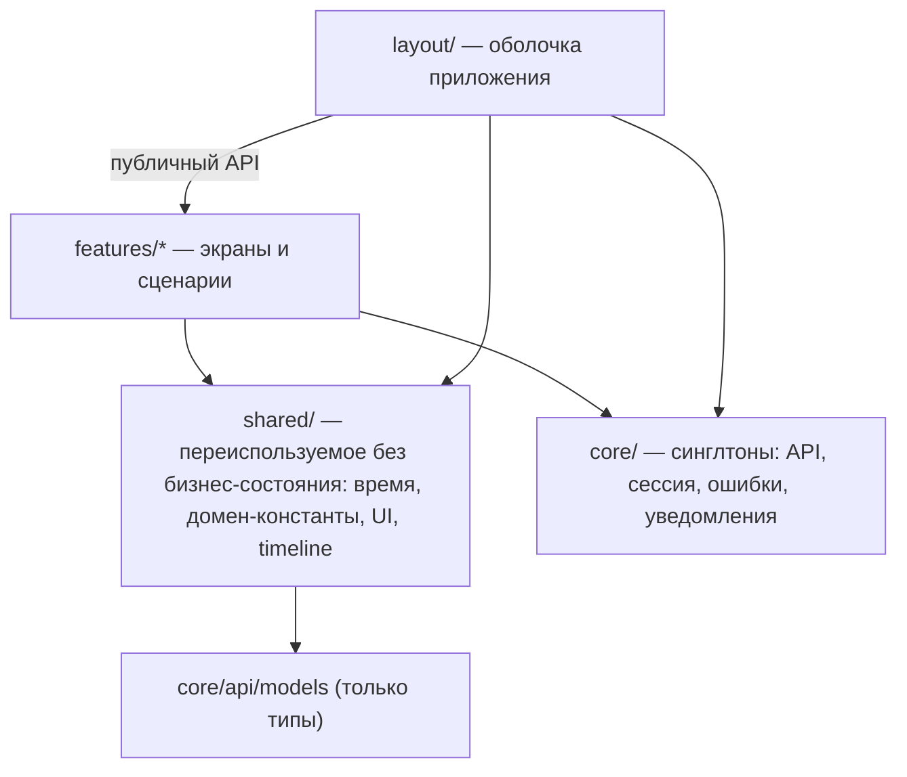
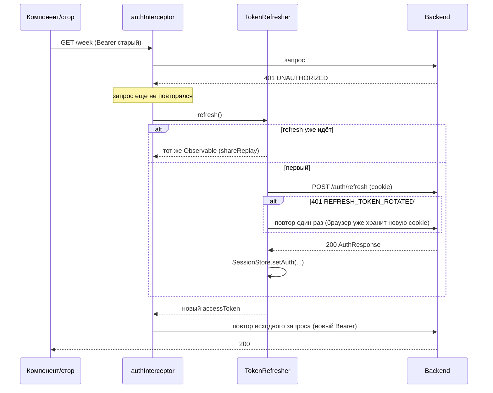
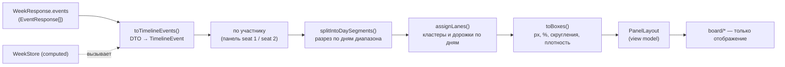

# Together Planner — окончательные архитектурные решения frontend

Версия 1.0 · 2026-11-17 · статус: **утверждено к реализации** (кроме открытых вопросов в §14).

Связанные документы:
- `frontend-final-roadmap.md` — фазы, задачи с ID, приоритеты, тесты. **Главный документ для работы.**
- `frontend-development-guide.md` — как вести разработку день за днём: правила, проверки, именование.
- `backend-spec-v2.md` — контракт API (дальше «spec»). Ссылки вида «spec §8.6» ведут туда.
- `design/Main.dc.html` — кликабельный прототип (дальше «прототип»): источник цветов, размеров и поведения UI.

Решения пронумерованы `FD-xx`. Если решение меняется, старый текст не удаляется: в конце раздела добавляется запись «Изменено YYYY-MM-DD: что и почему».

---

## 0. Исходные данные и что было исправлено

### 0.1. Что найдено при анализе (2026-11-17)

| Что проверялось | Результат | Следствие |
|---|---|---|
| `frontend-architecture.md`, `frontend-implementation-roadmap.md`, `frontend-open-questions.md` | **Не найдены**: ни в `C:\private projects`, ни на диске C:, ни в git-истории, ни в других сессиях | Этот документ заменяет все три. Решения собраны заново из spec, кода backend и прототипа. Открытые вопросы — в §14. Если файлы лежат в другом месте, их нужно сверить с этим документом |
| Репозиторий `together-planner-frontend` | **Не существует** | Frontend живёт в том же репозитории, в папке `frontend/` (FD-02) |
| `package.json`, Angular, TypeScript, конфигурации | Нет: frontend ещё не создан | Проект создаётся в задаче FND-02 |
| Node.js / npm на машине | **v17.4.0 / 8.3.1** | **Блокер.** Angular 22 требует Node `^22.22.3 \|\| ^24.15.0` (проверено по `engines` у `@angular/cli`). Первая задача — обновить Node (FND-01) |
| Контракт API | Код контроллеров и DTO совпадает со spec v2: 27 эндпоинтов. Незакоммиченные изменения backend затрагивают только комментарии, контракт не меняют | Модели TypeScript строятся по spec §8 (FD-20) |
| Прототип | Экраны: вход/регистрация, онбординг, неделя (Неделя/День, «Общее свободное время»), календарь месяца с «Запланировано», шаблоны, предпросмотр шаблона, журнал, диалог события, диалог применения | Это референс UI. Значения цветов и размеров берутся из него (FD-60, FD-41) |

### 0.2. Актуальные версии (npm registry, 2026-11-17)

| Пакет | Последняя | Берём | Почему |
|---|---|---|---|
| `@angular/core`, `@angular/cli`, `@angular/cdk` | 22.2.6 / 22.2.7 / 22.2.7 | **22.2.x** | Текущая стабильная ветка |
| TypeScript | 7.0.2 | **6.0.x** | `@angular/compiler-cli@22` требует `typescript >=6.0 <6.1`. TypeScript 7 Angular 22 **не поддерживает** |
| Vitest | 5.1.0 | **5.x** | `@angular/build@22` поддерживает `vitest ^4.0.8 \|\| ^5.0.0` |
| Playwright | 1.65.1 | **1.65.x** | E2E-тесты |
| Node.js | — | **24 LTS (≥ 24.15)** | Требование Angular CLI 22 |
| RxJS | 7.x | **7.8.x** | Peer-зависимость Angular |

Точные версии фиксируются в `package-lock.json` при создании проекта (FND-02) и дальше обновляются только сознательно.

### 0.3. Что изменено относительно проекта, принятого на Этапе 0

Это ранние решения из обсуждения на Этапе 0. Документов, которые можно было бы исправить, нет, поэтому изменения фиксируются здесь.

| Было (Этап 0) | Стало | Почему |
|---|---|---|
| Angular Material + CDK | **Только Angular CDK** (FD-40) | Прототип полностью кастомный: свои поля, чипы, сегментированные переключатели, модалки. Подгонять под него темы Material дольше, чем написать 8–10 простых компонентов. Datepicker не нужен: нативные `<input type="date">` и `<input type="time">` удобнее на мобильных. CDK даёт всё сложное: Dialog, Overlay, FocusTrap, LiveAnnouncer, BreakpointObserver |
| Отдельный проект frontend | Папка `frontend/` в текущем репозитории (FD-02) | Один `docker-compose.yml`, один `.env`, один origin (spec D-7). `.gitignore` уже содержит `node_modules/` и `dist/` «для frontend» |
| Ближайшие события — через `GET /events/upcoming` (E2) | Блок «Запланировано» строится по **E1** (диапазон дат) с фильтром «только ручные» (roadmap CAL-02) | В прототипе этот список показывает только ручные события. E2 отдаёт и события из шаблонов, по 20 на страницу: страница может целиком состоять из «Работы» и «Сна», и список останется пустым. E2 используется в P2 — для полного списка с пагинацией |
| CSP nginx `default-src 'self'` (spec §10.6) | `default-src 'self'; style-src 'self' 'unsafe-inline'; …` + отключённый `inlineCritical` (FD-91) | Angular вставляет стили компонентов тегами `<style>`, а инлайнинг критического CSS — атрибутом `onload`. Со строгим `default-src 'self'` приложение не отрисуется. Это правка конфигурации nginx — она создаётся на этапе frontend, backend не меняется |
| Сетка недели — часть фичи `schedule` | Движок и доска таймлайна в `shared/timeline/` (FD-50) | Та же сетка нужна для предпросмотра шаблона (TPL-09). Если держать её внутри `schedule`, шаблонам пришлось бы импортировать внутренности чужой фичи |

---

## 1. Платформа и инструменты

| # | Решение | Обоснование | Отклонено |
|---|---|---|---|
| FD-01 | **Angular 22, standalone-компоненты, zoneless** (`provideZonelessChangeDetection`) | Standalone и zoneless — режим по умолчанию в новых проектах Angular. Если CLI всё же подключит `zone.js`, его убирают в FND-02. Все компоненты на signals и `OnPush`, поэтому zone.js не нужен: меньше бандл, понятнее, когда обновляется экран | NgModules; zone.js |
| FD-02 | **Монорепозиторий: `frontend/` рядом с `backend/`** | §0.3 | Отдельный репозиторий `together-planner-frontend` |
| FD-03 | **TypeScript strict**: `strict`, `noImplicitOverride`, `noImplicitReturns`, `noFallthroughCasesInSwitch`, `noPropertyAccessFromIndexSignature`; в `angularCompilerOptions` — `strictTemplates`, `strictInjectionParameters`, `strictInputAccessModifiers`, `extendedDiagnostics` (ошибки, а не предупреждения) | Ошибки контракта и шаблонов ловятся компилятором, а не в браузере | `noUncheckedIndexedAccess` — в коде таймлайна много доступа по индексу, флаг дал бы шум без пользы |
| FD-04 | **Сборка — `@angular/build` (esbuild + Vite dev server)** | Стандарт CLI | webpack-builder |
| FD-05 | **Зависимости:** runtime — `@angular/*`, `@angular/cdk`, `rxjs`, `tslib`. Dev — `vitest`, `@vitest/coverage-v8`, `jsdom`, `@playwright/test`, `angular-eslint`, `prettier`. **Больше ничего** | Каждая зависимость — это обновления и риски. Для дат свои функции (FD-30), для иконок — inline SVG (FD-42) | NgRx, Angular Material, date-fns / dayjs / luxon, Tailwind, библиотеки календарей, Testing Library, Cypress |
| FD-06 | **Язык интерфейса — только русский**, строки прямо в шаблонах. `LOCALE_ID = 'ru'` + `registerLocaleData(localeRu)` для числовых пайпов | Приложение на двоих. Если понадобится i18n, строки извлекаются позже | `@angular/localize` сейчас |
| FD-07 | **Окружения: файлов `environment.*.ts` нет.** Адрес API — токен `API_BASE_URL = '/api/v1'`, одинаковый везде | В разработке `/api` проксирует dev server (FD-92), в продакшене — nginx. Различающихся настроек нет | `environment.ts` с URL |

---

## 2. Структура приложения

### 2.1. Слои и направление зависимостей



| # | Правило |
|---|---|
| FD-10 | `core/` не импортирует `shared/ui`, `layout/` и `features/`. `shared/` не импортирует `features/` и сервисы `core/` с состоянием — только типы из `core/api/models` и чистые функции |
| FD-11 | Фича импортирует другую фичу **только через её `index.ts`** (публичный API). Разрешённые связи: `schedule → events`, `schedule → templates` (диалог применения), `calendar → events`, `layout → events` (кнопка «+ Событие»), `layout → onboarding` и `settings → onboarding` (карточка приглашения). Остальные запрещены |
| FD-12 | Компоненты не вызывают `HttpClient`. HTTP — только в `*Api`-классах `core/api` |
| FD-13 | Алиасы путей: `@core/*`, `@shared/*`, `@features/*`, `@layout/*`. Относительные пути — только внутри одной папки фичи |

### 2.2. Итоговая структура папок

```
frontend/
├── package.json, package-lock.json, angular.json
├── tsconfig.json, tsconfig.app.json, tsconfig.spec.json
├── proxy.conf.json               # dev: /api → http://localhost:8080
├── playwright.config.ts          # E2E: проекты desktop-chromium и mobile-chromium
├── eslint.config.js, .prettierrc, .editorconfig
├── Dockerfile                    # node:24-alpine (build) → nginx (runtime)
├── nginx/nginx.conf              # один origin, CSP, кеширование, limit_req
├── e2e/                          # Playwright: specs + helpers (API-помощники для данных)
├── public/                       # favicon, fonts/ (Inter, Manrope — локально, FD-61)
└── src/
    ├── index.html, main.ts, styles.scss
    ├── styles/                   # _tokens.scss, _reset.scss, _typography.scss, _animations.scss, _breakpoints.scss
    └── app/
        ├── app.config.ts         # провайдеры: router, http + interceptors, initializer, locale
        ├── app.routes.ts         # корневые маршруты (§6)
        ├── app.ts                # <router-outlet> + <tp-toast-host>
        ├── core/
        │   ├── api/
        │   │   ├── api-base-url.ts            # InjectionToken API_BASE_URL
        │   │   ├── models/                    # 1:1 с DTO backend (§3)
        │   │   │   ├── common.models.ts       # PageResponse, ProblemDetail, ValidationErrorItem, алиасы типов
        │   │   │   ├── enums.ts               # EventCategory, EventColor, ApplyMode, WorkspaceRole, DayOfWeek
        │   │   │   ├── auth.models.ts, user.models.ts, workspace.models.ts
        │   │   │   ├── event.models.ts, week.models.ts
        │   │   │   └── template.models.ts     # включая apply/preview/history
        │   │   ├── auth-api.ts                # A1–A6
        │   │   ├── workspace-api.ts           # W1–W6
        │   │   ├── week-api.ts                # S1
        │   │   ├── events-api.ts              # E1–E6
        │   │   ├── templates-api.ts           # T1–T7
        │   │   └── template-applications-api.ts  # T8
        │   ├── auth/
        │   │   ├── session-store.ts           # сигналы: статус, user, workspace, access-токен (в памяти)
        │   │   ├── auth-service.ts            # сценарии: restore, login, register, logout, logoutAll, reloadWorkspace
        │   │   ├── token-refresher.ts         # single-flight refresh (§5)
        │   │   ├── auth-interceptor.ts        # Bearer, X-Requested-With, 401 → refresh → повтор
        │   │   ├── session-initializer.ts     # provideAppInitializer: восстановление сессии
        │   │   ├── session-sync.ts            # (P1) BroadcastChannel: выход во всех вкладках
        │   │   └── guards.ts                  # authGuard, guestGuard, workspaceGuard, noWorkspaceGuard
        │   ├── error/
        │   │   ├── api-error.ts               # класс ApiError (status, code, detail, fieldErrors)
        │   │   ├── error-interceptor.ts       # HttpErrorResponse → ApiError
        │   │   └── error-messages.ts          # code → русский текст (единственный словарь)
        │   ├── notify/toast-service.ts        # очередь тостов (сигнал)
        │   ├── time/zone-clock.ts             # «сейчас» в поясе пространства, токен CLOCK
        │   ├── changes/data-changes.ts        # «события/шаблоны изменились» → сторы перезагружаются
        │   └── view/view-context.ts           # дата в фокусе текущего экрана (для «+ Событие»)
        ├── shared/
        │   ├── time/                 # local-date-time.ts, week.ts, format-ru.ts, plural.ts (чистые функции)
        │   ├── domain/               # category-palette.ts, event-constraints.ts, participants.ts
        │   ├── forms/                # server-errors.ts (errors[] → контролы), validators.ts
        │   ├── timeline/
        │   │   ├── engine/           # ЧИСТЫЙ TS: model.ts, constants.ts, day-segments.ts, lanes.ts,
        │   │   │                     #   geometry.ts, panel-layout.ts, free-slots.ts (P1) + *.spec.ts
        │   │   ├── board/            # отображение: schedule-board, person-panel, day-column, day-header,
        │   │   │                     #   time-gutter, event-card, now-indicator, free-slot (P1)
        │   │   └── testing/          # фикстуры и билдер событий для тестов и dev-площадки
        │   └── ui/                   # button, icon, avatar, dialog-shell, confirm-dialog, form-field,
        │                             #   segmented-control, chip-group, spinner, empty-state, error-state,
        │                             #   toast-host, menu
        ├── layout/
        │   ├── app-shell/            # header + <router-outlet>
        │   ├── app-header/           # бренд, вкладки, «+ Событие», участники, меню
        │   └── user-menu/
        └── features/
            ├── auth/                 # auth-page (вкладки «Вход» / «Регистрация»)
            ├── onboarding/           # onboarding-page, create-workspace-form, join-workspace-form,
            │                         #   invite-card (публичный, нужен в layout и settings), join-link-page
            ├── schedule/             # week-page, week-store, week-toolbar, day-chips, dev/board-playground
            ├── events/               # index.ts → EventEditor; event-dialog, event-form.ts, conflict-dialog
            ├── templates/            # templates-page, templates-store, template-card, template-editor-page,
            │                         #   template-form.ts, template-event-row, apply/ (apply-dialog,
            │                         #   apply-preview), history-list; index.ts → ApplyTemplateDialog
            ├── calendar/             # (P1) calendar-page, month-grid, upcoming-list
            └── settings/             # (P1) settings-page
```

**Назначение ключевых файлов** — в таблицах разделов ниже и в описаниях задач в `frontend-final-roadmap.md`.

---

## 3. Модели API (TypeScript ↔ DTO backend)

| # | Решение |
|---|---|
| FD-20 | Модели — `interface`, **один к одному с DTO из spec §8**: те же имена полей, без переименований и без «удобных» добавлений. Файл модели указывает в шапке раздел spec, из которого взят |
| FD-21 | Перечисления — **строковые union-типы + массив констант**: `type EventCategory = 'WORK' \| …` и `const EVENT_CATEGORIES = [...] as const`. TS-`enum` не используем: union сериализуется как есть и не порождает runtime-код |
| FD-22 | Поля, которые backend может вернуть как `null`, объявляются `T \| null`, а не `T?`. Jackson пишет `null` явно |
| FD-23 | Даты и время — строковые алиасы: `Uuid`, `IsoDate` (`2026-11-20`), `IsoTime` (`08:00:00`), `IsoLocalDateTime` (`2026-11-20T08:00:00`), `IsoInstant` (`2026-11-12T09:15:30Z`). В `Date` не превращаются никогда (FD-31) |
| FD-24 | Модели запросов и ответов разделены (`EventRequest` / `EventResponse`), как в spec |

**Таблица соответствия типов:**

| Java (backend) | JSON | TypeScript |
|---|---|---|
| `UUID` | `"7f0c…"` | `Uuid` (`string`) |
| `LocalDate` | `"2026-11-20"` | `IsoDate` |
| `LocalTime` | `"08:00:00"`; на вход можно `"08:00"` | `IsoTime` |
| `LocalDateTime` | `"2026-11-20T08:00:00"`; на вход можно без секунд | `IsoLocalDateTime` |
| `Instant` | `"2026-11-12T09:15:30Z"` | `IsoInstant` |
| `DayOfWeek` | `"MONDAY"` | `DayOfWeek` (union из 7 значений) |
| `Set<UUID>` | массив без гарантии порядка | `Uuid[]` |
| `long` / `int` | число | `number` |
| `boolean` | `true` / `false` | `boolean` |
| `PageResponse<T>` | `{items, page, size, totalElements, totalPages, hasNext}` | `PageResponse<T>` |

**Отправка времени:** frontend всегда шлёт `YYYY-MM-DDTHH:mm` (без секунд) и `HH:mm`. **Парсер принимает обе формы ответа:** с секундами и без, с дробной частью (FD-32).

---

## 4. Состояние (state management)

| # | Решение | Обоснование |
|---|---|---|
| FD-25 | **Signals-сторы — обычные `@Injectable` сервисы.** Состояние — `signal()`, производные — `computed()`. Наружу отдаются только `asReadonly()` и методы-команды. Без NgRx | Данных немного, у каждого экрана свой стор. NgRx добавил бы шаблонный код, но не дал бы ничего нового |
| FD-26 | **RxJS — только там, где нужно время и отмена**: HTTP, `switchMap` при смене недели или параметров предпросмотра, single-flight refresh, debounce. Из Observable в signal — через `toSignal`/подписку в сторе, обратно — `toObservable` | Signals не умеют отменять запросы, RxJS умеет |
| FD-27 | **Сервер — источник правды.** После любой мутации данные перезагружаются запросом (S1, T1, E1). Оптимистичных обновлений нет | Два человека правят одни данные. Перезагрузка недели — один лёгкий запрос, зато экран всегда консистентен |
| FD-28 | **Уведомление об изменениях** — `DataChanges` (`core/changes`): `eventsChanged()` / `templatesChanged()`. Сторы подписаны и перезагружаются сами | Диалог события открывается из недели, календаря и шапки. Без шины каждый вызывающий должен был бы помнить, что нужно перезагрузить |

| Стор | Где живёт | Состояние | Производные |
|---|---|---|---|
| `SessionStore` | root | `status: 'unknown' \| 'anonymous' \| 'authenticated'`, `user`, `workspace`, access-токен и срок (приватно) | `isAuthenticated`, `hasWorkspace`, `members` (по `seat`), `me`, `partner`, `timeZone`, `isPartnerMissing` |
| `WeekStore` | `providers` компонента `WeekPage` | `weekStart`, `selectedDay`, `status`, `data: WeekResponse \| null`, `error`, `highlightedEventId`, `showFreeTime` | `panels` (раскладка двух панелей), `periodLabel`, `appliedTemplates`, `isEmpty` |
| `TemplatesStore` | `providers` маршрута `/templates` | `items`, `status`, `error` | счётчики по участникам для карточек |
| `CalendarStore` (P1) | `providers` `CalendarPage` | `month`, события месяца, «Запланировано» | ячейки сетки |
| Формы | внутри своих компонентов | Reactive Forms (FD-80) | — |

Предыдущие данные недели при загрузке следующей **не стираются**: сетка остаётся на экране, сверху показывается тонкий индикатор загрузки. Так при листании недель экран не мигает.

---

## 5. Аутентификация

### 5.1. Решения

| # | Решение |
|---|---|
| FD-35 | Access-токен **только в памяти** (`SessionStore`, приватное поле `#token`). Не в `localStorage` и не в `sessionStorage` (spec §10.1). Срок считается от момента получения ответа (`expiresIn`), после него `accessToken()` даёт `null`: просроченный токен не отправляется, backend отвечает 401, и дальше работает refresh по §5.2. Таймеров нет |
| FD-36 | Refresh-токен — HttpOnly-cookie `tp_refresh`. Frontend её не видит: браузер сам прикладывает её к `/api/v1/auth/*` (один origin, `withCredentials` не нужен) |
| FD-37 | Заголовок **`X-Requested-With: XMLHttpRequest` — на каждый запрос к API.** Spec требует его на `POST /api/v1/auth/**`, включая `logout-all` (§10.5, фильтр). На остальных запросах он безвреден, и не нужен список исключений |
| FD-38 | **`Authorization` не прикладывается** к `register`, `login`, `refresh`, `logout`. Spec §10.3: невалидный Bearer на permitAll-эндпоинте даёт 401. Без этого просроченный токен ломал бы refresh |
| FD-39 | Восстановление сессии при старте — `provideAppInitializer`: `A3 refresh` → при успехе `W2 /workspaces/current` (404 `WORKSPACE_NOT_FOUND` → пространства нет, `null`) → `SessionStore.status = 'authenticated'`; при 401 → `'anonymous'`. Любая другая ошибка (сеть, 5xx, в том числе у W2 после удачного refresh) → `'anonymous'` + тост: приложение запускается всегда, полузаполненной сессии не бывает. Guards выполняются уже после инициализатора |

### 5.2. Обработка 401 и параллельные refresh



Правила `TokenRefresher` и `authInterceptor`:

1. **Single-flight.** Пока refresh в полёте, все новые 401 ждут один и тот же Observable (`shareReplay({bufferSize: 1, refCount: false})`). После завершения (`finalize`) ссылка сбрасывается.
2. **`REFRESH_TOKEN_ROTATED`** (параллельный refresh из другой вкладки, spec §10.4) → ровно один повтор refresh.
3. **Исходный запрос повторяется не больше одного раза.** Повтор помечается `HttpContextToken` `RETRIED`, поэтому бесконечного цикла нет.
4. **Refresh не удался** (`REFRESH_TOKEN_INVALID` или повторный 401) → `SessionStore.clear()`, переход на `/login?returnUrl=<текущий url>`, тост «Сессия истекла, войдите снова». Все ожидавшие запросы получают ошибку `ApiError('SESSION_EXPIRED')`, и компоненты не показывают свою ошибку поверх.
5. 401 от `login` (`INVALID_CREDENTIALS`) и от самого `refresh` **не запускают** refresh.
   - Refresh запускается, только пока сессия есть (`SessionStore.isAuthenticated`): 401 без сессии восстанавливать нечем, он уходит вызывающему без тоста.
   - Сессию завершает только **отказ** refresh (ответ 401: `REFRESH_TOKEN_INVALID`, `ROTATED` дважды). Ошибка сети или 5xx при refresh уходит вызывающему, сессия остаётся: следующий запрос попробует снова.
   - Тост и переход — один раз на все ожидавшие запросы: первый вызывает `clear()`, остальные видят, что сессии уже нет.
   - Заголовки и Bearer ставятся только запросам к `API_BASE_URL`: токен не уходит на чужие адреса.
6. Проактивного обновления по таймеру нет: refresh только по 401 и при старте. Лишний запрос раз в 15 минут дешевле, чем таймер, который нужно тестировать и синхронизировать между вкладками.
7. **Повтор POST безопасен:** 401 возвращается фильтром безопасности до контроллера, мутация не выполнялась.

### 5.3. Выход

- `A4 logout`: отзывает refresh, работает без access-токена → `SessionStore.clear()` → `/login`.
- `A5 logout-all` — в настройках (P1).
- P1: `BroadcastChannel('tp-session')` — выход в одной вкладке завершает сессию во всех.

---

## 6. Маршрутизация

| Путь | Компонент | Guard | Примечание |
|---|---|---|---|
| `''` | — | — | redirect → `week` |
| `login`, `register` | `AuthPage` (вкладка по пути) | `guestGuard` | `returnUrl` в query |
| `join` | `JoinLinkPage` | `inviteeGuard` | `?code=`: не залогинен → guard ведёт на `/register?returnUrl=/join?code=…` (страница входа показывает «Вас пригласили в пространство»); без пространства → форма с подставленным кодом, отправка только по нажатию; с пространством → сообщение и «К расписанию» |
| `onboarding` | `OnboardingPage` | `authGuard`, `noWorkspaceGuard` | Выбор: создать или присоединиться |
| `''` (оболочка `AppShell`) | — | `canMatch: authGuard, workspaceGuard` | Дочерние ниже |
| `week` | — | — | redirect-функция → `/week/<понедельник сегодняшней недели в поясе пространства>` |
| `week/:weekStart` | `WeekPage` | — | Не понедельник → `replaceUrl` на понедельник. `?day=YYYY-MM-DD` → режим «День» |
| `templates` | `TemplatesPage` | — | |
| `templates/new`, `templates/:templateId` | `TemplateEditorPage` | — | |
| `calendar` | `CalendarPage` (P1) | — | `?month=YYYY-MM` |
| `settings` | `SettingsPage` (P1) | — | |
| `_dev/board` | `BoardPlayground` | — | **Только при `isDevMode()`**: площадка таймлайна на фикстурах (WEEK-05, WEEK-08) |
| `**` | — | — | redirect → `week` |

| # | Решение |
|---|---|
| FD-45 | Все страницы грузятся лениво (`loadComponent`). Параметры маршрута приходят в компонент как `input()` (`withComponentInputBinding()`) |
| FD-46 | Guards функциональные и читают только `SessionStore`. Инициализатор к этому моменту уже определил статус |
| FD-47 | **Неделя и день — в URL.** Работают «Назад», обновление страницы и ссылки. Режим «Неделя»/«День» на десктопе дополнительно запоминается в `localStorage` (с `try/catch`) |

---

## 7. Время и даты

Самое опасное место во frontend. Модель времени задаёт backend (spec §3): **время события — местные часы пространства, без пояса.**

| # | Решение | Почему |
|---|---|---|
| FD-30 | Своя маленькая библиотека в `shared/time/`, без зависимостей. Арифметика — над целыми **«локальными минутами»**: `Date.UTC(y, m-1, d, hh, mm) / 60000`. UTC здесь только счётная шкала без переходов на летнее время, а не часовой пояс | В локальном календаре каждый день длится 1440 минут, как и в модели backend (spec §3, правило 2). Расчёты таймлайна становятся целочисленными и детерминированными |
| FD-31 | **Запрещено** `new Date('2026-11-20T08:00')`, `Date.parse` для локального времени, `getHours()`/`getDate()` и `toLocaleString()` без `timeZone` | Браузер прочитает строку в поясе компьютера, а не пространства. В дни перевода часов это даёт сдвиги на час |
| FD-32 | Парсер `parseLocalDateTime` принимает `YYYY-MM-DDTHH:mm`, `…:ss`, `…:ss.SSS`; форматтер всегда выдаёт `YYYY-MM-DDTHH:mm` | Spec допускает оба формата |
| FD-33 | **«Сейчас» и «сегодня» — в поясе пространства** (`workspace.timeZone`), не браузера: `ZoneClock.now()` через `Intl.DateTimeFormat('en-CA', {timeZone, hourCycle: 'h23', …}).formatToParts(instant)`. Источник момента — токен `CLOCK` (в тестах фиксированный). Сигнал `nowMinute` обновляется раз в минуту | Если ноутбук в другом поясе, «сегодня» должно совпадать с тем, что видит партнёр и что считает backend (E2, S1) |
| FD-34 | Пояс для нового пространства (W1) — `Intl.DateTimeFormat().resolvedOptions().timeZone`; показывается в форме («определён по браузеру», как в прототипе). Если браузер вернул не region-id и backend ответил `INVALID_TIME_ZONE` → подставляется `Asia/Almaty` с сообщением | Spec D-1, §3: только region-id |
| — | Неделя: понедельник 00:00 — следующий понедельник 00:00 (spec §3, правило 5). Интервалы полуоткрытые `[start; end)`: события 09–10 и 10–11 не пересекаются | Совпадает с backend |
| — | **DST.** Backend нормализует несуществующее время (spec §3). Frontend сравнивает отправленные `start`/`end` с полученными и при расхождении показывает тост «Время скорректировано: в этот день часы переводятся» (P1, EVT-08) | В `Asia/Almaty` переходов нет, но код корректен для любого пояса |
| — | Русские подписи (дни, месяцы в родительном падеже, «через 3 дня», `plural`) — свои массивы и функции в `format-ru.ts`, перенесённые из прототипа | Вывод `Intl` для `ru` различается между движками (`нояб.` / `ноя`), а тестам нужен стабильный текст |

---

## 8. Таймлайн (главный экран)

### 8.1. Конвейер



| # | Решение |
|---|---|
| FD-50 | Движок (`shared/timeline/engine/`) — **чистые функции без Angular**: без DI, сигналов, DOM и «сейчас». Вход — данные, выход — данные. Это самое тестируемое место приложения |
| FD-51 | Движок не знает про DTO. Вход — `TimelineEvent {id, title, startMin, endMin, participantIds, category, color, joint, fromTemplate}` в «локальных минутах». Маппер `toTimelineEvents` — единственное место, где DTO превращается во вход движка |
| FD-52 | Диапазон отображения — параметр: `{firstDay, dayCount: 1 \| 7}`. Режимы «Неделя» и «День» и предпросмотр шаблона используют одни и те же функции |
| FD-53 | **Через полночь и на границе недели — с первой версии движка**, а не «потом»: сегмент — базовая единица, на ней строятся дорожки и геометрия. Если добавить разрез позже, пришлось бы переписывать оба следующих шага |
| FD-54 | **Пересечения — по сегментам одного дня одной панели.** Алгоритм из прототипа (`layoutDay`): сортировка по началу, при равенстве — длинные первыми, затем по `id`; кластер заканчивается, когда следующее начало ≥ максимального конца; жадное назначение дорожек; ширина = 1 / число дорожек кластера |
| FD-55 | **Совместное событие** (2 участника) отображается в обеих панелях с бейджем «вместе». При наведении подсвечиваются обе копии: общий сигнал `highlightedEventId` в `WeekStore` (P1, WEEK-14) |
| FD-56 | Геометрия (из прототипа): **40 px на час** (`PX_PER_MIN = 2/3`), сутки 960 px, зазор 2 px, минимальная высота карточки 14 px, радиус 8 px (3 px на крае, который продолжается в соседний день), шрифт 12 px (10.5 px при высоте < 20 px). Все числа — в `engine/constants.ts` |
| FD-57 | **Синхронная прокрутка — один общий scroll-контейнер.** Панель A, шкала времени и панель B лежат в одном элементе с `overflow: auto`; заголовки (участник, дни) — `position: sticky; top: 0` внутри него. Вертикальная синхронность обеспечена устройством DOM: JavaScript-синхронизации нет, на мобильных ничего не дёргается при инерционной прокрутке. В режиме «Неделя» минимальная ширина доски — 1080 px; на узком десктопе доска прокручивается горизонтально целиком |
| FD-58 | При открытии недели — прокрутка к 06:00 (как в прототипе). Если сегодняшняя неделя и «сейчас» вне видимой области — к «сейчас» минус 1 час |
| FD-59 | Компоненты доски — презентационные: `input()` → разметка, `output()` → намерения (`slotClick {date, minute, personId}`, `eventClick {eventId}`, `eventHover`). Ни API, ни сторов внутри |

### 8.2. Адаптивность

| Ширина | Поведение |
|---|---|
| ≥ 820 px | По умолчанию «Неделя»: [Панель A · 7 дней] [шкала времени] [Панель B · 7 дней], переключатель «Неделя / День» |
| < 820 px | Только «День»: [A] [шкала] [B] на один день, чипы дней недели сверху, «← →» листают дни (с переходом через границу недели). Порог из прототипа (`window.innerWidth < 820`), реализуется через CDK `BreakpointObserver` |

### 8.3. Взаимодействия

- Клик по пустому месту колонки дня → диалог создания: дата колонки, время округлено вниз до 30 минут, участник — владелец панели (прототип `slotClick`). Колонка дня — одна кнопка с `aria-label` «Создать событие для Daulet, понедельник, 9 ноября». Слотов-кнопок по 30 минут нет: это 672 лишние остановки Tab.
- Клик по карточке → диалог редактирования. Карточка — `<button>` с `aria-label` «Работа, Пн, 9 нояб. · 09:00–13:00, вместе».
- P1: hover-карточка с описанием и «из шаблона «…»» (CDK Overlay).

---

## 9. Ошибки и уведомления

| # | Решение |
|---|---|
| FD-65 | `errorInterceptor` превращает любой `HttpErrorResponse` в `ApiError {status, code, detail, fieldErrors}`. Тело ProblemDetail разбирается по spec §7.1. Сеть недоступна → `code = 'NETWORK_ERROR'`, `status = 0`. Ответ без `code` → `'UNKNOWN'` |
| FD-66 | **Интерцептор ничего не показывает пользователю.** Решение принимает владелец сценария (форма, диалог, стор): только он знает, ожидаемая это ошибка или нет. Иначе неизбежны двойные сообщения |
| FD-67 | Тексты ошибок — **один словарь** `error-messages.ts`: все 34 кода из spec §7.4 + `NETWORK_ERROR`, `SESSION_EXPIRED`, `UNKNOWN`. Тест проверяет, что у каждого кода из каталога есть текст. Там же тексты ошибок полей (`FIELD_ERROR_MESSAGES`); `errors[].message` сервера пользователю не показывается — поле получает «Проверьте это поле.» |
| FD-68 | Тосты — свой `ToastService` + `<tp-toast-host>`: один видимый тост, 4.8 с, необязательная кнопка действия («Показать»), `aria-live="polite"` (прототип). Пока на тост наведён указатель или в нём фокус, таймер стоит; после ухода — снова полные 4.8 с |

| Ситуация | Кто обрабатывает | Что видит пользователь |
|---|---|---|
| `400 VALIDATION_FAILED` с `errors[]` | форма | ошибки под полями (`shared/forms/server-errors.ts`) + общее сообщение |
| `400` доменные (`EVENT_END_NOT_AFTER_START`, `EVENT_TOO_LONG`, `EVENT_DATE_OUT_OF_RANGE`, `EVENT_PARTICIPANT_NOT_MEMBER`, `PASSWORD_TOO_LONG`, `INVALID_TIME_ZONE`, `TEMPLATE_EVENT_NOT_FOUND`) | форма | ошибка у соответствующего поля (таблица соответствия в EVT-02 и TPL-03) |
| `401` на защищённом API | интерцептор | незаметный refresh и повтор; при неудаче — `/login` + тост |
| `401 INVALID_CREDENTIALS` | `AuthPage` | «Неверный email или пароль» |
| `403 CSRF_HEADER_MISSING`, `400 MALFORMED_REQUEST`, `400 VERSION_REQUIRED`, `400 REPLACE_CONFIRMATION_REQUIRED` | — | **Ошибка программы**: тост «Что-то пошло не так» + `console.error`. Покрывается тестами, у пользователя не должна возникать |
| `404 WORKSPACE_NOT_FOUND` на экранах пространства | стор → `WorkspaceRefresh.workspaceNotFound()` (W2; ошибка повторной проверки → тост) | переход в онбординг |
| `404 EVENT_NOT_FOUND`, `TEMPLATE_NOT_FOUND` | диалог / редактор | тост «Уже удалено партнёром», закрытие, `DataChanges` |
| `409 VERSION_CONFLICT` | диалог / редактор | диалог конфликта (EVT-07, TPL-04) |
| `409 APPLY_PLAN_OUTDATED`, `TEMPLATE_APPLY_CONFLICT` | диалог применения | новый предпросмотр + плашка «Неделя изменилась, проверьте ещё раз» |
| `409` прочие (`EMAIL_ALREADY_REGISTERED`, `TEMPLATE_NAME_TAKEN`, `WORKSPACE_FULL`, `INVITE_*`, `ALREADY_IN_WORKSPACE`, `DATA_CONFLICT`) | форма | сообщение у поля или формы |
| `0` (сеть), `5xx` | стор / компонент | состояние ошибки с кнопкой «Повторить» (экраны) или тост (действия) |

---

## 10. Формы и валидация

| # | Решение |
|---|---|
| FD-80 | **Reactive Forms, типизированные** (`NonNullableFormBuilder`). Signal Forms не используем: в Angular они пока экспериментальные |
| FD-81 | Каждая сложная форма — **два файла**: `*-form.ts` (создание `FormGroup`, валидаторы, функции `toRequest(form)` / `fromResponse(dto)`, без Angular-компонента, тестируется отдельно) и компонент с разметкой |
| FD-82 | **Клиентская валидация повторяет ограничения backend ради UX, но backend — последняя инстанция.** Числа берутся из одного файла `shared/domain/event-constraints.ts` со ссылками на spec: название ≤ 100, описание ≤ 2000, событие ≤ 31 дня, год 2000–2100, 1–2 участника, длительность шаблона 1..10080 минут, имя шаблона ≤ 60, описание шаблона ≤ 500, ≤ 300 событий в шаблоне, имя пространства ≤ 60, `displayName` ≤ 50, email ≤ 254, пароль 8–72 символа и ≤ 72 байт UTF-8 (`TextEncoder`) |
| FD-83 | Ошибки показываются после первой попытки отправки или после `blur` (прототип: `touched`). Кнопка отправки во время запроса неактивна и показывает спиннер. Повторной отправки нет |
| FD-84 | **Бизнес-логику шаблонов frontend не повторяет.** Режимы MERGE/FILL/REPLACE, занятость дня, дубли, исключения и восстановление считает только backend (T6/T7). Frontend показывает `ApplyPreviewResponse` и передаёт в T7 ровно то, что показал (spec §8.8) |

---

## 11. UI-компоненты и стили

| # | Решение |
|---|---|
| FD-40 | Angular CDK: `Dialog` (модалки), `Overlay` (меню, hover-карточка), `A11y` (`FocusTrap`, `LiveAnnouncer`, `cdkFocusInitial`), `Layout` (`BreakpointObserver`), `Clipboard` (копирование кода приглашения). Angular Material не подключается (§0.3) |
| FD-41 | Свой набор UI-примитивов в `shared/ui/`: `tp-button` (primary / ghost / danger; компонент на нативной кнопке — `<button tpButton>`), `tp-icon`, `tp-avatar` (буква + цвет места), `tp-dialog-shell` (заголовок / тело / подвал, анимация `tpIn` из прототипа), `tp-confirm-dialog`, `tp-form-field` (метка, подсказка, ошибка), `tp-segmented-control` (Вход/Регистрация, Неделя/День, Оба), `tp-chip-group` (категории), `tp-spinner`, `tp-empty-state`, `tp-error-state`, `tp-toast-host`, `tp-menu`. Новый примитив создаётся, только когда он нужен второму месту (§13 гайда) |
| FD-42 | Иконки — компонент `tp-icon` с небольшим набором inline-SVG (стрелки, плюс, крестик, меню, календарь, копирование). Без иконочных шрифтов и библиотек |
| FD-60 | **Design tokens — CSS custom properties в `:root`** (`styles/_tokens.scss`), значения из прототипа: фон `#F6F5F2`, поверхность `#FFFFFF`, текст `#1E1F24`, вторичный текст `#5C5F67` / `#6B6E76`, границы `#E2DFD9` / `#EEEBE6`, hover `#F1EFEB`, акцент `#4F46E5` (hover `#3730A3`), опасное действие `#C42B2B`, участник места 1 `#2763C9` / `#E8EFFB`, места 2 `#B64E2E` / `#F9E9E3`, сегодня `#FFFCF3`, выходные `#FBFAF7`, свободное время `#E6F4EC` / `#9CC9AE` / `#1A603C`; радиусы, тени, длительности анимаций. SCSS-переменные — только для брейкпоинтов (`_breakpoints.scss`, mixin `narrow` = `max-width: 819.98px`) |
| FD-61 | Шрифты Inter (текст, 400/500/600/700) и Manrope (заголовки, 600/700/800) — **локальные файлы** `public/fonts/*.woff2` (лицензия OFL), без Google Fonts | CSP `'self'`, работа без внешних запросов, приватность |
| FD-62 | **Палитра категорий — одна TS-константа** `CATEGORY_PALETTE` (`shared/domain/category-palette.ts`): `{label, bg, fg, dot}` для 9 категорий из прототипа. Карточки получают цвета через `[style.--ev-bg]` и т. п. Цвет события = `color ?? category` (spec §5.3: `EventColor` — ключ палитры) |
| FD-63 | Стили компонентов — свои (`:host`), только токены, без захардкоженных цветов, без `::ng-deep`. Глобальные классы — только `reset`, типографика, `.tp-visually-hidden`, рамка диалога `.tp-dialog-panel` / `.tp-dialog-backdrop` (`styles/_overlay.scss`: CDK рисует диалоги вне компонентов) и вид поля ввода `.tp-control` (`styles/_controls.scss`: поле проецируется в `tp-form-field`) |
| FD-64 | `prefers-reduced-motion: reduce` отключает анимации `tpIn`/`tpFade` и hover-сдвиг карточек |

---

## 12. Тестирование (сводка; детали — в roadmap §7)

| # | Решение |
|---|---|
| FD-85 | **Unit- и компонентные тесты: Vitest 5 + jsdom** через builder `@angular/build:unit-test` (`ng test`). Karma и Jasmine не используются: Karma снят с поддержки, Vitest — стандарт новых проектов Angular |
| FD-86 | HTTP-тесты: `provideHttpClient(withInterceptors([...]))` + `provideHttpClientTesting()` + `HttpTestingController` |
| FD-87 | Zoneless: `fakeAsync`/`tick` недоступны (они из zone.js). Для таймеров — `vi.useFakeTimers()`, для стабилизации — `await fixture.whenStable()` |
| FD-88 | **E2E: Playwright** (Chromium desktop 1440×900 + Chromium mobile 375×812). Только там проверяется то, что требует настоящей вёрстки: синхронная прокрутка, sticky-заголовки, адаптивность. Данные для E2E создаются через API backend (уникальный email на каждый прогон), без доступа к БД |
| FD-89 | Чистые модули (`shared/time`, `shared/timeline/engine`, `*-form.ts`) покрываются табличными тестами (`it.each`) по каталогам кейсов из roadmap §7.4. Snapshot-тесты не используются: числа проверяются явно |

---

## 13. Сборка и развёртывание

| # | Решение |
|---|---|
| FD-90 | Production-сборка: `ng build` (по умолчанию production), source maps выключены, бюджеты CLI по умолчанию |
| FD-91 | **CSP в nginx:** `default-src 'self'; script-src 'self'; style-src 'self' 'unsafe-inline'; img-src 'self' data:; font-src 'self'; connect-src 'self'; frame-ancestors 'none'; base-uri 'self'; form-action 'self'`. В `angular.json` — `optimization.styles.inlineCritical: false`. Проверяется рано, в FND-07. `'unsafe-inline'` для стилей — осознанный компромисс: инъекция CSS гораздо менее опасна, чем инъекция скриптов, а `script-src` остаётся строгим. Альтернатива — nonce через `sub_filter` в nginx (`ngCspNonce`) — если понадобится, позже |
| FD-92 | Разработка: `ng serve` (порт 4200) + `proxy.conf.json` (`/api` → `http://localhost:8080`). Браузер видит один origin, CORS не нужен. В `.env` для локальной разработки по HTTP — `REFRESH_COOKIE_SECURE=false` (README backend) |
| FD-93 | Продакшен-образ: `frontend/Dockerfile` (multi-stage: `node:24-alpine` → `nginx:alpine`). `nginx.conf` по spec §10.6 + CSP (FD-91) + кеширование: `index.html` — `no-cache`, файлы с хешем — `max-age=31536000, immutable` + `limit_req` на `/api/v1/auth/` и `/api/v1/workspaces/join` (spec §10.7) + gzip |
| FD-94 | `docker-compose.yml`: сервис `frontend` в профиле `app`, `depends_on: backend`, порт `8081:80`. Порт 80 на Windows часто занят IIS. `http://localhost:8081` — безопасный контекст, Secure-cookie работает. Настоящий HTTPS (сертификаты, домен) — вне MVP, описывается в README |

---

## 14. Открытые вопросы (решаете вы, frontend их не решает)

Эти вопросы влияют на поведение продукта. Пока ответа нет, в плане стоит безопасное поведение по умолчанию, а зависимые задачи помечены **BLOCKED**.

| # | Вопрос | Варианты | Поведение до решения | Задачи |
|---|---|---|---|---|
| **OQ-1** | Давать ли менять **часовой пояс пространства** в интерфейсе (W3 `timeZone`)? Backend это умеет, и события при смене **не сдвигаются**: «Работа 09:00» остаётся 09:00 по часам нового пояса (spec §3, правило 9) | а) не давать в MVP; б) давать с предупреждением о том, что время событий не пересчитывается | Не показывать. Пояс видно только для чтения (в настройках) | SET-03 (P2, BLOCKED) |
| **OQ-2** | Что предлагать при **конфликте версий** (партнёр изменил событие или шаблон, пока вы редактировали)? | а) только «Загрузить актуальную версию» (ваши правки в форме теряются); б) ещё и «Сохранить мою версию поверх» — осознанная перезапись изменений партнёра | Только (а): ничего не теряется у партнёра, данные не перезаписываются молча | EVT-07, TPL-04 |
| **OQ-3** | Функция прототипа **«Сохранить неделю как шаблон»**: в backend отдельного эндпоинта нет, frontend собрал бы `TemplateRequest` из событий недели. Какие события брать? | Например: только начинающиеся в неделе; включать ли созданные из шаблонов; что делать с событиями длиннее 7 дней (в шаблоне максимум 10080 минут) | Функция не делается | TPL-12 (P2, BLOCKED) |
| **OQ-4** | Определение **«Общее свободное время»** (подсветка «Оба свободны»). В прототипе: окно 07:00–23:00, интервалы от 30 минут, сон считается занятостью | а) как в прототипе; б) другие границы | Как в прототипе. Константы в одном месте (`free-slots.ts`) — их легко поменять | WEEK-15 (P1) |

Решения, которые **не** выносились в вопросы: они не меняют поведение данных и берутся из прототипа или spec.
- «Запланировано» показывает только ручные события (прототип).
- Значения по умолчанию в диалоге события: сегодня 19:00, участник — текущий пользователь (прототип; вместо «A» — «я»).
- При удалении события из шаблона показывается подсказка: «Добавить» и «Только в свободные дни» его не вернут, вернуть можно через «Заменить» (spec §9.1).
- Новый код приглашения отменяет прежний (spec W5) — UI предупреждает.

---

## 15. Что сознательно не делаем

- NgRx, SSR и гидратацию, PWA и Service Worker, i18n, тёмную тему (токены её позволяют, но это не MVP).
- Drag & drop событий и растягивание мышью: перенос и изменение длительности — через форму (Этап 0, вопрос 6). Позже — CDK DragDrop.
- WebSocket и SSE: изменения партнёра подтягиваются при возврате на вкладку (WEEK-16, P1) и после своих действий.
- Виртуализацию сетки: в неделе ~100–200 событий, `OnPush` + `computed` достаточно.
- Генерацию клиента из OpenAPI: модели пишутся руками один раз и сверяются со spec (CORE-01…03). Генератор добавил бы зависимость и код, который сложнее читать.
- Собственную логику применения шаблонов, занятости дней и дублей (FD-84).

---

## 16. Журнал изменений решений

| Дата | Решение | Было | Стало | Почему |
|---|---|---|---|---|
| 2026-11-17 | FD-01, FD-41, гайд §6 | Каждый компонент явно объявляет `changeDetection: ChangeDetectionStrategy.OnPush` | `changeDetection` не указывается | В Angular 22 `OnPush` — стратегия по умолчанию (`onPush = changeDetection !== Eager`), прежний `Default` стал псевдонимом `Eager`. ESLint (`prefer-on-push-component-change-detection`, `allowExplicitOnPush: false`) запрещает и отказ от OnPush, и избыточное явное объявление (FND-08) |
| 2026-11-17 | FD-01 | `provideZonelessChangeDetection()` в `app.config.ts` | Не нужен | В Angular 22 zoneless — режим по умолчанию: без zone.js приложение работает без этого провайдера (FND-02) |
| 2026-11-17 | FD-10/11, гайд §4.1 | `shared` импортирует из `core` только модели API | `shared` может импортировать `core`, кроме `core/auth` | `tp-toast-host` (CORE-09) использует `ToastService`, линия «сейчас» (WEEK-07) — `ZoneClock`, помощники форм (CORE-12) — `ApiError`. Запрещена только зависимость от сессии. `shared/timeline/engine` по-прежнему берёт из `core` только модели API (FND-08) |
| 2026-11-17 | FD-05 | Dev-зависимости: `vitest`, `jsdom`, `@playwright/test`, `angular-eslint`, `prettier` | + `@vitest/coverage-v8` (5.1.0, точная версия) и скрипт `npm run test:coverage` | DoD задач CORE-05 и WEEK-02 требует порог покрытия; без провайдера Vitest его не измерить. Официальный пакет Vitest, только для разработки, в сборку не попадает (CORE-05, установлен с согласия пользователя) |
| 2026-11-18 | FD-68 | Тост скрывается через 4.8 с в любом случае | Пока тост под указателем или в фокусе, таймер стоит; потом снова 4.8 с | Кнопку действия нужно успеть нажать с клавиатуры и прочитать длинный текст (WCAG 2.2.1 «Регулируемое время»); в прототипе этого не было (CORE-09) |
| 2026-11-18 | FD-63 | Глобальные классы: reset, типографика, `.tp-visually-hidden` | + `.tp-dialog-panel`, `.tp-dialog-backdrop` в `styles/_overlay.scss` | Панель и фон диалога CDK создаёт в своём контейнере в конце `<body>`, стили компонента туда не достают (CORE-10) |
| 2026-11-18 | FD-63 | Глобальные классы: reset, типографика, `.tp-visually-hidden`, рамка диалога | + `.tp-control` в `styles/_controls.scss` (ставит директива `tpControl`) | Поле ввода — содержимое, проецируемое в `tp-form-field`: ни стили поля, ни стили страницы до него не достают без `::ng-deep`, а копировать вид поля на каждую форму — дублирование (CORE-11) |
| 2026-11-18 | FD-41 | `tp-button` — элемент | Компонент с селектором `button[tpButton]` (как `button[mat-button]`), одно исключение из правила ESLint `component-selector` с комментарием | Обёртка-элемент прячет кнопку от формы (submit по Enter) и клавиатуры; на нативной кнопке всё это работает само (CORE-11) |
| 2026-11-18 | FD-67 | Словарь — только тексты кодов API | + `FIELD_ERROR_MESSAGES` (обязательное поле, email, длина, «Проверьте это поле.»); текст `errors[].message` с сервера не выводится | `errors[].message` — текст Bean Validation на языке JVM сервера: локально русский, в контейнере английский. Клиентская валидация повторяет ограничения (FD-82), так что серверная ошибка поля — редкость, и для неё хватает общего текста (CORE-12) |
| 2026-11-18 | FD-35 | Токен в памяти, срок «приватно» | Срок = время получения + `expiresIn`; после него `accessToken()` → `null`; поле `#token` (приватное и во время выполнения) | Срок иначе нигде не использовался бы. Отсчёт от локального времени получения не зависит от расхождения часов с сервером. Просроченный токен всё равно дал бы 401, поэтому поведение refresh не меняется |
| 2026-11-18 | §5.2 | 401 → refresh; неудача refresh → выход | Refresh только при живой сессии; выход только при отказе refresh (401), сеть и 5xx — ошибка вызывающему; один тост и один переход на все запросы; заголовки — только к `API_BASE_URL` | Без сессии восстанавливать нечего, и тост «Сессия истекла» был бы неправдой. Выход при обрыве сети выкинул бы пользователя без причины. Повтор `clear()` дал бы три тоста и три перехода |
| 2026-11-18 | FD-39 | 401 → `anonymous`; сеть → `anonymous` + тост | Любая не-401 ошибка refresh или `/me` → `clear()` + тост; инициализатор никогда не падает | Ошибка инициализатора остановила бы запуск приложения. `authenticated` без пространства после упавшего `/me` отправил бы guards в онбординг при живом пространстве |
| 2026-11-19 | §6 | `join` без guard: страница сама решает, что делать с гостем | `inviteeGuard` — как `authGuard`, но гостя ведёт на `/register?returnUrl=…` (общая функция `signedInOr`) | Редирект в guard не показывает страницу гостю даже на мгновение; ссылку-приглашение чаще открывает человек без аккаунта, поэтому регистрация, а вкладка «Вход» сохраняет `returnUrl` |
| 2026-11-19 | FD-39 | `A3 refresh` → `A6 /me` | `A3 refresh` → `W2 /workspaces/current`; 404 `WORKSPACE_NOT_FOUND` → пространства нет (`null`), не ошибка | W2 — единый источник пространства (WS-07): им же пользуются `reloadWorkspace()` и вход/регистрация; A6 возвращает пользователя, а он уже есть в ответе A1/A2/A3 |
| 2026-11-19 | §9 | Стор при `WORKSPACE_NOT_FOUND` вызывает `AuthService.reloadWorkspace()` | Стор вызывает `WorkspaceRefresh.workspaceNotFound()`: W2 → `null` → `/onboarding`; пространство нашлось → остаёмся; ошибка W2 → тост | Переход в онбординг и тост — в одном месте, сторы не повторяют эту логику |
