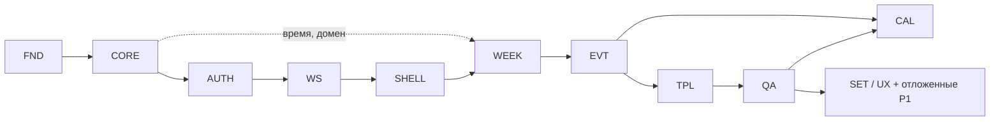

# Together Planner — окончательный план реализации frontend

Версия 1.0 · 2026-11-17. **Главный документ для разработки frontend.**

- Почему принято то или иное решение — `frontend-final-decisions.md` (ссылки `FD-xx`, открытые вопросы `OQ-x`).
- Как работать день за днём — `frontend-development-guide.md`.
- Контракт API — `backend-spec-v2.md` (ссылки «spec §…»), коды эндпоинтов A1…T8 — из spec §8.1.

Задача = одна рабочая сессия = один коммит `<ID>: <что сделано>`. Сложность: **S** ≤ 2 ч, **M** ≈ полдня, **L** ≈ рабочий день.

**Общий Definition of Done для каждой задачи** (в задачах не повторяется):
1. `npm run lint`, `npm test`, `npm run build` — без ошибок (lint — после FND-08).
2. Тесты, перечисленные в задаче, написаны и проходят.
3. `npm start` + запущенный backend: всё, что уже было сделано, по-прежнему работает (короткий ручной прогон, гайд §3).
4. Нет `any`, нет `TODO` вместо работающей логики, нет захардкоженных цветов и `new Date('…')` для локального времени.
5. Новые файлы лежат там, где их размещает структура (FD §2.2). Публичный API фичи — через `index.ts`.
6. Статус задачи обновлён в §5 этого документа. Если что-то отличилось от плана — запись в журнал §12.

---

## 1. Окончательная архитектура (кратко)

- **Angular 22** (standalone, zoneless, signals, `OnPush`), **TypeScript 6.0 strict**, **Angular CDK** без Material, SCSS + CSS-токены, своя небольшая библиотека UI.
- **Слои:** `core` (API, сессия, ошибки, уведомления, часы) → `shared` (время, доменные константы, формы, UI, **timeline**) → `layout` (оболочка) → `features` (auth, onboarding, schedule, events, templates, calendar, settings).
- **Состояние:** signals-сторы на экран (`SessionStore`, `WeekStore`, `TemplatesStore`, `CalendarStore`), RxJS — для HTTP и отмены. После мутаций данные перезагружаются с сервера, сторы узнают об изменениях через `DataChanges`.
- **API:** `*Api`-классы 1:1 с эндпоинтами, модели 1:1 с DTO. `authInterceptor` (Bearer, `X-Requested-With`, single-flight refresh) и `errorInterceptor` (ProblemDetail → `ApiError`).
- **Время:** строки ISO-local + целые «локальные минуты». «Сейчас» — в поясе пространства. `Date` для локального времени запрещён.
- **Timeline:** чистый движок (разрез по дням → дорожки → геометрия → `PanelLayout`) + презентационная доска. Одна прокрутка на обе панели.
- **Тесты:** Vitest + jsdom (unit, компоненты, HTTP), Playwright (E2E и вёрстка: синхронная прокрутка, адаптивность).
- **Продакшен:** nginx — один origin (`/` → SPA, `/api/` → backend), CSP, `docker compose --profile app`.

Структура папок и назначение файлов — FD §2.2.

---

## 2. Порядок фаз

| # | Фаза | Префикс | Итог фазы: что можно запустить и проверить |
|---|---|---|---|
| 1 | Фундамент | FND | `npm start` → страницы-заглушки; `/api` проксируется на backend; production-образ nginx стартует, CSP не ломает приложение |
| 2 | Ядро | CORE | То же + модели API, ошибки, время, тосты, диалоги, UI-примитивы — всё покрыто тестами |
| 3 | Аутентификация | AUTH | Регистрация, вход, выход, обновление страницы без разлогина; просроченный токен незаметно обновляется |
| 4 | Пространство | WS | Онбординг двух людей: создание, код или ссылка, присоединение |
| 5 | Оболочка | SHELL | Шапка с вкладками, двумя участниками, меню; приглашение, если партнёра ещё нет |
| 6 | Недельное расписание | WEEK | Настоящая неделя из backend в двух панелях, навигация, режим «День», мобильная версия (только просмотр) |
| 7 | События | EVT | Создание, редактирование, удаление, конфликт версий → **расписание полностью рабочее** |
| 8 | Шаблоны | TPL | CRUD шаблонов, применение с предпросмотром → **функционально MVP готов** |
| 9 | Тесты и production | QA | E2E ключевых сценариев, `docker compose --profile app up` поднимает всё → **MVP выпущен** |
| 10 | Календарь | CAL | Месяц, «Запланировано», будущие события (P1) |
| 11 | Настройки и полировка | SET / UX | Профиль, пространство, выход везде, аудит доступности и адаптивности + отложенные P1-задачи фаз 3–8 |

### 2.1. Что изменено относительно предложенного порядка и почему

| Изменение | Причина |
|---|---|
| **Production-сборка и nginx — в Фазе 1** (FND-07), а не только в конце | CSP из spec (`default-src 'self'`) несовместим с тем, как Angular вставляет стили (FD-91). Если обнаружить это в конце, придётся разбирать готовое приложение. Проверка на пустом проекте занимает полчаса |
| **Библиотека времени — в Фазе 2** (CORE-05…07), а не внутри расписания | На неё опираются онбординг (пояс), шапка, расписание, формы, календарь. Это чистые функции, их проще всего написать и протестировать до любого UI |
| **API-сервисы создаются в фазе своей функции** (AUTH-01, WS-01, WEEK-09, EVT-01, TPL-01), модели — сразу все в Фазе 2 | Модели — это сверка контракта, её выгодно сделать один раз и целиком. Сервис без потребителя — непроверенный код. Каждый сервис появляется вместе с первым экраном, который его вызывает, и сразу проверяется на настоящем backend |
| **Shared UI — минимальный набор в Фазе 2**, остальное — по требованию | «Не создавать компоненты, которые потом придётся переписывать»: в CORE-11 только примитивы, нужные уже формам AUTH и WS. Меню появляется в SHELL-02, hover-карточка — в WEEK-14 |
| **Тесты и production (бывш. Фаза 10) — перед настройками и календарём** | Настройки и календарь — P1. MVP выпускается сразу после шаблонов. Отложенные P1-задачи из фаз 3–8 делаются после выпуска |
| **Календарь — отдельная фаза 10** (в предложенном списке его не было) | Требование проекта (будущие события, календарное представление). Будущие события в MVP уже работают: событие создаётся на любую дату и показывается в нужной неделе. Календарь — удобство, поэтому P1 |
| **Разрез по дням (через полночь, граница недели) — шаг 2 таймлайна, а не 11–12** | Сегмент — базовая единица, на ней строятся дорожки и геометрия. Если добавить разрез позже, пришлось бы переписать оба шага (FD-53). Сложной бизнес-логики здесь нет — это чистая геометрия |
| **E2E-инфраструктура появляется в Фазе 6** (WEEK-08), а не в конце | Синхронную прокрутку и sticky-заголовки jsdom проверить не может: в нём нет вёрстки. Тест на dev-площадке с фикстурами не требует backend и нужен ровно тогда, когда собирается доска |

### 2.2. Граф зависимостей фаз

Критический путь MVP: FND-01 → FND-02 → CORE-05 → AUTH-03 → AUTH-04 → AUTH-05 → WS-03 → SHELL-01 → WEEK-02 → WEEK-03 → WEEK-04 → WEEK-05 → WEEK-09 → WEEK-10 → EVT-02 → EVT-04 → TPL-03 → TPL-04 → TPL-06 → TPL-07 → QA-05.

---

## 3. MVP scope

| Приоритет | Что входит | Задач |
|---|---|---|
| **P0** — первая рабочая версия | Регистрация и вход; сессия с refresh; создание пространства и присоединение (код и ссылка); два участника в шапке и панелях; неделя в двух панелях с общей шкалой, синхронной прокруткой, пересечениями, событиями через полночь и на границе недели, линией «сейчас»; навигация по неделям; режим «День» и мобильная версия; CRUD событий с конфликтом версий; CRUD шаблонов; применение шаблона MERGE/FILL/REPLACE через предпросмотр и подтверждение; выход; production-сборка; E2E ключевых сценариев | **74** |
| **P1** — сразу после MVP | Календарь месяца и «Запланировано»; настройки (профиль, имя пространства, участники, приглашение); выход на всех устройствах; синхронизация выхода между вкладками; hover-карточка и связанная подсветка совместных событий; «Общее свободное время»; обновление при возврате на вкладку; уведомление о сдвиге времени при переводе часов; предпросмотр шаблона на сетке; журнал применений; аудит доступности, адаптивности, пустых и ошибочных состояний, анимации | **15** |
| **P2** — можно отложить | Статистика часов в панели; мини-сетка в карточке шаблона; «Сохранить неделю как шаблон» (BLOCKED, OQ-3); полный список предстоящих (E2); легенда категорий; смена часового пояса (BLOCKED, OQ-1) | **6** |

Требования к первой рабочей версии — и где они выполняются:

| # | Требование | Задачи |
|---|---|---|
| 1 | Зарегистрироваться и войти | AUTH-01…08 |
| 2 | Создать пространство или присоединиться | WS-01…07 |
| 3 | Увидеть двух участников | SHELL-01, SHELL-04, WEEK-09 |
| 4 | Переключать недели | WEEK-10, WEEK-11 |
| 5 | Просматривать два расписания | WEEK-01…13 |
| 6–8 | Создавать, редактировать, удалять события | EVT-01…07 |
| 9 | Создавать шаблоны | TPL-01…04 |
| 10 | Применять шаблоны через предпросмотр | TPL-05…08 |

В P0 нет ничего сверх этого списка, кроме двух вещей:
- **FND-07** (ранняя проверка production-сборки) — это снятие риска, а не функция;
- **QA-01…07** (E2E и production) — без них нельзя сказать, что первая версия работает.

---

## 4. Как строится главный экран (таймлайн)

Порядок выбран так, чтобы сложная геометрия заработала и была покрыта тестами **до** того, как к ней подключатся backend, навигация и формы.

| Шаг | Задача | Что появляется | Почему именно здесь |
|---|---|---|---|
| 1 | WEEK-01 | Тип `TimelineEvent`, константы шкалы, маппер DTO → `TimelineEvent` | Движок отделён от DTO с первой строки (FD-51) |
| 2 | WEEK-02 | Разрез событий на сегменты по дням: через полночь, на границе недели, многодневные, фильтр по участнику | Базовая единица для всего остального (FD-53) |
| 3 | WEEK-03 | Кластеры и дорожки пересечений | Работает уже на сегментах; полуоткрытые интервалы |
| 4 | WEEK-04 | Геометрия (px, %, скругления, плотность) и `PanelLayout` — готовая view model | После этого шага весь расчёт закрыт тестами |
| 5 | WEEK-05 | Статичная доска на фикстурах на dev-площадке `/_dev/board`: панели, шкала времени, заголовки, **одна прокрутка**, sticky, сетка часов, прокрутка к 06:00 | Вёрстку проверяем без backend и без авторизации |
| 6 | WEEK-06 | Карточки событий по `PanelLayout`: пересечения, продолжение через полночь, «вместе» | Отображение без собственной логики |
| 7 | WEEK-07 | Линия «сейчас» | Нужен `ZoneClock` (CORE-06) |
| 8 | WEEK-08 | Playwright: синхронная прокрутка, sticky, начальная позиция | Закрепляем вёрстку тестом, пока она свежая |
| 9 | WEEK-09 | `WeekApi` + `WeekStore`: загрузка, отмена, состояния, `computed` раскладка | Только теперь подключаем backend |
| 10 | WEEK-10 | `WeekPage`: маршрут, нормализация недели, настоящие данные вместо фикстур | Доска не меняется: меняется только источник данных |
| 11 | WEEK-11 | Навигация по неделям | Работает через URL |
| 12 | WEEK-12 | Загрузка, пустая неделя, ошибка | |
| 13 | WEEK-13 | Режим «День», < 820 px, чипы дней | Тот же движок с `dayCount = 1` (FD-52) |
| 14 | WEEK-14 (P1) | Hover-карточка, связанная подсветка совместных событий | |
| 15 | WEEK-15 (P1) | «Оба свободны» | Новая чистая функция `free-slots.ts` + слой отображения |

Создание и редактирование (EVT) подключаются к доске только через её `output()` (`slotClick`, `eventClick`). Сама доска для этого не меняется.

---

## 5. Сводная таблица задач (статус)

Статус: ☐ — не начата, ◐ — в работе, ☑ — готова, ⛔ — заблокирована открытым вопросом.

| ID | Задача | P | Сл. | Статус |
|---|---|---|---|---|
| **Фаза 1 — Фундамент** |||||
| FND-01 | Окружение разработки | P0 | S | ☑ |
| FND-02 | Создание Angular-проекта | P0 | S | ☑ |
| FND-03 | Строгий TypeScript, алиасы, верхний уровень папок | P0 | S | ☑ |
| FND-04 | Design tokens, глобальные стили, шрифты | P0 | M | ☑ |
| FND-05 | Каркас маршрутизации | P0 | S | ☑ |
| FND-06 | HTTP, proxy, локаль | P0 | S | ☑ |
| FND-07 | Production-сборка и nginx (ранняя проверка) | P0 | M | ☑ |
| FND-08 | ESLint и Prettier с правилами проекта | P0 | S | ☑ |
| **Фаза 2 — Ядро** |||||
| CORE-01 | Модели: общие типы и перечисления | P0 | S | ☑ |
| CORE-02 | Модели: auth, user, workspace | P0 | S | ☐ |
| CORE-03 | Модели: event, week, template, apply | P0 | S | ☐ |
| CORE-04 | `ApiError`, `errorInterceptor`, словарь сообщений | P0 | M | ☐ |
| CORE-05 | Время: локальные дата и время, неделя | P0 | M | ☐ |
| CORE-06 | `ZoneClock`: «сейчас» в поясе пространства | P0 | S | ☐ |
| CORE-07 | Русское форматирование дат | P0 | S | ☐ |
| CORE-08 | Доменные константы | P0 | S | ☐ |
| CORE-09 | Тосты | P0 | S | ☐ |
| CORE-10 | Диалоги | P0 | M | ☐ |
| CORE-11 | UI-примитивы | P0 | M | ☐ |
| CORE-12 | Помощники форм | P0 | S | ☐ |
| **Фаза 3 — Аутентификация** |||||
| AUTH-01 | `AuthApi` | P0 | S | ☐ |
| AUTH-02 | `SessionStore` | P0 | S | ☐ |
| AUTH-03 | `TokenRefresher` (single-flight) | P0 | M | ☐ |
| AUTH-04 | `authInterceptor` | P0 | L | ☐ |
| AUTH-05 | Восстановление сессии при старте | P0 | M | ☐ |
| AUTH-06 | Guards | P0 | S | ☐ |
| AUTH-07 | Страница входа и регистрации | P0 | M | ☐ |
| AUTH-08 | Выход | P0 | S | ☐ |
| AUTH-09 | Выход во всех вкладках (BroadcastChannel) | P1 | S | ☐ |
| **Фаза 4 — Пространство** |||||
| WS-01 | `WorkspaceApi` | P0 | S | ☐ |
| WS-02 | Онбординг: выбор пути | P0 | S | ☐ |
| WS-03 | Создание пространства | P0 | S | ☐ |
| WS-04 | Карточка приглашения | P0 | S | ☐ |
| WS-05 | Присоединение по коду | P0 | S | ☐ |
| WS-06 | Ссылка-приглашение `/join?code=` | P0 | M | ☐ |
| WS-07 | Актуализация пространства | P0 | S | ☐ |
| **Фаза 5 — Оболочка** |||||
| SHELL-01 | `AppShell` и шапка | P0 | M | ☐ |
| SHELL-02 | Меню пользователя | P0 | S | ☐ |
| SHELL-03 | Адаптивная шапка | P0 | S | ☐ |
| SHELL-04 | «Партнёр ещё не присоединился» | P0 | S | ☐ |
| **Фаза 6 — Недельное расписание** |||||
| WEEK-01 | Модель таймлайна и константы | P0 | S | ☐ |
| WEEK-02 | Engine: разрез по дням | P0 | M | ☐ |
| WEEK-03 | Engine: дорожки пересечений | P0 | M | ☐ |
| WEEK-04 | Engine: геометрия и `PanelLayout` | P0 | M | ☐ |
| WEEK-05 | Статичная доска на фикстурах | P0 | L | ☐ |
| WEEK-06 | Карточка события | P0 | M | ☐ |
| WEEK-07 | Линия текущего времени | P0 | S | ☐ |
| WEEK-08 | E2E-инфраструктура и тест прокрутки | P0 | M | ☐ |
| WEEK-09 | `WeekApi` и `WeekStore` | P0 | M | ☐ |
| WEEK-10 | `WeekPage` с настоящими данными | P0 | M | ☐ |
| WEEK-11 | Навигация по неделям | P0 | S | ☐ |
| WEEK-12 | Загрузка, пустая неделя, ошибка | P0 | S | ☐ |
| WEEK-13 | Режим «День» и адаптивность | P0 | M | ☐ |
| WEEK-14 | Hover-карточка и связанная подсветка | P1 | M | ☐ |
| WEEK-15 | Общее свободное время | P1 | M | ☐ |
| WEEK-16 | Обновление при возврате на вкладку | P1 | S | ☐ |
| WEEK-17 | Статистика часов в панели | P2 | S | ☐ |
| **Фаза 7 — События** |||||
| EVT-01 | `EventsApi` | P0 | S | ☐ |
| EVT-02 | Модель формы события | P0 | M | ☐ |
| EVT-03 | Диалог события: разметка и поведение | P0 | M | ☐ |
| EVT-04 | Создание события | P0 | M | ☐ |
| EVT-05 | Редактирование события | P0 | M | ☐ |
| EVT-06 | Удаление события | P0 | S | ☐ |
| EVT-07 | Конфликт версий и удалённое событие | P0 | M | ☐ |
| EVT-08 | Уведомление о сдвиге времени (DST) | P1 | S | ☐ |
| **Фаза 8 — Шаблоны** |||||
| TPL-01 | `TemplatesApi` и `TemplateApplicationsApi` | P0 | S | ☐ |
| TPL-02 | Страница шаблонов: список и удаление | P0 | M | ☐ |
| TPL-03 | Модель формы шаблона | P0 | M | ☐ |
| TPL-04 | Редактор шаблона | P0 | L | ☐ |
| TPL-05 | Диалог применения: параметры | P0 | M | ☐ |
| TPL-06 | Предпросмотр применения | P0 | M | ☐ |
| TPL-07 | Применение и результат | P0 | M | ☐ |
| TPL-08 | Точки входа «Применить шаблон» | P0 | S | ☐ |
| TPL-09 | Предпросмотр шаблона на сетке | P1 | M | ☐ |
| TPL-10 | Журнал применений | P1 | S | ☐ |
| TPL-11 | Мини-сетка в карточке шаблона | P2 | S | ☐ |
| TPL-12 | «Сохранить неделю как шаблон» | P2 | M | ⛔ OQ-3 |
| **Фаза 9 — Тесты и production** |||||
| QA-01 | E2E-помощники: пользователи и пространство | P0 | M | ☐ |
| QA-02 | E2E: регистрация, пространство, присоединение | P0 | M | ☐ |
| QA-03 | E2E: события и конфликт версий | P0 | M | ☐ |
| QA-04 | E2E: шаблоны | P0 | M | ☐ |
| QA-05 | Docker Compose: сервис frontend | P0 | M | ☐ |
| QA-06 | Production-чеклист | P0 | S | ☐ |
| QA-07 | Документация | P0 | S | ☐ |
| **Фаза 10 — Календарь** |||||
| CAL-01 | Календарь месяца | P1 | M | ☐ |
| CAL-02 | «Запланировано» и будущее событие | P1 | S | ☐ |
| CAL-03 | Полный список предстоящих (E2) | P2 | S | ☐ |
| CAL-04 | Легенда категорий | P2 | S | ☐ |
| **Фаза 11 — Настройки и полировка** |||||
| SET-01 | Настройки: профиль, пространство, участники, приглашение | P1 | M | ☐ |
| SET-02 | Выйти на всех устройствах | P1 | S | ☐ |
| SET-03 | Смена часового пояса пространства | P2 | S | ⛔ OQ-1 |
| UX-01 | Аудит пустых и ошибочных состояний | P1 | S | ☐ |
| UX-02 | Аудит адаптивности | P1 | M | ☐ |
| UX-03 | Аудит доступности | P1 | M | ☐ |
| UX-04 | Анимации и визуальная полировка | P1 | S | ☐ |

Итого: **95 задач** — P0: 74, P1: 15, P2: 6.

**Порядок выполнения:** сначала все P0 по порядку таблицы (фазы 1–9) — это MVP. Затем P1: фазы 10–11 и отложенные AUTH-09, WEEK-14…16, EVT-08, TPL-09, TPL-10. Затем P2.

---

## 6. Задачи

Поля каждой задачи: **Цель** · **Сделать** · **Файлы** · **Затрагивает** (сервисы и компоненты) · **API** · **Зависит от** · **Проверка** · **DoD** (сверх общего DoD).

### Фаза 1 — Фундамент

#### FND-01 · Окружение разработки · P0 · S
- **Цель:** на машине собирается Angular 22 и запускается backend.
- **Сделать:**
  - Установить Node.js 24 LTS (≥ 24.15) — установщиком или через nvm-windows. Текущий Node 17.4 Angular 22 не поддерживает.
  - Проверить `node -v`, `npm -v`.
  - Angular CLI — через `npx @angular/cli@22`, глобальная установка не нужна.
  - Backend: в `.env` для локального HTTP — `REFRESH_COOKIE_SECURE=false`; `docker compose up -d postgres`; `cd backend && ./mvnw spring-boot:run`.
- **Файлы:** только локальный `.env` (в git не попадает).
- **Затрагивает:** —
- **API:** `GET /actuator/health`.
- **Зависит от:** —
- **Проверка:** `node -v` → `v24.*`; health → `UP`; Swagger UI открывается.
- **DoD:** версии Node и npm записаны в журнал §12.

#### FND-02 · Создание Angular-проекта · P0 · S
- **Цель:** пустой проект Angular 22 в `frontend/` с нужными настройками по умолчанию.
- **Сделать:**
  - Из корня репозитория: `npx @angular/cli@22 new frontend --style=scss --routing --ssr=false --skip-git`. Тест-раннер — Vitest (по умолчанию; если CLI спросит — выбрать его).
  - Проверить:
    - компоненты standalone;
    - проект zoneless: если `zone.js` есть в `polyfills` — удалить и добавить `provideZonelessChangeDetection()`;
    - TypeScript 6.0.x.
  - `angular.json` → `prefix: "tp"`.
  - Скрипты в `package.json`: `start`, `build`, `test` (`ng test --watch=false`), `test:watch`.
  - Удалить демо-разметку из `app.html`.
- **Файлы:** `frontend/**` (сгенерированные), `angular.json`, `package.json`, `package-lock.json`.
- **Затрагивает:** `App`.
- **API:** —
- **Зависит от:** FND-01.
- **Проверка:** `npm start` → пустая страница на `:4200`; `npm test` и `npm run build` проходят.
- **DoD:** `package-lock.json` в git, `node_modules/` и `dist/` — нет.

#### FND-03 · Строгий TypeScript, алиасы, верхний уровень папок · P0 · S
- **Цель:** компилятор ловит ошибки шаблонов и типов; импорты читаемы.
- **Сделать:**
  - Флаги FD-03 в `tsconfig.json`.
  - `paths`: `@core/*`, `@shared/*`, `@features/*`, `@layout/*`.
  - Папки `core/`, `shared/`, `layout/`, `features/` (подпапки — по задачам, пустых не создаём).
  - `.editorconfig`.
- **Файлы:** `tsconfig.json`, `tsconfig.app.json`, `tsconfig.spec.json`, `.editorconfig`.
- **Затрагивает:** —
- **API:** —
- **Зависит от:** FND-02.
- **Проверка:** пробный импорт через `@core/...` компилируется и в приложении, и в тесте (потом удалить).
- **DoD:** сборка и тесты зелёные со строгими флагами.

#### FND-04 · Design tokens, глобальные стили, шрифты · P0 · M
- **Цель:** все визуальные константы прототипа — в одном месте.
- **Сделать:**
  - `_tokens.scss` (FD-60): цвета, радиусы, тени, длительности, шрифты.
  - `_reset.scss` (из `<helmet>` прототипа).
  - `_typography.scss`: Inter — текст, Manrope — заголовки.
  - `_animations.scss`: `tpIn`, `tpFade`, `prefers-reduced-motion`.
  - `_breakpoints.scss`: mixin `narrow` (< 820 px).
  - Глобальный `:focus-visible`.
  - Шрифты `woff2` в `public/fonts/` + `@font-face` с `font-display: swap`.
- **Файлы:** `src/styles/*.scss`, `src/styles.scss`, `public/fonts/*`.
- **Затрагивает:** —
- **API:** —
- **Зависит от:** FND-02.
- **Проверка:** временная разметка в `App` показывает шрифты и цвета; в Network нет запросов к `fonts.googleapis.com`.
- **DoD:** значения прототипа (`<helmet>`, цвета участников, «сегодня», выходных, свободного времени) перенесены в токены; вне `_tokens.scss` цветов нет.

#### FND-05 · Каркас маршрутизации · P0 · S
- **Цель:** все маршруты FD §6 существуют и грузятся лениво.
- **Сделать:**
  - `app.routes.ts` по таблице FD §6: страницы-заглушки `login`, `register`, `join`, `onboarding`, `week/:weekStart`, `templates`, `templates/new`, `templates/:templateId` (`loadComponent`).
  - `provideRouter(routes, withComponentInputBinding())`.
  - `''` и `**` → `week` (временно — на заглушку; функция-редирект появится в WEEK-10).
  - Guards пока не подключены.
- **Файлы:** `app.routes.ts`, `app.config.ts`, `features/*/…-page.ts` (заглушки).
- **Затрагивает:** заглушки страниц.
- **API:** —
- **Зависит от:** FND-03.
- **Проверка:** переход по каждому пути показывает свою заглушку; `npm run build` показывает отдельные lazy chunks.
- **DoD:** заглушки содержат только заголовок страницы.

#### FND-06 · HTTP, proxy, локаль · P0 · S
- **Цель:** frontend обращается к backend через один origin.
- **Сделать:**
  - `provideHttpClient(withFetch(), withInterceptors([]))`.
  - Токен `API_BASE_URL = '/api/v1'`.
  - `proxy.conf.json` (`/api` → `http://localhost:8080`); `start` = `ng serve --proxy-config proxy.conf.json`.
  - `LOCALE_ID = 'ru'` + `registerLocaleData(localeRu)`.
  - Временно: на заглушке вызвать `GET /api/v1/auth/me` (после проверки удалить).
- **Файлы:** `app.config.ts`, `core/api/api-base-url.ts`, `proxy.conf.json`, `package.json`.
- **Затрагивает:** —
- **API:** A6 (ожидается `401`).
- **Зависит от:** FND-05, FND-01.
- **Проверка:** в Network `localhost:4200/api/v1/auth/me` → `401`, тело `ProblemDetail` с `code: "UNAUTHORIZED"`.
- **DoD:** временный вызов удалён.

#### FND-07 · Production-сборка и nginx (ранняя проверка) · P0 · M
- **Цель:** до начала разработки убедиться, что production-сборка работает за nginx с CSP (FD-91).
- **Сделать:**
  - `frontend/Dockerfile` (multi-stage, FD-93), `frontend/.dockerignore`.
  - `frontend/nginx/nginx.conf`:
    - `location /api/` → `backend:8080` (с `resolver`, чтобы nginx стартовал без backend, или проверка `/api` переносится в QA-05);
    - SPA fallback;
    - CSP (FD-91);
    - кеш-заголовки.
  - В `angular.json` — `optimization.styles.inlineCritical: false`.
  - `docker build` + `docker run -p 8081:80`.
- **Файлы:** `frontend/Dockerfile`, `frontend/.dockerignore`, `frontend/nginx/nginx.conf`, `angular.json`.
- **Затрагивает:** —
- **API:** — (проксирование `/api` проверяется в QA-05).
- **Зависит от:** FND-04, FND-05.
- **Проверка:**
  - `http://localhost:8081/templates` (прямая ссылка) открывает приложение;
  - в консоли нет нарушений CSP, шрифты загрузились;
  - в DevTools видны заголовки `Content-Security-Policy` и `Cache-Control`.
- **DoD:** образ собирается одной командой; итоговая CSP записана в журнал §12.

#### FND-08 · ESLint и Prettier с правилами проекта · P0 · S
- **Цель:** правила гайда проверяются автоматически, а не только по памяти.
- **Сделать:**
  - `ng add angular-eslint`; Prettier.
  - Правила:
    - `prefer-on-push-component-change-detection`;
    - запрет `any`;
    - `no-restricted-syntax`: `new Date(<аргументы>)` и `Date.parse` — вне `shared/time/**` и `core/time/**`;
    - `no-restricted-imports`: границы слоёв FD-10/11 — `core` не импортирует `features`/`layout`/`shared/ui`; фичи — только через `index.ts`.
  - Скрипты `lint`, `format`.
- **Файлы:** `eslint.config.js`, `.prettierrc`, `.prettierignore`, `package.json`.
- **Затрагивает:** —
- **API:** —
- **Зависит от:** FND-03.
- **Проверка:** пробный `new Date('2026-11-20T08:00')` в компоненте → ошибка lint (потом удалить).
- **DoD:** `npm run lint` зелёный на всём проекте.

### Фаза 2 — Ядро

#### CORE-01 · Модели: общие типы и перечисления · P0 · S
- **Цель:** базовые типы контракта (FD-20…23).
- **Сделать:**
  - `common.models.ts`: `Uuid`, `IsoDate`, `IsoTime`, `IsoLocalDateTime`, `IsoInstant`, `PageResponse<T>`, `ValidationErrorItem`, `ProblemDetail` (`type`, `title`, `status`, `detail`, `instance`, `code`, `errors?`).
  - `enums.ts`: `EventCategory` и `EventColor` (9 значений), `ApplyMode` (3), `WorkspaceRole` (2), `DayOfWeek` (7) + массивы констант.
- **Файлы:** `core/api/models/common.models.ts`, `core/api/models/enums.ts`, `enums.spec.ts`.
- **Затрагивает:** —
- **API:** spec §5.6, §7.1, §8.0, §8.2.
- **Зависит от:** FND-03.
- **Проверка:** тест — массивы констант совпадают со значениями spec §5.6 (порядок и написание).
- **DoD:** у каждого файла в шапке — ссылка на раздел spec.

#### CORE-02 · Модели: auth, user, workspace · P0 · S
- **Цель:** типы для фаз 3–5.
- **Сделать:**
  - `RegisterRequest`, `LoginRequest`, `AuthResponse`, `MeResponse` (`workspace: WorkspaceResponse | null`), `UserResponse`.
  - `MemberResponse`, `CreateWorkspaceRequest`, `UpdateWorkspaceRequest` (поля `string | null`), `JoinWorkspaceRequest`, `WorkspaceResponse`, `InviteResponse`.
  - Образцы JSON: снять из Swagger настоящего backend ответы A1, A6, W1, W5 → `models/testing/samples.ts` с проверкой `satisfies` (это проверка контракта на этапе компиляции).
- **Файлы:** `core/api/models/auth.models.ts`, `user.models.ts`, `workspace.models.ts`, `models/testing/samples.ts`.
- **Затрагивает:** —
- **API:** spec §8.2–§8.4.
- **Зависит от:** CORE-01, FND-01 (запущенный backend для образцов).
- **Проверка:** образцы компилируются; сверка поле-в-поле по §10.
- **DoD:** `satisfies` проходит для всех образцов; отличий от spec нет.

#### CORE-03 · Модели: event, week, template, apply · P0 · S
- **Цель:** типы для фаз 6–8.
- **Сделать:**
  - `EventRequest` (`version?: number`, `color: EventColor | null`), `EventResponse`, `EventSourceResponse`, `WeekResponse`.
  - `TemplateRequest`, `TemplateEventRequest` (`id: Uuid | null`), `TemplateResponse` (`lastApplication: … | null`), `TemplateEventResponse`.
  - `ApplyTemplateRequest` (`confirmedDeleteIds` / `confirmedRestoredIds: Uuid[] | null`), `PlannedEvent`, `ApplyConflict`, `ApplyPreviewResponse`, `TemplateApplicationResponse`, `ApplyResultResponse`.
  - Образцы JSON (E3, S1, T2, T6, T7) — тоже из настоящего backend. Для T6 — недельный сценарий, в котором заполнены `conflicts` и `toDelete`.
- **Файлы:** `core/api/models/event.models.ts`, `week.models.ts`, `template.models.ts`, `models/testing/samples.ts`.
- **Затрагивает:** —
- **API:** spec §8.5–§8.9.
- **Зависит от:** CORE-01.
- **Проверка:** образцы компилируются; сверка по §10.
- **DoD:** все 27 эндпоинтов из §9 имеют типы запроса и ответа.

#### CORE-04 · `ApiError`, `errorInterceptor`, словарь сообщений · P0 · M
- **Цель:** любая ошибка HTTP приходит в код в одном виде (FD-65…67).
- **Сделать:**
  - Класс `ApiError {status, code, detail, fieldErrors, problem}` + `isApiError()`.
  - `errorInterceptor`: `HttpErrorResponse` → `ApiError`; сеть → `NETWORK_ERROR`; нет `code` → `UNKNOWN`.
  - `error-messages.ts`: тексты для всех кодов spec §7.4 + `NETWORK_ERROR`, `SESSION_EXPIRED`, `UNKNOWN`; функция `messageFor(error)`.
  - Подключить интерцептор в `app.config.ts`.
- **Файлы:** `core/error/api-error.ts`, `error-interceptor.ts`, `error-messages.ts` + `*.spec.ts`; `app.config.ts`.
- **Затрагивает:** все будущие `*Api`.
- **API:** формат spec §7.1.
- **Зависит от:** CORE-01, FND-06.
- **Проверка:**
  - ER-01: 400 с `errors[]` → `fieldErrors` заполнены.
  - ER-02: 409 → `code` из тела.
  - ER-03: статус 0 → `NETWORK_ERROR`.
  - ER-04: 500 без тела → `UNKNOWN`.
  - ER-05: для каждого кода из `ErrorCode` (список spec §7.4, 34 шт.) есть текст.
- **DoD:** интерцептор ничего не показывает пользователю (FD-66).

#### CORE-05 · Время: локальные дата и время, неделя · P0 · M
- **Цель:** надёжная арифметика местного времени без `Date` (FD-30…32).
- **Сделать:**
  - `local-date-time.ts`: `parseLocalDateTime`, `formatLocalDateTime`, `parseDate`, `formatDate`, `toLocalMinutes`, `fromLocalMinutes`, `parseTime`, `formatTime`, `minutesOfDay`, `dateOfMinutes`, `compareLocal`.
  - `week.ts`: `isoDayOfWeek`, `addDays`, `weekStartOf`, `weekDays(weekStart)`, `isMonday`, `daysBetween`.
- **Файлы:** `shared/time/local-date-time.ts`, `shared/time/week.ts` + `*.spec.ts`.
- **Затрагивает:** — (основа для всех следующих фаз).
- **API:** —
- **Зависит от:** CORE-01.
- **Проверка:** кейсы DT-01…DT-10 (§8.4).
- **DoD:** покрытие строк ≥ 95 %; нет `getHours`, `getDate` и `new Date(string)`.

#### CORE-06 · `ZoneClock`: «сейчас» в поясе пространства · P0 · S
- **Цель:** «сегодня» и «сейчас» совпадают с backend (FD-33).
- **Сделать:**
  - Токен `CLOCK` (`() => number`, по умолчанию `Date.now`).
  - `ZoneClock.nowIn(zone): LocalMinutes`, `todayIn(zone): IsoDate` через `Intl.DateTimeFormat(…, {timeZone}).formatToParts`.
  - Сигнал `minuteTick`, выровненный по границе минуты.
- **Файлы:** `core/time/zone-clock.ts` + `.spec.ts`.
- **Затрагивает:** будущие `WeekStore`, `NowIndicator`, редирект недели.
- **API:** —
- **Зависит от:** CORE-05.
- **Проверка:** кейсы ZC-01…ZC-04 (§8.4).
- **DoD:** в тестах время всегда фиксированное через `CLOCK`.

#### CORE-07 · Русское форматирование дат · P0 · S
- **Цель:** все подписи дат из прототипа — функциями с тестами.
- **Сделать:** `format-ru.ts` (перенос из прототипа):
  - `weekLabel` («9 – 15 ноября 2026», «30 ноября – 6 декабря 2026»), `weekShort` («9–15 нояб.»);
  - `dateLong` («понедельник, 9 ноября»), `dateShort` («пн, 9 нояб.»);
  - `rangeText` (с «→» для разных дней), `durText` («1 ч 30 мин»);
  - `relWeek` («Эта неделя», «Через 2 недели»), `relDays` («сегодня», «завтра», «через 5 дней»).
  - `plural.ts`.
- **Файлы:** `shared/time/format-ru.ts`, `shared/time/plural.ts` + `*.spec.ts`.
- **Затрагивает:** —
- **API:** —
- **Зависит от:** CORE-05.
- **Проверка:** FR-01…FR-06 (§8.4) — ожидаемые строки взяты из прототипа.
- **DoD:** формулировки совпадают с прототипом.

#### CORE-08 · Доменные константы · P0 · S
- **Цель:** единственные источники палитры, ограничений и правил отображения участников (FD-62, FD-82).
- **Сделать:**
  - `category-palette.ts`: 9 категорий `{label, bg, fg, dot}`, `colorKeyOf(event) = color ?? category`.
  - `event-constraints.ts`: все числовые лимиты FD-82 со ссылками на spec.
  - `participants.ts`: `seatColor(seat)`, `seatTint(seat)`, `initialOf(name)`, `whoText(participantIds, members)` («вместе» или имя).
- **Файлы:** `shared/domain/*.ts` + `*.spec.ts`.
- **Затрагивает:** —
- **API:** —
- **Зависит от:** CORE-01, FND-04.
- **Проверка:** палитра покрывает все значения `EventCategory`; `whoText` для 1 и 2 участников.
- **DoD:** цвета категорий нигде больше не повторяются.

#### CORE-09 · Тосты · P0 · S
- **Цель:** короткие уведомления с действием, как в прототипе (FD-68).
- **Сделать:**
  - `ToastService`: `show(text, {action?, durationMs = 4800})`, `error(apiError)` (через `messageFor`); сигнал с одним текущим тостом.
  - `tp-toast-host` (`aria-live="polite"`, анимация `tpFade`); подключить в `App`.
- **Файлы:** `core/notify/toast-service.ts`, `shared/ui/toast-host/*` + `*.spec.ts`; `app.ts`.
- **Затрагивает:** `App`.
- **API:** —
- **Зависит от:** CORE-04, FND-04.
- **Проверка:**
  - новый тост заменяет предыдущий;
  - тост скрывается через 4.8 с (`vi.useFakeTimers`);
  - кнопка действия вызывает callback и закрывает тост.
- **DoD:** у тоста есть доступное имя, его читает скринридер.

#### CORE-10 · Диалоги · P0 · M
- **Цель:** единый вид и поведение модальных окон (CDK Dialog).
- **Сделать:**
  - `DialogService.open(component, data): Observable<Result | undefined>` поверх CDK `Dialog`: фон, `tpIn`, закрытие по Esc и клику мимо, возврат фокуса.
  - `tp-dialog-shell`: заголовок, кнопка закрытия, тело, подвал; на < 820 px — на всю ширину снизу.
  - `tp-confirm-dialog`: заголовок, текст, кнопка подтверждения (`danger`).
- **Файлы:** `shared/ui/dialog/*`, `shared/ui/confirm-dialog/*` + `*.spec.ts`.
- **Затрагивает:** —
- **API:** —
- **Зависит от:** FND-04.
- **Проверка:**
  - Esc закрывает диалог и возвращает `undefined`;
  - confirm возвращает `true`;
  - фокус уходит на первый элемент с `cdkFocusInitial`;
  - Tab не выходит за пределы диалога.
- **DoD:** стили совпадают с модалками прототипа.

#### CORE-11 · UI-примитивы · P0 · M
- **Цель:** минимальный набор, который нужен формам AUTH и WS (FD-41).
- **Сделать:**
  - `tp-button` (`primary` / `ghost` / `danger`, `loading`);
  - `tp-icon` (стартовый набор SVG);
  - `tp-avatar` (буква + цвет места);
  - `tp-form-field` (метка, подсказка, ошибка; связывает `aria-describedby`);
  - `tp-segmented-control`, `tp-spinner`, `tp-empty-state`, `tp-error-state` (текст + «Повторить»).
- **Файлы:** `shared/ui/<имя>/*` + `*.spec.ts`.
- **Затрагивает:** —
- **API:** —
- **Зависит от:** FND-04.
- **Проверка:** компонентные тесты:
  - `loading` блокирует кнопку;
  - `form-field` показывает ошибку и связывает её с полем;
  - `segmented-control` переключается клавишами-стрелками.
- **DoD:** все примитивы `OnPush`, на signal-inputs.

#### CORE-12 · Помощники форм · P0 · S
- **Цель:** серверные ошибки попадают к полям одной функцией (FD-83).
- **Сделать:**
  - `applyServerErrors(form, apiError, fieldMap?)`: `errors[].field` → контрол; доменные коды → поле по карте.
  - `controlErrorMessage(control)`.
  - Валидаторы `notBlank`, `maxUtf8Bytes(n)`.
- **Файлы:** `shared/forms/server-errors.ts`, `shared/forms/validators.ts` + `*.spec.ts`.
- **Затрагивает:** —
- **API:** формат `errors[]` (spec §7.1).
- **Зависит от:** CORE-04.
- **Проверка:**
  - FE-01: `errors[{field: 'end'}]` → ошибка на `end`.
  - FE-02: код из карты → ошибка на нужном поле.
  - FE-03: неизвестное поле → ошибка формы.
  - FE-04: `maxUtf8Bytes(72)` — 40 кириллических символов (80 байт) отклоняются.
- **DoD:** —

### Фаза 3 — Аутентификация

#### AUTH-01 · `AuthApi` · P0 · S
- **Цель:** типизированные вызовы A1–A6.
- **Сделать:** методы `register`, `login`, `refresh`, `logout`, `logoutAll`, `me`. Только HTTP: без состояния и без перехвата ошибок.
- **Файлы:** `core/api/auth-api.ts` + `.spec.ts`.
- **Затрагивает:** —
- **API:** A1–A6.
- **Зависит от:** CORE-02, CORE-04.
- **Проверка:** `HttpTestingController` — метод, URL и тело каждого вызова.
- **DoD:** —

#### AUTH-02 · `SessionStore` · P0 · S
- **Цель:** единое состояние сессии (FD-25, FD-35).
- **Сделать:**
  - Сигналы: `status`, `user`, `workspace`; access-токен с `expiresAt` — приватно.
  - `computed`: `isAuthenticated`, `hasWorkspace`, `members` (по `seat`), `me`, `partner`, `timeZone`, `isPartnerMissing`.
  - Команды: `setAuth(AuthResponse)`, `setWorkspace(ws | null)`, `clear()`, `accessToken()`.
- **Файлы:** `core/auth/session-store.ts` + `.spec.ts`.
- **Затрагивает:** —
- **API:** —
- **Зависит от:** CORE-02.
- **Проверка:**
  - `members` сортируются по `seat`;
  - `partner` — участник, отличный от `me`;
  - `clear()` сбрасывает всё.
- **DoD:** токен недоступен снаружи иначе как через `accessToken()`.

#### AUTH-03 · `TokenRefresher` (single-flight) · P0 · M
- **Цель:** параллельные запросы не запускают несколько refresh (FD §5.2).
- **Сделать:** `refresh(): Observable<string>`:
  - один запрос в полёте (`shareReplay`, сброс в `finalize`);
  - `REFRESH_TOKEN_ROTATED` → один повтор;
  - успех → `SessionStore.setAuth`;
  - ошибка → наружу.
- **Файлы:** `core/auth/token-refresher.ts` + `.spec.ts`.
- **Затрагивает:** `SessionStore`, `AuthApi`.
- **API:** A3.
- **Зависит от:** AUTH-01, AUTH-02.
- **Проверка:** TR-01…TR-05 (§8.4).
- **DoD:** нет таймеров и состояния за пределами одного refresh.

#### AUTH-04 · `authInterceptor` · P0 · L
- **Цель:** Bearer, CSRF-заголовок и прозрачное обновление токена (FD-37, FD-38, §5.2).
- **Сделать:**
  - `X-Requested-With: XMLHttpRequest` на каждый запрос к `API_BASE_URL`.
  - Bearer — на все, кроме `auth/register|login|refresh|logout`.
  - 401 (не от этих четырёх и не повторённый, флаг `HttpContextToken RETRIED`) → `TokenRefresher.refresh()` → повтор с новым токеном.
  - Неудача refresh → `SessionStore.clear()`, `/login?returnUrl=…`, тост `SESSION_EXPIRED`, ошибка `ApiError('SESSION_EXPIRED')`.
  - Порядок интерцепторов: `authInterceptor` → `errorInterceptor`.
- **Файлы:** `core/auth/auth-interceptor.ts` + `.spec.ts`; `app.config.ts`.
- **Затрагивает:** все `*Api`.
- **API:** A3 и любой защищённый эндпоинт.
- **Зависит от:** AUTH-03, CORE-09.
- **Проверка:** AI-01…AI-10 (§8.4).
- **DoD:** бесконечный цикл refresh невозможен (тест AI-06).

#### AUTH-05 · Восстановление сессии при старте · P0 · M
- **Цель:** обновление страницы не разлогинивает (FD-39).
- **Сделать:**
  - `provideAppInitializer`: `refresh` → `me` → `SessionStore` (`authenticated` + `workspace`).
  - 401 → `anonymous`; сеть недоступна → `anonymous` + тост.
  - `AuthService` (сценарии): `restore`, `login`, `register` (оба — `setAuth` + `me`), `reloadWorkspace` (заготовка для WS-07).
- **Файлы:** `core/auth/session-initializer.ts`, `core/auth/auth-service.ts` + `*.spec.ts`; `app.config.ts`.
- **Затрагивает:** `SessionStore`, `TokenRefresher`, `AuthApi`.
- **API:** A3, A6, A1, A2.
- **Зависит от:** AUTH-04.
- **Проверка:** unit — три исхода инициализатора. Вручную — войти, F5, сессия на месте.
- **DoD:** до окончания инициализатора не мелькает страница входа.

#### AUTH-06 · Guards · P0 · S
- **Цель:** правильный экран для каждого состояния сессии (FD-46).
- **Сделать:**
  - `authGuard` → `/login?returnUrl`;
  - `guestGuard` → `/week`;
  - `workspaceGuard` → `/onboarding`;
  - `noWorkspaceGuard` → `/week`.
  - Подключить к маршрутам FD §6.
- **Файлы:** `core/auth/guards.ts` + `.spec.ts`; `app.routes.ts`.
- **Затрагивает:** маршруты.
- **API:** —
- **Зависит от:** AUTH-02, FND-05.
- **Проверка:** матрица «статус × маршрут» (anonymous / без пространства / с пространством) → ожидаемый редирект.
- **DoD:** `returnUrl` принимается только относительный (начинается с `/`, не `//`).

#### AUTH-07 · Страница входа и регистрации · P0 · M
- **Цель:** экран прототипа «Вход / Регистрация».
- **Сделать:**
  - `AuthPage`: вкладки (путь `/login` | `/register`).
  - Поля: «Как вас зовут» (только регистрация), Email, Пароль. Валидация FD-82: email, 8–72 символа, ≤ 72 байт.
  - Отправка через `AuthService`; ошибки `INVALID_CREDENTIALS`, `EMAIL_ALREADY_REGISTERED`, `PASSWORD_TOO_LONG`, `VALIDATION_FAILED` — у полей.
  - После успеха: `returnUrl`, иначе `/week` (guards сами отправят в онбординг).
- **Файлы:** `features/auth/auth-page/*` + `.spec.ts`, `features/auth/auth-form.ts`.
- **Затрагивает:** `AuthService`, примитивы CORE-11.
- **API:** A1, A2.
- **Зависит от:** AUTH-05, AUTH-06, CORE-11, CORE-12.
- **Проверка:**
  - компонентные тесты: валидация, отображение серверных ошибок, блокировка кнопки;
  - вручную: регистрация → онбординг, вход → `/week`.
- **DoD:** Enter отправляет форму; автозаполнение браузера работает (`autocomplete`).

#### AUTH-08 · Выход · P0 · S
- **Цель:** завершить сессию на сервере и в клиенте.
- **Сделать:** `AuthService.logout()`: A4 → `SessionStore.clear()` → `/login`; ошибка сети не мешает локальному выходу. Временная кнопка на заглушке недели (в SHELL-02 переедет в меню).
- **Файлы:** `core/auth/auth-service.ts` (+ тест).
- **Затрагивает:** `SessionStore`.
- **API:** A4.
- **Зависит от:** AUTH-05.
- **Проверка:** после выхода F5 → страница входа (cookie отозвана).
- **DoD:** —

#### AUTH-09 · Выход во всех вкладках · P1 · S
- **Цель:** выход в одной вкладке не оставляет «живую» сессию в другой.
- **Сделать:** `session-sync.ts`: `BroadcastChannel('tp-session')`, сообщение `logout` → `SessionStore.clear()` + `/login`.
- **Файлы:** `core/auth/session-sync.ts` + `.spec.ts`.
- **Затрагивает:** `AuthService`.
- **API:** —
- **Зависит от:** AUTH-08.
- **Проверка:** unit с подменой канала; вручную — две вкладки.
- **DoD:** при отсутствии `BroadcastChannel` ничего не ломается.

### Фаза 4 — Пространство

#### WS-01 · `WorkspaceApi` · P0 · S
- **Цель:** вызовы W1–W6.
- **Сделать:** `create`, `current`, `update`, `members`, `createInvite`, `join`.
- **Файлы:** `core/api/workspace-api.ts` + `.spec.ts`.
- **Затрагивает:** —
- **API:** W1–W6.
- **Зависит от:** CORE-02, AUTH-04.
- **Проверка:** `HttpTestingController` — метод, URL, тело.
- **DoD:** —

#### WS-02 · Онбординг: выбор пути · P0 · S
- **Цель:** экран «Общее пространство» прототипа.
- **Сделать:** `OnboardingPage`: текст из прототипа, два пути — «Создать пространство» и «У меня есть код»; состояние шага — сигнал.
- **Файлы:** `features/onboarding/onboarding-page/*`.
- **Затрагивает:** —
- **API:** —
- **Зависит от:** AUTH-07.
- **Проверка:** компонентный тест переключения шагов.
- **DoD:** —

#### WS-03 · Создание пространства · P0 · S
- **Цель:** первый участник создаёт пространство (FD-34).
- **Сделать:**
  - Форма: название (≤ 60, по умолчанию «Мы»), пояс из браузера (только показ).
  - W1 → `SessionStore.setWorkspace` → шаг «Пространство создано» с карточкой приглашения (WS-04).
  - Ошибки: `INVALID_TIME_ZONE` → `Asia/Almaty` + сообщение; `ALREADY_IN_WORKSPACE` → `reloadWorkspace` и `/week`.
- **Файлы:** `features/onboarding/create-workspace-form/*` + `.spec.ts`.
- **Затрагивает:** `WorkspaceApi`, `SessionStore`.
- **API:** W1.
- **Зависит от:** WS-01, WS-02.
- **Проверка:** компонентный тест; вручную — создание и переход к коду.
- **DoD:** —

#### WS-04 · Карточка приглашения · P0 · S
- **Цель:** код и ссылка для партнёра (публичный компонент фичи).
- **Сделать:**
  - `tp-invite-card`: W5 → `displayCode`, срок действия («действует до …»).
  - «Скопировать код», «Скопировать ссылку» (`${location.origin}/join?code=<code>`) через CDK Clipboard + тост.
  - «Новый код» — с предупреждением «прежний код перестанет работать» (spec W5).
  - `WORKSPACE_FULL` → «Партнёр уже присоединился».
- **Файлы:** `features/onboarding/invite-card/*` + `.spec.ts`, `features/onboarding/index.ts`.
- **Затрагивает:** `WorkspaceApi`, `ToastService`.
- **API:** W5.
- **Зависит от:** WS-03.
- **Проверка:** тест: копируется ссылка с кодом без дефиса; повторная генерация требует подтверждения.
- **DoD:** экспортируется через `index.ts` (нужна в SHELL и SET).

#### WS-05 · Присоединение по коду · P0 · S
- **Цель:** второй участник входит в пространство.
- **Сделать:**
  - Поле кода (подсказка «Код из 8 символов, например K7Q2-M9XD»; регистр и дефис не важны — нормализует backend).
  - W6 → `setWorkspace` → `/week`.
  - Ошибки `INVITE_NOT_FOUND`, `INVITE_EXPIRED`, `INVITE_ALREADY_USED`, `WORKSPACE_FULL`, `ALREADY_IN_WORKSPACE` — понятным текстом у поля.
- **Файлы:** `features/onboarding/join-workspace-form/*` + `.spec.ts`.
- **Затрагивает:** `WorkspaceApi`, `SessionStore`.
- **API:** W6.
- **Зависит от:** WS-02.
- **Проверка:** тест каждого кода ошибки; вручную — второй браузер присоединяется по коду.
- **DoD:** —

#### WS-06 · Ссылка-приглашение `/join?code=` · P0 · M
- **Цель:** партнёр открывает ссылку и попадает в пространство с минимумом шагов.
- **Сделать:** `JoinLinkPage`:
  - не вошёл → `/register?returnUrl=/join?code=…`, страница входа показывает «Вас пригласили в пространство»;
  - вошёл, без пространства → форма WS-05 с подставленным кодом, кнопка «Присоединиться» (автоматически не отправляем);
  - уже в пространстве → сообщение и «К расписанию».
- **Файлы:** `features/onboarding/join-link-page/*` + `.spec.ts`; `app.routes.ts`; `auth-page` (подсказка).
- **Затрагивает:** guards, `AuthPage`.
- **API:** W6.
- **Зависит от:** WS-05, AUTH-06.
- **Проверка:** тест трёх ветвей; вручную — ссылка в окне инкогнито → регистрация → присоединение.
- **DoD:** код не теряется после регистрации.

#### WS-07 · Актуализация пространства · P0 · S
- **Цель:** первый участник видит партнёра сразу после его присоединения; пространство не «пропадает» молча.
- **Сделать:**
  - `AuthService.reloadWorkspace()` через W2 (404 → `null` → онбординг).
  - Пока `isPartnerMissing` — перезагрузка при `visibilitychange` / `focus` (не чаще раза в 10 с).
  - Общий обработчик `WORKSPACE_NOT_FOUND` для сторов.
- **Файлы:** `core/auth/auth-service.ts`, `core/auth/workspace-refresh.ts` + `.spec.ts`.
- **Затрагивает:** `SessionStore`.
- **API:** W2.
- **Зависит от:** WS-03.
- **Проверка:** unit (троттлинг, 404); вручную — B присоединился, A переключился на вкладку и увидел B.
- **DoD:** —

### Фаза 5 — Оболочка

#### SHELL-01 · `AppShell` и шапка · P0 · M
- **Цель:** каркас экранов пространства, как в прототипе.
- **Сделать:**
  - `AppShell` (шапка + `<router-outlet>`, высота во весь экран).
  - `AppHeader`:
    - логотип «Together»;
    - вкладки «Расписание», «Шаблоны» (`routerLinkActive`, `aria-current`; «Календарь» появится в CAL-01);
    - аватары участников (цвет места, имя);
    - название пространства.
  - Подключить маршруты пространства как дочерние `AppShell`.
- **Файлы:** `layout/app-shell/*`, `layout/app-header/*` + `.spec.ts`; `app.routes.ts`.
- **Затрагивает:** `SessionStore`.
- **API:** —
- **Зависит от:** WS-07, CORE-11.
- **Проверка:** тест: два аватара по `seat`, активная вкладка.
- **DoD:** кнопки «+ Событие» пока нет — она появится в EVT-04 (никаких неработающих кнопок).

#### SHELL-02 · Меню пользователя · P0 · S
- **Цель:** «Пригласить по коду», «Выйти» (настройки — в SET-01).
- **Сделать:**
  - Примитив `tp-menu` (CDK Overlay, навигация стрелками, Esc).
  - `UserMenu`: имя и email; «Пригласить по коду» (диалог с `tp-invite-card`, только если `isPartnerMissing`); «Выйти».
- **Файлы:** `shared/ui/menu/*`, `layout/user-menu/*` + `.spec.ts`.
- **Затрагивает:** `AuthService`, `DialogService`.
- **API:** W5 (через карточку), A4.
- **Зависит от:** SHELL-01, WS-04, AUTH-08.
- **Проверка:** тест меню с клавиатуры; вручную — выход из меню.
- **DoD:** временная кнопка выхода из AUTH-08 удалена.

#### SHELL-03 · Адаптивная шапка · P0 · S
- **Цель:** шапка помещается на 375 px.
- **Сделать:** при < 820 px вкладки становятся иконками с подписями, имена участников скрываются (остаются аватары), отступы уменьшаются.
- **Файлы:** `layout/app-header/*.scss`.
- **Затрагивает:** —
- **API:** —
- **Зависит от:** SHELL-01.
- **Проверка:** вручную в DevTools — 375, 768, 1440; без горизонтальной прокрутки.
- **DoD:** —

#### SHELL-04 · «Партнёр ещё не присоединился» · P0 · S
- **Цель:** у одинокого участника понятный следующий шаг.
- **Сделать:** в шапке вместо второго аватара — «+» с подписью «Пригласить» (открывает диалог приглашения).
- **Файлы:** `layout/app-header/*`.
- **Затрагивает:** `SessionStore.isPartnerMissing`.
- **API:** W5.
- **Зависит от:** SHELL-02.
- **Проверка:** тест: при одном участнике есть «Пригласить», при двух — нет.
- **DoD:** заглушка правой панели расписания делается в WEEK-09/10.

### Фаза 6 — Недельное расписание

#### WEEK-01 · Модель таймлайна и константы · P0 · S
- **Цель:** движок отделён от DTO (FD-51, FD-56).
- **Сделать:**
  - `model.ts`: `TimelineEvent`, `DayRange {firstDay, dayCount}`, `Segment`, `LaidOutSegment`, `EventBox`, `DayColumnLayout`, `PanelLayout`.
  - `constants.ts`: `PX_PER_HOUR = 40`, `DAY_MINUTES = 1440`, `CARD_GAP = 2`, `MIN_CARD_HEIGHT = 14`, `SCROLL_START_HOUR = 6`, пороги плотности, `WEEK_MIN_WIDTH = 1080`, `NARROW_BREAKPOINT = 820`.
  - `to-timeline-events.ts`: `EventResponse` → `TimelineEvent`.
  - `testing/event-builder.ts`: `ev('2026-11-13T23:00', '2026-11-14T07:00', [A])`.
- **Файлы:** `shared/timeline/engine/model.ts`, `constants.ts`, `to-timeline-events.ts` + `.spec.ts`; `shared/timeline/testing/event-builder.ts`.
- **Затрагивает:** —
- **API:** — (вход — `EventResponse`).
- **Зависит от:** CORE-03, CORE-05.
- **Проверка:** маппер — минуты, `joint`, `fromTemplate`, цвет.
- **DoD:** движок не импортирует ничего из `@angular/*`.

#### WEEK-02 · Engine: разрез по дням · P0 · M
- **Цель:** сегменты событий для каждого дня диапазона (FD-53).
- **Сделать:** `splitIntoDaySegments(events, range, personId): Segment[]`:
  - фильтр по участнику;
  - пересечение с днём по полуоткрытым интервалам;
  - клиппинг к `[0; 1440)`;
  - флаги `continuesBefore` / `continuesAfter`;
  - события вне диапазона отбрасываются.
- **Файлы:** `shared/timeline/engine/day-segments.ts` + `.spec.ts`.
- **Затрагивает:** —
- **API:** —
- **Зависит от:** WEEK-01.
- **Проверка:** TL-01…TL-12 (§8.4) + инвариант: сумма длительностей сегментов = длительность события внутри диапазона.
- **DoD:** покрытие ≥ 95 %.

#### WEEK-03 · Engine: дорожки пересечений · P0 · M
- **Цель:** параллельные события стоят рядом и не накладываются (FD-54).
- **Сделать:** `assignLanes(segments): LaidOutSegment[]` для одного дня: детерминированная сортировка, кластеры, жадные дорожки, `lane` и `laneCount` у каждого сегмента.
- **Файлы:** `shared/timeline/engine/lanes.ts` + `.spec.ts`.
- **Затрагивает:** —
- **API:** —
- **Зависит от:** WEEK-02.
- **Проверка:** LN-01…LN-09 (§8.4) + инвариант: в одной дорожке интервалы не пересекаются.
- **DoD:** результат не зависит от порядка входа (тест с перемешиванием).

#### WEEK-04 · Engine: геометрия и `PanelLayout` · P0 · M
- **Цель:** готовая view model для отображения: компонентам ничего не нужно считать.
- **Сделать:**
  - `toBox(seg, scale)`: `top`, `height` (зазор, минимум), `leftPct` / `widthPct`, радиусы по флагам продолжения, плотность `tall | short | tiny`, `timeLabel`, `ariaLabel`.
  - `buildPanelLayout(events, range, person, {today, members}) → PanelLayout`: дни → `{date, isToday, isWeekend, boxes}`.
- **Файлы:** `shared/timeline/engine/geometry.ts`, `panel-layout.ts` + `.spec.ts`.
- **Затрагивает:** —
- **API:** —
- **Зависит от:** WEEK-03, CORE-07, CORE-08.
- **Проверка:** GM-01…GM-07, PL-01…PL-04 (§8.4).
- **DoD:** `panel-layout.ts` — единственная точка входа, которую вызывают сторы.

#### WEEK-05 · Статичная доска на фикстурах · P0 · L
- **Цель:** вёрстка главного экрана без backend (FD-57…59).
- **Сделать:**
  - `tp-schedule-board`: один scroll-контейнер, в нём три колонки — `[person-panel A] [time-gutter] [person-panel B]`.
  - Sticky-заголовки: участник (аватар, имя) + дни (Пн 9, сегодня — кружок акцентом).
  - `tp-day-column`: сетка часов — фон `repeating-linear-gradient`; фон выходных и сегодняшнего дня; `slotClick {date, minute (вниз до 30), personId}` — по координате клика.
  - `tp-time-gutter`: подписи 01:00…23:00.
  - Начальная прокрутка к 06:00. `min-width: 1080px` в режиме «Неделя».
  - Dev-площадка `/_dev/board` (только `isDevMode()`): фикстуры по мотивам прототипа — «Обычная неделя», сон через полночь, пересечения, поездка на несколько дней, событие на границе недели.
- **Файлы:** `shared/timeline/board/schedule-board/*`, `person-panel/*`, `day-column/*`, `day-header/*`, `time-gutter/*` + `*.spec.ts`; `shared/timeline/testing/fixtures.ts`; `features/schedule/dev/board-playground.ts`; `app.routes.ts`.
- **Затрагивает:** —
- **API:** —
- **Зависит от:** WEEK-04, CORE-11, SHELL-01.
- **Проверка:**
  - компонентные тесты: 7 колонок в каждой панели, 23 подписи часов, `slotClick` с правильной минутой (клик в `top = 9.5 ч` → 570);
  - визуально — сравнение с прототипом.
- **DoD:** нет JavaScript-синхронизации прокрутки; доска получает данные только через `input()`.

#### WEEK-06 · Карточка события · P0 · M
- **Цель:** блоки событий как в прототипе (FD-55, FD-56).
- **Сделать:** `tp-event-card` (`<button>`):
  - позиция и размер из `EventBox`;
  - цвета из палитры через CSS-переменные;
  - плотности: `tall` — название и время, `short` — название в строку, `tiny` — уменьшенный шрифт;
  - бейдж «вместе» для совместных;
  - скругления на краях продолжения;
  - hover-подъём; `eventClick`;
  - `aria-label` из `EventBox`.
- **Файлы:** `shared/timeline/board/event-card/*` + `.spec.ts`.
- **Затрагивает:** `tp-day-column`.
- **API:** —
- **Зависит от:** WEEK-05.
- **Проверка:**
  - тесты: стили `top`/`height`/`left`/`width` из box; бейдж только у совместных; клик → `eventClick(id)`;
  - на площадке — пересечения и ночной сон выглядят как в прототипе.
- **DoD:** у карточки нет вычислений, кроме чтения `EventBox`.

#### WEEK-07 · Линия текущего времени · P0 · S
- **Цель:** видно «сейчас» в сегодняшней колонке.
- **Сделать:** `tp-now-indicator` в колонке, где `isToday`; метка времени в шкале; позиция из `ZoneClock` (`minuteTick`).
- **Файлы:** `shared/timeline/board/now-indicator/*` + `.spec.ts`.
- **Затрагивает:** `tp-day-column`, `tp-time-gutter`.
- **API:** —
- **Зависит от:** WEEK-05, CORE-06.
- **Проверка:** тест с фиксированным `CLOCK` (`2026-11-06T09:20Z`, `Asia/Almaty`) → линия на 14:20, только в колонке пт 6 нояб.
- **DoD:** линия обновляется раз в минуту, без лишних перерисовок.

#### WEEK-08 · E2E-инфраструктура и тест прокрутки · P0 · M
- **Цель:** вёрстку, которую не проверить в jsdom, закрепить в настоящем браузере (FD-88).
- **Сделать:**
  - `@playwright/test`, `npx playwright install chromium`.
  - `playwright.config.ts`: `webServer: npm start` (reuse), проекты `desktop` (1440×900) и `mobile` (375×812).
  - Скрипт `e2e`.
  - Спека `board-scroll.spec.ts` на `/_dev/board`.
- **Файлы:** `playwright.config.ts`, `e2e/board-scroll.spec.ts`, `package.json`.
- **Затрагивает:** —
- **API:** —
- **Зависит от:** WEEK-06.
- **Проверка:** SC-01…SC-05 (§8.4).
- **DoD:** `npm run e2e` зелёный локально; как запускать — в гайде §3.

#### WEEK-09 · `WeekApi` и `WeekStore` · P0 · M
- **Цель:** данные недели с backend с правильными состояниями (FD-25…28).
- **Сделать:**
  - `WeekApi.get(wsId, date)`.
  - `WeekStore` (`providers` страницы):
    - `setWeek(weekStart)` → загрузка через `switchMap` (отмена предыдущей);
    - `status` / `data` / `error`; прежние данные сохраняются при загрузке новых;
    - `computed panels` через `buildPanelLayout` для `seat 1` и `seat 2`;
    - `periodLabel`, `appliedTemplates`, `isEmpty`;
    - `reload()`; подписка на `DataChanges.eventsChanged`; обработка `WORKSPACE_NOT_FOUND` (WS-07).
  - `DataChanges` — создаётся здесь.
- **Файлы:** `core/api/week-api.ts`, `core/changes/data-changes.ts`, `features/schedule/week-store.ts` + `*.spec.ts`.
- **Затрагивает:** `SessionStore`, timeline engine.
- **API:** S1.
- **Зависит от:** WEEK-04, CORE-03.
- **Проверка:**
  - быстрое переключение недель → в состояние попадает только последний ответ;
  - ошибка → `status = 'error'`;
  - `eventsChanged` → повторный запрос;
  - один участник → `panels` содержит заглушку для `seat 2`.
- **DoD:** стор не знает про DOM и маршрутизатор.

#### WEEK-10 · `WeekPage` с настоящими данными · P0 · M
- **Цель:** главный экран показывает реальную неделю.
- **Сделать:**
  - Редирект-функция для `/week` → понедельник «сегодня» в поясе пространства (`ZoneClock` + `weekStartOf`).
  - `WeekPage`: `input weekStart`; не понедельник → `replaceUrl` на понедельник; `WeekStore.setWeek`; `tp-schedule-board` с данными стора.
  - Правая панель без партнёра — заглушка с приглашением (SHELL-04).
  - `ViewContext.focusDate` = выбранный день или понедельник недели.
- **Файлы:** `features/schedule/week-page/*` + `.spec.ts`, `core/view/view-context.ts`, `app.routes.ts`.
- **Затрагивает:** `WeekStore`, доска.
- **API:** S1.
- **Зависит от:** WEEK-09, WEEK-07.
- **Проверка:**
  - тесты: нормализация `/week/2026-11-11` → `/week/2026-11-09`; редирект `/week` с фиксированным `CLOCK`;
  - вручную — события, созданные через Swagger, видны в нужных днях.
- **DoD:** фикстуры используются только на dev-площадке и в тестах.

#### WEEK-11 · Навигация по неделям · P0 · S
- **Цель:** быстрые переходы между неделями.
- **Сделать:** `tp-week-toolbar`:
  - «‹ ›» → `/week/<±7 дней>`; «Сегодня» (неактивна на текущей неделе);
  - заголовок `weekLabel`, подзаголовок `relWeek` + «шаблон «…»» из `appliedTemplates`;
  - переключатель «Неделя / День» (поведение — в WEEK-13).
- **Файлы:** `features/schedule/week-toolbar/*` + `.spec.ts`.
- **Затрагивает:** `WeekPage`, маршрутизатор.
- **API:** —
- **Зависит от:** WEEK-10.
- **Проверка:**
  - NV-01: «›» с `2026-11-09` → `/week/2026-11-16`.
  - NV-02: «‹» через границу года.
  - NV-03: «Сегодня» → текущая неделя по `CLOCK`.
  - NV-04: «Назад» браузера возвращает предыдущую неделю.
  - NV-05: подписи для текущей и следующей недели.
- **DoD:** —

#### WEEK-12 · Загрузка, пустая неделя, ошибка · P0 · S
- **Цель:** понятные состояния без «прыжков» экрана.
- **Сделать:**
  - Первая загрузка — скелет сетки.
  - Следующие — тонкая полоса сверху, сетка прежней недели остаётся.
  - Пустая неделя — плашка прототипа «На эту неделю пока ничего нет…» (кнопка «Применить шаблон» появится в TPL-08).
  - Ошибка — `tp-error-state` с «Повторить».
- **Файлы:** `features/schedule/week-page/*`.
- **Затрагивает:** `WeekStore`.
- **API:** S1.
- **Зависит от:** WEEK-10.
- **Проверка:** компонентные тесты трёх состояний.
- **DoD:** —

#### WEEK-13 · Режим «День» и адаптивность · P0 · M
- **Цель:** удобно на телефоне; на десктопе — подробный вид одного дня (FD §8.2).
- **Сделать:**
  - `?day=YYYY-MM-DD` → `DayRange {day, 1}`.
  - Клик по заголовку дня открывает день, повторный — возвращает к неделе.
  - Чипы дней недели; «‹ ›» листают дни с переходом через границу недели (меняется `:weekStart`).
  - `BreakpointObserver`: < 820 px — всегда «День» (по умолчанию сегодня, если неделя текущая).
  - Выбор «Неделя/День» на десктопе запоминается (FD-47).
- **Файлы:** `features/schedule/week-page/*`, `features/schedule/day-chips/*`, `week-store.ts` + `*.spec.ts`.
- **Затрагивает:** `WeekStore`, доска.
- **API:** S1.
- **Зависит от:** WEEK-11.
- **Проверка:**
  - тесты: вс → «›» → пн следующей недели (URL);
  - E2E (проект `mobile`): нет горизонтальной прокрутки, видны обе колонки дня.
- **DoD:** доска не изменилась — меняется только `DayRange`.

#### WEEK-14 · Hover-карточка и связанная подсветка · P1 · M
- **Цель:** детали без клика; совместное событие подсвечено в обеих панелях (FD-55).
- **Сделать:**
  - `highlightedEventId` в `WeekStore`; `eventHover` от карточек; кольцо цвета категории у всех копий.
  - Hover-карточка (CDK Overlay): название, время (`rangeText`), участники, описание, «из шаблона «…»», подсказка «Нажмите, чтобы изменить». На тач-устройствах не показывается.
- **Файлы:** `shared/timeline/board/event-card/*`, `shared/timeline/board/event-hovercard/*`, `week-store.ts` + `*.spec.ts`.
- **Затрагивает:** доска.
- **API:** —
- **Зависит от:** WEEK-13.
- **Проверка:** тест: hover на копии в панели A подсвечивает копию в панели B.
- **DoD:** hover-карточка не перекрывает курсор и не мерцает.

#### WEEK-15 · Общее свободное время · P1 · M
- **Цель:** подсветка «Оба свободны» (OQ-4: параметры прототипа).
- **Сделать:**
  - `free-slots.ts` (чистая функция): окно 07:00–23:00, интервалы ≥ 30 мин без событий **обоих** участников; подписи «Оба свободны» при высоте ≥ 30 px, время — при ≥ 44 px.
  - Слой `tp-free-slot` в колонках; переключатель в toolbar (по умолчанию включён, как в прототипе).
- **Файлы:** `shared/timeline/engine/free-slots.ts` + `.spec.ts`, `shared/timeline/board/free-slot/*`, `week-toolbar`.
- **Затрагивает:** `WeekStore`.
- **API:** —
- **Зависит от:** WEEK-13.
- **Проверка:** FS-01…FS-05 (§8.4).
- **DoD:** константы окна и минимума — только в `free-slots.ts`.

#### WEEK-16 · Обновление при возврате на вкладку · P1 · S
- **Цель:** изменения партнёра появляются без F5.
- **Сделать:** `WeekStore` перезагружает неделю на `visibilitychange → visible` (не чаще раза в 30 с), если не открыт диалог редактирования.
- **Файлы:** `features/schedule/week-store.ts` + `.spec.ts`.
- **Затрагивает:** —
- **API:** S1.
- **Зависит от:** WEEK-09.
- **Проверка:** unit с фейковыми таймерами.
- **DoD:** —

#### WEEK-17 · Статистика часов в панели · P2 · S
- **Цель:** «за неделю N ч без учёта сна» (прототип).
- **Сделать:** функция в `panel-layout.ts` — сумма клипованных сегментов без `SLEEP`; вывод в заголовке панели.
- **Файлы:** `panel-layout.ts`, `person-panel`.
- **Затрагивает:** —
- **API:** —
- **Зависит от:** WEEK-13.
- **Проверка:** unit.
- **DoD:** —

### Фаза 7 — События

#### EVT-01 · `EventsApi` · P0 · S
- **Цель:** вызовы E1–E6.
- **Сделать:** `range(from, to)`, `upcoming(page, size)`, `create`, `get`, `update` (тело с `version`), `delete(id, version)` → `?version=`.
- **Файлы:** `core/api/events-api.ts` + `.spec.ts`.
- **Затрагивает:** —
- **API:** E1–E6.
- **Зависит от:** CORE-03, AUTH-04.
- **Проверка:** `HttpTestingController`: у DELETE параметр `version` есть всегда.
- **DoD:** —

#### EVT-02 · Модель формы события · P0 · M
- **Цель:** вся логика формы — вне компонента (FD-81, FD-82).
- **Сделать:** `event-form.ts`:
  - `createEventForm()`: `title`, `description`, `startDate`, `startTime`, `endDate`, `endTime`, `participants {seat1, seat2}`, `category`, `color`.
  - Валидаторы: не пусто, ≤ 100 / ≤ 2000; `end > start`; ≤ 31 дня; год 2000–2100; ≥ 1 участник.
  - `shiftEndWithStart(form)` — при смене начала длительность сохраняется (прототип `setStart`).
  - `toEventRequest(form, members, version?)`, `fromEventResponse(dto, members)`, `prefillCreate({date, minute, personSeat})` (+ 60 мин).
  - Карта серверных кодов → поля: `EVENT_END_NOT_AFTER_START`, `EVENT_TOO_LONG` → `end`; `EVENT_DATE_OUT_OF_RANGE` → `start`; `EVENT_PARTICIPANT_NOT_MEMBER` → `participants`.
- **Файлы:** `features/events/event-form.ts` + `.spec.ts`.
- **Затрагивает:** `shared/domain/event-constraints.ts`.
- **API:** формат `EventRequest` / `EventResponse`.
- **Зависит от:** CORE-05, CORE-08, CORE-12.
- **Проверка:** EF-01…EF-10 (§8.4).
- **DoD:** форма отправляет `YYYY-MM-DDTHH:mm`; лимиты взяты только из констант.

#### EVT-03 · Диалог события: разметка и поведение · P0 · M
- **Цель:** диалог прототипа.
- **Сделать:** `EventDialog` (`tp-dialog-shell`):
  - поля: «Название», «Начало», «Окончание» (нативные `date` + `time`), подсказка «Через полночь — будет показано в обоих днях»;
  - «Участники» (сегменты: имя A / имя B / «Оба»), «Категория» (`tp-chip-group`), «Цвет» («Как у категории» + палитра), «Описание — необязательно»;
  - строка «В расписании: неделя 16–22 нояб.»; для событий из шаблона — «Из шаблона «…»»;
  - «Отмена» / «Сохранить» (в режиме редактирования — ещё «Удалить»);
  - фокус на названии; Enter в однострочных полях сохраняет.
- **Файлы:** `features/events/event-dialog/*` + `.spec.ts`, `shared/ui/chip-group/*`.
- **Затрагивает:** `DialogService`, примитивы.
- **API:** —
- **Зависит от:** EVT-02, CORE-10.
- **Проверка:** компонентные тесты: ошибки после попытки сохранения; «Оба» выставляет двух участников; смена начала сдвигает конец.
- **DoD:** на 375 px диалог — нижний лист на всю ширину, без горизонтальной прокрутки.

#### EVT-04 · Создание события · P0 · M
- **Цель:** создать событие из сетки и из шапки.
- **Сделать:**
  - `EventEditor` (публичный API `features/events`): `openCreate(prefill)` → диалог → E3 → `DataChanges.eventsChanged()` → тост «Событие создано». Если неделя события ≠ текущей — тост с кнопкой «Показать» (переход к неделе).
  - Серверные ошибки → поля (EVT-02).
  - Подключение:
    - `slotClick` доски → `prefillCreate` (дата, минута, участник-владелец панели);
    - кнопка «+ Событие» в шапке → `ViewContext.focusDate`, сегодня 19:00, участник — «я».
- **Файлы:** `features/events/event-editor.ts`, `features/events/index.ts` + `.spec.ts`; `features/schedule/week-page/*`; `layout/app-header/*`.
- **Затрагивает:** `EventsApi`, `DataChanges`, `ToastService`, `WeekPage`, `AppHeader`.
- **API:** E3.
- **Зависит от:** EVT-01, EVT-03, WEEK-10.
- **Проверка:**
  - тест `EventEditor` с `HttpTestingController`: тело POST; уведомление об изменениях; 400 → ошибка у поля;
  - вручную — «Поездка» 20 ноября 08:00–20:00 (оба) видна в неделе 16–22 ноября; сон пт 23:00 – сб 07:00 — в двух днях.
- **DoD:** после сохранения неделя обновилась без F5.

#### EVT-05 · Редактирование события · P0 · M
- **Цель:** изменить любое поле, перенести, изменить длительность.
- **Сделать:**
  - `EventEditor.openEdit(event)`: форма из данных недели (там уже есть `version`).
  - E5 с `version` → `eventsChanged` → тост «Изменения сохранены» (с «Показать», если событие переехало на другую неделю).
  - `eventClick` доски → `openEdit`.
- **Файлы:** `features/events/event-editor.ts`, `event-dialog/*` + `.spec.ts`; `week-page`.
- **Затрагивает:** `EventsApi`, `DataChanges`.
- **API:** E5.
- **Зависит от:** EVT-04.
- **Проверка:** тест: PUT содержит `version` из ответа недели; перенос на другую неделю → тост с действием.
- **DoD:** у события из шаблона `source` в UI сохраняется (spec E5 его не меняет).

#### EVT-06 · Удаление события · P0 · S
- **Цель:** удалить с подтверждением.
- **Сделать:**
  - «Удалить» → на месте «Точно удалить?» (прототип `confirmDel`) → E6 `?version=` → `eventsChanged` → тост «Событие удалено».
  - Для события из шаблона — подсказка «“Добавить” и “Только в свободные дни” его не вернут, вернуть можно через “Заменить”».
- **Файлы:** `features/events/event-dialog/*`, `event-editor.ts` + `.spec.ts`.
- **Затрагивает:** `EventsApi`.
- **API:** E6.
- **Зависит от:** EVT-05.
- **Проверка:** тест: первое нажатие не удаляет; DELETE с версией; подсказка только при `source != null`.
- **DoD:** —

#### EVT-07 · Конфликт версий и удалённое событие · P0 · M
- **Цель:** правки партнёра не теряются и не перезаписываются молча (OQ-2: пока только «загрузить актуальную»).
- **Сделать:**
  - `409 VERSION_CONFLICT` при E5/E6 → `tp-event-conflict-dialog`: «Партнёр изменил это событие» + «Загрузить актуальную версию» (E4 → форма заполняется заново, новая `version`) + «Отмена».
  - `404 EVENT_NOT_FOUND` → тост «Событие уже удалено», диалог закрывается, `eventsChanged`.
- **Файлы:** `features/events/event-conflict-dialog/*`, `event-editor.ts` + `.spec.ts`.
- **Затрагивает:** `EventsApi`, `DialogService`.
- **API:** E4, E5, E6.
- **Зависит от:** EVT-06.
- **Проверка:**
  - тесты 409 при PUT и DELETE, 404;
  - вручную — два браузера редактируют одно событие.
- **DoD:** после «Загрузить актуальную» следующее сохранение проходит (новая `version`).

#### EVT-08 · Уведомление о сдвиге времени (DST) · P1 · S
- **Цель:** пользователь видит, что backend нормализовал несуществующее время (spec §3).
- **Сделать:** после E3/E5 сравнить отправленные `start`/`end` с полученными (с точностью до минуты); при расхождении — тост «Время скорректировано: в этот день часы переводятся».
- **Файлы:** `features/events/event-editor.ts` + `.spec.ts`.
- **Затрагивает:** —
- **API:** E3, E5.
- **Зависит от:** EVT-05.
- **Проверка:** unit (ответ с `03:30` на запрос `02:30`).
- **DoD:** при совпадении — без тоста.

### Фаза 8 — Шаблоны

#### TPL-01 · `TemplatesApi` и `TemplateApplicationsApi` · P0 · S
- **Цель:** вызовы T1–T8.
- **Сделать:** `list`, `create`, `get`, `update` (с `version`), `delete(id, version)`, `preview(id, req)`, `apply(id, req)`; `history(page, size)`.
- **Файлы:** `core/api/templates-api.ts`, `core/api/template-applications-api.ts` + `*.spec.ts`.
- **Затрагивает:** —
- **API:** T1–T8.
- **Зависит от:** CORE-03, AUTH-04.
- **Проверка:** `HttpTestingController` — метод, URL, тело, `?version=`.
- **DoD:** —

#### TPL-02 · Страница шаблонов: список и удаление · P0 · M
- **Цель:** экран «Шаблоны недель» прототипа.
- **Сделать:**
  - `TemplatesStore` (T1, подписан на `templatesChanged`).
  - Карточки: название, описание, счётчики «имя A · n», «имя B · n», «вместе · n», текст применения из `lastApplication` («Ещё не применялся» / «Последний раз: неделя 9–15 нояб.»).
  - Кнопки: «Открыть», «Удалить» (второе нажатие «Точно удалить?» → T5 `?version=` → тост «Шаблон удалён. Созданные из него события остались на своих неделях»).
  - «+ Новый шаблон»; пустое состояние; пояснение прототипа про копирование.
- **Файлы:** `features/templates/templates-store.ts`, `templates-page/*`, `template-card/*` + `*.spec.ts`.
- **Затрагивает:** `TemplatesApi`, `DataChanges`.
- **API:** T1, T5.
- **Зависит от:** TPL-01, SHELL-01.
- **Проверка:**
  - тесты счётчиков (совместные — отдельно);
  - 409 при удалении → перезагрузка списка + сообщение; 404 → «уже удалён».
- **DoD:** —

#### TPL-03 · Модель формы шаблона · P0 · M
- **Цель:** редактирование событий шаблона без потери id (spec §9.8).
- **Сделать:** `template-form.ts`:
  - `FormGroup {name, description, events: FormArray}`; строка — `{id, title, description, dayOfWeek, startTime, endTime, endDayOffset (0..6), participants, category, color}`.
  - Длительность = `offset × 1440 + end − start`, проверка `1..10080`; при `end ≤ start` и `offset = 0` — автоматически «+1 день».
  - `toTemplateRequest(form, version?)` — `id` переносится как есть; `fromTemplateResponse(dto)`.
  - Лимиты FD-82; карта ошибок: `TEMPLATE_NAME_TAKEN` → `name`, `TEMPLATE_EVENT_NOT_FOUND` и `EVENT_PARTICIPANT_NOT_MEMBER` → общая ошибка формы.
- **Файлы:** `features/templates/template-form.ts` + `.spec.ts`.
- **Затрагивает:** `event-constraints.ts`.
- **API:** формат `TemplateRequest` / `TemplateResponse`.
- **Зависит от:** CORE-05, CORE-12.
- **Проверка:** TF-01…TF-08 (§8.4).
- **DoD:** у существующих строк `id` никогда не теряется.

#### TPL-04 · Редактор шаблона · P0 · L
- **Цель:** создавать и менять шаблоны.
- **Сделать:**
  - `TemplateEditorPage` (`/templates/new`, `/templates/:id`): T3 → форма.
  - Название, описание; события, сгруппированные по дням (Пн…Вс, по времени начала); «+ событие» в дне.
  - Строка `tp-template-event-row`: время начала и конца, «+N дн.», название, участники, категория, цвет, описание (раскрывается); «Дублировать», «Удалить».
  - «Сохранить»: T2 / T4 с `version` → **форма пересобирается из ответа** (новые строки получают `id`) → тост «Шаблон сохранён. Уже заполненные недели не изменились».
  - 409 → диалог конфликта (как EVT-07: «Загрузить актуальную»); 404 → тост + `/templates`.
  - Защита от ухода с несохранёнными изменениями (`canDeactivate` + `confirm-dialog`).
- **Файлы:** `features/templates/template-editor-page/*`, `template-event-row/*` + `*.spec.ts`; `app.routes.ts`.
- **Затрагивает:** `TemplatesApi`, `DataChanges`, `DialogService`.
- **API:** T2, T3, T4.
- **Зависит от:** TPL-03, TPL-02.
- **Проверка:**
  - тест: после T2 повторное сохранение идёт через T4 с `id` из ответа (дублей нет);
  - вручную — шаблон из 5 событий, включая «Сон 23:00 + 8 ч» и совместное.
- **DoD:** удаление строки и сохранение удаляют событие шаблона, у остальных строк `id` прежние.

#### TPL-05 · Диалог применения: параметры · P0 · M
- **Цель:** выбор «что, куда и как» перед предпросмотром.
- **Сделать:** `ApplyTemplateDialog` (публичный API `features/templates`):
  - «Шаблон» (список T1), «Неделя» («‹ 16–22 нояб. ›», только понедельники).
  - «Если в неделе уже есть события» — три режима с текстами прототипа (MERGE / FILL / REPLACE); «Удалить и созданные вручную» (`includeManual`) — только для REPLACE.
  - Вход: `{templateId?, weekStart}`.
- **Файлы:** `features/templates/apply/apply-dialog/*` + `.spec.ts`, `features/templates/index.ts`.
- **Затрагивает:** `TemplatesStore`, `DialogService`.
- **API:** T1.
- **Зависит от:** TPL-02, CORE-10.
- **Проверка:** тест: `includeManual` виден только при REPLACE; неделя всегда понедельник.
- **DoD:** —

#### TPL-06 · Предпросмотр применения · P0 · M
- **Цель:** показать план backend без собственных вычислений (FD-84).
- **Сделать:**
  - Любое изменение параметров → T6 (`switchMap`, debounce 150 мс) → `ApplyPreview`.
  - Плашка «Предпросмотр — ничего ещё не сохранено».
  - Разделы:
    - «Будет добавлено: n» (список по дням);
    - «Уже применено»;
    - «Вы удаляли — не вернём» (`skippedDeleted`);
    - «День занят» (`skippedBusy`);
    - «Пересечения (блоки встанут рядом)» (`conflicts`: план ↔ существующее);
    - для REPLACE: «Будет удалено» (`toDelete` поимённо) и «Будет восстановлено» (`restoredDeleted`);
    - подсказка `manualEventsInWeek` («n событий, созданных вручную, останутся»).
  - Имена участников — из `members`.
  - Ошибки T6 — внутри диалога.
- **Файлы:** `features/templates/apply/apply-preview/*`, `apply-dialog/*` + `*.spec.ts`.
- **Затрагивает:** `TemplatesApi`.
- **API:** T6.
- **Зависит от:** TPL-05.
- **Проверка:** AP-01…AP-06 (§8.4), образцы T6 из CORE-03.
- **DoD:** во frontend нет функций, которые определяют «занят ли день», «дубль ли это» или «что удалить».

#### TPL-07 · Применение и результат · P0 · M
- **Цель:** применить ровно то, что показано (spec §8.8).
- **Сделать:**
  - «Применить»: для REPLACE с непустыми `toDelete` / `restoredDeleted` — подтверждение со списками.
  - T7 с `confirmedDeleteIds = preview.toDelete[].id` и `confirmedRestoredIds = preview.restoredDeleted[].templateEventId` **из того же объекта предпросмотра, который на экране**.
  - `409 APPLY_PLAN_OUTDATED` / `TEMPLATE_APPLY_CONFLICT` → новый T6 + плашка «Неделя изменилась, проверьте ещё раз».
  - Успех → тост в формате прототипа («“Обычная неделя” → 9–15 нояб.: добавлено 12, удалено 3, без дублей: пропущено 4…») → `/week/<weekStart>` → `eventsChanged()` + `templatesChanged()`.
- **Файлы:** `features/templates/apply/apply-dialog/*` + `.spec.ts`.
- **Затрагивает:** `TemplatesApi`, `DataChanges`, маршрутизатор.
- **API:** T7.
- **Зависит от:** TPL-06.
- **Проверка:** AP-07…AP-11 (§8.4).
- **DoD:** при пустых `toDelete` и `restoredDeleted` для REPLACE передаются пустые массивы, а не `null`.

#### TPL-08 · Точки входа «Применить шаблон» · P0 · S
- **Цель:** применить шаблон оттуда, где это нужно.
- **Сделать:** открыть `ApplyTemplateDialog`:
  - из toolbar недели («Применить шаблон», неделя — текущая);
  - из пустой недели (WEEK-12);
  - из карточки шаблона и из редактора («Применить к неделе», неделя — следующая, как в прототипе).
  - Нет шаблонов → тост «Сначала создайте шаблон» со ссылкой.
- **Файлы:** `week-toolbar`, `week-page`, `template-card`, `template-editor-page`.
- **Затрагивает:** —
- **API:** —
- **Зависит от:** TPL-07, WEEK-12.
- **Проверка:** тесты: правильные `weekStart` и `templateId` во входе диалога.
- **DoD:** —

#### TPL-09 · Предпросмотр шаблона на сетке · P1 · M
- **Цель:** увидеть шаблон как неделю (прототип, экран шаблона).
- **Сделать:** в редакторе — вкладка «Сетка»: `tp-schedule-board` только для чтения; события шаблона перенесены на условную неделю (только для отображения: заголовки — дни недели без дат). Клик по блоку прокручивает список к строке.
- **Файлы:** `features/templates/template-preview/*`, `shared/timeline/engine/template-to-timeline.ts` + `*.spec.ts`.
- **Затрагивает:** доска (режим `readOnly`).
- **API:** —
- **Зависит от:** TPL-04, WEEK-13.
- **Проверка:** unit: «Сон вс 23:00 + 480» показан вс 23–24 и пн 00–07 той же условной недели.
- **DoD:** это отображение, а не применение: на результат T6/T7 функция не влияет.

#### TPL-10 · Журнал применений · P1 · S
- **Цель:** история прототипа «Журнал применений».
- **Сделать:** блок на странице шаблонов: T8 (`size = 20`, «Показать ещё»). Строка: «“имя” → неделя 9–15 нояб.», режим, создано / пропущено / удалено, кто и когда. Пояснение прототипа про снимок имени.
- **Файлы:** `features/templates/history-list/*` + `.spec.ts`.
- **Затрагивает:** `TemplateApplicationsApi`.
- **API:** T8.
- **Зависит от:** TPL-02.
- **Проверка:** тест пагинации (`hasNext`).
- **DoD:** —

#### TPL-11 · Мини-сетка в карточке шаблона · P2 · S
- **Цель:** миниатюра недели в карточке (прототип).
- **Сделать:** маленькая колонка дня: панель A слева, B справа; масштаб 96 px на сутки; данные из `template-to-timeline`.
- **Файлы:** `features/templates/template-card/*`.
- **Затрагивает:** —
- **API:** —
- **Зависит от:** TPL-09.
- **Проверка:** компонентный тест.
- **DoD:** —

#### TPL-12 · «Сохранить неделю как шаблон» · P2 · M · ⛔ OQ-3
- **Цель:** шаблон из текущей недели (прототип).
- **Сделать:** после решения OQ-3 — функция `weekToTemplateRequest(weekEvents, rules)` + кнопка на странице шаблонов → T2.
- **Файлы:** `features/templates/week-to-template.ts` + `.spec.ts`.
- **Затрагивает:** —
- **API:** T2.
- **Зависит от:** OQ-3, TPL-04.
- **Проверка:** unit по правилам OQ-3.
- **DoD:** —

### Фаза 9 — Тесты и production (выпуск MVP)

#### QA-01 · E2E-помощники: пользователи и пространство · P0 · M
- **Цель:** быстро готовить данные для E2E через настоящий backend (FD-88).
- **Сделать:**
  - `e2e/helpers/api.ts` (Playwright `request`, `baseURL` = dev server с proxy, заголовок `X-Requested-With`): `registerUser()` (email `e2e-<runId>-<n>@example.test`), `createWorkspace`, `createInvite`, `join`, `createEvent`, `createTemplate`.
  - `loginViaUi(page, user)`.
  - Фикстура `couple` (два пользователя в одном пространстве).
  - Как запускать (backend + `npm start` + `npm run e2e`) — в гайде §3.
- **Файлы:** `e2e/helpers/*.ts`, `e2e/fixtures.ts`.
- **Затрагивает:** —
- **API:** A1, A2, W1, W5, W6, E3, T2.
- **Зависит от:** WEEK-08, TPL-07.
- **Проверка:** смоук-спека с фикстурой `couple` открывает неделю с двумя участниками.
- **DoD:** тесты не зависят друг от друга и не чистят БД.

#### QA-02 · E2E: регистрация, пространство, присоединение · P0 · M
- **Цель:** сквозной сценарий знакомства.
- **Сделать:** спека:
  1. A регистрируется через UI → создаёт пространство → видит код;
  2. B открывает ссылку `/join?code=` в новом контексте → регистрируется → присоединяется;
  3. у обоих в шапке два участника;
  4. F5 не разлогинивает;
  5. A выходит → `/login`.
- **Файлы:** `e2e/onboarding.spec.ts`.
- **Затрагивает:** —
- **API:** A1, A2, A3, A4, A6, W1, W5, W6.
- **Зависит от:** QA-01.
- **Проверка:** зелёный прогон в `desktop` и `mobile`.
- **DoD:** —

#### QA-03 · E2E: события и конфликт версий · P0 · M
- **Цель:** CRUD и спорные случаи на настоящем backend.
- **Сделать:** спеки:
  - совместное событие видно в обеих панелях;
  - сон пт 23:00 – сб 07:00 — в двух колонках;
  - событие вс 23:00 – пн 07:00 — в двух неделях;
  - будущая «Поездка» 20.11 — в неделе 16–22.11;
  - редактирование (перенос) и удаление;
  - конфликт: A и B открыли одно событие, B сохранил, A сохраняет → диалог конфликта → «Загрузить актуальную».
- **Файлы:** `e2e/events.spec.ts`.
- **Затрагивает:** —
- **API:** S1, E3–E6.
- **Зависит от:** QA-01.
- **Проверка:** зелёный прогон.
- **DoD:** —

#### QA-04 · E2E: шаблоны · P0 · M
- **Цель:** главный бизнес-сценарий шаблонов от UI до БД.
- **Сделать:** спека:
  1. создать шаблон из 3 событий (одно совместное, одно через полночь);
  2. применить MERGE к неделе → события видны;
  3. применить снова → предпросмотр «добавлено 0, уже применено 3»;
  4. удалить одно событие → MERGE показывает «вы удаляли»;
  5. REPLACE → подтверждение со списком → событие восстановлено;
  6. изменить шаблон → прежняя неделя не изменилась.
- **Файлы:** `e2e/templates.spec.ts`.
- **Затрагивает:** —
- **API:** T1–T7, S1, E6.
- **Зависит от:** QA-01.
- **Проверка:** зелёный прогон.
- **DoD:** —

#### QA-05 · Docker Compose: сервис frontend · P0 · M
- **Цель:** всё приложение поднимается одной командой (FD-93, FD-94).
- **Сделать:**
  - Сервис `frontend` (profile `app`, `build: ./frontend`, `8081:80`, `depends_on: backend`).
  - В `nginx.conf` — `limit_req` для `/api/v1/auth/` и `/api/v1/workspaces/join`.
  - Проверить `/api` через nginx.
  - Комментарий в compose про порт backend (в продакшене убрать).
- **Файлы:** `docker-compose.yml`, `frontend/nginx/nginx.conf`.
- **Затрагивает:** —
- **API:** все (через nginx).
- **Зависит от:** FND-07, QA-02.
- **Проверка:** `docker compose --profile app up --build` → `http://localhost:8081`: регистрация, неделя, событие; F5 на `/week/…` работает; нарушений CSP нет; refresh-cookie выставлена.
- **DoD:** E2E QA-02 проходит против `http://localhost:8081` (`baseURL` из переменной окружения).

#### QA-06 · Production-чеклист · P0 · S
- **Цель:** ничего не забыто перед выпуском.
- **Сделать:** пройти чеклист:
  - бюджеты сборки не превышены;
  - source maps выключены;
  - нет `console.log`;
  - `/_dev/board` недоступен в production;
  - кеш-заголовки и CSP;
  - заголовки безопасности;
  - Secure-cookie за HTTPS (README);
  - `npm audit` без high/critical в runtime-зависимостях;
  - все P0-задачи ☑.
- **Файлы:** журнал §12 (результат).
- **Затрагивает:** —
- **API:** —
- **Зависит от:** QA-05.
- **Проверка:** чеклист заполнен.
- **DoD:** все пункты — «да» или осознанное «нет» с причиной.

#### QA-07 · Документация · P0 · S
- **Цель:** проект можно запустить и продолжить по документам.
- **Сделать:**
  - `README.md` в корне: раздел frontend (требования, `npm start`, тесты, E2E, `docker compose --profile app`), ссылки на три frontend-документа.
  - `frontend/README.md` — коротко со ссылкой на корневой.
  - Сверить decisions и roadmap с фактом, заполнить журнал.
- **Файлы:** `README.md`, `frontend/README.md`, `docs/frontend-*.md`.
- **Затрагивает:** —
- **API:** —
- **Зависит от:** QA-06.
- **Проверка:** запуск «с нуля» по README на чистом клоне.
- **DoD:** MVP выпущен — тег `frontend-mvp`.

### Фаза 10 — Календарь (P1)

#### CAL-01 · Календарь месяца · P1 · M
- **Цель:** экран «Календарь» прототипа.
- **Сделать:**
  - Вкладка «Календарь» в шапке; `/calendar?month=YYYY-MM`.
  - `CalendarStore`: диапазон сетки (пн первой недели — 35 или 42 дня) → **E1** (≤ 93 дней).
  - Ячейки: число (сегодня — акцент), до 3 «пилюль» ручных событий («+ ещё n»), «n из шаблона».
  - Клик по дню → `/week/<понедельник>?day=<день>`; клик по пилюле → `EventEditor.openEdit`.
  - «‹ › Сегодня» по месяцам.
- **Файлы:** `features/calendar/calendar-store.ts`, `calendar-page/*`, `month-grid/*` + `*.spec.ts`; `app.routes.ts`, `app-header`.
- **Затрагивает:** `EventsApi`, `EventEditor`, `DataChanges`.
- **API:** E1.
- **Зависит от:** EVT-05, QA-07.
- **Проверка:**
  - тесты: сетка ноября 2026 начинается с 26.10, 35 ячеек;
  - диапазон запроса ≤ 93 дней;
  - событие через полночь попадает в день начала (как в прототипе).
- **DoD:** —

#### CAL-02 · «Запланировано» и будущее событие · P1 · S
- **Цель:** список ближайших ручных событий (FD §0.3, прототип).
- **Сделать:**
  - Блок «Запланировано»: E1 `[сегодня; сегодня + 92]`, только `source == null` и `end > сейчас`, первые 8.
  - Строка: точка категории, название, `rangeText`, участники, «неделя 16–22 нояб.», «через 3 дня».
  - Кнопка «+ Запланировать на будущее» → `openCreate` (сегодня + 21 день, 10:00, оба).
- **Файлы:** `features/calendar/upcoming-list/*` + `.spec.ts`.
- **Затрагивает:** `CalendarStore`.
- **API:** E1.
- **Зависит от:** CAL-01.
- **Проверка:** тест фильтра (шаблонные и прошедшие не показываются).
- **DoD:** —

#### CAL-03 · Полный список предстоящих (E2) · P2 · S
- **Цель:** все предстоящие события с пагинацией.
- **Сделать:** страница или раздел со списком E2 (`size = 20`, «Показать ещё»).
- **Файлы:** `features/calendar/upcoming-all/*` + `.spec.ts`.
- **Затрагивает:** `EventsApi`.
- **API:** E2.
- **Зависит от:** CAL-02.
- **Проверка:** тест пагинации.
- **DoD:** —

#### CAL-04 · Легенда категорий · P2 · S
- **Цель:** расшифровка цветов (прототип, блок «Категории»).
- **Сделать:** компонент легенды из `CATEGORY_PALETTE` на странице календаря.
- **Файлы:** `features/calendar/category-legend/*`.
- **Затрагивает:** —
- **API:** —
- **Зависит от:** CAL-01.
- **Проверка:** компонентный тест (9 элементов).
- **DoD:** —

### Фаза 11 — Настройки и полировка (P1)

#### SET-01 · Настройки: профиль, пространство, участники, приглашение · P1 · M
- **Цель:** только то, что поддерживает backend.
- **Сделать:**
  - `/settings` (пункт меню).
  - Профиль — **только чтение**: имя, email, дата регистрации. Эндпоинта изменения профиля в backend нет.
  - Пространство:
    - переименование (W3 `{name}`);
    - пояс — только чтение (OQ-1);
    - участники (W4: имя, роль, дата присоединения);
    - приглашение (`tp-invite-card`, только при одном участнике).
- **Файлы:** `features/settings/settings-page/*` + `.spec.ts`; `user-menu`; `app.routes.ts`.
- **Затрагивает:** `WorkspaceApi`, `SessionStore`.
- **API:** W3, W4, W5.
- **Зависит от:** QA-07.
- **Проверка:** тест переименования (обновляется шапка).
- **DoD:** нет полей для функций, которых нет в backend.

#### SET-02 · Выйти на всех устройствах · P1 · S
- **Цель:** отозвать все сессии.
- **Сделать:** кнопка в настройках → подтверждение («другие устройства выйдут; уже выданные access-токены работают до 15 минут») → A5 → локальный выход.
- **Файлы:** `features/settings/settings-page/*`, `auth-service.ts`.
- **Затрагивает:** `AuthService`.
- **API:** A5.
- **Зависит от:** SET-01.
- **Проверка:** тест; вручную — второй браузер после refresh выходит.
- **DoD:** —

#### SET-03 · Смена часового пояса пространства · P2 · S · ⛔ OQ-1
- **Цель:** по решению OQ-1.
- **Сделать:** выбор из `Intl.supportedValuesOf('timeZone')` + предупреждение (если OQ-1 = «б») → W3 `{timeZone}` → `reloadWorkspace` → неделя перезагружается.
- **Файлы:** `features/settings/*`.
- **Затрагивает:** `SessionStore`, `WeekStore`.
- **API:** W3.
- **Зависит от:** OQ-1, SET-01.
- **Проверка:** тест; `INVALID_TIME_ZONE`.
- **DoD:** —

#### UX-01 · Аудит пустых и ошибочных состояний · P1 · S
- **Цель:** ни один экран не «молчит».
- **Сделать:** пройти все экраны:
  - пустые данные;
  - сеть выключена (DevTools Offline);
  - 500 (подменить ответ через DevTools);
  - медленная сеть.
  - Нехватку закрыть через `tp-empty-state` / `tp-error-state` / тосты.
- **Файлы:** по результатам.
- **Затрагивает:** все страницы.
- **API:** —
- **Зависит от:** QA-07.
- **Проверка:** таблица «экран × состояние» в журнале §12.
- **DoD:** —

#### UX-02 · Аудит адаптивности · P1 · M
- **Цель:** удобно на 375, 768, 1024, 1440 px.
- **Сделать:** пройти все экраны и диалоги; добавить E2E-проверку отсутствия горизонтальной прокрутки на ключевых страницах (`mobile`).
- **Файлы:** стили по результатам, `e2e/responsive.spec.ts`.
- **Затрагивает:** —
- **API:** —
- **Зависит от:** QA-07.
- **Проверка:** скриншоты в журнале; E2E зелёный.
- **DoD:** —

#### UX-03 · Аудит доступности · P1 · M
- **Цель:** приложением можно пользоваться с клавиатуры и скринридером.
- **Сделать:**
  - Tab-порядок; видимый фокус;
  - `aria-label` у карточек и колонок;
  - диалоги (FocusTrap, возврат фокуса);
  - `LiveAnnouncer` для тостов и результатов применения;
  - контраст пар `fg`/`bg` палитры (≥ 4.5:1);
  - `prefers-reduced-motion`.
  - Lighthouse Accessibility ≥ 95 на неделе и в диалоге события.
- **Файлы:** по результатам.
- **Затрагивает:** —
- **API:** —
- **Зависит от:** QA-07.
- **Проверка:** чеклист + Lighthouse в журнале.
- **DoD:** —

#### UX-04 · Анимации и визуальная полировка · P1 · S
- **Цель:** ощущение прототипа: мягко, без шума.
- **Сделать:** сверка с прототипом — отступы, тени, hover, `tpIn` / `tpFade`, переходы недели без мигания.
- **Файлы:** стили.
- **Затрагивает:** —
- **API:** —
- **Зависит от:** UX-02.
- **Проверка:** визуальное сравнение бок о бок с `design/Main.dc.html`.
- **DoD:** —

---

## 7. Стратегия тестирования

### 7.1. Стек

| Уровень | Инструмент | Что проверяем |
|---|---|---|
| Unit (чистые функции) | Vitest 5 | `shared/time`, `shared/timeline/engine`, `shared/domain`, `*-form.ts`, `TokenRefresher` |
| HTTP | Vitest + `HttpTestingController` | `*Api`, `authInterceptor`, `errorInterceptor` |
| Компоненты | Vitest + jsdom + `TestBed` (zoneless) | разметка от входов, события, формы, состояния |
| E2E и вёрстка | Playwright (desktop 1440×900, mobile 375×812) | прокрутка, sticky, адаптивность, сквозные сценарии с backend |

Не используются: Karma и Jasmine (Karma снят с поддержки), Jest, Cypress, Testing Library, snapshot-тесты (FD-85…89).

### 7.2. Что писать сразу, а что позже

| Фаза | Сразу (входит в DoD задачи) | Позже |
|---|---|---|
| FND | — (проверки ручные) | — |
| CORE | Все unit (время, форматирование, ошибки, формы, константы); компонентные тесты примитивов и диалогов | — |
| AUTH | **Refresh-flow** (TR), **интерцептор** (AI), guards, инициализатор, форма входа | Сквозной сценарий → QA-02 |
| WS | Компонентные тесты форм и ошибок, ветви `/join` | Два пользователя → QA-02 |
| SHELL | Компонентные тесты шапки и меню | Адаптивность → UX-02 |
| WEEK | **Расчёты таймлайна** (TL, LN, GM, PL), **навигация** (NV), стор, **синхронная прокрутка** (SC, Playwright на фикстурах) | Сценарии с backend → QA-03 |
| EVT | Модель формы (EF), **CRUD** через `EventEditor` + `HttpTestingController`, **конфликт версий** (409, 404) | Конфликт двух браузеров → QA-03 |
| TPL | Модель формы шаблона (TF), **предпросмотр** (AP-01…06), **результаты применения** (AP-07…11) | Сквозной сценарий → QA-04 |
| QA | E2E QA-02…04 | — |
| CAL / SET / UX | Unit и компонентные тесты задач | — |

### 7.3. Обязательные области → где покрыты

| Область | Кейсы | Задачи |
|---|---|---|
| Auth refresh flow | TR-01…05, AI-04…07 | AUTH-03, AUTH-04, QA-02 |
| HTTP interceptor | AI-01…10, ER-01…05 | AUTH-04, CORE-04 |
| Timeline calculations | TL, GM, PL | WEEK-02, WEEK-04 |
| Overlapping events | LN-01…09 | WEEK-03 |
| Cross-midnight events | TL-02…07, PL-03 | WEEK-02, WEEK-04, QA-03 |
| Week navigation | NV-01…05, SC-05 | WEEK-11, WEEK-13 |
| Synchronized scrolling | SC-01…04 | WEEK-08 |
| Event CRUD | EF-01…10 + тесты `EventEditor` | EVT-02…06, QA-03 |
| Version conflicts | тесты EVT-07 + QA-03 | EVT-07, TPL-04, QA-03 |
| Template preview | AP-01…06 | TPL-06, QA-04 |
| Template apply results | AP-07…11 | TPL-07, QA-04 |

### 7.4. Каталоги тест-кейсов

Обозначения: `W` — неделя `2026-11-09` (пн) – `2026-11-15` (вс); участники `A` (seat 1) и `B` (seat 2); пояс `Asia/Almaty` (UTC+5 без переходов).

**Время — CORE-05**

| # | Вход | Ожидание |
|---|---|---|
| DT-01 | `parseLocalDateTime('2026-11-20T08:00')`, `'…T08:00:00'`, `'…T08:00:00.000'` | одинаковые локальные минуты |
| DT-02 | `formatLocalDateTime` от DT-01 | `'2026-11-20T08:00'` |
| DT-03 | `weekStartOf('2026-11-09')`, `('2026-11-12')`, `('2026-11-15')` | `'2026-11-09'` |
| DT-04 | `addDays('2026-12-28', 7)` | `'2027-01-04'` |
| DT-05 | `addDays('2026-02-28', 1)`, `('2028-02-28', 1)` | `'2026-03-01'`, `'2028-02-29'` |
| DT-06 | `isoDayOfWeek('2026-11-15')` | `7` |
| DT-07 | Минуты `'2026-03-29T00:00'` → `'2026-03-30T00:00'` (день перевода часов в Европе) | `1440`: в локальном календаре сутки всегда 1440 минут |
| DT-08 | `parseLocalDateTime('2026-13-01T00:00')`, `'abc'` | ошибка, а не «тихая» дата |
| DT-09 | `parseTime('08:00:00')`, `('23:30')` | 480, 1410 |
| DT-10 | `weekDays('2026-11-30')` | 30.11 … 06.12 |

**ZoneClock — CORE-06**

| # | Вход | Ожидание |
|---|---|---|
| ZC-01 | `CLOCK = 2026-11-06T09:20:00Z`, `Asia/Almaty` | `2026-11-06T14:20` |
| ZC-02 | `CLOCK = 2026-11-06T20:30:00Z`, `Asia/Almaty` | `todayIn` → `2026-11-07` (у нас уже завтра) |
| ZC-03 | Тот же момент, `Europe/Berlin` | `2026-11-06T21:30` |
| ZC-04 | `minuteTick` с фейковыми таймерами | срабатывает на границе минуты, затем каждые 60 с |

**Форматирование — CORE-07**

| # | Вход | Ожидание |
|---|---|---|
| FR-01 | `weekLabel('2026-11-09')` | `9 – 15 ноября 2026` |
| FR-02 | `weekLabel('2026-11-30')` | `30 ноября – 6 декабря 2026` |
| FR-03 | `weekShort('2026-11-16')` | `16–22 нояб.` |
| FR-04 | `rangeText` пт 23:00 → сб 07:00 | `Пт, 13 нояб. 23:00 → сб, 14 нояб. 07:00` |
| FR-05 | `durText(90)`, `(60)`, `(0)` | `1 ч 30 мин`, `1 ч`, `0 мин` |
| FR-06 | `plural(1/2/5/11/21, …)` | событие / события / событий / событий / событие |

**Refresh — AUTH-03**

| # | Сценарий | Ожидание |
|---|---|---|
| TR-01 | Три вызова `refresh()` подряд | один HTTP-запрос, три подписчика получают один токен |
| TR-02 | Первый ответ `401 REFRESH_TOKEN_ROTATED`, второй `200` | два запроса, успех |
| TR-03 | `ROTATED` дважды | ошибка после второго запроса, третьего нет |
| TR-04 | `401 REFRESH_TOKEN_INVALID` | ошибка без повтора |
| TR-05 | Вызов после завершения предыдущего | новый HTTP-запрос (кэш не залипает) |

**Интерцептор — AUTH-04**

| # | Сценарий | Ожидание |
|---|---|---|
| AI-01 | `GET /workspaces/…` с токеном | `Authorization: Bearer …` |
| AI-02 | `POST /auth/register`, `/login`, `/refresh`, `/logout` | без `Authorization` |
| AI-03 | Любой запрос к API | `X-Requested-With: XMLHttpRequest` |
| AI-04 | `401` → refresh `200` | исходный запрос повторён с новым токеном, вызывающий получает `200` |
| AI-05 | Три параллельных запроса → три `401` | **один** refresh, три повтора |
| AI-06 | Повтор снова `401` | второго refresh нет, ошибка `SESSION_EXPIRED` |
| AI-07 | Refresh неуспешен | `SessionStore.clear()`, навигация на `/login?returnUrl=<url>`, один тост |
| AI-08 | `401 INVALID_CREDENTIALS` от `/auth/login` | refresh не вызывается |
| AI-09 | `409` / `500` | проходят без изменений |
| AI-10 | `POST /auth/logout-all` | и `Authorization`, и `X-Requested-With` |

**Разрез по дням — WEEK-02** (диапазон `W`, 7 дней, панель A)

| # | Событие | Ожидаемые сегменты |
|---|---|---|
| TL-01 | Пн 09:00–10:00 [A] | пн `[540; 600)` |
| TL-02 | Пт 23:00 → сб 07:00 [A] | пт `[1380; 1440)` `continuesAfter`; сб `[0; 420)` `continuesBefore` |
| TL-03 | Вс 15.11 23:00 → пн 16.11 07:00 | только вс `[1380; 1440)` `continuesAfter` |
| TL-04 | Вс 08.11 23:00 → пн 09.11 07:00 (прошлая неделя) | только пн `[0; 420)` `continuesBefore` |
| TL-05 | Пн 22:00 → вт 00:00 | только пн `[1320; 1440)`, без `continuesAfter` и без сегмента во вторник |
| TL-06 | Вт 00:00–02:00 | только вт `[0; 120)`, без сегмента в понедельник |
| TL-07 | Пт 08:00 → вс 20:00 | пт `[480; 1440)`, сб `[0; 1440)`, вс `[0; 1200)` |
| TL-08 | 01.11 → 30.11 (длиннее недели) | 7 сегментов `[0; 1440)` |
| TL-09 | Событие [B] | в панели A сегментов нет |
| TL-10 | Совместное [A, B] | по сегменту в каждой панели, `joint = true` |
| TL-11 | Событие целиком в следующей неделе | сегментов нет |
| TL-12 | Диапазон 1 день (`dayCount = 1`), событие TL-02 | только сегмент выбранного дня |

**Дорожки — WEEK-03** (сегменты одного дня)

| # | Вход | Ожидание |
|---|---|---|
| LN-01 | 09–10, 11–12 | у обоих `lane 0`, `laneCount 1` |
| LN-02 | 09–10, 10–11 (касаются) | `lane 0`, `laneCount 1`, разные кластеры |
| LN-03 | 09–11, 10–12 | `lane 0` и `1`, `laneCount 2` |
| LN-04 | a 09–11, b 10–12, c 11:30–13 | один кластер, 2 дорожки: a,c → 0; b → 1 |
| LN-05 | Три события 09–10 | дорожки 0, 1, 2; `laneCount 3` |
| LN-06 | Кластер (09–11, 10–12) и отдельное 14–15 | у отдельного `laneCount 1` |
| LN-07 | Одинаковое начало, 09–12 и 09–10 | длинное → `lane 0` |
| LN-08 | Одинаковые интервалы, разные `id` | порядок по `id` (детерминированность) |
| LN-09 | Сегмент ночного сна 00:00–07:00 и 06:30–08:00 | пересекаются → 2 дорожки |

**Геометрия и PanelLayout — WEEK-04**

| # | Вход | Ожидание |
|---|---|---|
| GM-01 | `[540; 600)` | `top = 360 + 1`, `height = 40 − 2 = 38` |
| GM-02 | `[540; 545)` (5 мин) | `height = 14` (минимум) |
| GM-03 | `lane 1`, `laneCount 3` | `leftPct ≈ 33.333`, `widthPct ≈ 33.333` |
| GM-04 | `continuesBefore` | верхний радиус 3, нижний 8 |
| GM-05 | `continuesAfter` | верхний 8, нижний 3 |
| GM-06 | Высота < 20 px | плотность `tiny`, шрифт 10.5 |
| GM-07 | `ariaLabel` совместного | содержит название, `rangeText` и «вместе» |
| PL-01 | Неделя `W`, сегодня `2026-11-12` | `isToday` только у чт; `isWeekend` у сб, вс |
| PL-02 | Пустой список событий | 7 дней, `boxes = []` |
| PL-03 | Событие TL-02 | box в пт и в сб с одним `eventId` |
| PL-04 | Цвет: `color = null`, `category = SPORT` | палитра `SPORT`; `color = TRIP` → палитра `TRIP` |

**Синхронная прокрутка и вёрстка — WEEK-08, WEEK-13** (Playwright)

| # | Сценарий | Ожидание |
|---|---|---|
| SC-01 | Открыть `/_dev/board` | контейнер прокручен к 06:00 (линия 06:00 у верхнего края ± 2 px) |
| SC-02 | Прокрутить контейнер на 400 px | линия 12:00 в панели A и в панели B на одной координате `y` (± 1 px); подпись 12:00 в шкале — на той же `y` |
| SC-03 | После прокрутки | заголовки участников и дней видны (sticky), их `y` не изменился |
| SC-04 | Desktop 1000 px, режим «Неделя» | горизонтальная прокрутка у доски, у страницы — нет; панели и шкала сдвигаются вместе |
| SC-05 | Mobile 375 px | режим «День», нет горизонтальной прокрутки, видны обе колонки дня |

**Форма события — EVT-02**

| # | Вход | Ожидание |
|---|---|---|
| EF-01 | Название из пробелов | ошибка `title` |
| EF-02 | Конец = начало | ошибка `end` |
| EF-03 | Пт 23:00 → сб 07:00 | валидно |
| EF-04 | Ровно 31 день; 31 день + 1 мин | валидно; ошибка `end` |
| EF-05 | Год 1999 | ошибка `start` |
| EF-06 | Нет участников | ошибка `participants` |
| EF-07 | Сдвиг начала 09:00 → 10:00 при конце 10:30 | конец 11:30 |
| EF-08 | `toEventRequest` | `start: '2026-11-20T08:00'`, `participantIds` по местам, `color: null` для «как у категории», `version` только при редактировании |
| EF-09 | `fromEventResponse` с `'…T08:00:00'` | поля даты и времени `2026-11-20` / `08:00` |
| EF-10 | `prefillCreate({date: пт, minute: 1170, seat 2})` | 19:30–20:30, участник B |

**Форма шаблона — TPL-03**

| # | Вход | Ожидание |
|---|---|---|
| TF-01 | 09:00–13:00, `offset 0` | `durationMinutes = 240` |
| TF-02 | 23:00–07:00 | автоматически `offset 1`, 480 |
| TF-03 | 08:00–08:00, `offset 0` | ошибка (0 минут) |
| TF-04 | `offset 6`, 00:00 → 23:59 | 10079 — валидно; `offset 7` невозможен |
| TF-05 | `fromTemplateResponse` → `toTemplateRequest` без правок | те же `id`, поля и длительности |
| TF-06 | Новая строка | `id: null` |
| TF-07 | 301 событие | ошибка формы |
| TF-08 | `TEMPLATE_NAME_TAKEN` | ошибка `name` |

**Предпросмотр и применение — TPL-06, TPL-07**

| # | Сценарий | Ожидание |
|---|---|---|
| AP-01 | Смена режима MERGE → FILL | новый T6; ответ на старый запрос (пришёл позже) игнорируется |
| AP-02 | Ответ с `conflicts` | список пар «план ↔ существующее» с именами участников |
| AP-03 | REPLACE с `toDelete` | раздел «Будет удалено» поимённо, кнопка применения требует подтверждения |
| AP-04 | `restoredDeleted` не пуст | раздел «Будет восстановлено» |
| AP-05 | MERGE с `skippedDeleted` | раздел «Вы удаляли — не вернём» |
| AP-06 | Ошибка T6 (`404 TEMPLATE_NOT_FOUND`) | сообщение в диалоге, кнопка применения неактивна |
| AP-07 | Применение REPLACE | тело T7: `confirmedDeleteIds` = id из показанного `toDelete`, `confirmedRestoredIds` = `templateEventId` из `restoredDeleted` |
| AP-08 | Применение MERGE | `confirmed*` не влияют (можно `null`), `includeManual: false` |
| AP-09 | `409 APPLY_PLAN_OUTDATED` | новый T6, плашка «Неделя изменилась» |
| AP-10 | Успех | тост с числами из `application` (`created` / `deleted` / `skipped`), переход на `/week/<weekStart>`, `eventsChanged` и `templatesChanged` |
| AP-11 | `created = 0` | тост «ничего не добавлено: всё уже применено» |

**Свободное время — WEEK-15 (P1)**

| # | Вход | Ожидание |
|---|---|---|
| FS-01 | Пустой день | один интервал 07:00–23:00 |
| FS-02 | A 09–18, B 10–19 | 07:00–09:00 и 19:00–23:00 |
| FS-03 | Промежуток 25 мин | не показывается |
| FS-04 | Сон A 23:30 → 07:00 | не влияет на окно 07–23 |
| FS-05 | Совместное 20:00–22:00 | исключается из свободного |

---

## 8. Покрытие эндпоинтов

| # | Эндпоинт | Задачи | Приоритет |
|---|---|---|---|
| A1 | `POST /auth/register` | AUTH-01, AUTH-07, QA-01 | P0 |
| A2 | `POST /auth/login` | AUTH-01, AUTH-07 | P0 |
| A3 | `POST /auth/refresh` | AUTH-03, AUTH-04, AUTH-05 | P0 |
| A4 | `POST /auth/logout` | AUTH-08, SHELL-02 | P0 |
| A5 | `POST /auth/logout-all` | SET-02 | P1 |
| A6 | `GET /auth/me` | AUTH-05 | P0 |
| W1 | `POST /workspaces` | WS-03 | P0 |
| W2 | `GET /workspaces/current` | WS-07 | P0 |
| W3 | `PATCH /workspaces/{wsId}` | SET-01 (имя), SET-03 (пояс, OQ-1) | P1 / P2 |
| W4 | `GET /workspaces/{wsId}/members` | SET-01 | P1 |
| W5 | `POST /workspaces/{wsId}/invites` | WS-04, SHELL-02, SHELL-04 | P0 |
| W6 | `POST /workspaces/join` | WS-05, WS-06 | P0 |
| S1 | `GET /workspaces/{wsId}/week` | WEEK-09, WEEK-10 | P0 |
| E1 | `GET /workspaces/{wsId}/events?from&to` | CAL-01, CAL-02 | P1 |
| E2 | `GET /workspaces/{wsId}/events/upcoming` | CAL-03 | P2 |
| E3 | `POST /workspaces/{wsId}/events` | EVT-04 | P0 |
| E4 | `GET /workspaces/{wsId}/events/{id}` | EVT-07 | P0 |
| E5 | `PUT /workspaces/{wsId}/events/{id}` | EVT-05 | P0 |
| E6 | `DELETE /workspaces/{wsId}/events/{id}?version=` | EVT-06 | P0 |
| T1 | `GET /workspaces/{wsId}/templates` | TPL-02, TPL-05 | P0 |
| T2 | `POST /workspaces/{wsId}/templates` | TPL-04 | P0 |
| T3 | `GET /workspaces/{wsId}/templates/{id}` | TPL-04 | P0 |
| T4 | `PUT /workspaces/{wsId}/templates/{id}` | TPL-04 | P0 |
| T5 | `DELETE /workspaces/{wsId}/templates/{id}?version=` | TPL-02 | P0 |
| T6 | `POST …/templates/{id}/apply/preview` | TPL-06 | P0 |
| T7 | `POST …/templates/{id}/apply` | TPL-07 | P0 |
| T8 | `GET /workspaces/{wsId}/template-applications` | TPL-10 | P1 |

Все 27 эндпоинтов учтены. Других вызовов в плане нет. E1 и E2 в MVP не используются: неделя целиком приходит из S1, а будущие события видны при листании недель.

---

## 9. DTO → модели TypeScript (чеклист для CORE-01…03)

| Файл | DTO (spec §) |
|---|---|
| `common.models.ts` | `PageResponse<T>` (§8.2), `ValidationErrorItem`, `ProblemDetail` (§7.1) |
| `enums.ts` | `WorkspaceRole`, `EventCategory`, `EventColor`, `ApplyMode` (§5.6), `DayOfWeek` (§8.0) |
| `user.models.ts` | `UserResponse` (§8.2) |
| `auth.models.ts` | `RegisterRequest`, `LoginRequest`, `AuthResponse`, `MeResponse` (§8.3) |
| `workspace.models.ts` | `MemberResponse` (§8.2), `CreateWorkspaceRequest`, `UpdateWorkspaceRequest`, `JoinWorkspaceRequest`, `WorkspaceResponse`, `InviteResponse` (§8.4) |
| `week.models.ts` | `WeekResponse` (§8.5) |
| `event.models.ts` | `EventRequest`, `EventResponse`, `EventSourceResponse` (§8.6) |
| `template.models.ts` | `TemplateRequest`, `TemplateEventRequest`, `TemplateResponse`, `TemplateEventResponse` (§8.7); `ApplyTemplateRequest`, `PlannedEvent`, `ApplyConflict`, `ApplyPreviewResponse`, `TemplateApplicationResponse`, `ApplyResultResponse` (§8.8) |

Внутренние DTO backend (`IssuedTokens`, `UserCredentials`, `NewTemplateEvent`, `TemplateOccurrenceDeletedEvent`, `PlanInput`, `ApplyPlan`) наружу не отдаются, и моделей для них нет. Сверено с кодом `backend/src/main/java/**/dto` на 2026-11-17.

---

## 10. Самые сложные части

| Часть | Сложность | Почему | Как снижаем риск |
|---|---|---|---|
| `authInterceptor` + refresh (AUTH-03/04) | Высокая | Асинхронность, параллельные 401, повторы, гонка вкладок, вероятность бесконечного цикла | Single-flight в отдельном классе; таблица AI/TR из 15 кейсов; флаг `RETRIED` |
| Движок таймлайна (WEEK-02…04) | Средняя–высокая | Граничные случаи: полночь, границы недели, полуоткрытые интервалы, детерминированные дорожки | Чистые функции, 35 табличных кейсов, инварианты, `it.each` |
| Вёрстка доски (WEEK-05, WEEK-13) | Высокая | Одна прокрутка + sticky + `min-width` + режим «День» + мобильная версия | Dev-площадка на фикстурах; Playwright SC-01…05 сразу после вёрстки |
| Редактор шаблона (TPL-03/04) | Средняя–высокая | `FormArray`, перевод длительности в «+N дней», сохранение `id` (иначе ломаются дубли и исключения на backend) | Модель формы отдельно; TF-05/06; пересборка формы из ответа |
| Диалог применения (TPL-05…07) | Средняя | Состояние предпросмотра ↔ подтверждения ↔ `APPLY_PLAN_OUTDATED` | `switchMap`; подтверждения только из объекта, который на экране (AP-07) |
| Время и пояс (CORE-05/06) | Средняя | Ошибки здесь тихие: сдвиг на час или «сегодня» не тот день | Запрет `Date` lint-правилом; ZC-тесты с поясом пространства ≠ пояса браузера |
| E2E двух пользователей (QA-01…04) | Средняя | Нужен запущенный backend; два браузерных контекста | API-помощники, уникальные email, независимые тесты |

---

## 11. Самопроверка плана

| # | Проверка | Результат |
|---|---|---|
| 1 | Все эндпоинты учтены | Да: 27 из 27 (§8) |
| 2 | DTO соответствуют backend | Да: сверено с кодом `dto/*.java` и spec v2 (§9); образцы ответов проверяются `satisfies` (CORE-02/03) |
| 3 | Нет несуществующих API-вызовов | Да. Изменения профиля нет (SET-01 — только чтение). «Сохранить неделю как шаблон» использует существующий T2 и заблокирован OQ-3. Предпросмотр шаблона на сетке не вызывает API |
| 4 | Зависимости между задачами | Ссылаются только на задачи раньше по порядку или на OQ. Циклов нет. Задачи P1 и P2 не являются зависимостями задач P0 |
| 5 | У каждой задачи понятный результат | Да: поля «Проверка» и «DoD» в каждой задаче |
| 6 | После каждой фазы приложение запускается | Да: §2, колонка «Итог фазы». Неработающих кнопок нет — элементы появляются вместе с функцией (SHELL-01, WEEK-12, TPL-08) |
| 7 | MVP не перегружен | Да: P0 = ровно 10 требований + фундамент + выпуск. Календарь, настройки и полировка — P1 (§3) |
| 8 | Таймлайн разработан поэтапно | Да: расчёт → вёрстка на фикстурах → E2E вёрстки → данные → навигация → режим «День» (§4) |
| 9 | Подходит для одного разработчика | Да: без NgRx и Material, сторы на экран, задачи по 2–8 часов, один репозиторий |
| 10 | Документы согласованы | `FD-xx` и `OQ-x` в этом документе совпадают с `frontend-final-decisions.md`; правила гайда ссылаются на те же решения |

---

## 12. Журнал выполнения

Сюда записываются факты по ходу работы: версии, отклонения от плана, найденные проблемы и их решения.

| Дата | Задача | Запись |
|---|---|---|
| 2026-11-17 | — | План утверждён к реализации. Node на машине — 17.4.0, нужно обновление (FND-01) |
| 2026-11-17 | FND-01 | Node.js 24.22.3 (npm 11.19.1) установлен через nvm-windows 2.0.0 и выбран по умолчанию; 17.4.0 оставлен в nvm. Angular CLI глобально не ставится — через `npx @angular/cli@22`. Docker 29.6.2. Backend: `REFRESH_COOKIE_SECURE=false` уже был в `.env`; `java` нет в PATH — для запуска использован JBR 21.0.11 (`C:\Users\kabdy\.jdks\jbr-21.0.11`) через `JAVA_HOME` на время сессии. `/actuator/health` → `UP`, Swagger UI → 200, в `/v3/api-docs` 27 операций (совпадает с §8), `GET /api/v1/auth/me` без токена → 401 |
| 2026-11-17 | FND-02 | `npx @angular/cli@22.2.7 new frontend --style=scss --routing --ssr=false --skip-git --zoneless --test-runner=vitest --ai-config=none`. Фактические версии: `@angular/core` 22.2.6, `@angular/cli`/`@angular/build` 22.2.7, TypeScript 6.0.3, Vitest 5.1.0, jsdom 30, RxJS 7.8. Проект zoneless по умолчанию (zone.js и polyfills нет, `provideZonelessChangeDetection()` не нужен — в v22 это поведение по умолчанию). CLI сам добавил Prettier 3.8 и `.prettierrc` (разрешён FD-05; настройка правил — FND-08). `prefix: tp`, корень `tp-root`, `lang="ru"`. npm 11 не выполняет install-скрипты без разрешения: предупреждение про `msgpackr-extract` (необязательный нативный ускоритель кеша сборки) — работает JS-вариант, действий не требуется. Initial bundle 189.5 kB (51.7 kB gzip) |
| 2026-11-17 | FND-03 | Флаги FD-03 в `tsconfig.json`: CLI уже ставил `noImplicitOverride`, `noPropertyAccessFromIndexSignature`, `noImplicitReturns`, `noFallthroughCasesInSwitch`, `strictInjectionParameters`, `strictInputAccessModifiers`; добавлены явный `strict` (в TS 6 он и так по умолчанию), `strictTemplates`, `extendedDiagnostics.defaultCategory: error`. Алиасы `@core/*`, `@shared/*`, `@layout/*`, `@features/*` — без `baseUrl` (в TS 6 он устарел), пути относительно `tsconfig.json`; esbuild и Vitest их понимают без доп. настроек. Папки слоёв созданы с `.gitkeep` (git не хранит пустые каталоги; `.gitkeep` удаляется, когда в папке появится первый файл). `.editorconfig` от CLI подходит без изменений. Проверено: алиас работает в сборке и в тесте; `null` в `string` → TS2322, неизвестное свойство в шаблоне → TS2551, невызванный signal в интерполяции → NG8109/NG8117 как ошибки. Пробные файлы удалены |
| 2026-11-17 | FND-04 | `src/styles/`: `_tokens.scss` (CSS custom properties `--tp-*`: поверхности, текст, границы и сетка, акцент, опасное действие, места 1/2, фон дня/сегодня/выходных, свободное время, тост, 9 радиусов, 8 теней, шрифты, длительности, `--tp-hover-lift`/`--tp-press-shift`), `_reset.scss` (+ глобальный `:focus-visible`, `.tp-visually-hidden`), `_typography.scss`, `_animations.scss` (`tpIn`, `tpFade`, `prefers-reduced-motion` гасит анимации и обнуляет lift-токены — FD-64), `_breakpoints.scss` (mixin `narrow`). В `angular.json` — `stylePreprocessorOptions.includePaths: ["src/styles"]`: в компонентах `@use 'breakpoints' as bp`. Цвета категорий в токены не вынесены — только `CATEGORY_PALETTE` (FD-62, CORE-08). Шрифты: переменные woff2 из `@fontsource-variable/inter@5.3.0` и `@fontsource-variable/manrope@5.3.0` (npm-архивы скачаны один раз во временную папку, в зависимости не добавлены), по 2 подмножества — latin и cyrillic, всего 106 КБ, + тексты OFL-1.1 (`public/fonts/README.md`). Проверено в браузере: 4 начертания `loaded`, запросы только к `/fonts/*.woff2`, внешних запросов нет; заголовки Manrope 800, текст Inter. Вне `_tokens.scss` hex/rgba в `src/` нет. Глобальный CSS 4.6 КБ |
| 2026-11-17 | FND-05 | Маршруты FD §6 с `loadComponent` и `title` («… — Together Planner»): `login`, `register` (оба → `AuthPage`), `join`, `onboarding`, `week` (временно — заглушка недели, редирект на понедельник в WEEK-10), `week/:weekStart`, `templates`, `templates/new`, `templates/:templateId`; `''` и `**` → `week`. `withComponentInputBinding()` — `weekStart` и `templateId` приходят как `input()`. Заглушки — standalone `OnPush` с одним заголовком (+ значение параметра там, где он есть). `calendar`, `settings` (P1) и `_dev/board` (WEEK-05) не добавлены — появятся в своих задачах. Тест `app.routes.spec.ts` (RouterTestingHarness): каждый путь → своя заглушка и заголовок вкладки, привязка параметров, редиректы `/` и неизвестного пути (11 кейсов). В сборке 6 lazy-чанков по 0.3–0.5 КБ. Коммиты идут в `master` (как вся история репозитория; рабочий каталог общий с сессиями backend) |
| 2026-11-17 | FND-06 | `provideHttpClient(withFetch(), withInterceptors([]))`; `API_BASE_URL` — `InjectionToken` с фабрикой `'/api/v1'` (`core/api/api-base-url.ts`); `LOCALE_ID = 'ru'` + `registerLocaleData(localeRu)`. **Отклонение от карточки:** proxy подключён через `angular.json` → `serve.options.proxyConfig`, а не флагом в скрипте `start` — так его использует любой `ng serve`, в т. ч. будущий `webServer` Playwright. `proxy.conf.json`: `/api` → `http://localhost:8080`, `changeOrigin: false`. Проверено: временный вызов `HttpClient.get(API_BASE_URL + '/auth/me')` из `App` → запрос `fetch` на `localhost:4200/api/v1/auth/me` → 401 с ProblemDetail `code: "UNAUTHORIZED"`; вызов удалён. Тест `app.config.spec.ts`: HttpClient, `API_BASE_URL`, `ru` для `DecimalPipe` (`1 234,5`) и `formatDate` (`20 ноября 2026`). Initial bundle вырос до 222 КБ (60 КБ gzip) — HttpClient и данные локали. Перед задачей отдельным коммитом зафиксирован перевод комментариев backend на английский (126 файлов; сверено без комментариев — код не менялся, кроме текста фикстуры в `ApplyPlannerTest`; 81 unit-тест зелёный) |
| 2026-11-17 | FND-07 | `frontend/Dockerfile` (`node:24-alpine` → `nginx:stable-alpine`, фактически nginx 1.30.6), `.dockerignore`, `nginx/nginx.conf` + `nginx/security-headers.conf`. Заголовки безопасности вынесены в snippet и подключаются в каждом `location`: nginx отбрасывает `add_header` уровня `server`, если в `location` есть свой. `Cache-Control` без `always` — чтобы 404 не кешировались. Кеш: `index.html`/SPA fallback — `no-cache`; `main|chunk|styles-<hash>` — `max-age=31536000, immutable`; `/fonts/` — 30 дней, без fallback на `index.html`. gzip включён. `/api/` — `proxy_pass` через переменную + `resolver 127.0.0.11`: nginx стартует без backend (через `docker run` без сети compose `/api` → 502, проксирование проверяется в QA-05). В `angular.json` (production): `optimization.styles.inlineCritical: false`, `sourceMap: false`; в `index.html` нет инлайн-скриптов и стилей. Итоговая CSP: `default-src 'self'; script-src 'self'; style-src 'self' 'unsafe-inline'; img-src 'self' data:; font-src 'self'; connect-src 'self'; frame-ancestors 'none'; base-uri 'self'; form-action 'self'` + `X-Content-Type-Options: nosniff`, `X-Frame-Options: DENY`, `Referrer-Policy: same-origin`, `Permissions-Policy: camera=(), microphone=(), geolocation=()`. Проверено на `http://localhost:8081`: прямые ссылки `/templates`, `/week/2026-11-16` открывают приложение, нарушений CSP и ошибок в консоли нет, шрифты загружены; вставленный в рантайме `<style>` применяется, инлайн-`<script>` блокируется (`script-src-elem`) |
| 2026-11-17 | FND-08 | `ng add angular-eslint@22` → angular-eslint 22.7.0, ESLint 10.14, `@eslint/js` 10, typescript-eslint 8.72 (две последние — обязательные зависимости angular-eslint), скрипт `lint`. Правила в `eslint.config.js`: `no-explicit-any`; `no-restricted-syntax` — `new Date(<аргументы>)`, `Date.parse`, локальные `get/set(Hours…FullYear)` вне `shared/time/**` и `core/time/**`; `no-restricted-imports` по слоям (core → только `shared/time`, `shared/domain`; shared → без features/layout/`core/auth`; engine → без `@angular/*`, `rxjs`, только модели из core; features/layout → чужая фича только через `@features/<имя>`, features → без layout). **Находка:** в Angular 22 `OnPush` — стратегия по умолчанию (`Default` = `Eager`), правило `prefer-on-push-component-change-detection` теперь запрещает отказ от OnPush; включено с `allowExplicitOnPush: false`, явный `OnPush` убран из заглушек; изменения записаны в decisions §16 и гайд §4.1, §6. Не проверяется автоматически: список разрешённых связей между фичами и относительные пути в соседнюю фичу (гайд §4.1). Prettier: `.prettierignore`, скрипты `format` / `format:check`, `endOfLine: auto` (в репозитории `core.autocrlf=true`, после клона файлы будут CRLF). Проект отформатирован. Каждое правило проверено намеренным нарушением во временных файлах (14 ошибок + OnPush, разрешённые случаи без ошибок), файлы удалены. `lint`, `format:check`, `test` (16), `build` — зелёные. **Фаза 1 завершена** |
| 2026-11-17 | CORE-01 | `core/api/models/common.models.ts` (`Uuid`, `IsoDate`, `IsoTime`, `IsoLocalDateTime`, `IsoInstant`, `PageResponse<T>`, `ValidationErrorItem`, `ProblemDetail`), `enums.ts` (`WorkspaceRole`, `EventCategory`, `EventColor`, `ApplyMode`, `DayOfWeek` — union-типы выводятся из `as const`-массивов, один источник), **дополнительно** `error-codes.ts` (`ERROR_CODES` — 34 кода spec §7.4, сверено с `ErrorCode.java`; `isErrorCode()`) — нужен для типа `ProblemDetail.code` и пригодится в CORE-04. **Уточнение контракта по живому backend:** поля `type` в ProblemDetail нет никогда (Spring 7 не пишет `about:blank`), поэтому `type`, `detail`, `instance` — необязательные; `detail` — служебный текст (англ. или сообщения Bean Validation на русском из локали JVM), в UI не показывается. `models/testing/samples.ts` начат: 5 реальных ProblemDetail (400 validation с `errors[]`, 400 malformed, 401, 401 credentials, 403 CSRF) с `satisfies ProblemDetail`. Тесты: значения перечислений и порядок по spec, 34 уникальных кода, `isErrorCode`, все образцы с известным кодом и без `type` (+ проверено, что spec-файлы проходят проверку типов: `@ts-expect-error` срабатывает). 36 тестов |
