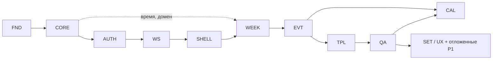

# Together Planner — окончательный план реализации frontend

Версия 1.0 · 2026-11-17. **Главный документ для разработки frontend.**

- Почему принято то или иное решение — `frontend-final-decisions.md` (ссылки `FD-xx`, открытые вопросы `OQ-x`).
- Как работать день за днём — `frontend-development-guide.md`.
- Контракт API — `backend-spec-v2.md` (ссылки «spec §…»), коды эндпоинтов A1…T8 — из spec §8.1.

Задача = одна рабочая сессия = один коммит `<ID>: <что сделано>`. Сложность: **S** ≤ 2 ч, **M** ≈ полдня, **L** ≈ рабочий день.

**Общий Definition of Done для каждой задачи** (в задачах не повторяется):
1. `npm run lint`, `npm test`, `npm run build` — без ошибок (lint — после FND-08).
2. Тесты, перечисленные в задаче, написаны и проходят.
3. `npm start` + запущенный backend: всё, что уже было сделано, по-прежнему работает (короткий ручной прогон, гайд §3).
4. Нет `any`, нет `TODO` вместо работающей логики, нет захардкоженных цветов и `new Date('…')` для локального времени.
5. Новые файлы лежат там, где их размещает структура (FD §2.2). Публичный API фичи — через `index.ts`.
6. Статус задачи обновлён в §5 этого документа. Если что-то отличилось от плана — запись в журнал §12.

---

## 1. Окончательная архитектура (кратко)

- **Angular 22** (standalone, zoneless, signals, `OnPush`), **TypeScript 6.0 strict**, **Angular CDK** без Material, SCSS + CSS-токены, своя небольшая библиотека UI.
- **Слои:** `core` (API, сессия, ошибки, уведомления, часы) → `shared` (время, доменные константы, формы, UI, **timeline**) → `layout` (оболочка) → `features` (auth, onboarding, schedule, events, templates, calendar, settings).
- **Состояние:** signals-сторы на экран (`SessionStore`, `WeekStore`, `TemplatesStore`, `CalendarStore`), RxJS — для HTTP и отмены. После мутаций данные перезагружаются с сервера, сторы узнают об изменениях через `DataChanges`.
- **API:** `*Api`-классы 1:1 с эндпоинтами, модели 1:1 с DTO. `authInterceptor` (Bearer, `X-Requested-With`, single-flight refresh) и `errorInterceptor` (ProblemDetail → `ApiError`).
- **Время:** строки ISO-local + целые «локальные минуты». «Сейчас» — в поясе пространства. `Date` для локального времени запрещён.
- **Timeline:** чистый движок (разрез по дням → дорожки → геометрия → `PanelLayout`) + презентационная доска. Одна прокрутка на обе панели.
- **Тесты:** Vitest + jsdom (unit, компоненты, HTTP), Playwright (E2E и вёрстка: синхронная прокрутка, адаптивность).
- **Продакшен:** nginx — один origin (`/` → SPA, `/api/` → backend), CSP, `docker compose --profile app`.

Структура папок и назначение файлов — FD §2.2.

---

## 2. Порядок фаз

| # | Фаза | Префикс | Итог фазы: что можно запустить и проверить |
|---|---|---|---|
| 1 | Фундамент | FND | `npm start` → страницы-заглушки; `/api` проксируется на backend; production-образ nginx стартует, CSP не ломает приложение |
| 2 | Ядро | CORE | То же + модели API, ошибки, время, тосты, диалоги, UI-примитивы — всё покрыто тестами |
| 3 | Аутентификация | AUTH | Регистрация, вход, выход, обновление страницы без разлогина; просроченный токен незаметно обновляется |
| 4 | Пространство | WS | Онбординг двух людей: создание, код или ссылка, присоединение |
| 5 | Оболочка | SHELL | Шапка с вкладками, двумя участниками, меню; приглашение, если партнёра ещё нет |
| 6 | Недельное расписание | WEEK | Настоящая неделя из backend в двух панелях, навигация, режим «День», мобильная версия (только просмотр) |
| 7 | События | EVT | Создание, редактирование, удаление, конфликт версий → **расписание полностью рабочее** |
| 8 | Шаблоны | TPL | CRUD шаблонов, применение с предпросмотром → **функционально MVP готов** |
| 9 | Тесты и production | QA | E2E ключевых сценариев, `docker compose --profile app up` поднимает всё → **MVP выпущен** |
| 10 | Календарь | CAL | Месяц, «Запланировано», будущие события (P1) |
| 11 | Настройки и полировка | SET / UX | Профиль, пространство, выход везде, аудит доступности и адаптивности + отложенные P1-задачи фаз 3–8 |

### 2.1. Что изменено относительно предложенного порядка и почему

| Изменение | Причина |
|---|---|
| **Production-сборка и nginx — в Фазе 1** (FND-07), а не только в конце | CSP из spec (`default-src 'self'`) несовместим с тем, как Angular вставляет стили (FD-91). Если обнаружить это в конце, придётся разбирать готовое приложение. Проверка на пустом проекте занимает полчаса |
| **Библиотека времени — в Фазе 2** (CORE-05…07), а не внутри расписания | На неё опираются онбординг (пояс), шапка, расписание, формы, календарь. Это чистые функции, их проще всего написать и протестировать до любого UI |
| **API-сервисы создаются в фазе своей функции** (AUTH-01, WS-01, WEEK-09, EVT-01, TPL-01), модели — сразу все в Фазе 2 | Модели — это сверка контракта, её выгодно сделать один раз и целиком. Сервис без потребителя — непроверенный код. Каждый сервис появляется вместе с первым экраном, который его вызывает, и сразу проверяется на настоящем backend |
| **Shared UI — минимальный набор в Фазе 2**, остальное — по требованию | «Не создавать компоненты, которые потом придётся переписывать»: в CORE-11 только примитивы, нужные уже формам AUTH и WS. Меню появляется в SHELL-02, hover-карточка — в WEEK-14 |
| **Тесты и production (бывш. Фаза 10) — перед настройками и календарём** | Настройки и календарь — P1. MVP выпускается сразу после шаблонов. Отложенные P1-задачи из фаз 3–8 делаются после выпуска |
| **Календарь — отдельная фаза 10** (в предложенном списке его не было) | Требование проекта (будущие события, календарное представление). Будущие события в MVP уже работают: событие создаётся на любую дату и показывается в нужной неделе. Календарь — удобство, поэтому P1 |
| **Разрез по дням (через полночь, граница недели) — шаг 2 таймлайна, а не 11–12** | Сегмент — базовая единица, на ней строятся дорожки и геометрия. Если добавить разрез позже, пришлось бы переписать оба шага (FD-53). Сложной бизнес-логики здесь нет — это чистая геометрия |
| **E2E-инфраструктура появляется в Фазе 6** (WEEK-08), а не в конце | Синхронную прокрутку и sticky-заголовки jsdom проверить не может: в нём нет вёрстки. Тест на dev-площадке с фикстурами не требует backend и нужен ровно тогда, когда собирается доска |

### 2.2. Граф зависимостей фаз

Критический путь MVP: FND-01 → FND-02 → CORE-05 → AUTH-03 → AUTH-04 → AUTH-05 → WS-03 → SHELL-01 → WEEK-02 → WEEK-03 → WEEK-04 → WEEK-05 → WEEK-09 → WEEK-10 → EVT-02 → EVT-04 → TPL-03 → TPL-04 → TPL-06 → TPL-07 → QA-05.

---

## 3. MVP scope

| Приоритет | Что входит | Задач |
|---|---|---|
| **P0** — первая рабочая версия | Регистрация и вход; сессия с refresh; создание пространства и присоединение (код и ссылка); два участника в шапке и панелях; неделя в двух панелях с общей шкалой, синхронной прокруткой, пересечениями, событиями через полночь и на границе недели, линией «сейчас»; навигация по неделям; режим «День» и мобильная версия; CRUD событий с конфликтом версий; CRUD шаблонов; применение шаблона MERGE/FILL/REPLACE через предпросмотр и подтверждение; выход; production-сборка; E2E ключевых сценариев | **74** |
| **P1** — сразу после MVP | Календарь месяца и «Запланировано»; настройки (профиль, имя пространства, участники, приглашение); выход на всех устройствах; синхронизация выхода между вкладками; hover-карточка и связанная подсветка совместных событий; «Общее свободное время»; обновление при возврате на вкладку; уведомление о сдвиге времени при переводе часов; предпросмотр шаблона на сетке; журнал применений; аудит доступности, адаптивности, пустых и ошибочных состояний, анимации | **15** |
| **P2** — можно отложить | Статистика часов в панели; мини-сетка в карточке шаблона; «Сохранить неделю как шаблон» (BLOCKED, OQ-3); полный список предстоящих (E2); легенда категорий; смена часового пояса (BLOCKED, OQ-1) | **6** |

Требования к первой рабочей версии — и где они выполняются:

| # | Требование | Задачи |
|---|---|---|
| 1 | Зарегистрироваться и войти | AUTH-01…08 |
| 2 | Создать пространство или присоединиться | WS-01…07 |
| 3 | Увидеть двух участников | SHELL-01, SHELL-04, WEEK-09 |
| 4 | Переключать недели | WEEK-10, WEEK-11 |
| 5 | Просматривать два расписания | WEEK-01…13 |
| 6–8 | Создавать, редактировать, удалять события | EVT-01…07 |
| 9 | Создавать шаблоны | TPL-01…04 |
| 10 | Применять шаблоны через предпросмотр | TPL-05…08 |

В P0 нет ничего сверх этого списка, кроме двух вещей:
- **FND-07** (ранняя проверка production-сборки) — это снятие риска, а не функция;
- **QA-01…07** (E2E и production) — без них нельзя сказать, что первая версия работает.

---

## 4. Как строится главный экран (таймлайн)

Порядок выбран так, чтобы сложная геометрия заработала и была покрыта тестами **до** того, как к ней подключатся backend, навигация и формы.

| Шаг | Задача | Что появляется | Почему именно здесь |
|---|---|---|---|
| 1 | WEEK-01 | Тип `TimelineEvent`, константы шкалы, маппер DTO → `TimelineEvent` | Движок отделён от DTO с первой строки (FD-51) |
| 2 | WEEK-02 | Разрез событий на сегменты по дням: через полночь, на границе недели, многодневные, фильтр по участнику | Базовая единица для всего остального (FD-53) |
| 3 | WEEK-03 | Кластеры и дорожки пересечений | Работает уже на сегментах; полуоткрытые интервалы |
| 4 | WEEK-04 | Геометрия (px, %, скругления, плотность) и `PanelLayout` — готовая view model | После этого шага весь расчёт закрыт тестами |
| 5 | WEEK-05 | Статичная доска на фикстурах на dev-площадке `/_dev/board`: панели, шкала времени, заголовки, **одна прокрутка**, sticky, сетка часов, прокрутка к 06:00 | Вёрстку проверяем без backend и без авторизации |
| 6 | WEEK-06 | Карточки событий по `PanelLayout`: пересечения, продолжение через полночь, «вместе» | Отображение без собственной логики |
| 7 | WEEK-07 | Линия «сейчас» | Нужен `ZoneClock` (CORE-06) |
| 8 | WEEK-08 | Playwright: синхронная прокрутка, sticky, начальная позиция | Закрепляем вёрстку тестом, пока она свежая |
| 9 | WEEK-09 | `WeekApi` + `WeekStore`: загрузка, отмена, состояния, `computed` раскладка | Только теперь подключаем backend |
| 10 | WEEK-10 | `WeekPage`: маршрут, нормализация недели, настоящие данные вместо фикстур | Доска не меняется: меняется только источник данных |
| 11 | WEEK-11 | Навигация по неделям | Работает через URL |
| 12 | WEEK-12 | Загрузка, пустая неделя, ошибка | |
| 13 | WEEK-13 | Режим «День», < 820 px, чипы дней | Тот же движок с `dayCount = 1` (FD-52) |
| 14 | WEEK-14 (P1) | Hover-карточка, связанная подсветка совместных событий | |
| 15 | WEEK-15 (P1) | «Оба свободны» | Новая чистая функция `free-slots.ts` + слой отображения |

Создание и редактирование (EVT) подключаются к доске только через её `output()` (`slotClick`, `eventClick`). Сама доска для этого не меняется.

---

## 5. Сводная таблица задач (статус)

Статус: ☐ — не начата, ◐ — в работе, ☑ — готова, ⛔ — заблокирована открытым вопросом.

| ID | Задача | P | Сл. | Статус |
|---|---|---|---|---|
| **Фаза 1 — Фундамент** |||||
| FND-01 | Окружение разработки | P0 | S | ☑ |
| FND-02 | Создание Angular-проекта | P0 | S | ☑ |
| FND-03 | Строгий TypeScript, алиасы, верхний уровень папок | P0 | S | ☑ |
| FND-04 | Design tokens, глобальные стили, шрифты | P0 | M | ☑ |
| FND-05 | Каркас маршрутизации | P0 | S | ☑ |
| FND-06 | HTTP, proxy, локаль | P0 | S | ☑ |
| FND-07 | Production-сборка и nginx (ранняя проверка) | P0 | M | ☑ |
| FND-08 | ESLint и Prettier с правилами проекта | P0 | S | ☑ |
| **Фаза 2 — Ядро** |||||
| CORE-01 | Модели: общие типы и перечисления | P0 | S | ☑ |
| CORE-02 | Модели: auth, user, workspace | P0 | S | ☑ |
| CORE-03 | Модели: event, week, template, apply | P0 | S | ☑ |
| CORE-04 | `ApiError`, `errorInterceptor`, словарь сообщений | P0 | M | ☑ |
| CORE-05 | Время: локальные дата и время, неделя | P0 | M | ☑ |
| CORE-06 | `ZoneClock`: «сейчас» в поясе пространства | P0 | S | ☑ |
| CORE-07 | Русское форматирование дат | P0 | S | ☑ |
| CORE-08 | Доменные константы | P0 | S | ☑ |
| CORE-09 | Тосты | P0 | S | ☑ |
| CORE-10 | Диалоги | P0 | M | ☑ |
| CORE-11 | UI-примитивы | P0 | M | ☑ |
| CORE-12 | Помощники форм | P0 | S | ☑ |
| **Фаза 3 — Аутентификация** |||||
| AUTH-01 | `AuthApi` | P0 | S | ☑ |
| AUTH-02 | `SessionStore` | P0 | S | ☑ |
| AUTH-03 | `TokenRefresher` (single-flight) | P0 | M | ☑ |
| AUTH-04 | `authInterceptor` | P0 | L | ☑ |
| AUTH-05 | Восстановление сессии при старте | P0 | M | ☑ |
| AUTH-06 | Guards | P0 | S | ☑ |
| AUTH-07 | Страница входа и регистрации | P0 | M | ☑ |
| AUTH-08 | Выход | P0 | S | ☑ |
| AUTH-09 | Выход во всех вкладках (BroadcastChannel) | P1 | S | ☐ |
| **Фаза 4 — Пространство** |||||
| WS-01 | `WorkspaceApi` | P0 | S | ☑ |
| WS-02 | Онбординг: выбор пути | P0 | S | ☑ |
| WS-03 | Создание пространства | P0 | S | ☑ |
| WS-04 | Карточка приглашения | P0 | S | ☑ |
| WS-05 | Присоединение по коду | P0 | S | ☑ |
| WS-06 | Ссылка-приглашение `/join?code=` | P0 | M | ☑ |
| WS-07 | Актуализация пространства | P0 | S | ☑ |
| **Фаза 5 — Оболочка** |||||
| SHELL-01 | `AppShell` и шапка | P0 | M | ☑ |
| SHELL-02 | Меню пользователя | P0 | S | ☑ |
| SHELL-03 | Адаптивная шапка | P0 | S | ☑ |
| SHELL-04 | «Партнёр ещё не присоединился» | P0 | S | ☑ |
| **Фаза 6 — Недельное расписание** |||||
| WEEK-01 | Модель таймлайна и константы | P0 | S | ☑ |
| WEEK-02 | Engine: разрез по дням | P0 | M | ☑ |
| WEEK-03 | Engine: дорожки пересечений | P0 | M | ☑ |
| WEEK-04 | Engine: геометрия и `PanelLayout` | P0 | M | ☑ |
| WEEK-05 | Статичная доска на фикстурах | P0 | L | ☑ |
| WEEK-06 | Карточка события | P0 | M | ☑ |
| WEEK-07 | Линия текущего времени | P0 | S | ☑ |
| WEEK-08 | E2E-инфраструктура и тест прокрутки | P0 | M | ☑ |
| WEEK-09 | `WeekApi` и `WeekStore` | P0 | M | ☑ |
| WEEK-10 | `WeekPage` с настоящими данными | P0 | M | ☑ |
| WEEK-11 | Навигация по неделям | P0 | S | ☑ |
| WEEK-12 | Загрузка, пустая неделя, ошибка | P0 | S | ☑ |
| WEEK-13 | Режим «День» и адаптивность | P0 | M | ☑ |
| WEEK-14 | Hover-карточка и связанная подсветка | P1 | M | ☐ |
| WEEK-15 | Общее свободное время | P1 | M | ☐ |
| WEEK-16 | Обновление при возврате на вкладку | P1 | S | ☐ |
| WEEK-17 | Статистика часов в панели | P2 | S | ☐ |
| **Фаза 7 — События** |||||
| EVT-01 | `EventsApi` | P0 | S | ☑ |
| EVT-02 | Модель формы события | P0 | M | ☑ |
| EVT-03 | Диалог события: разметка и поведение | P0 | M | ☑ |
| EVT-04 | Создание события | P0 | M | ☑ |
| EVT-05 | Редактирование события | P0 | M | ☐ |
| EVT-06 | Удаление события | P0 | S | ☐ |
| EVT-07 | Конфликт версий и удалённое событие | P0 | M | ☐ |
| EVT-08 | Уведомление о сдвиге времени (DST) | P1 | S | ☐ |
| **Фаза 8 — Шаблоны** |||||
| TPL-01 | `TemplatesApi` и `TemplateApplicationsApi` | P0 | S | ☐ |
| TPL-02 | Страница шаблонов: список и удаление | P0 | M | ☐ |
| TPL-03 | Модель формы шаблона | P0 | M | ☐ |
| TPL-04 | Редактор шаблона | P0 | L | ☐ |
| TPL-05 | Диалог применения: параметры | P0 | M | ☐ |
| TPL-06 | Предпросмотр применения | P0 | M | ☐ |
| TPL-07 | Применение и результат | P0 | M | ☐ |
| TPL-08 | Точки входа «Применить шаблон» | P0 | S | ☐ |
| TPL-09 | Предпросмотр шаблона на сетке | P1 | M | ☐ |
| TPL-10 | Журнал применений | P1 | S | ☐ |
| TPL-11 | Мини-сетка в карточке шаблона | P2 | S | ☐ |
| TPL-12 | «Сохранить неделю как шаблон» | P2 | M | ⛔ OQ-3 |
| **Фаза 9 — Тесты и production** |||||
| QA-01 | E2E-помощники: пользователи и пространство | P0 | M | ☐ |
| QA-02 | E2E: регистрация, пространство, присоединение | P0 | M | ☐ |
| QA-03 | E2E: события и конфликт версий | P0 | M | ☐ |
| QA-04 | E2E: шаблоны | P0 | M | ☐ |
| QA-05 | Docker Compose: сервис frontend | P0 | M | ☐ |
| QA-06 | Production-чеклист | P0 | S | ☐ |
| QA-07 | Документация | P0 | S | ☐ |
| **Фаза 10 — Календарь** |||||
| CAL-01 | Календарь месяца | P1 | M | ☐ |
| CAL-02 | «Запланировано» и будущее событие | P1 | S | ☐ |
| CAL-03 | Полный список предстоящих (E2) | P2 | S | ☐ |
| CAL-04 | Легенда категорий | P2 | S | ☐ |
| **Фаза 11 — Настройки и полировка** |||||
| SET-01 | Настройки: профиль, пространство, участники, приглашение | P1 | M | ☐ |
| SET-02 | Выйти на всех устройствах | P1 | S | ☐ |
| SET-03 | Смена часового пояса пространства | P2 | S | ⛔ OQ-1 |
| UX-01 | Аудит пустых и ошибочных состояний | P1 | S | ☐ |
| UX-02 | Аудит адаптивности | P1 | M | ☐ |
| UX-03 | Аудит доступности | P1 | M | ☐ |
| UX-04 | Анимации и визуальная полировка | P1 | S | ☐ |

Итого: **95 задач** — P0: 74, P1: 15, P2: 6.

**Порядок выполнения:** сначала все P0 по порядку таблицы (фазы 1–9) — это MVP. Затем P1: фазы 10–11 и отложенные AUTH-09, WEEK-14…16, EVT-08, TPL-09, TPL-10. Затем P2.

---

## 6. Задачи

Поля каждой задачи: **Цель** · **Сделать** · **Файлы** · **Затрагивает** (сервисы и компоненты) · **API** · **Зависит от** · **Проверка** · **DoD** (сверх общего DoD).

### Фаза 1 — Фундамент

#### FND-01 · Окружение разработки · P0 · S
- **Цель:** на машине собирается Angular 22 и запускается backend.
- **Сделать:**
  - Установить Node.js 24 LTS (≥ 24.15) — установщиком или через nvm-windows. Текущий Node 17.4 Angular 22 не поддерживает.
  - Проверить `node -v`, `npm -v`.
  - Angular CLI — через `npx @angular/cli@22`, глобальная установка не нужна.
  - Backend: в `.env` для локального HTTP — `REFRESH_COOKIE_SECURE=false`; `docker compose up -d postgres`; `cd backend && ./mvnw spring-boot:run`.
- **Файлы:** только локальный `.env` (в git не попадает).
- **Затрагивает:** —
- **API:** `GET /actuator/health`.
- **Зависит от:** —
- **Проверка:** `node -v` → `v24.*`; health → `UP`; Swagger UI открывается.
- **DoD:** версии Node и npm записаны в журнал §12.

#### FND-02 · Создание Angular-проекта · P0 · S
- **Цель:** пустой проект Angular 22 в `frontend/` с нужными настройками по умолчанию.
- **Сделать:**
  - Из корня репозитория: `npx @angular/cli@22 new frontend --style=scss --routing --ssr=false --skip-git`. Тест-раннер — Vitest (по умолчанию; если CLI спросит — выбрать его).
  - Проверить:
    - компоненты standalone;
    - проект zoneless: если `zone.js` есть в `polyfills` — удалить и добавить `provideZonelessChangeDetection()`;
    - TypeScript 6.0.x.
  - `angular.json` → `prefix: "tp"`.
  - Скрипты в `package.json`: `start`, `build`, `test` (`ng test --watch=false`), `test:watch`.
  - Удалить демо-разметку из `app.html`.
- **Файлы:** `frontend/**` (сгенерированные), `angular.json`, `package.json`, `package-lock.json`.
- **Затрагивает:** `App`.
- **API:** —
- **Зависит от:** FND-01.
- **Проверка:** `npm start` → пустая страница на `:4200`; `npm test` и `npm run build` проходят.
- **DoD:** `package-lock.json` в git, `node_modules/` и `dist/` — нет.

#### FND-03 · Строгий TypeScript, алиасы, верхний уровень папок · P0 · S
- **Цель:** компилятор ловит ошибки шаблонов и типов; импорты читаемы.
- **Сделать:**
  - Флаги FD-03 в `tsconfig.json`.
  - `paths`: `@core/*`, `@shared/*`, `@features/*`, `@layout/*`.
  - Папки `core/`, `shared/`, `layout/`, `features/` (подпапки — по задачам, пустых не создаём).
  - `.editorconfig`.
- **Файлы:** `tsconfig.json`, `tsconfig.app.json`, `tsconfig.spec.json`, `.editorconfig`.
- **Затрагивает:** —
- **API:** —
- **Зависит от:** FND-02.
- **Проверка:** пробный импорт через `@core/...` компилируется и в приложении, и в тесте (потом удалить).
- **DoD:** сборка и тесты зелёные со строгими флагами.

#### FND-04 · Design tokens, глобальные стили, шрифты · P0 · M
- **Цель:** все визуальные константы прототипа — в одном месте.
- **Сделать:**
  - `_tokens.scss` (FD-60): цвета, радиусы, тени, длительности, шрифты.
  - `_reset.scss` (из `<helmet>` прототипа).
  - `_typography.scss`: Inter — текст, Manrope — заголовки.
  - `_animations.scss`: `tpIn`, `tpFade`, `prefers-reduced-motion`.
  - `_breakpoints.scss`: mixin `narrow` (< 820 px).
  - Глобальный `:focus-visible`.
  - Шрифты `woff2` в `public/fonts/` + `@font-face` с `font-display: swap`.
- **Файлы:** `src/styles/*.scss`, `src/styles.scss`, `public/fonts/*`.
- **Затрагивает:** —
- **API:** —
- **Зависит от:** FND-02.
- **Проверка:** временная разметка в `App` показывает шрифты и цвета; в Network нет запросов к `fonts.googleapis.com`.
- **DoD:** значения прототипа (`<helmet>`, цвета участников, «сегодня», выходных, свободного времени) перенесены в токены; вне `_tokens.scss` цветов нет.

#### FND-05 · Каркас маршрутизации · P0 · S
- **Цель:** все маршруты FD §6 существуют и грузятся лениво.
- **Сделать:**
  - `app.routes.ts` по таблице FD §6: страницы-заглушки `login`, `register`, `join`, `onboarding`, `week/:weekStart`, `templates`, `templates/new`, `templates/:templateId` (`loadComponent`).
  - `provideRouter(routes, withComponentInputBinding())`.
  - `''` и `**` → `week` (временно — на заглушку; функция-редирект появится в WEEK-10).
  - Guards пока не подключены.
- **Файлы:** `app.routes.ts`, `app.config.ts`, `features/*/…-page.ts` (заглушки).
- **Затрагивает:** заглушки страниц.
- **API:** —
- **Зависит от:** FND-03.
- **Проверка:** переход по каждому пути показывает свою заглушку; `npm run build` показывает отдельные lazy chunks.
- **DoD:** заглушки содержат только заголовок страницы.

#### FND-06 · HTTP, proxy, локаль · P0 · S
- **Цель:** frontend обращается к backend через один origin.
- **Сделать:**
  - `provideHttpClient(withFetch(), withInterceptors([]))`.
  - Токен `API_BASE_URL = '/api/v1'`.
  - `proxy.conf.json` (`/api` → `http://localhost:8080`); `start` = `ng serve --proxy-config proxy.conf.json`.
  - `LOCALE_ID = 'ru'` + `registerLocaleData(localeRu)`.
  - Временно: на заглушке вызвать `GET /api/v1/auth/me` (после проверки удалить).
- **Файлы:** `app.config.ts`, `core/api/api-base-url.ts`, `proxy.conf.json`, `package.json`.
- **Затрагивает:** —
- **API:** A6 (ожидается `401`).
- **Зависит от:** FND-05, FND-01.
- **Проверка:** в Network `localhost:4200/api/v1/auth/me` → `401`, тело `ProblemDetail` с `code: "UNAUTHORIZED"`.
- **DoD:** временный вызов удалён.

#### FND-07 · Production-сборка и nginx (ранняя проверка) · P0 · M
- **Цель:** до начала разработки убедиться, что production-сборка работает за nginx с CSP (FD-91).
- **Сделать:**
  - `frontend/Dockerfile` (multi-stage, FD-93), `frontend/.dockerignore`.
  - `frontend/nginx/nginx.conf`:
    - `location /api/` → `backend:8080` (с `resolver`, чтобы nginx стартовал без backend, или проверка `/api` переносится в QA-05);
    - SPA fallback;
    - CSP (FD-91);
    - кеш-заголовки.
  - В `angular.json` — `optimization.styles.inlineCritical: false`.
  - `docker build` + `docker run -p 8081:80`.
- **Файлы:** `frontend/Dockerfile`, `frontend/.dockerignore`, `frontend/nginx/nginx.conf`, `angular.json`.
- **Затрагивает:** —
- **API:** — (проксирование `/api` проверяется в QA-05).
- **Зависит от:** FND-04, FND-05.
- **Проверка:**
  - `http://localhost:8081/templates` (прямая ссылка) открывает приложение;
  - в консоли нет нарушений CSP, шрифты загрузились;
  - в DevTools видны заголовки `Content-Security-Policy` и `Cache-Control`.
- **DoD:** образ собирается одной командой; итоговая CSP записана в журнал §12.

#### FND-08 · ESLint и Prettier с правилами проекта · P0 · S
- **Цель:** правила гайда проверяются автоматически, а не только по памяти.
- **Сделать:**
  - `ng add angular-eslint`; Prettier.
  - Правила:
    - `prefer-on-push-component-change-detection`;
    - запрет `any`;
    - `no-restricted-syntax`: `new Date(<аргументы>)` и `Date.parse` — вне `shared/time/**` и `core/time/**`;
    - `no-restricted-imports`: границы слоёв FD-10/11 — `core` не импортирует `features`/`layout`/`shared/ui`; фичи — только через `index.ts`.
  - Скрипты `lint`, `format`.
- **Файлы:** `eslint.config.js`, `.prettierrc`, `.prettierignore`, `package.json`.
- **Затрагивает:** —
- **API:** —
- **Зависит от:** FND-03.
- **Проверка:** пробный `new Date('2026-11-20T08:00')` в компоненте → ошибка lint (потом удалить).
- **DoD:** `npm run lint` зелёный на всём проекте.

### Фаза 2 — Ядро

#### CORE-01 · Модели: общие типы и перечисления · P0 · S
- **Цель:** базовые типы контракта (FD-20…23).
- **Сделать:**
  - `common.models.ts`: `Uuid`, `IsoDate`, `IsoTime`, `IsoLocalDateTime`, `IsoInstant`, `PageResponse<T>`, `ValidationErrorItem`, `ProblemDetail` (`type`, `title`, `status`, `detail`, `instance`, `code`, `errors?`).
  - `enums.ts`: `EventCategory` и `EventColor` (9 значений), `ApplyMode` (3), `WorkspaceRole` (2), `DayOfWeek` (7) + массивы констант.
- **Файлы:** `core/api/models/common.models.ts`, `core/api/models/enums.ts`, `enums.spec.ts`.
- **Затрагивает:** —
- **API:** spec §5.6, §7.1, §8.0, §8.2.
- **Зависит от:** FND-03.
- **Проверка:** тест — массивы констант совпадают со значениями spec §5.6 (порядок и написание).
- **DoD:** у каждого файла в шапке — ссылка на раздел spec.

#### CORE-02 · Модели: auth, user, workspace · P0 · S
- **Цель:** типы для фаз 3–5.
- **Сделать:**
  - `RegisterRequest`, `LoginRequest`, `AuthResponse`, `MeResponse` (`workspace: WorkspaceResponse | null`), `UserResponse`.
  - `MemberResponse`, `CreateWorkspaceRequest`, `UpdateWorkspaceRequest` (поля `string | null`), `JoinWorkspaceRequest`, `WorkspaceResponse`, `InviteResponse`.
  - Образцы JSON: снять из Swagger настоящего backend ответы A1, A6, W1, W5 → `models/testing/samples.ts` с проверкой `satisfies` (это проверка контракта на этапе компиляции).
- **Файлы:** `core/api/models/auth.models.ts`, `user.models.ts`, `workspace.models.ts`, `models/testing/samples.ts`.
- **Затрагивает:** —
- **API:** spec §8.2–§8.4.
- **Зависит от:** CORE-01, FND-01 (запущенный backend для образцов).
- **Проверка:** образцы компилируются; сверка поле-в-поле по §10.
- **DoD:** `satisfies` проходит для всех образцов; отличий от spec нет.

#### CORE-03 · Модели: event, week, template, apply · P0 · S
- **Цель:** типы для фаз 6–8.
- **Сделать:**
  - `EventRequest` (`version?: number`, `color: EventColor | null`), `EventResponse`, `EventSourceResponse`, `WeekResponse`.
  - `TemplateRequest`, `TemplateEventRequest` (`id: Uuid | null`), `TemplateResponse` (`lastApplication: … | null`), `TemplateEventResponse`.
  - `ApplyTemplateRequest` (`confirmedDeleteIds` / `confirmedRestoredIds: Uuid[] | null`), `PlannedEvent`, `ApplyConflict`, `ApplyPreviewResponse`, `TemplateApplicationResponse`, `ApplyResultResponse`.
  - Образцы JSON (E3, S1, T2, T6, T7) — тоже из настоящего backend. Для T6 — недельный сценарий, в котором заполнены `conflicts` и `toDelete`.
- **Файлы:** `core/api/models/event.models.ts`, `week.models.ts`, `template.models.ts`, `models/testing/samples.ts`.
- **Затрагивает:** —
- **API:** spec §8.5–§8.9.
- **Зависит от:** CORE-01.
- **Проверка:** образцы компилируются; сверка по §10.
- **DoD:** все 27 эндпоинтов из §9 имеют типы запроса и ответа.

#### CORE-04 · `ApiError`, `errorInterceptor`, словарь сообщений · P0 · M
- **Цель:** любая ошибка HTTP приходит в код в одном виде (FD-65…67).
- **Сделать:**
  - Класс `ApiError {status, code, detail, fieldErrors, problem}` + `isApiError()`.
  - `errorInterceptor`: `HttpErrorResponse` → `ApiError`; сеть → `NETWORK_ERROR`; нет `code` → `UNKNOWN`.
  - `error-messages.ts`: тексты для всех кодов spec §7.4 + `NETWORK_ERROR`, `SESSION_EXPIRED`, `UNKNOWN`; функция `messageFor(error)`.
  - Подключить интерцептор в `app.config.ts`.
- **Файлы:** `core/error/api-error.ts`, `error-interceptor.ts`, `error-messages.ts` + `*.spec.ts`; `app.config.ts`.
- **Затрагивает:** все будущие `*Api`.
- **API:** формат spec §7.1.
- **Зависит от:** CORE-01, FND-06.
- **Проверка:**
  - ER-01: 400 с `errors[]` → `fieldErrors` заполнены.
  - ER-02: 409 → `code` из тела.
  - ER-03: статус 0 → `NETWORK_ERROR`.
  - ER-04: 500 без тела → `UNKNOWN`.
  - ER-05: для каждого кода из `ErrorCode` (список spec §7.4, 34 шт.) есть текст.
- **DoD:** интерцептор ничего не показывает пользователю (FD-66).

#### CORE-05 · Время: локальные дата и время, неделя · P0 · M
- **Цель:** надёжная арифметика местного времени без `Date` (FD-30…32).
- **Сделать:**
  - `local-date-time.ts`: `parseLocalDateTime`, `formatLocalDateTime`, `parseDate`, `formatDate`, `toLocalMinutes`, `fromLocalMinutes`, `parseTime`, `formatTime`, `minutesOfDay`, `dateOfMinutes`, `compareLocal`.
  - `week.ts`: `isoDayOfWeek`, `addDays`, `weekStartOf`, `weekDays(weekStart)`, `isMonday`, `daysBetween`.
- **Файлы:** `shared/time/local-date-time.ts`, `shared/time/week.ts` + `*.spec.ts`.
- **Затрагивает:** — (основа для всех следующих фаз).
- **API:** —
- **Зависит от:** CORE-01.
- **Проверка:** кейсы DT-01…DT-10 (§8.4).
- **DoD:** покрытие строк ≥ 95 %; нет `getHours`, `getDate` и `new Date(string)`.

#### CORE-06 · `ZoneClock`: «сейчас» в поясе пространства · P0 · S
- **Цель:** «сегодня» и «сейчас» совпадают с backend (FD-33).
- **Сделать:**
  - Токен `CLOCK` (`() => number`, по умолчанию `Date.now`).
  - `ZoneClock.nowIn(zone): LocalMinutes`, `todayIn(zone): IsoDate` через `Intl.DateTimeFormat(…, {timeZone}).formatToParts`.
  - Сигнал `minuteTick`, выровненный по границе минуты.
- **Файлы:** `core/time/zone-clock.ts` + `.spec.ts`.
- **Затрагивает:** будущие `WeekStore`, `NowIndicator`, редирект недели.
- **API:** —
- **Зависит от:** CORE-05.
- **Проверка:** кейсы ZC-01…ZC-04 (§8.4).
- **DoD:** в тестах время всегда фиксированное через `CLOCK`.

#### CORE-07 · Русское форматирование дат · P0 · S
- **Цель:** все подписи дат из прототипа — функциями с тестами.
- **Сделать:** `format-ru.ts` (перенос из прототипа):
  - `weekLabel` («9 – 15 ноября 2026», «30 ноября – 6 декабря 2026»), `weekShort` («9–15 нояб.»);
  - `dateLong` («понедельник, 9 ноября»), `dateShort` («пн, 9 нояб.»);
  - `rangeText` (с «→» для разных дней), `durText` («1 ч 30 мин»);
  - `relWeek` («Эта неделя», «Через 2 недели»), `relDays` («сегодня», «завтра», «через 5 дней»).
  - `plural.ts`.
- **Файлы:** `shared/time/format-ru.ts`, `shared/time/plural.ts` + `*.spec.ts`.
- **Затрагивает:** —
- **API:** —
- **Зависит от:** CORE-05.
- **Проверка:** FR-01…FR-06 (§8.4) — ожидаемые строки взяты из прототипа.
- **DoD:** формулировки совпадают с прототипом.

#### CORE-08 · Доменные константы · P0 · S
- **Цель:** единственные источники палитры, ограничений и правил отображения участников (FD-62, FD-82).
- **Сделать:**
  - `category-palette.ts`: 9 категорий `{label, bg, fg, dot}`, `colorKeyOf(event) = color ?? category`.
  - `event-constraints.ts`: все числовые лимиты FD-82 со ссылками на spec.
  - `participants.ts`: `seatColor(seat)`, `seatTint(seat)`, `initialOf(name)`, `whoText(participantIds, members)` («вместе» или имя).
- **Файлы:** `shared/domain/*.ts` + `*.spec.ts`.
- **Затрагивает:** —
- **API:** —
- **Зависит от:** CORE-01, FND-04.
- **Проверка:** палитра покрывает все значения `EventCategory`; `whoText` для 1 и 2 участников.
- **DoD:** цвета категорий нигде больше не повторяются.

#### CORE-09 · Тосты · P0 · S
- **Цель:** короткие уведомления с действием, как в прототипе (FD-68).
- **Сделать:**
  - `ToastService`: `show(text, {action?, durationMs = 4800})`, `error(apiError)` (через `messageFor`); сигнал с одним текущим тостом.
  - `tp-toast-host` (`aria-live="polite"`, анимация `tpFade`); подключить в `App`.
- **Файлы:** `core/notify/toast-service.ts`, `shared/ui/toast-host/*` + `*.spec.ts`; `app.ts`.
- **Затрагивает:** `App`.
- **API:** —
- **Зависит от:** CORE-04, FND-04.
- **Проверка:**
  - новый тост заменяет предыдущий;
  - тост скрывается через 4.8 с (`vi.useFakeTimers`);
  - кнопка действия вызывает callback и закрывает тост.
- **DoD:** у тоста есть доступное имя, его читает скринридер.

#### CORE-10 · Диалоги · P0 · M
- **Цель:** единый вид и поведение модальных окон (CDK Dialog).
- **Сделать:**
  - `DialogService.open(component, data): Observable<Result | undefined>` поверх CDK `Dialog`: фон, `tpIn`, закрытие по Esc и клику мимо, возврат фокуса.
  - `tp-dialog-shell`: заголовок, кнопка закрытия, тело, подвал; на < 820 px — на всю ширину снизу.
  - `tp-confirm-dialog`: заголовок, текст, кнопка подтверждения (`danger`).
- **Файлы:** `shared/ui/dialog/*`, `shared/ui/confirm-dialog/*` + `*.spec.ts`.
- **Затрагивает:** —
- **API:** —
- **Зависит от:** FND-04.
- **Проверка:**
  - Esc закрывает диалог и возвращает `undefined`;
  - confirm возвращает `true`;
  - фокус уходит на первый элемент с `cdkFocusInitial`;
  - Tab не выходит за пределы диалога.
- **DoD:** стили совпадают с модалками прототипа.

#### CORE-11 · UI-примитивы · P0 · M
- **Цель:** минимальный набор, который нужен формам AUTH и WS (FD-41).
- **Сделать:**
  - `tp-button` (`primary` / `ghost` / `danger`, `loading`);
  - `tp-icon` (стартовый набор SVG);
  - `tp-avatar` (буква + цвет места);
  - `tp-form-field` (метка, подсказка, ошибка; связывает `aria-describedby`);
  - `tp-segmented-control`, `tp-spinner`, `tp-empty-state`, `tp-error-state` (текст + «Повторить»).
- **Файлы:** `shared/ui/<имя>/*` + `*.spec.ts`.
- **Затрагивает:** —
- **API:** —
- **Зависит от:** FND-04.
- **Проверка:** компонентные тесты:
  - `loading` блокирует кнопку;
  - `form-field` показывает ошибку и связывает её с полем;
  - `segmented-control` переключается клавишами-стрелками.
- **DoD:** все примитивы `OnPush`, на signal-inputs.

#### CORE-12 · Помощники форм · P0 · S
- **Цель:** серверные ошибки попадают к полям одной функцией (FD-83).
- **Сделать:**
  - `applyServerErrors(form, apiError, fieldMap?)`: `errors[].field` → контрол; доменные коды → поле по карте.
  - `controlErrorMessage(control)`.
  - Валидаторы `notBlank`, `maxUtf8Bytes(n)`.
- **Файлы:** `shared/forms/server-errors.ts`, `shared/forms/validators.ts` + `*.spec.ts`.
- **Затрагивает:** —
- **API:** формат `errors[]` (spec §7.1).
- **Зависит от:** CORE-04.
- **Проверка:**
  - FE-01: `errors[{field: 'end'}]` → ошибка на `end`.
  - FE-02: код из карты → ошибка на нужном поле.
  - FE-03: неизвестное поле → ошибка формы.
  - FE-04: `maxUtf8Bytes(72)` — 40 кириллических символов (80 байт) отклоняются.
- **DoD:** —

### Фаза 3 — Аутентификация

#### AUTH-01 · `AuthApi` · P0 · S
- **Цель:** типизированные вызовы A1–A6.
- **Сделать:** методы `register`, `login`, `refresh`, `logout`, `logoutAll`, `me`. Только HTTP: без состояния и без перехвата ошибок.
- **Файлы:** `core/api/auth-api.ts` + `.spec.ts`.
- **Затрагивает:** —
- **API:** A1–A6.
- **Зависит от:** CORE-02, CORE-04.
- **Проверка:** `HttpTestingController` — метод, URL и тело каждого вызова.
- **DoD:** —

#### AUTH-02 · `SessionStore` · P0 · S
- **Цель:** единое состояние сессии (FD-25, FD-35).
- **Сделать:**
  - Сигналы: `status`, `user`, `workspace`; access-токен с `expiresAt` — приватно.
  - `computed`: `isAuthenticated`, `hasWorkspace`, `members` (по `seat`), `me`, `partner`, `timeZone`, `isPartnerMissing`.
  - Команды: `setAuth(AuthResponse)`, `setWorkspace(ws | null)`, `clear()`, `accessToken()`.
- **Файлы:** `core/auth/session-store.ts` + `.spec.ts`.
- **Затрагивает:** —
- **API:** —
- **Зависит от:** CORE-02.
- **Проверка:**
  - `members` сортируются по `seat`;
  - `partner` — участник, отличный от `me`;
  - `clear()` сбрасывает всё.
- **DoD:** токен недоступен снаружи иначе как через `accessToken()`.

#### AUTH-03 · `TokenRefresher` (single-flight) · P0 · M
- **Цель:** параллельные запросы не запускают несколько refresh (FD §5.2).
- **Сделать:** `refresh(): Observable<string>`:
  - один запрос в полёте (`shareReplay`, сброс в `finalize`);
  - `REFRESH_TOKEN_ROTATED` → один повтор;
  - успех → `SessionStore.setAuth`;
  - ошибка → наружу.
- **Файлы:** `core/auth/token-refresher.ts` + `.spec.ts`.
- **Затрагивает:** `SessionStore`, `AuthApi`.
- **API:** A3.
- **Зависит от:** AUTH-01, AUTH-02.
- **Проверка:** TR-01…TR-05 (§8.4).
- **DoD:** нет таймеров и состояния за пределами одного refresh.

#### AUTH-04 · `authInterceptor` · P0 · L
- **Цель:** Bearer, CSRF-заголовок и прозрачное обновление токена (FD-37, FD-38, §5.2).
- **Сделать:**
  - `X-Requested-With: XMLHttpRequest` на каждый запрос к `API_BASE_URL`.
  - Bearer — на все, кроме `auth/register|login|refresh|logout`.
  - 401 (не от этих четырёх и не повторённый, флаг `HttpContextToken RETRIED`) → `TokenRefresher.refresh()` → повтор с новым токеном.
  - Неудача refresh → `SessionStore.clear()`, `/login?returnUrl=…`, тост `SESSION_EXPIRED`, ошибка `ApiError('SESSION_EXPIRED')`.
  - Порядок интерцепторов: `authInterceptor` → `errorInterceptor`.
- **Файлы:** `core/auth/auth-interceptor.ts` + `.spec.ts`; `app.config.ts`.
- **Затрагивает:** все `*Api`.
- **API:** A3 и любой защищённый эндпоинт.
- **Зависит от:** AUTH-03, CORE-09.
- **Проверка:** AI-01…AI-10 (§8.4).
- **DoD:** бесконечный цикл refresh невозможен (тест AI-06).

#### AUTH-05 · Восстановление сессии при старте · P0 · M
- **Цель:** обновление страницы не разлогинивает (FD-39).
- **Сделать:**
  - `provideAppInitializer`: `refresh` → `me` → `SessionStore` (`authenticated` + `workspace`).
  - 401 → `anonymous`; сеть недоступна → `anonymous` + тост.
  - `AuthService` (сценарии): `restore`, `login`, `register` (оба — `setAuth` + `me`), `reloadWorkspace` (заготовка для WS-07).
- **Файлы:** `core/auth/session-initializer.ts`, `core/auth/auth-service.ts` + `*.spec.ts`; `app.config.ts`.
- **Затрагивает:** `SessionStore`, `TokenRefresher`, `AuthApi`.
- **API:** A3, A6, A1, A2.
- **Зависит от:** AUTH-04.
- **Проверка:** unit — три исхода инициализатора. Вручную — войти, F5, сессия на месте.
- **DoD:** до окончания инициализатора не мелькает страница входа.

#### AUTH-06 · Guards · P0 · S
- **Цель:** правильный экран для каждого состояния сессии (FD-46).
- **Сделать:**
  - `authGuard` → `/login?returnUrl`;
  - `guestGuard` → `/week`;
  - `workspaceGuard` → `/onboarding`;
  - `noWorkspaceGuard` → `/week`.
  - Подключить к маршрутам FD §6.
- **Файлы:** `core/auth/guards.ts` + `.spec.ts`; `app.routes.ts`.
- **Затрагивает:** маршруты.
- **API:** —
- **Зависит от:** AUTH-02, FND-05.
- **Проверка:** матрица «статус × маршрут» (anonymous / без пространства / с пространством) → ожидаемый редирект.
- **DoD:** `returnUrl` принимается только относительный (начинается с `/`, не `//`).

#### AUTH-07 · Страница входа и регистрации · P0 · M
- **Цель:** экран прототипа «Вход / Регистрация».
- **Сделать:**
  - `AuthPage`: вкладки (путь `/login` | `/register`).
  - Поля: «Как вас зовут» (только регистрация), Email, Пароль. Валидация FD-82: email, 8–72 символа, ≤ 72 байт.
  - Email и имя перед отправкой — `trim()`: backend проверяет `@Email` раньше, чем обрезает пробелы, и `" a@b.test "` получает `VALIDATION_FAILED` (журнал, CORE-02).
  - Отправка через `AuthService`; ошибки `INVALID_CREDENTIALS`, `EMAIL_ALREADY_REGISTERED`, `PASSWORD_TOO_LONG`, `VALIDATION_FAILED` — у полей.
  - После успеха: `returnUrl`, иначе `/week` (guards сами отправят в онбординг).
- **Файлы:** `features/auth/auth-page/*` + `.spec.ts`, `features/auth/auth-form.ts`.
- **Затрагивает:** `AuthService`, примитивы CORE-11.
- **API:** A1, A2.
- **Зависит от:** AUTH-05, AUTH-06, CORE-11, CORE-12.
- **Проверка:**
  - компонентные тесты: валидация, отображение серверных ошибок, блокировка кнопки;
  - вручную: регистрация → онбординг, вход → `/week`.
- **DoD:** Enter отправляет форму; автозаполнение браузера работает (`autocomplete`).

#### AUTH-08 · Выход · P0 · S
- **Цель:** завершить сессию на сервере и в клиенте.
- **Сделать:** `AuthService.logout()`: A4 → `SessionStore.clear()` → `/login`; ошибка сети не мешает локальному выходу. Временная кнопка на заглушке недели (в SHELL-02 переедет в меню).
- **Файлы:** `core/auth/auth-service.ts` (+ тест).
- **Затрагивает:** `SessionStore`.
- **API:** A4.
- **Зависит от:** AUTH-05.
- **Проверка:** после выхода F5 → страница входа (cookie отозвана).
- **DoD:** —

#### AUTH-09 · Выход во всех вкладках · P1 · S
- **Цель:** выход в одной вкладке не оставляет «живую» сессию в другой.
- **Сделать:** `session-sync.ts`: `BroadcastChannel('tp-session')`, сообщение `logout` → `SessionStore.clear()` + `/login`.
- **Файлы:** `core/auth/session-sync.ts` + `.spec.ts`.
- **Затрагивает:** `AuthService`.
- **API:** —
- **Зависит от:** AUTH-08.
- **Проверка:** unit с подменой канала; вручную — две вкладки.
- **DoD:** при отсутствии `BroadcastChannel` ничего не ломается.

### Фаза 4 — Пространство

#### WS-01 · `WorkspaceApi` · P0 · S
- **Цель:** вызовы W1–W6.
- **Сделать:** `create`, `current`, `update`, `members`, `createInvite`, `join`.
- **Файлы:** `core/api/workspace-api.ts` + `.spec.ts`.
- **Затрагивает:** —
- **API:** W1–W6.
- **Зависит от:** CORE-02, AUTH-04.
- **Проверка:** `HttpTestingController` — метод, URL, тело.
- **DoD:** —

#### WS-02 · Онбординг: выбор пути · P0 · S
- **Цель:** экран «Общее пространство» прототипа.
- **Сделать:** `OnboardingPage`: текст из прототипа, два пути — «Создать пространство» и «У меня есть код»; состояние шага — сигнал.
- **Файлы:** `features/onboarding/onboarding-page/*`.
- **Затрагивает:** —
- **API:** —
- **Зависит от:** AUTH-07.
- **Проверка:** компонентный тест переключения шагов.
- **DoD:** —

#### WS-03 · Создание пространства · P0 · S
- **Цель:** первый участник создаёт пространство (FD-34).
- **Сделать:**
  - Форма: название (≤ 60, по умолчанию «Мы»), пояс из браузера (только показ).
  - W1 → `SessionStore.setWorkspace` → шаг «Пространство создано» с карточкой приглашения (WS-04).
  - Ошибки: `INVALID_TIME_ZONE` → `Asia/Almaty` + сообщение; `ALREADY_IN_WORKSPACE` → `reloadWorkspace` и `/week`.
- **Файлы:** `features/onboarding/create-workspace-form/*` + `.spec.ts`.
- **Затрагивает:** `WorkspaceApi`, `SessionStore`.
- **API:** W1.
- **Зависит от:** WS-01, WS-02.
- **Проверка:** компонентный тест; вручную — создание и переход к коду.
- **DoD:** —

#### WS-04 · Карточка приглашения · P0 · S
- **Цель:** код и ссылка для партнёра (публичный компонент фичи).
- **Сделать:**
  - `tp-invite-card`: W5 → `displayCode`, срок действия («действует до …»).
  - «Скопировать код», «Скопировать ссылку» (`${location.origin}/join?code=<code>`) через CDK Clipboard + тост.
  - «Новый код» — с предупреждением «прежний код перестанет работать» (spec W5).
  - `WORKSPACE_FULL` → «Партнёр уже присоединился».
- **Файлы:** `features/onboarding/invite-card/*` + `.spec.ts`, `features/onboarding/index.ts`.
- **Затрагивает:** `WorkspaceApi`, `ToastService`.
- **API:** W5.
- **Зависит от:** WS-03.
- **Проверка:** тест: копируется ссылка с кодом без дефиса; повторная генерация требует подтверждения.
- **DoD:** экспортируется через `index.ts` (нужна в SHELL и SET).

#### WS-05 · Присоединение по коду · P0 · S
- **Цель:** второй участник входит в пространство.
- **Сделать:**
  - Поле кода (подсказка «Код из 8 символов, например K7Q2-M9XD»; регистр и дефис не важны — нормализует backend).
  - W6 → `setWorkspace` → `/week`.
  - Ошибки `INVITE_NOT_FOUND`, `INVITE_EXPIRED`, `INVITE_ALREADY_USED`, `WORKSPACE_FULL`, `ALREADY_IN_WORKSPACE` — понятным текстом у поля.
- **Файлы:** `features/onboarding/join-workspace-form/*` + `.spec.ts`.
- **Затрагивает:** `WorkspaceApi`, `SessionStore`.
- **API:** W6.
- **Зависит от:** WS-02.
- **Проверка:** тест каждого кода ошибки; вручную — второй браузер присоединяется по коду.
- **DoD:** —

#### WS-06 · Ссылка-приглашение `/join?code=` · P0 · M
- **Цель:** партнёр открывает ссылку и попадает в пространство с минимумом шагов.
- **Сделать:** `JoinLinkPage`:
  - не вошёл → `/register?returnUrl=/join?code=…`, страница входа показывает «Вас пригласили в пространство»;
  - вошёл, без пространства → форма WS-05 с подставленным кодом, кнопка «Присоединиться» (автоматически не отправляем);
  - уже в пространстве → сообщение и «К расписанию».
- **Файлы:** `features/onboarding/join-link-page/*` + `.spec.ts`; `app.routes.ts`; `auth-page` (подсказка).
- **Затрагивает:** guards, `AuthPage`.
- **API:** W6.
- **Зависит от:** WS-05, AUTH-06.
- **Проверка:** тест трёх ветвей; вручную — ссылка в окне инкогнито → регистрация → присоединение.
- **DoD:** код не теряется после регистрации.

#### WS-07 · Актуализация пространства · P0 · S
- **Цель:** первый участник видит партнёра сразу после его присоединения; пространство не «пропадает» молча.
- **Сделать:**
  - `AuthService.reloadWorkspace()` через W2 (404 → `null` → онбординг).
  - Пока `isPartnerMissing` — перезагрузка при `visibilitychange` / `focus` (не чаще раза в 10 с).
  - Общий обработчик `WORKSPACE_NOT_FOUND` для сторов.
- **Файлы:** `core/auth/auth-service.ts`, `core/auth/workspace-refresh.ts` + `.spec.ts`.
- **Затрагивает:** `SessionStore`.
- **API:** W2.
- **Зависит от:** WS-03.
- **Проверка:** unit (троттлинг, 404); вручную — B присоединился, A переключился на вкладку и увидел B.
- **DoD:** —

### Фаза 5 — Оболочка

#### SHELL-01 · `AppShell` и шапка · P0 · M
- **Цель:** каркас экранов пространства, как в прототипе.
- **Сделать:**
  - `AppShell` (шапка + `<router-outlet>`, высота во весь экран).
  - `AppHeader`:
    - логотип «Together»;
    - вкладки «Расписание», «Шаблоны» (`routerLinkActive`, `aria-current`; «Календарь» появится в CAL-01);
    - аватары участников (цвет места, имя);
    - название пространства.
  - Подключить маршруты пространства как дочерние `AppShell`.
- **Файлы:** `layout/app-shell/*`, `layout/app-header/*` + `.spec.ts`; `app.routes.ts`.
- **Затрагивает:** `SessionStore`.
- **API:** —
- **Зависит от:** WS-07, CORE-11.
- **Проверка:** тест: два аватара по `seat`, активная вкладка.
- **DoD:** кнопки «+ Событие» пока нет — она появится в EVT-04 (никаких неработающих кнопок).

#### SHELL-02 · Меню пользователя · P0 · S
- **Цель:** «Пригласить по коду», «Выйти» (настройки — в SET-01).
- **Сделать:**
  - Примитив `tp-menu` (CDK Overlay, навигация стрелками, Esc).
  - `UserMenu`: имя и email; «Пригласить по коду» (диалог с `tp-invite-card`, только если `isPartnerMissing`); «Выйти».
- **Файлы:** `shared/ui/menu/*`, `layout/user-menu/*` + `.spec.ts`.
- **Затрагивает:** `AuthService`, `DialogService`.
- **API:** W5 (через карточку), A4.
- **Зависит от:** SHELL-01, WS-04, AUTH-08.
- **Проверка:** тест меню с клавиатуры; вручную — выход из меню.
- **DoD:** временная кнопка выхода из AUTH-08 удалена.

#### SHELL-03 · Адаптивная шапка · P0 · S
- **Цель:** шапка помещается на 375 px.
- **Сделать:** при < 820 px вкладки становятся иконками с подписями, имена участников скрываются (остаются аватары), отступы уменьшаются.
- **Файлы:** `layout/app-header/*.scss`.
- **Затрагивает:** —
- **API:** —
- **Зависит от:** SHELL-01.
- **Проверка:** вручную в DevTools — 375, 768, 1440; без горизонтальной прокрутки.
- **DoD:** —

#### SHELL-04 · «Партнёр ещё не присоединился» · P0 · S
- **Цель:** у одинокого участника понятный следующий шаг.
- **Сделать:** в шапке вместо второго аватара — «+» с подписью «Пригласить» (открывает диалог приглашения).
- **Файлы:** `layout/app-header/*`.
- **Затрагивает:** `SessionStore.isPartnerMissing`.
- **API:** W5.
- **Зависит от:** SHELL-02.
- **Проверка:** тест: при одном участнике есть «Пригласить», при двух — нет.
- **DoD:** заглушка правой панели расписания делается в WEEK-09/10.

### Фаза 6 — Недельное расписание

#### WEEK-01 · Модель таймлайна и константы · P0 · S
- **Цель:** движок отделён от DTO (FD-51, FD-56).
- **Сделать:**
  - `model.ts`: `TimelineEvent`, `DayRange {firstDay, dayCount}`, `Segment`, `LaidOutSegment`, `EventBox`, `DayColumnLayout`, `PanelLayout`.
  - `constants.ts`: `PX_PER_HOUR = 40`, `DAY_MINUTES = 1440`, `CARD_GAP = 2`, `MIN_CARD_HEIGHT = 14`, `SCROLL_START_HOUR = 6`, пороги плотности, `WEEK_MIN_WIDTH = 1080`, `NARROW_BREAKPOINT = 820`.
  - `to-timeline-events.ts`: `EventResponse` → `TimelineEvent`.
  - `testing/event-builder.ts`: `ev('2026-11-13T23:00', '2026-11-14T07:00', [A])`.
- **Файлы:** `shared/timeline/engine/model.ts`, `constants.ts`, `to-timeline-events.ts` + `.spec.ts`; `shared/timeline/testing/event-builder.ts`.
- **Затрагивает:** —
- **API:** — (вход — `EventResponse`).
- **Зависит от:** CORE-03, CORE-05.
- **Проверка:** маппер — минуты, `joint`, `fromTemplate`, цвет.
- **DoD:** движок не импортирует ничего из `@angular/*`.

#### WEEK-02 · Engine: разрез по дням · P0 · M
- **Цель:** сегменты событий для каждого дня диапазона (FD-53).
- **Сделать:** `splitIntoDaySegments(events, range, personId): Segment[]`:
  - фильтр по участнику;
  - пересечение с днём по полуоткрытым интервалам;
  - клиппинг к `[0; 1440)`;
  - флаги `continuesBefore` / `continuesAfter`;
  - события вне диапазона отбрасываются.
- **Файлы:** `shared/timeline/engine/day-segments.ts` + `.spec.ts`.
- **Затрагивает:** —
- **API:** —
- **Зависит от:** WEEK-01.
- **Проверка:** TL-01…TL-12 (§8.4) + инвариант: сумма длительностей сегментов = длительность события внутри диапазона.
- **DoD:** покрытие ≥ 95 %.

#### WEEK-03 · Engine: дорожки пересечений · P0 · M
- **Цель:** параллельные события стоят рядом и не накладываются (FD-54).
- **Сделать:** `assignLanes(segments): LaidOutSegment[]` для одного дня: детерминированная сортировка, кластеры, жадные дорожки, `lane` и `laneCount` у каждого сегмента.
- **Файлы:** `shared/timeline/engine/lanes.ts` + `.spec.ts`.
- **Затрагивает:** —
- **API:** —
- **Зависит от:** WEEK-02.
- **Проверка:** LN-01…LN-09 (§8.4) + инвариант: в одной дорожке интервалы не пересекаются.
- **DoD:** результат не зависит от порядка входа (тест с перемешиванием).

#### WEEK-04 · Engine: геометрия и `PanelLayout` · P0 · M
- **Цель:** готовая view model для отображения: компонентам ничего не нужно считать.
- **Сделать:**
  - `toBox(seg, scale)`: `top`, `height` (зазор, минимум), `leftPct` / `widthPct`, радиусы по флагам продолжения, плотность `tall | short | tiny`, `timeLabel`, `ariaLabel`.
  - `buildPanelLayout(events, range, person, {today, members}) → PanelLayout`: дни → `{date, isToday, isWeekend, boxes}`.
- **Файлы:** `shared/timeline/engine/geometry.ts`, `panel-layout.ts` + `.spec.ts`.
- **Затрагивает:** —
- **API:** —
- **Зависит от:** WEEK-03, CORE-07, CORE-08.
- **Проверка:** GM-01…GM-07, PL-01…PL-04 (§8.4).
- **DoD:** `panel-layout.ts` — единственная точка входа, которую вызывают сторы.

#### WEEK-05 · Статичная доска на фикстурах · P0 · L
- **Цель:** вёрстка главного экрана без backend (FD-57…59).
- **Сделать:**
  - `tp-schedule-board`: один scroll-контейнер, в нём три колонки — `[person-panel A] [time-gutter] [person-panel B]`.
  - Sticky-заголовки: участник (аватар, имя) + дни (Пн 9, сегодня — кружок акцентом).
  - `tp-day-column`: сетка часов — фон `repeating-linear-gradient`; фон выходных и сегодняшнего дня; `slotClick {date, minute (вниз до 30), personId}` — по координате клика.
  - `tp-time-gutter`: подписи 01:00…23:00.
  - Начальная прокрутка к 06:00. `min-width: 1080px` в режиме «Неделя».
  - Dev-площадка `/_dev/board` (только `isDevMode()`): фикстуры по мотивам прототипа — «Обычная неделя», сон через полночь, пересечения, поездка на несколько дней, событие на границе недели.
- **Файлы:** `shared/timeline/board/schedule-board/*`, `person-panel/*`, `day-column/*`, `day-header/*`, `time-gutter/*` + `*.spec.ts`; `shared/timeline/testing/fixtures.ts`; `features/schedule/dev/board-playground.ts`; `app.routes.ts`.
- **Затрагивает:** —
- **API:** —
- **Зависит от:** WEEK-04, CORE-11, SHELL-01.
- **Проверка:**
  - компонентные тесты: 7 колонок в каждой панели, 23 подписи часов, `slotClick` с правильной минутой (клик в `top = 9.5 ч` → 570);
  - визуально — сравнение с прототипом.
- **DoD:** нет JavaScript-синхронизации прокрутки; доска получает данные только через `input()`.

#### WEEK-06 · Карточка события · P0 · M
- **Цель:** блоки событий как в прототипе (FD-55, FD-56).
- **Сделать:** `tp-event-card` (`<button>`):
  - позиция и размер из `EventBox`;
  - цвета из палитры через CSS-переменные;
  - плотности: `tall` — название и время, `short` — название в строку, `tiny` — уменьшенный шрифт;
  - бейдж «вместе» для совместных;
  - скругления на краях продолжения;
  - hover-подъём; `eventClick`;
  - `aria-label` из `EventBox`.
- **Файлы:** `shared/timeline/board/event-card/*` + `.spec.ts`.
- **Затрагивает:** `tp-day-column`.
- **API:** —
- **Зависит от:** WEEK-05.
- **Проверка:**
  - тесты: стили `top`/`height`/`left`/`width` из box; бейдж только у совместных; клик → `eventClick(id)`;
  - на площадке — пересечения и ночной сон выглядят как в прототипе.
- **DoD:** у карточки нет вычислений, кроме чтения `EventBox`.

#### WEEK-07 · Линия текущего времени · P0 · S
- **Цель:** видно «сейчас» в сегодняшней колонке.
- **Сделать:** `tp-now-indicator` в колонке, где `isToday`; метка времени в шкале; позиция из `ZoneClock` (`minuteTick`).
- **Файлы:** `shared/timeline/board/now-indicator/*` + `.spec.ts`.
- **Затрагивает:** `tp-day-column`, `tp-time-gutter`.
- **API:** —
- **Зависит от:** WEEK-05, CORE-06.
- **Проверка:** тест с фиксированным `CLOCK` (`2026-11-06T09:20Z`, `Asia/Almaty`) → линия на 14:20, только в колонке пт 6 нояб.
- **DoD:** линия обновляется раз в минуту, без лишних перерисовок.

#### WEEK-08 · E2E-инфраструктура и тест прокрутки · P0 · M
- **Цель:** вёрстку, которую не проверить в jsdom, закрепить в настоящем браузере (FD-88).
- **Сделать:**
  - `@playwright/test`, `npx playwright install chromium`.
  - `playwright.config.ts`: `webServer: npm start` (reuse), проекты `desktop` (1440×900) и `mobile` (375×812).
  - Скрипт `e2e`.
  - Спека `board-scroll.spec.ts` на `/_dev/board`.
- **Файлы:** `playwright.config.ts`, `e2e/board-scroll.spec.ts`, `package.json`.
- **Затрагивает:** —
- **API:** —
- **Зависит от:** WEEK-06.
- **Проверка:** SC-01…SC-05 (§8.4).
- **DoD:** `npm run e2e` зелёный локально; как запускать — в гайде §3.

#### WEEK-09 · `WeekApi` и `WeekStore` · P0 · M
- **Цель:** данные недели с backend с правильными состояниями (FD-25…28).
- **Сделать:**
  - `WeekApi.get(wsId, date)`.
  - `WeekStore` (`providers` страницы):
    - `setWeek(weekStart)` → загрузка через `switchMap` (отмена предыдущей);
    - `status` / `data` / `error`; прежние данные сохраняются при загрузке новых;
    - `computed panels` через `buildPanelLayout` для `seat 1` и `seat 2`;
    - `periodLabel`, `appliedTemplates`, `isEmpty`;
    - `reload()`; подписка на `DataChanges.eventsChanged`; обработка `WORKSPACE_NOT_FOUND` (WS-07).
  - `DataChanges` — создаётся здесь.
- **Файлы:** `core/api/week-api.ts`, `core/changes/data-changes.ts`, `features/schedule/week-store.ts` + `*.spec.ts`.
- **Затрагивает:** `SessionStore`, timeline engine.
- **API:** S1.
- **Зависит от:** WEEK-04, CORE-03.
- **Проверка:**
  - быстрое переключение недель → в состояние попадает только последний ответ;
  - ошибка → `status = 'error'`;
  - `eventsChanged` → повторный запрос;
  - один участник → `panels` содержит заглушку для `seat 2`.
- **DoD:** стор не знает про DOM и маршрутизатор.

#### WEEK-10 · `WeekPage` с настоящими данными · P0 · M
- **Цель:** главный экран показывает реальную неделю.
- **Сделать:**
  - Редирект-функция для `/week` → понедельник «сегодня» в поясе пространства (`ZoneClock` + `weekStartOf`).
  - `WeekPage`: `input weekStart`; не понедельник → `replaceUrl` на понедельник; `WeekStore.setWeek`; `tp-schedule-board` с данными стора.
  - Правая панель без партнёра — заглушка с приглашением (SHELL-04).
  - `ViewContext.focusDate` = выбранный день или понедельник недели.
- **Файлы:** `features/schedule/week-page/*` + `.spec.ts`, `core/view/view-context.ts`, `app.routes.ts`.
- **Затрагивает:** `WeekStore`, доска.
- **API:** S1.
- **Зависит от:** WEEK-09, WEEK-07.
- **Проверка:**
  - тесты: нормализация `/week/2026-11-11` → `/week/2026-11-09`; редирект `/week` с фиксированным `CLOCK`;
  - вручную — события, созданные через Swagger, видны в нужных днях.
- **DoD:** фикстуры используются только на dev-площадке и в тестах.

#### WEEK-11 · Навигация по неделям · P0 · S
- **Цель:** быстрые переходы между неделями.
- **Сделать:** `tp-week-toolbar`:
  - «‹ ›» → `/week/<±7 дней>`; «Сегодня» (неактивна на текущей неделе);
  - заголовок `weekLabel`, подзаголовок `relWeek` + «шаблон «…»» из `appliedTemplates`;
  - переключатель «Неделя / День» (поведение — в WEEK-13).
- **Файлы:** `features/schedule/week-toolbar/*` + `.spec.ts`.
- **Затрагивает:** `WeekPage`, маршрутизатор.
- **API:** —
- **Зависит от:** WEEK-10.
- **Проверка:**
  - NV-01: «›» с `2026-11-09` → `/week/2026-11-16`.
  - NV-02: «‹» через границу года.
  - NV-03: «Сегодня» → текущая неделя по `CLOCK`.
  - NV-04: «Назад» браузера возвращает предыдущую неделю.
  - NV-05: подписи для текущей и следующей недели.
- **DoD:** —

#### WEEK-12 · Загрузка, пустая неделя, ошибка · P0 · S
- **Цель:** понятные состояния без «прыжков» экрана.
- **Сделать:**
  - Первая загрузка — скелет сетки.
  - Следующие — тонкая полоса сверху, сетка прежней недели остаётся.
  - Пустая неделя — плашка прототипа «На эту неделю пока ничего нет…» (кнопка «Применить шаблон» появится в TPL-08).
  - Ошибка — `tp-error-state` с «Повторить».
- **Файлы:** `features/schedule/week-page/*`.
- **Затрагивает:** `WeekStore`.
- **API:** S1.
- **Зависит от:** WEEK-10.
- **Проверка:** компонентные тесты трёх состояний.
- **DoD:** —

#### WEEK-13 · Режим «День» и адаптивность · P0 · M
- **Цель:** удобно на телефоне; на десктопе — подробный вид одного дня (FD §8.2).
- **Сделать:**
  - `?day=YYYY-MM-DD` → `DayRange {day, 1}`.
  - Клик по заголовку дня открывает день, повторный — возвращает к неделе.
  - Чипы дней недели; «‹ ›» листают дни с переходом через границу недели (меняется `:weekStart`).
  - `BreakpointObserver`: < 820 px — всегда «День» (по умолчанию сегодня, если неделя текущая).
  - Выбор «Неделя/День» на десктопе запоминается (FD-47).
- **Файлы:** `features/schedule/week-page/*`, `features/schedule/day-chips/*`, `week-store.ts` + `*.spec.ts`.
- **Затрагивает:** `WeekStore`, доска.
- **API:** S1.
- **Зависит от:** WEEK-11.
- **Проверка:**
  - тесты: вс → «›» → пн следующей недели (URL);
  - E2E (проект `mobile`): нет горизонтальной прокрутки, видны обе колонки дня.
- **DoD:** доска не изменилась — меняется только `DayRange`.

#### WEEK-14 · Hover-карточка и связанная подсветка · P1 · M
- **Цель:** детали без клика; совместное событие подсвечено в обеих панелях (FD-55).
- **Сделать:**
  - `highlightedEventId` в `WeekStore`; `eventHover` от карточек; кольцо цвета категории у всех копий.
  - Hover-карточка (CDK Overlay): название, время (`rangeText`), участники, описание, «из шаблона «…»», подсказка «Нажмите, чтобы изменить». На тач-устройствах не показывается.
- **Файлы:** `shared/timeline/board/event-card/*`, `shared/timeline/board/event-hovercard/*`, `week-store.ts` + `*.spec.ts`.
- **Затрагивает:** доска.
- **API:** —
- **Зависит от:** WEEK-13.
- **Проверка:** тест: hover на копии в панели A подсвечивает копию в панели B.
- **DoD:** hover-карточка не перекрывает курсор и не мерцает.

#### WEEK-15 · Общее свободное время · P1 · M
- **Цель:** подсветка «Оба свободны» (OQ-4: параметры прототипа).
- **Сделать:**
  - `free-slots.ts` (чистая функция): окно 07:00–23:00, интервалы ≥ 30 мин без событий **обоих** участников; подписи «Оба свободны» при высоте ≥ 30 px, время — при ≥ 44 px.
  - Слой `tp-free-slot` в колонках; переключатель в toolbar (по умолчанию включён, как в прототипе).
- **Файлы:** `shared/timeline/engine/free-slots.ts` + `.spec.ts`, `shared/timeline/board/free-slot/*`, `week-toolbar`.
- **Затрагивает:** `WeekStore`.
- **API:** —
- **Зависит от:** WEEK-13.
- **Проверка:** FS-01…FS-05 (§8.4).
- **DoD:** константы окна и минимума — только в `free-slots.ts`.

#### WEEK-16 · Обновление при возврате на вкладку · P1 · S
- **Цель:** изменения партнёра появляются без F5.
- **Сделать:** `WeekStore` перезагружает неделю на `visibilitychange → visible` (не чаще раза в 30 с), если не открыт диалог редактирования.
- **Файлы:** `features/schedule/week-store.ts` + `.spec.ts`.
- **Затрагивает:** —
- **API:** S1.
- **Зависит от:** WEEK-09.
- **Проверка:** unit с фейковыми таймерами.
- **DoD:** —

#### WEEK-17 · Статистика часов в панели · P2 · S
- **Цель:** «за неделю N ч без учёта сна» (прототип).
- **Сделать:** функция в `panel-layout.ts` — сумма клипованных сегментов без `SLEEP`; вывод в заголовке панели.
- **Файлы:** `panel-layout.ts`, `person-panel`.
- **Затрагивает:** —
- **API:** —
- **Зависит от:** WEEK-13.
- **Проверка:** unit.
- **DoD:** —

### Фаза 7 — События

#### EVT-01 · `EventsApi` · P0 · S
- **Цель:** вызовы E1–E6.
- **Сделать:** `range(from, to)`, `upcoming(page, size)`, `create`, `get`, `update` (тело с `version`), `delete(id, version)` → `?version=`.
- **Файлы:** `core/api/events-api.ts` + `.spec.ts`.
- **Затрагивает:** —
- **API:** E1–E6.
- **Зависит от:** CORE-03, AUTH-04.
- **Проверка:** `HttpTestingController`: у DELETE параметр `version` есть всегда.
- **DoD:** —

#### EVT-02 · Модель формы события · P0 · M
- **Цель:** вся логика формы — вне компонента (FD-81, FD-82).
- **Сделать:** `event-form.ts`:
  - `createEventForm()`: `title`, `description`, `startDate`, `startTime`, `endDate`, `endTime`, `participants {seat1, seat2}`, `category`, `color`.
  - Валидаторы: не пусто, ≤ 100 / ≤ 2000; `end > start`; ≤ 31 дня; год 2000–2100; ≥ 1 участник.
  - `shiftEndWithStart(form)` — при смене начала длительность сохраняется (прототип `setStart`).
  - `toEventRequest(form, members, version?)`, `fromEventResponse(dto, members)`, `prefillCreate({date, minute, personSeat})` (+ 60 мин).
  - Карта серверных кодов → поля: `EVENT_END_NOT_AFTER_START`, `EVENT_TOO_LONG` → `end`; `EVENT_DATE_OUT_OF_RANGE` → `start`; `EVENT_PARTICIPANT_NOT_MEMBER` → `participants`.
- **Файлы:** `features/events/event-form.ts` + `.spec.ts`.
- **Затрагивает:** `shared/domain/event-constraints.ts`.
- **API:** формат `EventRequest` / `EventResponse`.
- **Зависит от:** CORE-05, CORE-08, CORE-12.
- **Проверка:** EF-01…EF-10 (§8.4).
- **DoD:** форма отправляет `YYYY-MM-DDTHH:mm`; лимиты взяты только из констант.

#### EVT-03 · Диалог события: разметка и поведение · P0 · M
- **Цель:** диалог прототипа.
- **Сделать:** `EventDialog` (`tp-dialog-shell`):
  - поля: «Название», «Начало», «Окончание» (нативные `date` + `time`), подсказка «Через полночь — будет показано в обоих днях»;
  - «Участники» (сегменты: имя A / имя B / «Оба»), «Категория» (`tp-chip-group`), «Цвет» («Как у категории» + палитра), «Описание — необязательно»;
  - строка «В расписании: неделя 16–22 нояб.»; для событий из шаблона — «Из шаблона «…»»;
  - «Отмена» / «Сохранить» (в режиме редактирования — ещё «Удалить»);
  - фокус на названии; Enter в однострочных полях сохраняет.
- **Файлы:** `features/events/event-dialog/*` + `.spec.ts`, `shared/ui/chip-group/*`.
- **Затрагивает:** `DialogService`, примитивы.
- **API:** —
- **Зависит от:** EVT-02, CORE-10.
- **Проверка:** компонентные тесты: ошибки после попытки сохранения; «Оба» выставляет двух участников; смена начала сдвигает конец.
- **DoD:** на 375 px диалог — нижний лист на всю ширину, без горизонтальной прокрутки.

#### EVT-04 · Создание события · P0 · M
- **Цель:** создать событие из сетки и из шапки.
- **Сделать:**
  - `EventEditor` (публичный API `features/events`): `openCreate(prefill)` → диалог → E3 → `DataChanges.eventsChanged()` → тост «Событие создано». Если неделя события ≠ текущей — тост с кнопкой «Показать» (переход к неделе).
  - Серверные ошибки → поля (EVT-02).
  - Подключение:
    - `slotClick` доски → `prefillCreate` (дата, минута, участник-владелец панели);
    - кнопка «+ Событие» в шапке → `ViewContext.focusDate`, сегодня 19:00, участник — «я».
- **Файлы:** `features/events/event-editor.ts`, `features/events/index.ts` + `.spec.ts`; `features/schedule/week-page/*`; `layout/app-header/*`.
- **Затрагивает:** `EventsApi`, `DataChanges`, `ToastService`, `WeekPage`, `AppHeader`.
- **API:** E3.
- **Зависит от:** EVT-01, EVT-03, WEEK-10.
- **Проверка:**
  - тест `EventEditor` с `HttpTestingController`: тело POST; уведомление об изменениях; 400 → ошибка у поля;
  - вручную — «Поездка» 20 ноября 08:00–20:00 (оба) видна в неделе 16–22 ноября; сон пт 23:00 – сб 07:00 — в двух днях.
- **DoD:** после сохранения неделя обновилась без F5.

#### EVT-05 · Редактирование события · P0 · M
- **Цель:** изменить любое поле, перенести, изменить длительность.
- **Сделать:**
  - `EventEditor.openEdit(event)`: форма из данных недели (там уже есть `version`).
  - E5 с `version` → `eventsChanged` → тост «Изменения сохранены» (с «Показать», если событие переехало на другую неделю).
  - `eventClick` доски → `openEdit`.
- **Файлы:** `features/events/event-editor.ts`, `event-dialog/*` + `.spec.ts`; `week-page`.
- **Затрагивает:** `EventsApi`, `DataChanges`.
- **API:** E5.
- **Зависит от:** EVT-04.
- **Проверка:** тест: PUT содержит `version` из ответа недели; перенос на другую неделю → тост с действием.
- **DoD:** у события из шаблона `source` в UI сохраняется (spec E5 его не меняет).

#### EVT-06 · Удаление события · P0 · S
- **Цель:** удалить с подтверждением.
- **Сделать:**
  - «Удалить» → на месте «Точно удалить?» (прототип `confirmDel`) → E6 `?version=` → `eventsChanged` → тост «Событие удалено».
  - Для события из шаблона — подсказка «“Добавить” и “Только в свободные дни” его не вернут, вернуть можно через “Заменить”».
- **Файлы:** `features/events/event-dialog/*`, `event-editor.ts` + `.spec.ts`.
- **Затрагивает:** `EventsApi`.
- **API:** E6.
- **Зависит от:** EVT-05.
- **Проверка:** тест: первое нажатие не удаляет; DELETE с версией; подсказка только при `source != null`.
- **DoD:** —

#### EVT-07 · Конфликт версий и удалённое событие · P0 · M
- **Цель:** правки партнёра не теряются и не перезаписываются молча (OQ-2: пока только «загрузить актуальную»).
- **Сделать:**
  - `409 VERSION_CONFLICT` при E5/E6 → `tp-event-conflict-dialog`: «Партнёр изменил это событие» + «Загрузить актуальную версию» (E4 → форма заполняется заново, новая `version`) + «Отмена».
  - `404 EVENT_NOT_FOUND` → тост «Событие уже удалено», диалог закрывается, `eventsChanged`.
- **Файлы:** `features/events/event-conflict-dialog/*`, `event-editor.ts` + `.spec.ts`.
- **Затрагивает:** `EventsApi`, `DialogService`.
- **API:** E4, E5, E6.
- **Зависит от:** EVT-06.
- **Проверка:**
  - тесты 409 при PUT и DELETE, 404;
  - вручную — два браузера редактируют одно событие.
- **DoD:** после «Загрузить актуальную» следующее сохранение проходит (новая `version`).

#### EVT-08 · Уведомление о сдвиге времени (DST) · P1 · S
- **Цель:** пользователь видит, что backend нормализовал несуществующее время (spec §3).
- **Сделать:** после E3/E5 сравнить отправленные `start`/`end` с полученными (с точностью до минуты); при расхождении — тост «Время скорректировано: в этот день часы переводятся».
- **Файлы:** `features/events/event-editor.ts` + `.spec.ts`.
- **Затрагивает:** —
- **API:** E3, E5.
- **Зависит от:** EVT-05.
- **Проверка:** unit (ответ с `03:30` на запрос `02:30`).
- **DoD:** при совпадении — без тоста.

### Фаза 8 — Шаблоны

#### TPL-01 · `TemplatesApi` и `TemplateApplicationsApi` · P0 · S
- **Цель:** вызовы T1–T8.
- **Сделать:** `list`, `create`, `get`, `update` (с `version`), `delete(id, version)`, `preview(id, req)`, `apply(id, req)`; `history(page, size)`.
- **Файлы:** `core/api/templates-api.ts`, `core/api/template-applications-api.ts` + `*.spec.ts`.
- **Затрагивает:** —
- **API:** T1–T8.
- **Зависит от:** CORE-03, AUTH-04.
- **Проверка:** `HttpTestingController` — метод, URL, тело, `?version=`.
- **DoD:** —

#### TPL-02 · Страница шаблонов: список и удаление · P0 · M
- **Цель:** экран «Шаблоны недель» прототипа.
- **Сделать:**
  - `TemplatesStore` (T1, подписан на `templatesChanged`).
  - Карточки: название, описание, счётчики «имя A · n», «имя B · n», «вместе · n», текст применения из `lastApplication` («Ещё не применялся» / «Последний раз: неделя 9–15 нояб.»).
  - Кнопки: «Открыть», «Удалить» (второе нажатие «Точно удалить?» → T5 `?version=` → тост «Шаблон удалён. Созданные из него события остались на своих неделях»).
  - «+ Новый шаблон»; пустое состояние; пояснение прототипа про копирование.
- **Файлы:** `features/templates/templates-store.ts`, `templates-page/*`, `template-card/*` + `*.spec.ts`.
- **Затрагивает:** `TemplatesApi`, `DataChanges`.
- **API:** T1, T5.
- **Зависит от:** TPL-01, SHELL-01.
- **Проверка:**
  - тесты счётчиков (совместные — отдельно);
  - 409 при удалении → перезагрузка списка + сообщение; 404 → «уже удалён».
- **DoD:** —

#### TPL-03 · Модель формы шаблона · P0 · M
- **Цель:** редактирование событий шаблона без потери id (spec §9.8).
- **Сделать:** `template-form.ts`:
  - `FormGroup {name, description, events: FormArray}`; строка — `{id, title, description, dayOfWeek, startTime, endTime, endDayOffset (0..6), participants, category, color}`.
  - Длительность = `offset × 1440 + end − start`, проверка `1..10080`; при `end ≤ start` и `offset = 0` — автоматически «+1 день».
  - `toTemplateRequest(form, version?)` — `id` переносится как есть; `fromTemplateResponse(dto)`.
  - Лимиты FD-82; карта ошибок: `TEMPLATE_NAME_TAKEN` → `name`, `TEMPLATE_EVENT_NOT_FOUND` и `EVENT_PARTICIPANT_NOT_MEMBER` → общая ошибка формы.
- **Файлы:** `features/templates/template-form.ts` + `.spec.ts`.
- **Затрагивает:** `event-constraints.ts`.
- **API:** формат `TemplateRequest` / `TemplateResponse`.
- **Зависит от:** CORE-05, CORE-12.
- **Проверка:** TF-01…TF-08 (§8.4).
- **DoD:** у существующих строк `id` никогда не теряется.

#### TPL-04 · Редактор шаблона · P0 · L
- **Цель:** создавать и менять шаблоны.
- **Сделать:**
  - `TemplateEditorPage` (`/templates/new`, `/templates/:id`): T3 → форма.
  - Название, описание; события, сгруппированные по дням (Пн…Вс, по времени начала); «+ событие» в дне.
  - Строка `tp-template-event-row`: время начала и конца, «+N дн.», название, участники, категория, цвет, описание (раскрывается); «Дублировать», «Удалить».
  - «Сохранить»: T2 / T4 с `version` → **форма пересобирается из ответа** (новые строки получают `id`) → тост «Шаблон сохранён. Уже заполненные недели не изменились».
  - 409 → диалог конфликта (как EVT-07: «Загрузить актуальную»); 404 → тост + `/templates`.
  - Защита от ухода с несохранёнными изменениями (`canDeactivate` + `confirm-dialog`).
- **Файлы:** `features/templates/template-editor-page/*`, `template-event-row/*` + `*.spec.ts`; `app.routes.ts`.
- **Затрагивает:** `TemplatesApi`, `DataChanges`, `DialogService`.
- **API:** T2, T3, T4.
- **Зависит от:** TPL-03, TPL-02.
- **Проверка:**
  - тест: после T2 повторное сохранение идёт через T4 с `id` из ответа (дублей нет);
  - вручную — шаблон из 5 событий, включая «Сон 23:00 + 8 ч» и совместное.
- **DoD:** удаление строки и сохранение удаляют событие шаблона, у остальных строк `id` прежние.

#### TPL-05 · Диалог применения: параметры · P0 · M
- **Цель:** выбор «что, куда и как» перед предпросмотром.
- **Сделать:** `ApplyTemplateDialog` (публичный API `features/templates`):
  - «Шаблон» (список T1), «Неделя» («‹ 16–22 нояб. ›», только понедельники).
  - «Если в неделе уже есть события» — три режима с текстами прототипа (MERGE / FILL / REPLACE); «Удалить и созданные вручную» (`includeManual`) — только для REPLACE.
  - Вход: `{templateId?, weekStart}`.
- **Файлы:** `features/templates/apply/apply-dialog/*` + `.spec.ts`, `features/templates/index.ts`.
- **Затрагивает:** `TemplatesStore`, `DialogService`.
- **API:** T1.
- **Зависит от:** TPL-02, CORE-10.
- **Проверка:** тест: `includeManual` виден только при REPLACE; неделя всегда понедельник.
- **DoD:** —

#### TPL-06 · Предпросмотр применения · P0 · M
- **Цель:** показать план backend без собственных вычислений (FD-84).
- **Сделать:**
  - Любое изменение параметров → T6 (`switchMap`, debounce 150 мс) → `ApplyPreview`.
  - Плашка «Предпросмотр — ничего ещё не сохранено».
  - Разделы:
    - «Будет добавлено: n» (список по дням);
    - «Уже применено»;
    - «Вы удаляли — не вернём» (`skippedDeleted`);
    - «День занят» (`skippedBusy`);
    - «Пересечения (блоки встанут рядом)» (`conflicts`: план ↔ существующее);
    - для REPLACE: «Будет удалено» (`toDelete` поимённо) и «Будет восстановлено» (`restoredDeleted`);
    - подсказка `manualEventsInWeek` («n событий, созданных вручную, останутся»).
  - Имена участников — из `members`.
  - Ошибки T6 — внутри диалога.
- **Файлы:** `features/templates/apply/apply-preview/*`, `apply-dialog/*` + `*.spec.ts`.
- **Затрагивает:** `TemplatesApi`.
- **API:** T6.
- **Зависит от:** TPL-05.
- **Проверка:** AP-01…AP-06 (§8.4), образцы T6 из CORE-03.
- **DoD:** во frontend нет функций, которые определяют «занят ли день», «дубль ли это» или «что удалить».

#### TPL-07 · Применение и результат · P0 · M
- **Цель:** применить ровно то, что показано (spec §8.8).
- **Сделать:**
  - «Применить»: для REPLACE с непустыми `toDelete` / `restoredDeleted` — подтверждение со списками.
  - T7 с `confirmedDeleteIds = preview.toDelete[].id` и `confirmedRestoredIds = preview.restoredDeleted[].templateEventId` **из того же объекта предпросмотра, который на экране**.
  - `409 APPLY_PLAN_OUTDATED` / `TEMPLATE_APPLY_CONFLICT` → новый T6 + плашка «Неделя изменилась, проверьте ещё раз».
  - Успех → тост в формате прототипа («“Обычная неделя” → 9–15 нояб.: добавлено 12, удалено 3, без дублей: пропущено 4…») → `/week/<weekStart>` → `eventsChanged()` + `templatesChanged()`.
- **Файлы:** `features/templates/apply/apply-dialog/*` + `.spec.ts`.
- **Затрагивает:** `TemplatesApi`, `DataChanges`, маршрутизатор.
- **API:** T7.
- **Зависит от:** TPL-06.
- **Проверка:** AP-07…AP-11 (§8.4).
- **DoD:** при пустых `toDelete` и `restoredDeleted` для REPLACE передаются пустые массивы, а не `null`.

#### TPL-08 · Точки входа «Применить шаблон» · P0 · S
- **Цель:** применить шаблон оттуда, где это нужно.
- **Сделать:** открыть `ApplyTemplateDialog`:
  - из toolbar недели («Применить шаблон», неделя — текущая);
  - из пустой недели (WEEK-12);
  - из карточки шаблона и из редактора («Применить к неделе», неделя — следующая, как в прототипе).
  - Нет шаблонов → тост «Сначала создайте шаблон» со ссылкой.
- **Файлы:** `week-toolbar`, `week-page`, `template-card`, `template-editor-page`.
- **Затрагивает:** —
- **API:** —
- **Зависит от:** TPL-07, WEEK-12.
- **Проверка:** тесты: правильные `weekStart` и `templateId` во входе диалога.
- **DoD:** —

#### TPL-09 · Предпросмотр шаблона на сетке · P1 · M
- **Цель:** увидеть шаблон как неделю (прототип, экран шаблона).
- **Сделать:** в редакторе — вкладка «Сетка»: `tp-schedule-board` только для чтения; события шаблона перенесены на условную неделю (только для отображения: заголовки — дни недели без дат). Клик по блоку прокручивает список к строке.
- **Файлы:** `features/templates/template-preview/*`, `shared/timeline/engine/template-to-timeline.ts` + `*.spec.ts`.
- **Затрагивает:** доска (режим `readOnly`).
- **API:** —
- **Зависит от:** TPL-04, WEEK-13.
- **Проверка:** unit: «Сон вс 23:00 + 480» показан вс 23–24 и пн 00–07 той же условной недели.
- **DoD:** это отображение, а не применение: на результат T6/T7 функция не влияет.

#### TPL-10 · Журнал применений · P1 · S
- **Цель:** история прототипа «Журнал применений».
- **Сделать:** блок на странице шаблонов: T8 (`size = 20`, «Показать ещё»). Строка: «“имя” → неделя 9–15 нояб.», режим, создано / пропущено / удалено, кто и когда. Пояснение прототипа про снимок имени.
- **Файлы:** `features/templates/history-list/*` + `.spec.ts`.
- **Затрагивает:** `TemplateApplicationsApi`.
- **API:** T8.
- **Зависит от:** TPL-02.
- **Проверка:** тест пагинации (`hasNext`).
- **DoD:** —

#### TPL-11 · Мини-сетка в карточке шаблона · P2 · S
- **Цель:** миниатюра недели в карточке (прототип).
- **Сделать:** маленькая колонка дня: панель A слева, B справа; масштаб 96 px на сутки; данные из `template-to-timeline`.
- **Файлы:** `features/templates/template-card/*`.
- **Затрагивает:** —
- **API:** —
- **Зависит от:** TPL-09.
- **Проверка:** компонентный тест.
- **DoD:** —

#### TPL-12 · «Сохранить неделю как шаблон» · P2 · M · ⛔ OQ-3
- **Цель:** шаблон из текущей недели (прототип).
- **Сделать:** после решения OQ-3 — функция `weekToTemplateRequest(weekEvents, rules)` + кнопка на странице шаблонов → T2.
- **Файлы:** `features/templates/week-to-template.ts` + `.spec.ts`.
- **Затрагивает:** —
- **API:** T2.
- **Зависит от:** OQ-3, TPL-04.
- **Проверка:** unit по правилам OQ-3.
- **DoD:** —

### Фаза 9 — Тесты и production (выпуск MVP)

#### QA-01 · E2E-помощники: пользователи и пространство · P0 · M
- **Цель:** быстро готовить данные для E2E через настоящий backend (FD-88).
- **Сделать:**
  - `e2e/helpers/api.ts` (Playwright `request`, `baseURL` = dev server с proxy, заголовок `X-Requested-With`): `registerUser()` (email `e2e-<runId>-<n>@example.test`), `createWorkspace`, `createInvite`, `join`, `createEvent`, `createTemplate`.
  - `loginViaUi(page, user)`.
  - Фикстура `couple` (два пользователя в одном пространстве).
  - Как запускать (backend + `npm start` + `npm run e2e`) — в гайде §3.
- **Файлы:** `e2e/helpers/*.ts`, `e2e/fixtures.ts`.
- **Затрагивает:** —
- **API:** A1, A2, W1, W5, W6, E3, T2.
- **Зависит от:** WEEK-08, TPL-07.
- **Проверка:** смоук-спека с фикстурой `couple` открывает неделю с двумя участниками.
- **DoD:** тесты не зависят друг от друга и не чистят БД.

#### QA-02 · E2E: регистрация, пространство, присоединение · P0 · M
- **Цель:** сквозной сценарий знакомства.
- **Сделать:** спека:
  1. A регистрируется через UI → создаёт пространство → видит код;
  2. B открывает ссылку `/join?code=` в новом контексте → регистрируется → присоединяется;
  3. у обоих в шапке два участника;
  4. F5 не разлогинивает;
  5. A выходит → `/login`.
- **Файлы:** `e2e/onboarding.spec.ts`.
- **Затрагивает:** —
- **API:** A1, A2, A3, A4, A6, W1, W5, W6.
- **Зависит от:** QA-01.
- **Проверка:** зелёный прогон в `desktop` и `mobile`.
- **DoD:** —

#### QA-03 · E2E: события и конфликт версий · P0 · M
- **Цель:** CRUD и спорные случаи на настоящем backend.
- **Сделать:** спеки:
  - совместное событие видно в обеих панелях;
  - сон пт 23:00 – сб 07:00 — в двух колонках;
  - событие вс 23:00 – пн 07:00 — в двух неделях;
  - будущая «Поездка» 20.11 — в неделе 16–22.11;
  - редактирование (перенос) и удаление;
  - конфликт: A и B открыли одно событие, B сохранил, A сохраняет → диалог конфликта → «Загрузить актуальную».
- **Файлы:** `e2e/events.spec.ts`.
- **Затрагивает:** —
- **API:** S1, E3–E6.
- **Зависит от:** QA-01.
- **Проверка:** зелёный прогон.
- **DoD:** —

#### QA-04 · E2E: шаблоны · P0 · M
- **Цель:** главный бизнес-сценарий шаблонов от UI до БД.
- **Сделать:** спека:
  1. создать шаблон из 3 событий (одно совместное, одно через полночь);
  2. применить MERGE к неделе → события видны;
  3. применить снова → предпросмотр «добавлено 0, уже применено 3»;
  4. удалить одно событие → MERGE показывает «вы удаляли»;
  5. REPLACE → подтверждение со списком → событие восстановлено;
  6. изменить шаблон → прежняя неделя не изменилась.
- **Файлы:** `e2e/templates.spec.ts`.
- **Затрагивает:** —
- **API:** T1–T7, S1, E6.
- **Зависит от:** QA-01.
- **Проверка:** зелёный прогон.
- **DoD:** —

#### QA-05 · Docker Compose: сервис frontend · P0 · M
- **Цель:** всё приложение поднимается одной командой (FD-93, FD-94).
- **Сделать:**
  - Сервис `frontend` (profile `app`, `build: ./frontend`, `8081:80`, `depends_on: backend`).
  - В `nginx.conf` — `limit_req` для `/api/v1/auth/` и `/api/v1/workspaces/join`.
  - Проверить `/api` через nginx.
  - Комментарий в compose про порт backend (в продакшене убрать).
- **Файлы:** `docker-compose.yml`, `frontend/nginx/nginx.conf`.
- **Затрагивает:** —
- **API:** все (через nginx).
- **Зависит от:** FND-07, QA-02.
- **Проверка:** `docker compose --profile app up --build` → `http://localhost:8081`: регистрация, неделя, событие; F5 на `/week/…` работает; нарушений CSP нет; refresh-cookie выставлена.
- **DoD:** E2E QA-02 проходит против `http://localhost:8081` (`baseURL` из переменной окружения).

#### QA-06 · Production-чеклист · P0 · S
- **Цель:** ничего не забыто перед выпуском.
- **Сделать:** пройти чеклист:
  - бюджеты сборки не превышены;
  - source maps выключены;
  - нет `console.log`;
  - `/_dev/board` недоступен в production;
  - кеш-заголовки и CSP;
  - заголовки безопасности;
  - Secure-cookie за HTTPS (README);
  - `npm audit` без high/critical в runtime-зависимостях;
  - все P0-задачи ☑.
- **Файлы:** журнал §12 (результат).
- **Затрагивает:** —
- **API:** —
- **Зависит от:** QA-05.
- **Проверка:** чеклист заполнен.
- **DoD:** все пункты — «да» или осознанное «нет» с причиной.

#### QA-07 · Документация · P0 · S
- **Цель:** проект можно запустить и продолжить по документам.
- **Сделать:**
  - `README.md` в корне: раздел frontend (требования, `npm start`, тесты, E2E, `docker compose --profile app`), ссылки на три frontend-документа.
  - `frontend/README.md` — коротко со ссылкой на корневой.
  - Сверить decisions и roadmap с фактом, заполнить журнал.
- **Файлы:** `README.md`, `frontend/README.md`, `docs/frontend-*.md`.
- **Затрагивает:** —
- **API:** —
- **Зависит от:** QA-06.
- **Проверка:** запуск «с нуля» по README на чистом клоне.
- **DoD:** MVP выпущен — тег `frontend-mvp`.

### Фаза 10 — Календарь (P1)

#### CAL-01 · Календарь месяца · P1 · M
- **Цель:** экран «Календарь» прототипа.
- **Сделать:**
  - Вкладка «Календарь» в шапке; `/calendar?month=YYYY-MM`.
  - `CalendarStore`: диапазон сетки (пн первой недели — 35 или 42 дня) → **E1** (≤ 93 дней).
  - Ячейки: число (сегодня — акцент), до 3 «пилюль» ручных событий («+ ещё n»), «n из шаблона».
  - Клик по дню → `/week/<понедельник>?day=<день>`; клик по пилюле → `EventEditor.openEdit`.
  - «‹ › Сегодня» по месяцам.
- **Файлы:** `features/calendar/calendar-store.ts`, `calendar-page/*`, `month-grid/*` + `*.spec.ts`; `app.routes.ts`, `app-header`.
- **Затрагивает:** `EventsApi`, `EventEditor`, `DataChanges`.
- **API:** E1.
- **Зависит от:** EVT-05, QA-07.
- **Проверка:**
  - тесты: сетка ноября 2026 начинается с 26.10, 35 ячеек;
  - диапазон запроса ≤ 93 дней;
  - событие через полночь попадает в день начала (как в прототипе).
- **DoD:** —

#### CAL-02 · «Запланировано» и будущее событие · P1 · S
- **Цель:** список ближайших ручных событий (FD §0.3, прототип).
- **Сделать:**
  - Блок «Запланировано»: E1 `[сегодня; сегодня + 92]`, только `source == null` и `end > сейчас`, первые 8.
  - Строка: точка категории, название, `rangeText`, участники, «неделя 16–22 нояб.», «через 3 дня».
  - Кнопка «+ Запланировать на будущее» → `openCreate` (сегодня + 21 день, 10:00, оба).
- **Файлы:** `features/calendar/upcoming-list/*` + `.spec.ts`.
- **Затрагивает:** `CalendarStore`.
- **API:** E1.
- **Зависит от:** CAL-01.
- **Проверка:** тест фильтра (шаблонные и прошедшие не показываются).
- **DoD:** —

#### CAL-03 · Полный список предстоящих (E2) · P2 · S
- **Цель:** все предстоящие события с пагинацией.
- **Сделать:** страница или раздел со списком E2 (`size = 20`, «Показать ещё»).
- **Файлы:** `features/calendar/upcoming-all/*` + `.spec.ts`.
- **Затрагивает:** `EventsApi`.
- **API:** E2.
- **Зависит от:** CAL-02.
- **Проверка:** тест пагинации.
- **DoD:** —

#### CAL-04 · Легенда категорий · P2 · S
- **Цель:** расшифровка цветов (прототип, блок «Категории»).
- **Сделать:** компонент легенды из `CATEGORY_PALETTE` на странице календаря.
- **Файлы:** `features/calendar/category-legend/*`.
- **Затрагивает:** —
- **API:** —
- **Зависит от:** CAL-01.
- **Проверка:** компонентный тест (9 элементов).
- **DoD:** —

### Фаза 11 — Настройки и полировка (P1)

#### SET-01 · Настройки: профиль, пространство, участники, приглашение · P1 · M
- **Цель:** только то, что поддерживает backend.
- **Сделать:**
  - `/settings` (пункт меню).
  - Профиль — **только чтение**: имя, email, дата регистрации. Эндпоинта изменения профиля в backend нет.
  - Пространство:
    - переименование (W3 `{name}`);
    - пояс — только чтение (OQ-1);
    - участники (W4: имя, роль, дата присоединения);
    - приглашение (`tp-invite-card`, только при одном участнике).
- **Файлы:** `features/settings/settings-page/*` + `.spec.ts`; `user-menu`; `app.routes.ts`.
- **Затрагивает:** `WorkspaceApi`, `SessionStore`.
- **API:** W3, W4, W5.
- **Зависит от:** QA-07.
- **Проверка:** тест переименования (обновляется шапка).
- **DoD:** нет полей для функций, которых нет в backend.

#### SET-02 · Выйти на всех устройствах · P1 · S
- **Цель:** отозвать все сессии.
- **Сделать:** кнопка в настройках → подтверждение («другие устройства выйдут; уже выданные access-токены работают до 15 минут») → A5 → локальный выход.
- **Файлы:** `features/settings/settings-page/*`, `auth-service.ts`.
- **Затрагивает:** `AuthService`.
- **API:** A5.
- **Зависит от:** SET-01.
- **Проверка:** тест; вручную — второй браузер после refresh выходит.
- **DoD:** —

#### SET-03 · Смена часового пояса пространства · P2 · S · ⛔ OQ-1
- **Цель:** по решению OQ-1.
- **Сделать:** выбор из `Intl.supportedValuesOf('timeZone')` + предупреждение (если OQ-1 = «б») → W3 `{timeZone}` → `reloadWorkspace` → неделя перезагружается.
- **Файлы:** `features/settings/*`.
- **Затрагивает:** `SessionStore`, `WeekStore`.
- **API:** W3.
- **Зависит от:** OQ-1, SET-01.
- **Проверка:** тест; `INVALID_TIME_ZONE`.
- **DoD:** —

#### UX-01 · Аудит пустых и ошибочных состояний · P1 · S
- **Цель:** ни один экран не «молчит».
- **Сделать:** пройти все экраны:
  - пустые данные;
  - сеть выключена (DevTools Offline);
  - 500 (подменить ответ через DevTools);
  - медленная сеть.
  - Нехватку закрыть через `tp-empty-state` / `tp-error-state` / тосты.
- **Файлы:** по результатам.
- **Затрагивает:** все страницы.
- **API:** —
- **Зависит от:** QA-07.
- **Проверка:** таблица «экран × состояние» в журнале §12.
- **DoD:** —

#### UX-02 · Аудит адаптивности · P1 · M
- **Цель:** удобно на 375, 768, 1024, 1440 px.
- **Сделать:** пройти все экраны и диалоги; добавить E2E-проверку отсутствия горизонтальной прокрутки на ключевых страницах (`mobile`).
- **Файлы:** стили по результатам, `e2e/responsive.spec.ts`.
- **Затрагивает:** —
- **API:** —
- **Зависит от:** QA-07.
- **Проверка:** скриншоты в журнале; E2E зелёный.
- **DoD:** —

#### UX-03 · Аудит доступности · P1 · M
- **Цель:** приложением можно пользоваться с клавиатуры и скринридером.
- **Сделать:**
  - Tab-порядок; видимый фокус;
  - `aria-label` у карточек и колонок;
  - диалоги (FocusTrap, возврат фокуса);
  - `LiveAnnouncer` для тостов и результатов применения;
  - контраст пар `fg`/`bg` палитры (≥ 4.5:1);
  - `prefers-reduced-motion`.
  - Lighthouse Accessibility ≥ 95 на неделе и в диалоге события.
- **Файлы:** по результатам.
- **Затрагивает:** —
- **API:** —
- **Зависит от:** QA-07.
- **Проверка:** чеклист + Lighthouse в журнале.
- **DoD:** —

#### UX-04 · Анимации и визуальная полировка · P1 · S
- **Цель:** ощущение прототипа: мягко, без шума.
- **Сделать:** сверка с прототипом — отступы, тени, hover, `tpIn` / `tpFade`, переходы недели без мигания.
- **Файлы:** стили.
- **Затрагивает:** —
- **API:** —
- **Зависит от:** UX-02.
- **Проверка:** визуальное сравнение бок о бок с `design/Main.dc.html`.
- **DoD:** —

---

## 7. Стратегия тестирования

### 7.1. Стек

| Уровень | Инструмент | Что проверяем |
|---|---|---|
| Unit (чистые функции) | Vitest 5 | `shared/time`, `shared/timeline/engine`, `shared/domain`, `*-form.ts`, `TokenRefresher` |
| HTTP | Vitest + `HttpTestingController` | `*Api`, `authInterceptor`, `errorInterceptor` |
| Компоненты | Vitest + jsdom + `TestBed` (zoneless) | разметка от входов, события, формы, состояния |
| E2E и вёрстка | Playwright (desktop 1440×900, mobile 375×812) | прокрутка, sticky, адаптивность, сквозные сценарии с backend |

Не используются: Karma и Jasmine (Karma снят с поддержки), Jest, Cypress, Testing Library, snapshot-тесты (FD-85…89).

### 7.2. Что писать сразу, а что позже

| Фаза | Сразу (входит в DoD задачи) | Позже |
|---|---|---|
| FND | — (проверки ручные) | — |
| CORE | Все unit (время, форматирование, ошибки, формы, константы); компонентные тесты примитивов и диалогов | — |
| AUTH | **Refresh-flow** (TR), **интерцептор** (AI), guards, инициализатор, форма входа | Сквозной сценарий → QA-02 |
| WS | Компонентные тесты форм и ошибок, ветви `/join` | Два пользователя → QA-02 |
| SHELL | Компонентные тесты шапки и меню | Адаптивность → UX-02 |
| WEEK | **Расчёты таймлайна** (TL, LN, GM, PL), **навигация** (NV), стор, **синхронная прокрутка** (SC, Playwright на фикстурах) | Сценарии с backend → QA-03 |
| EVT | Модель формы (EF), **CRUD** через `EventEditor` + `HttpTestingController`, **конфликт версий** (409, 404) | Конфликт двух браузеров → QA-03 |
| TPL | Модель формы шаблона (TF), **предпросмотр** (AP-01…06), **результаты применения** (AP-07…11) | Сквозной сценарий → QA-04 |
| QA | E2E QA-02…04 | — |
| CAL / SET / UX | Unit и компонентные тесты задач | — |

### 7.3. Обязательные области → где покрыты

| Область | Кейсы | Задачи |
|---|---|---|
| Auth refresh flow | TR-01…05, AI-04…07 | AUTH-03, AUTH-04, QA-02 |
| HTTP interceptor | AI-01…10, ER-01…05 | AUTH-04, CORE-04 |
| Timeline calculations | TL, GM, PL | WEEK-02, WEEK-04 |
| Overlapping events | LN-01…09 | WEEK-03 |
| Cross-midnight events | TL-02…07, PL-03 | WEEK-02, WEEK-04, QA-03 |
| Week navigation | NV-01…05, SC-05 | WEEK-11, WEEK-13 |
| Synchronized scrolling | SC-01…04 | WEEK-08 |
| Event CRUD | EF-01…10 + тесты `EventEditor` | EVT-02…06, QA-03 |
| Version conflicts | тесты EVT-07 + QA-03 | EVT-07, TPL-04, QA-03 |
| Template preview | AP-01…06 | TPL-06, QA-04 |
| Template apply results | AP-07…11 | TPL-07, QA-04 |

### 7.4. Каталоги тест-кейсов

Обозначения: `W` — неделя `2026-11-09` (пн) – `2026-11-15` (вс); участники `A` (seat 1) и `B` (seat 2); пояс `Asia/Almaty` (UTC+5 без переходов).

**Время — CORE-05**

| # | Вход | Ожидание |
|---|---|---|
| DT-01 | `parseLocalDateTime('2026-11-20T08:00')`, `'…T08:00:00'`, `'…T08:00:00.000'` | одинаковые локальные минуты |
| DT-02 | `formatLocalDateTime` от DT-01 | `'2026-11-20T08:00'` |
| DT-03 | `weekStartOf('2026-11-09')`, `('2026-11-12')`, `('2026-11-15')` | `'2026-11-09'` |
| DT-04 | `addDays('2026-12-28', 7)` | `'2027-01-04'` |
| DT-05 | `addDays('2026-02-28', 1)`, `('2028-02-28', 1)` | `'2026-03-01'`, `'2028-02-29'` |
| DT-06 | `isoDayOfWeek('2026-11-15')` | `7` |
| DT-07 | Минуты `'2026-03-29T00:00'` → `'2026-03-30T00:00'` (день перевода часов в Европе) | `1440`: в локальном календаре сутки всегда 1440 минут |
| DT-08 | `parseLocalDateTime('2026-13-01T00:00')`, `'abc'` | ошибка, а не «тихая» дата |
| DT-09 | `parseTime('08:00:00')`, `('23:30')` | 480, 1410 |
| DT-10 | `weekDays('2026-11-30')` | 30.11 … 06.12 |

**ZoneClock — CORE-06**

| # | Вход | Ожидание |
|---|---|---|
| ZC-01 | `CLOCK = 2026-11-06T09:20:00Z`, `Asia/Almaty` | `2026-11-06T14:20` |
| ZC-02 | `CLOCK = 2026-11-06T20:30:00Z`, `Asia/Almaty` | `todayIn` → `2026-11-07` (у нас уже завтра) |
| ZC-03 | Тот же момент, `Europe/Berlin` | `2026-11-06T21:30` |
| ZC-04 | `minuteTick` с фейковыми таймерами | срабатывает на границе минуты, затем каждые 60 с |

**Форматирование — CORE-07**

| # | Вход | Ожидание |
|---|---|---|
| FR-01 | `weekLabel('2026-11-09')` | `9 – 15 ноября 2026` |
| FR-02 | `weekLabel('2026-11-30')` | `30 ноября – 6 декабря 2026` |
| FR-03 | `weekShort('2026-11-16')` | `16–22 нояб.` |
| FR-04 | `rangeText` пт 23:00 → сб 07:00 | `Пт, 13 нояб. 23:00 → сб, 14 нояб. 07:00` |
| FR-05 | `durText(90)`, `(60)`, `(0)` | `1 ч 30 мин`, `1 ч`, `0 мин` |
| FR-06 | `plural(1/2/5/11/21, …)` | событие / события / событий / событий / событие |

**Refresh — AUTH-03**

| # | Сценарий | Ожидание |
|---|---|---|
| TR-01 | Три вызова `refresh()` подряд | один HTTP-запрос, три подписчика получают один токен |
| TR-02 | Первый ответ `401 REFRESH_TOKEN_ROTATED`, второй `200` | два запроса, успех |
| TR-03 | `ROTATED` дважды | ошибка после второго запроса, третьего нет |
| TR-04 | `401 REFRESH_TOKEN_INVALID` | ошибка без повтора |
| TR-05 | Вызов после завершения предыдущего | новый HTTP-запрос (кэш не залипает) |

**Интерцептор — AUTH-04**

| # | Сценарий | Ожидание |
|---|---|---|
| AI-01 | `GET /workspaces/…` с токеном | `Authorization: Bearer …` |
| AI-02 | `POST /auth/register`, `/login`, `/refresh`, `/logout` | без `Authorization` |
| AI-03 | Любой запрос к API | `X-Requested-With: XMLHttpRequest` |
| AI-04 | `401` → refresh `200` | исходный запрос повторён с новым токеном, вызывающий получает `200` |
| AI-05 | Три параллельных запроса → три `401` | **один** refresh, три повтора |
| AI-06 | Повтор снова `401` | второго refresh нет, ошибка `SESSION_EXPIRED` |
| AI-07 | Refresh неуспешен | `SessionStore.clear()`, навигация на `/login?returnUrl=<url>`, один тост |
| AI-08 | `401 INVALID_CREDENTIALS` от `/auth/login` | refresh не вызывается |
| AI-09 | `409` / `500` | проходят без изменений |
| AI-10 | `POST /auth/logout-all` | и `Authorization`, и `X-Requested-With` |

**Разрез по дням — WEEK-02** (диапазон `W`, 7 дней, панель A)

| # | Событие | Ожидаемые сегменты |
|---|---|---|
| TL-01 | Пн 09:00–10:00 [A] | пн `[540; 600)` |
| TL-02 | Пт 23:00 → сб 07:00 [A] | пт `[1380; 1440)` `continuesAfter`; сб `[0; 420)` `continuesBefore` |
| TL-03 | Вс 15.11 23:00 → пн 16.11 07:00 | только вс `[1380; 1440)` `continuesAfter` |
| TL-04 | Вс 08.11 23:00 → пн 09.11 07:00 (прошлая неделя) | только пн `[0; 420)` `continuesBefore` |
| TL-05 | Пн 22:00 → вт 00:00 | только пн `[1320; 1440)`, без `continuesAfter` и без сегмента во вторник |
| TL-06 | Вт 00:00–02:00 | только вт `[0; 120)`, без сегмента в понедельник |
| TL-07 | Пт 08:00 → вс 20:00 | пт `[480; 1440)`, сб `[0; 1440)`, вс `[0; 1200)` |
| TL-08 | 01.11 → 30.11 (длиннее недели) | 7 сегментов `[0; 1440)` |
| TL-09 | Событие [B] | в панели A сегментов нет |
| TL-10 | Совместное [A, B] | по сегменту в каждой панели, `joint = true` |
| TL-11 | Событие целиком в следующей неделе | сегментов нет |
| TL-12 | Диапазон 1 день (`dayCount = 1`), событие TL-02 | только сегмент выбранного дня |

**Дорожки — WEEK-03** (сегменты одного дня)

| # | Вход | Ожидание |
|---|---|---|
| LN-01 | 09–10, 11–12 | у обоих `lane 0`, `laneCount 1` |
| LN-02 | 09–10, 10–11 (касаются) | `lane 0`, `laneCount 1`, разные кластеры |
| LN-03 | 09–11, 10–12 | `lane 0` и `1`, `laneCount 2` |
| LN-04 | a 09–11, b 10–12, c 11:30–13 | один кластер, 2 дорожки: a,c → 0; b → 1 |
| LN-05 | Три события 09–10 | дорожки 0, 1, 2; `laneCount 3` |
| LN-06 | Кластер (09–11, 10–12) и отдельное 14–15 | у отдельного `laneCount 1` |
| LN-07 | Одинаковое начало, 09–12 и 09–10 | длинное → `lane 0` |
| LN-08 | Одинаковые интервалы, разные `id` | порядок по `id` (детерминированность) |
| LN-09 | Сегмент ночного сна 00:00–07:00 и 06:30–08:00 | пересекаются → 2 дорожки |

**Геометрия и PanelLayout — WEEK-04**

| # | Вход | Ожидание |
|---|---|---|
| GM-01 | `[540; 600)` | `top = 360 + 1`, `height = 40 − 2 = 38` |
| GM-02 | `[540; 545)` (5 мин) | `height = 14` (минимум) |
| GM-03 | `lane 1`, `laneCount 3` | `leftPct ≈ 33.333`, `widthPct ≈ 33.333` |
| GM-04 | `continuesBefore` | верхний радиус 3, нижний 8 |
| GM-05 | `continuesAfter` | верхний 8, нижний 3 |
| GM-06 | Высота < 20 px | плотность `tiny`, шрифт 10.5 |
| GM-07 | `ariaLabel` совместного | содержит название, `rangeText` и «вместе» |
| PL-01 | Неделя `W`, сегодня `2026-11-12` | `isToday` только у чт; `isWeekend` у сб, вс |
| PL-02 | Пустой список событий | 7 дней, `boxes = []` |
| PL-03 | Событие TL-02 | box в пт и в сб с одним `eventId` |
| PL-04 | Цвет: `color = null`, `category = SPORT` | палитра `SPORT`; `color = TRIP` → палитра `TRIP` |

**Синхронная прокрутка и вёрстка — WEEK-08, WEEK-13** (Playwright)

| # | Сценарий | Ожидание |
|---|---|---|
| SC-01 | Открыть `/_dev/board` | контейнер прокручен к 06:00 (линия 06:00 у верхнего края ± 2 px) |
| SC-02 | Прокрутить контейнер на 400 px | линия 12:00 в панели A и в панели B на одной координате `y` (± 1 px); подпись 12:00 в шкале — на той же `y` |
| SC-03 | После прокрутки | заголовки участников и дней видны (sticky), их `y` не изменился |
| SC-04 | Desktop 1000 px, режим «Неделя» | горизонтальная прокрутка у доски, у страницы — нет; панели и шкала сдвигаются вместе |
| SC-05 | Mobile 375 px | режим «День», нет горизонтальной прокрутки, видны обе колонки дня |

**Форма события — EVT-02**

| # | Вход | Ожидание |
|---|---|---|
| EF-01 | Название из пробелов | ошибка `title` |
| EF-02 | Конец = начало | ошибка `end` |
| EF-03 | Пт 23:00 → сб 07:00 | валидно |
| EF-04 | Ровно 31 день; 31 день + 1 мин | валидно; ошибка `end` |
| EF-05 | Год 1999 | ошибка `start` |
| EF-06 | Нет участников | ошибка `participants` |
| EF-07 | Сдвиг начала 09:00 → 10:00 при конце 10:30 | конец 11:30 |
| EF-08 | `toEventRequest` | `start: '2026-11-20T08:00'`, `participantIds` по местам, `color: null` для «как у категории», `version` только при редактировании |
| EF-09 | `fromEventResponse` с `'…T08:00:00'` | поля даты и времени `2026-11-20` / `08:00` |
| EF-10 | `prefillCreate({date: пт, minute: 1170, seat 2})` | 19:30–20:30, участник B |

**Форма шаблона — TPL-03**

| # | Вход | Ожидание |
|---|---|---|
| TF-01 | 09:00–13:00, `offset 0` | `durationMinutes = 240` |
| TF-02 | 23:00–07:00 | автоматически `offset 1`, 480 |
| TF-03 | 08:00–08:00, `offset 0` | ошибка (0 минут) |
| TF-04 | `offset 6`, 00:00 → 23:59 | 10079 — валидно; `offset 7` невозможен |
| TF-05 | `fromTemplateResponse` → `toTemplateRequest` без правок | те же `id`, поля и длительности |
| TF-06 | Новая строка | `id: null` |
| TF-07 | 301 событие | ошибка формы |
| TF-08 | `TEMPLATE_NAME_TAKEN` | ошибка `name` |

**Предпросмотр и применение — TPL-06, TPL-07**

| # | Сценарий | Ожидание |
|---|---|---|
| AP-01 | Смена режима MERGE → FILL | новый T6; ответ на старый запрос (пришёл позже) игнорируется |
| AP-02 | Ответ с `conflicts` | список пар «план ↔ существующее» с именами участников |
| AP-03 | REPLACE с `toDelete` | раздел «Будет удалено» поимённо, кнопка применения требует подтверждения |
| AP-04 | `restoredDeleted` не пуст | раздел «Будет восстановлено» |
| AP-05 | MERGE с `skippedDeleted` | раздел «Вы удаляли — не вернём» |
| AP-06 | Ошибка T6 (`404 TEMPLATE_NOT_FOUND`) | сообщение в диалоге, кнопка применения неактивна |
| AP-07 | Применение REPLACE | тело T7: `confirmedDeleteIds` = id из показанного `toDelete`, `confirmedRestoredIds` = `templateEventId` из `restoredDeleted` |
| AP-08 | Применение MERGE | `confirmed*` не влияют (можно `null`), `includeManual: false` |
| AP-09 | `409 APPLY_PLAN_OUTDATED` | новый T6, плашка «Неделя изменилась» |
| AP-10 | Успех | тост с числами из `application` (`created` / `deleted` / `skipped`), переход на `/week/<weekStart>`, `eventsChanged` и `templatesChanged` |
| AP-11 | `created = 0` | тост «ничего не добавлено: всё уже применено» |

**Свободное время — WEEK-15 (P1)**

| # | Вход | Ожидание |
|---|---|---|
| FS-01 | Пустой день | один интервал 07:00–23:00 |
| FS-02 | A 09–18, B 10–19 | 07:00–09:00 и 19:00–23:00 |
| FS-03 | Промежуток 25 мин | не показывается |
| FS-04 | Сон A 23:30 → 07:00 | не влияет на окно 07–23 |
| FS-05 | Совместное 20:00–22:00 | исключается из свободного |

---

## 8. Покрытие эндпоинтов

| # | Эндпоинт | Задачи | Приоритет |
|---|---|---|---|
| A1 | `POST /auth/register` | AUTH-01, AUTH-07, QA-01 | P0 |
| A2 | `POST /auth/login` | AUTH-01, AUTH-07 | P0 |
| A3 | `POST /auth/refresh` | AUTH-03, AUTH-04, AUTH-05 | P0 |
| A4 | `POST /auth/logout` | AUTH-08, SHELL-02 | P0 |
| A5 | `POST /auth/logout-all` | SET-02 | P1 |
| A6 | `GET /auth/me` | AUTH-05 | P0 |
| W1 | `POST /workspaces` | WS-03 | P0 |
| W2 | `GET /workspaces/current` | WS-07 | P0 |
| W3 | `PATCH /workspaces/{wsId}` | SET-01 (имя), SET-03 (пояс, OQ-1) | P1 / P2 |
| W4 | `GET /workspaces/{wsId}/members` | SET-01 | P1 |
| W5 | `POST /workspaces/{wsId}/invites` | WS-04, SHELL-02, SHELL-04 | P0 |
| W6 | `POST /workspaces/join` | WS-05, WS-06 | P0 |
| S1 | `GET /workspaces/{wsId}/week` | WEEK-09, WEEK-10 | P0 |
| E1 | `GET /workspaces/{wsId}/events?from&to` | CAL-01, CAL-02 | P1 |
| E2 | `GET /workspaces/{wsId}/events/upcoming` | CAL-03 | P2 |
| E3 | `POST /workspaces/{wsId}/events` | EVT-04 | P0 |
| E4 | `GET /workspaces/{wsId}/events/{id}` | EVT-07 | P0 |
| E5 | `PUT /workspaces/{wsId}/events/{id}` | EVT-05 | P0 |
| E6 | `DELETE /workspaces/{wsId}/events/{id}?version=` | EVT-06 | P0 |
| T1 | `GET /workspaces/{wsId}/templates` | TPL-02, TPL-05 | P0 |
| T2 | `POST /workspaces/{wsId}/templates` | TPL-04 | P0 |
| T3 | `GET /workspaces/{wsId}/templates/{id}` | TPL-04 | P0 |
| T4 | `PUT /workspaces/{wsId}/templates/{id}` | TPL-04 | P0 |
| T5 | `DELETE /workspaces/{wsId}/templates/{id}?version=` | TPL-02 | P0 |
| T6 | `POST …/templates/{id}/apply/preview` | TPL-06 | P0 |
| T7 | `POST …/templates/{id}/apply` | TPL-07 | P0 |
| T8 | `GET /workspaces/{wsId}/template-applications` | TPL-10 | P1 |

Все 27 эндпоинтов учтены. Других вызовов в плане нет. E1 и E2 в MVP не используются: неделя целиком приходит из S1, а будущие события видны при листании недель.

---

## 9. DTO → модели TypeScript (чеклист для CORE-01…03)

| Файл | DTO (spec §) |
|---|---|
| `common.models.ts` | `PageResponse<T>` (§8.2), `ValidationErrorItem`, `ProblemDetail` (§7.1) |
| `enums.ts` | `WorkspaceRole`, `EventCategory`, `EventColor`, `ApplyMode` (§5.6), `DayOfWeek` (§8.0) |
| `user.models.ts` | `UserResponse` (§8.2) |
| `auth.models.ts` | `RegisterRequest`, `LoginRequest`, `AuthResponse`, `MeResponse` (§8.3) |
| `workspace.models.ts` | `MemberResponse` (§8.2), `CreateWorkspaceRequest`, `UpdateWorkspaceRequest`, `JoinWorkspaceRequest`, `WorkspaceResponse`, `InviteResponse` (§8.4) |
| `week.models.ts` | `WeekResponse` (§8.5) |
| `event.models.ts` | `EventRequest`, `EventResponse`, `EventSourceResponse` (§8.6) |
| `template.models.ts` | `TemplateRequest`, `TemplateEventRequest`, `TemplateResponse`, `TemplateEventResponse` (§8.7); `ApplyTemplateRequest`, `PlannedEvent`, `ApplyConflict`, `ApplyPreviewResponse`, `TemplateApplicationResponse`, `ApplyResultResponse` (§8.8) |

Внутренние DTO backend (`IssuedTokens`, `UserCredentials`, `NewTemplateEvent`, `TemplateOccurrenceDeletedEvent`, `PlanInput`, `ApplyPlan`) наружу не отдаются, и моделей для них нет. Сверено с кодом `backend/src/main/java/**/dto` на 2026-11-17.

---

## 10. Самые сложные части

| Часть | Сложность | Почему | Как снижаем риск |
|---|---|---|---|
| `authInterceptor` + refresh (AUTH-03/04) | Высокая | Асинхронность, параллельные 401, повторы, гонка вкладок, вероятность бесконечного цикла | Single-flight в отдельном классе; таблица AI/TR из 15 кейсов; флаг `RETRIED` |
| Движок таймлайна (WEEK-02…04) | Средняя–высокая | Граничные случаи: полночь, границы недели, полуоткрытые интервалы, детерминированные дорожки | Чистые функции, 35 табличных кейсов, инварианты, `it.each` |
| Вёрстка доски (WEEK-05, WEEK-13) | Высокая | Одна прокрутка + sticky + `min-width` + режим «День» + мобильная версия | Dev-площадка на фикстурах; Playwright SC-01…05 сразу после вёрстки |
| Редактор шаблона (TPL-03/04) | Средняя–высокая | `FormArray`, перевод длительности в «+N дней», сохранение `id` (иначе ломаются дубли и исключения на backend) | Модель формы отдельно; TF-05/06; пересборка формы из ответа |
| Диалог применения (TPL-05…07) | Средняя | Состояние предпросмотра ↔ подтверждения ↔ `APPLY_PLAN_OUTDATED` | `switchMap`; подтверждения только из объекта, который на экране (AP-07) |
| Время и пояс (CORE-05/06) | Средняя | Ошибки здесь тихие: сдвиг на час или «сегодня» не тот день | Запрет `Date` lint-правилом; ZC-тесты с поясом пространства ≠ пояса браузера |
| E2E двух пользователей (QA-01…04) | Средняя | Нужен запущенный backend; два браузерных контекста | API-помощники, уникальные email, независимые тесты |

---

## 11. Самопроверка плана

| # | Проверка | Результат |
|---|---|---|
| 1 | Все эндпоинты учтены | Да: 27 из 27 (§8) |
| 2 | DTO соответствуют backend | Да: сверено с кодом `dto/*.java` и spec v2 (§9); образцы ответов проверяются `satisfies` (CORE-02/03) |
| 3 | Нет несуществующих API-вызовов | Да. Изменения профиля нет (SET-01 — только чтение). «Сохранить неделю как шаблон» использует существующий T2 и заблокирован OQ-3. Предпросмотр шаблона на сетке не вызывает API |
| 4 | Зависимости между задачами | Ссылаются только на задачи раньше по порядку или на OQ. Циклов нет. Задачи P1 и P2 не являются зависимостями задач P0 |
| 5 | У каждой задачи понятный результат | Да: поля «Проверка» и «DoD» в каждой задаче |
| 6 | После каждой фазы приложение запускается | Да: §2, колонка «Итог фазы». Неработающих кнопок нет — элементы появляются вместе с функцией (SHELL-01, WEEK-12, TPL-08) |
| 7 | MVP не перегружен | Да: P0 = ровно 10 требований + фундамент + выпуск. Календарь, настройки и полировка — P1 (§3) |
| 8 | Таймлайн разработан поэтапно | Да: расчёт → вёрстка на фикстурах → E2E вёрстки → данные → навигация → режим «День» (§4) |
| 9 | Подходит для одного разработчика | Да: без NgRx и Material, сторы на экран, задачи по 2–8 часов, один репозиторий |
| 10 | Документы согласованы | `FD-xx` и `OQ-x` в этом документе совпадают с `frontend-final-decisions.md`; правила гайда ссылаются на те же решения |

---

## 12. Журнал выполнения

Сюда записываются факты по ходу работы: версии, отклонения от плана, найденные проблемы и их решения.

| Дата | Задача | Запись |
|---|---|---|
| 2026-11-17 | — | План утверждён к реализации. Node на машине — 17.4.0, нужно обновление (FND-01) |
| 2026-11-17 | FND-01 | Node.js 24.22.3 (npm 11.19.1) установлен через nvm-windows 2.0.0 и выбран по умолчанию; 17.4.0 оставлен в nvm. Angular CLI глобально не ставится — через `npx @angular/cli@22`. Docker 29.6.2. Backend: `REFRESH_COOKIE_SECURE=false` уже был в `.env`; `java` нет в PATH — для запуска использован JBR 21.0.11 (`C:\Users\kabdy\.jdks\jbr-21.0.11`) через `JAVA_HOME` на время сессии. `/actuator/health` → `UP`, Swagger UI → 200, в `/v3/api-docs` 27 операций (совпадает с §8), `GET /api/v1/auth/me` без токена → 401 |
| 2026-11-17 | FND-02 | `npx @angular/cli@22.2.7 new frontend --style=scss --routing --ssr=false --skip-git --zoneless --test-runner=vitest --ai-config=none`. Фактические версии: `@angular/core` 22.2.6, `@angular/cli`/`@angular/build` 22.2.7, TypeScript 6.0.3, Vitest 5.1.0, jsdom 30, RxJS 7.8. Проект zoneless по умолчанию (zone.js и polyfills нет, `provideZonelessChangeDetection()` не нужен — в v22 это поведение по умолчанию). CLI сам добавил Prettier 3.8 и `.prettierrc` (разрешён FD-05; настройка правил — FND-08). `prefix: tp`, корень `tp-root`, `lang="ru"`. npm 11 не выполняет install-скрипты без разрешения: предупреждение про `msgpackr-extract` (необязательный нативный ускоритель кеша сборки) — работает JS-вариант, действий не требуется. Initial bundle 189.5 kB (51.7 kB gzip) |
| 2026-11-17 | FND-03 | Флаги FD-03 в `tsconfig.json`: CLI уже ставил `noImplicitOverride`, `noPropertyAccessFromIndexSignature`, `noImplicitReturns`, `noFallthroughCasesInSwitch`, `strictInjectionParameters`, `strictInputAccessModifiers`; добавлены явный `strict` (в TS 6 он и так по умолчанию), `strictTemplates`, `extendedDiagnostics.defaultCategory: error`. Алиасы `@core/*`, `@shared/*`, `@layout/*`, `@features/*` — без `baseUrl` (в TS 6 он устарел), пути относительно `tsconfig.json`; esbuild и Vitest их понимают без доп. настроек. Папки слоёв созданы с `.gitkeep` (git не хранит пустые каталоги; `.gitkeep` удаляется, когда в папке появится первый файл). `.editorconfig` от CLI подходит без изменений. Проверено: алиас работает в сборке и в тесте; `null` в `string` → TS2322, неизвестное свойство в шаблоне → TS2551, невызванный signal в интерполяции → NG8109/NG8117 как ошибки. Пробные файлы удалены |
| 2026-11-17 | FND-04 | `src/styles/`: `_tokens.scss` (CSS custom properties `--tp-*`: поверхности, текст, границы и сетка, акцент, опасное действие, места 1/2, фон дня/сегодня/выходных, свободное время, тост, 9 радиусов, 8 теней, шрифты, длительности, `--tp-hover-lift`/`--tp-press-shift`), `_reset.scss` (+ глобальный `:focus-visible`, `.tp-visually-hidden`), `_typography.scss`, `_animations.scss` (`tpIn`, `tpFade`, `prefers-reduced-motion` гасит анимации и обнуляет lift-токены — FD-64), `_breakpoints.scss` (mixin `narrow`). В `angular.json` — `stylePreprocessorOptions.includePaths: ["src/styles"]`: в компонентах `@use 'breakpoints' as bp`. Цвета категорий в токены не вынесены — только `CATEGORY_PALETTE` (FD-62, CORE-08). Шрифты: переменные woff2 из `@fontsource-variable/inter@5.3.0` и `@fontsource-variable/manrope@5.3.0` (npm-архивы скачаны один раз во временную папку, в зависимости не добавлены), по 2 подмножества — latin и cyrillic, всего 106 КБ, + тексты OFL-1.1 (`public/fonts/README.md`). Проверено в браузере: 4 начертания `loaded`, запросы только к `/fonts/*.woff2`, внешних запросов нет; заголовки Manrope 800, текст Inter. Вне `_tokens.scss` hex/rgba в `src/` нет. Глобальный CSS 4.6 КБ |
| 2026-11-17 | FND-05 | Маршруты FD §6 с `loadComponent` и `title` («… — Together Planner»): `login`, `register` (оба → `AuthPage`), `join`, `onboarding`, `week` (временно — заглушка недели, редирект на понедельник в WEEK-10), `week/:weekStart`, `templates`, `templates/new`, `templates/:templateId`; `''` и `**` → `week`. `withComponentInputBinding()` — `weekStart` и `templateId` приходят как `input()`. Заглушки — standalone `OnPush` с одним заголовком (+ значение параметра там, где он есть). `calendar`, `settings` (P1) и `_dev/board` (WEEK-05) не добавлены — появятся в своих задачах. Тест `app.routes.spec.ts` (RouterTestingHarness): каждый путь → своя заглушка и заголовок вкладки, привязка параметров, редиректы `/` и неизвестного пути (11 кейсов). В сборке 6 lazy-чанков по 0.3–0.5 КБ. Коммиты идут в `master` (как вся история репозитория; рабочий каталог общий с сессиями backend) |
| 2026-11-17 | FND-06 | `provideHttpClient(withFetch(), withInterceptors([]))`; `API_BASE_URL` — `InjectionToken` с фабрикой `'/api/v1'` (`core/api/api-base-url.ts`); `LOCALE_ID = 'ru'` + `registerLocaleData(localeRu)`. **Отклонение от карточки:** proxy подключён через `angular.json` → `serve.options.proxyConfig`, а не флагом в скрипте `start` — так его использует любой `ng serve`, в т. ч. будущий `webServer` Playwright. `proxy.conf.json`: `/api` → `http://localhost:8080`, `changeOrigin: false`. Проверено: временный вызов `HttpClient.get(API_BASE_URL + '/auth/me')` из `App` → запрос `fetch` на `localhost:4200/api/v1/auth/me` → 401 с ProblemDetail `code: "UNAUTHORIZED"`; вызов удалён. Тест `app.config.spec.ts`: HttpClient, `API_BASE_URL`, `ru` для `DecimalPipe` (`1 234,5`) и `formatDate` (`20 ноября 2026`). Initial bundle вырос до 222 КБ (60 КБ gzip) — HttpClient и данные локали. Перед задачей отдельным коммитом зафиксирован перевод комментариев backend на английский (126 файлов; сверено без комментариев — код не менялся, кроме текста фикстуры в `ApplyPlannerTest`; 81 unit-тест зелёный) |
| 2026-11-17 | FND-07 | `frontend/Dockerfile` (`node:24-alpine` → `nginx:stable-alpine`, фактически nginx 1.30.6), `.dockerignore`, `nginx/nginx.conf` + `nginx/security-headers.conf`. Заголовки безопасности вынесены в snippet и подключаются в каждом `location`: nginx отбрасывает `add_header` уровня `server`, если в `location` есть свой. `Cache-Control` без `always` — чтобы 404 не кешировались. Кеш: `index.html`/SPA fallback — `no-cache`; `main|chunk|styles-<hash>` — `max-age=31536000, immutable`; `/fonts/` — 30 дней, без fallback на `index.html`. gzip включён. `/api/` — `proxy_pass` через переменную + `resolver 127.0.0.11`: nginx стартует без backend (через `docker run` без сети compose `/api` → 502, проксирование проверяется в QA-05). В `angular.json` (production): `optimization.styles.inlineCritical: false`, `sourceMap: false`; в `index.html` нет инлайн-скриптов и стилей. Итоговая CSP: `default-src 'self'; script-src 'self'; style-src 'self' 'unsafe-inline'; img-src 'self' data:; font-src 'self'; connect-src 'self'; frame-ancestors 'none'; base-uri 'self'; form-action 'self'` + `X-Content-Type-Options: nosniff`, `X-Frame-Options: DENY`, `Referrer-Policy: same-origin`, `Permissions-Policy: camera=(), microphone=(), geolocation=()`. Проверено на `http://localhost:8081`: прямые ссылки `/templates`, `/week/2026-11-16` открывают приложение, нарушений CSP и ошибок в консоли нет, шрифты загружены; вставленный в рантайме `<style>` применяется, инлайн-`<script>` блокируется (`script-src-elem`) |
| 2026-11-17 | FND-08 | `ng add angular-eslint@22` → angular-eslint 22.7.0, ESLint 10.14, `@eslint/js` 10, typescript-eslint 8.72 (две последние — обязательные зависимости angular-eslint), скрипт `lint`. Правила в `eslint.config.js`: `no-explicit-any`; `no-restricted-syntax` — `new Date(<аргументы>)`, `Date.parse`, локальные `get/set(Hours…FullYear)` вне `shared/time/**` и `core/time/**`; `no-restricted-imports` по слоям (core → только `shared/time`, `shared/domain`; shared → без features/layout/`core/auth`; engine → без `@angular/*`, `rxjs`, только модели из core; features/layout → чужая фича только через `@features/<имя>`, features → без layout). **Находка:** в Angular 22 `OnPush` — стратегия по умолчанию (`Default` = `Eager`), правило `prefer-on-push-component-change-detection` теперь запрещает отказ от OnPush; включено с `allowExplicitOnPush: false`, явный `OnPush` убран из заглушек; изменения записаны в decisions §16 и гайд §4.1, §6. Не проверяется автоматически: список разрешённых связей между фичами и относительные пути в соседнюю фичу (гайд §4.1). Prettier: `.prettierignore`, скрипты `format` / `format:check`, `endOfLine: auto` (в репозитории `core.autocrlf=true`, после клона файлы будут CRLF). Проект отформатирован. Каждое правило проверено намеренным нарушением во временных файлах (14 ошибок + OnPush, разрешённые случаи без ошибок), файлы удалены. `lint`, `format:check`, `test` (16), `build` — зелёные. **Фаза 1 завершена** |
| 2026-11-17 | CORE-01 | `core/api/models/common.models.ts` (`Uuid`, `IsoDate`, `IsoTime`, `IsoLocalDateTime`, `IsoInstant`, `PageResponse<T>`, `ValidationErrorItem`, `ProblemDetail`), `enums.ts` (`WorkspaceRole`, `EventCategory`, `EventColor`, `ApplyMode`, `DayOfWeek` — union-типы выводятся из `as const`-массивов, один источник), **дополнительно** `error-codes.ts` (`ERROR_CODES` — 34 кода spec §7.4, сверено с `ErrorCode.java`; `isErrorCode()`) — нужен для типа `ProblemDetail.code` и пригодится в CORE-04. **Уточнение контракта по живому backend:** поля `type` в ProblemDetail нет никогда (Spring 7 не пишет `about:blank`), поэтому `type`, `detail`, `instance` — необязательные; `detail` — служебный текст (англ. или сообщения Bean Validation на русском из локали JVM), в UI не показывается. `models/testing/samples.ts` начат: 5 реальных ProblemDetail (400 validation с `errors[]`, 400 malformed, 401, 401 credentials, 403 CSRF) с `satisfies ProblemDetail`. Тесты: значения перечислений и порядок по spec, 34 уникальных кода, `isErrorCode`, все образцы с известным кодом и без `type` (+ проверено, что spec-файлы проходят проверку типов: `@ts-expect-error` срабатывает). 36 тестов |
| 2026-11-17 | CORE-02 | `user.models.ts`, `auth.models.ts` (`RegisterRequest`, `LoginRequest`, `AuthResponse` с `tokenType: 'Bearer'`, `MeResponse` с `workspace: … \| null`), `workspace.models.ts` (`Seat = 1 \| 2`, `MemberResponse`, `Create/Update/JoinWorkspaceRequest` — в `Update` поля `?: string \| null`, `WorkspaceResponse`, `InviteResponse`). Сверено с `*.java` и spec §8.2–8.4 — расхождений нет. Образцы A1, A6 (без пространства и с ним), W1, W5, W6 и 404 `INVITE_NOT_FOUND` сняты с живого backend сценарием «A регистрируется → создаёт пространство → код → B присоединяется»; токен заменён заглушкой; у каждого объекта свой `satisfies` (лишнее поле → TS2353, проверено). **Находки:** (1) email с пробелами по краям → `400 VALIDATION_FAILED` (Bean Validation `@Email` до `trim` в сервисе; spec §8.3 говорит «trim + lower») — frontend обрезает email сам, добавлено в карточку AUTH-07; на backend не исправлялось. (2) `Instant` приходит с разной точностью: 9 знаков после запятой сразу после записи, 6 — после чтения из БД; парсеры/форматтеры дат должны принимать 0–9 знаков. (3) `workspace: null` в A6 сериализуется явно. (4) Код приглашения в нижнем регистре с дефисом принимается. (5) В Git Bash кириллица в аргументе `curl -d` уходит не в UTF-8 → `MALFORMED_REQUEST`; тела запросов для ручных проверок — файлом через `--data-binary @file`. 42 теста |
| 2026-11-17 | CORE-03 | `event.models.ts` (`EventRequest` с `version?`, `EventResponse`, `EventSourceResponse`), `week.models.ts` (`WeekResponse`), `template.models.ts` (`TemplateRequest`/`TemplateEventRequest` с `id: Uuid \| null`, `TemplateResponse`/`TemplateEventResponse`, `ApplyTemplateRequest`, `PlannedEvent`, `ApplyConflict`, `ApplyPreviewResponse`, `TemplateApplicationResponse`, `ApplyResultResponse`). Сверено с `*.java` и spec §8.5–8.9 — расхождений нет. Образцы сняты с живого backend одним сценарием на неделе 2026-11-23: 4 ручных события (одно на двоих, одно через полночь, одно через конец недели) → шаблон из 3 событий → MERGE → удалено одно созданное событие → превью MERGE/FILL/REPLACE → REPLACE с подтверждёнными наборами из превью → шаблон удалён. В `samples.ts` 15 новых образцов: E2, E3 ×3, E5, T2, T3, T6 ×3 (в REPLACE заполнены `toDelete`, `restoredDeleted` и `conflicts`), T7 ×2, S1 ×2, T8. **Дополнительно к карточке:** в `event-template.models.spec.ts` — карта `ApiContract` из 27 пар «запрос/ответ» с проверкой полноты на этапе компиляции (DoD; удаление endpoint → TS1360, лишнее поле в образце → TS2353, проверено). **Находки:** (1) `participantIds` — множество: отправлено `[A, B]`, пришло `[B, A]`; порядок не использовать (места берутся из `members[].seat`). (2) `startTime` шаблона отправляется как `HH:mm`, возвращается `HH:mm:ss` (как в spec). (3) S1 отдаёт события, выходящие за неделю, без обрезки (`end` = следующий понедельник) — обрезает движок таймлайна. (4) После удаления шаблона `templateId: null` и в T8, и в `WeekResponse.appliedTemplates`; у событий `source` с `templateName` остаётся. (5) `manualEventsInWeek` считает и событие, которое начинается в неделе и заканчивается после неё. (6) Непустой `skippedBusy` (FILL) этим сценарием не получен — на повторном применении всё уходит в `skippedAlreadyApplied`/`skippedDeleted`; образец при необходимости снять в TPL-задачах. 55 тестов |
| 2026-11-17 | CORE-04 | `core/error/api-error.ts`: `ApiError extends Error` — `code` (`ErrorCode` или клиентские `NETWORK_ERROR` / `SESSION_EXPIRED` / `UNKNOWN`, массив `CLIENT_ERROR_CODES`), `status` (0 — ответа нет), `detail`, `fieldErrors`, `problem`; создаётся и из одного кода: `new ApiError('SESSION_EXPIRED')` (для AUTH-04); `message` = `"409 VERSION_CONFLICT: <detail>"` — для логов. `isApiError()`. `error-interceptor.ts`: `errorInterceptor` + экспортируемая `toApiError(HttpErrorResponse)`. Правила: статус 0 → `NETWORK_ERROR`; тело не объект (пусто, HTML прокси) → `UNKNOWN` с настоящим статусом; неизвестный `code` (более новый backend) → `UNKNOWN`, `problem: null`, `detail` сохраняется. **Уточнения к карточке:** (1) `fieldErrors` — `Record<поле, string[]>`: у одного поля может быть несколько нарушений; некорректные элементы `errors[]` отбрасываются. (2) Ошибки, которые не являются `HttpErrorResponse` (баг в коде), интерцептор пропускает как есть — чтобы не прятать их под `UNKNOWN`. `error-messages.ts`: `ERROR_MESSAGES: Record<ApiErrorCode, string>` (полнота проверяется компилятором и тестом ER-05, 37 кодов), `messageFor(unknown)` — для не-`ApiError` даёт текст `UNKNOWN`. Тексты на «вы», как в decisions §9 («Сессия истекла, войдите снова», «Уже удалено партнёром», «Неделя изменилась, проверьте ещё раз»); ошибки программы (`CSRF_HEADER_MISSING`, `MALFORMED_REQUEST`, `VERSION_REQUIRED`, `REPLACE_CONFIRMATION_REQUIRED`) и `UNKNOWN` — «Что-то пошло не так. Попробуйте ещё раз.»; `UNAUTHORIZED`, `REFRESH_TOKEN_*` — как `SESSION_EXPIRED`. Подключён в `app.config.ts` (`authInterceptor` встанет перед ним). Интерцептор ничего не показывает (FD-66). Тесты ER-01…05 на `HttpTestingController` с реальными образцами + тест регистрации в `appConfig`. Живая проверка через dev-сервер и `withFetch` (временный код в `App`, удалён): `GET /auth/me` → `UNAUTHORIZED 401`, `POST /auth/login` без заголовка → `CSRF_HEADER_MISSING 403`, `register` с плохим телом → `VALIDATION_FAILED 400` с `fieldErrors` по трём полям (тело `application/problem+json` разбирается), запрос на закрытый порт → `NETWORK_ERROR 0`. 73 теста; initial bundle 229 КБ (62 КБ gzip) |
| 2026-11-17 | CORE-05 | `shared/time/local-date-time.ts`: тип `LocalMinutes` (минуты от 1970-01-01T00:00 на шкале `Date.UTC`, сутки = `DAY_MINUTES` = 1440), `toLocalMinutes(parts)` / `fromLocalMinutes`, `parseLocalDateTime` (`HH:mm`, `:ss`, `:ss.f…` до 9 знаков; секунды отбрасываются — точность событий минута) / `formatLocalDateTime` (всегда `YYYY-MM-DDTHH:mm`), `parseDate` (→ полночь) / `formatDate` (дата любой минуты), `parseTime` (→ минуты от полуночи) / `formatTime` (`HH:mm`, только 0–1439), `minutesOfDay`, `dateOfMinutes` (→ полночь дня, а не строка: строку даёт `formatDate`), `compareLocal` (компаратор строк в любом формате). `shared/time/week.ts`: `IsoDayOfWeek` (1–7), `isoDayOfWeek`, `addDays`, `isMonday`, `weekStartOf`, `weekDays` (бросает, если не понедельник), `daysBetween`. **Дополнительно:** `shared/time/index.ts` — публичный API `@shared/time`. Невозможные значения (`2026-02-29`, `24:00`, `:60` секунд, пояс/`Z` в строке, год < 1000 — `Date.UTC` переносит 0–99 в 1900-е) → `RangeError`, а не «тихая» дата. Локальные геттеры не используются — только `getUTC*`; `new Date(<строка>)`, `Date.parse`, `getHours`, `getDate` в коде нет. Тесты DT-01…DT-10 + границы года, високосные годы (2000, 2028, 2100), даты до 1970, DST-дни Европы (сутки 1440 мин, «несуществующее» 02:30 остаётся валидным локальным временем). Покрытие `shared/time`: строки, ветки, функции — 100 %. Для замера с согласия пользователя добавлен `@vitest/coverage-v8` 5.1.0 и скрипт `test:coverage` (FD-05 изменён, decisions §16; гайд §3). Попытка прогнать тесты с `TZ=Europe/Berlin` и др. ничего не дала: Node на Windows игнорирует `TZ`; независимость от пояса обеспечена отсутствием локальных геттеров. 92 теста |
| 2026-11-17 | CORE-06 | `core/time/zone-clock.ts`: токен `CLOCK` (`() => number`, по умолчанию `() => Date.now()` — `Date.now` читается при каждом вызове, поэтому фейковые таймеры Vitest его подменяют); `ZoneClock` (root): `nowIn(zone, instant = CLOCK()) → LocalMinutes`, `todayIn(zone, instant?) → IsoDate` через `Intl.DateTimeFormat('en-CA', {timeZone, hourCycle: 'h23', …}).formatToParts` (форматтер кешируется на пояс; неизвестный пояс → `RangeError`; секунды отбрасываются). **Уточнение к карточке:** `minuteTick` — signal с моментом (epoch ms), обновляется на каждой границе минуты; таймер — цепочка `setTimeout`, выравниваемая заново на каждом шаге (после сна ноутбука догоняет и снова встаёт на границу), останавливается через `DestroyRef`. Использование: `computed(() => clock.nowIn(zone, clock.minuteTick()))`. Необязательный `instant` у `nowIn`/`todayIn` нужен, чтобы `computed` зависел от `minuteTick`, а не читал `CLOCK` в обход сигнала. Тесты ZC-01…ZC-04 + пояса +5:45, −3:30, +14, −11, переход Берлина на летнее время (01:59 → 03:00), полночь `00:00` (не `24:00`), независимость от пояса машины, догон после «сна», остановка таймера. **Замечание:** `Asia/Almaty` — UTC+5 с 2024-03-01 (ZC-01 это и ожидает); в браузере со старыми данными tzdata будет +6 — это вопрос окружения пользователя, не кода. Покрытие `core/time`: 100 % строк и веток. 101 тест |
| 2026-11-18 | CORE-07 | `shared/time/plural.ts`: `plural(count, one, few, many)` — правило из прототипа; знак не важен (`-3` → «события»), дробное число → `RangeError`. `shared/time/format-ru.ts` (свои массивы слов, не `Intl` — decisions §8): `weekLabel` («9 – 15 ноября 2026», «30 ноября – 6 декабря 2026»), `weekShort` («16–22 нояб.», «30 нояб. – 6 дек.»), `dateLong` («понедельник, 9 ноября»), `dateShort` («пн, 9 нояб.»), `rangeText(start, end)` (один день — «Пн, 9 нояб. · 09:00–18:00», разные — «Пт, 13 нояб. 23:00 → сб, 14 нояб. 07:00»), `durText` («1 ч 30 мин», «1 ч», «0 мин»), `relWeek` («Эта неделя», «Следующая/Прошлая неделя», «Через 2 недели», «3 недели назад»), `relDays` («сегодня», «завтра», «через 5 дней»), `capitalize`. **Дополнительно к карточке:** `monthTitle` («Ноябрь 2026» — заголовок календаря, тоже из прототипа) и экспортируемые массивы `MONTHS_GENITIVE`, `MONTHS_NOMINATIVE`, `MONTHS_SHORT`, `WEEKDAYS_SHORT` («Пн» — заголовки колонок), `WEEKDAYS_LONG`; модули добавлены в `@shared/time`. **Отличия от прототипа (только во входных данных, текст тот же):** `rangeText` принимает две строки, а не объект события, и понимает время backend с секундами (`23:00:00` → `23:00`); `weekLabel`/`weekShort` требуют понедельник, `durText` — целое ≥ 0, `relWeek`/`relDays` — целое; иначе `RangeError`. `relDays(≤ 0)` → «сегодня» (правило прототипа: событие уже идёт). **Решение пользователя (после сверки):** неделя на стыке лет показывает оба года — «28 декабря 2026 – 3 января 2027» (прототип писал только год воскресенья: «28 декабря – 3 января 2027»); это единственное намеренное отличие текста от прототипа. Тесты FR-01…FR-06 + все месяцы и дни недели, стык месяцев и лет, ошибки ввода. **Сверка с прототипом:** функции прототипа извлечены из `design/Main.dc.html` и сравнены с новыми на всех неделях 2020–2035, `plural`/`durText` для 0–3000, `relWeek` для −150…150 — 28 848 сравнений, расхождений нет (разовый скрипт, в репозиторий не добавлен). Покрытие всего проекта: 100 % строк, веток, функций. 121 тест |
| 2026-11-18 | CORE-08 | `shared/domain/category-palette.ts`: `CATEGORY_PALETTE: Record<EventCategory, {label, bg, fg, dot}>` — 9 категорий, значения из `CATS` прототипа, порядок как в `EVENT_CATEGORIES`; `colorKeyOf(event) = color ?? category`. **Дополнительно:** `styleOf(event)` (цвета карточки одним вызовом) и тип `Colored` (`{category, color}`) — подходят и событию, и событию шаблона, и `PlannedEvent`. `event-constraints.ts`: все лимиты FD-82 (сверены с `*.java`: `@Size`, `EventValidator`, `AuthService`) + **дополнительно** из DTO backend: `TIME_ZONE_MAX` 64, `INVITE_CODE_MAX` 20, `EVENT_RANGE_MAX_DAYS` 93 (E1), `PAGE_SIZE_MAX` 100 (E2, T8); длина — в UTF-16, как `@Size` в Java и `string.length`; `utf8Length()` через `TextEncoder` для лимита пароля 72 байта. `participants.ts`: `seatColor`/`seatTint` возвращают ссылки на токены (`var(--tp-color-seat-1)` …) — hex мест остаётся только в `_tokens.scss` (FD-60); `initialOf` (как в прототипе + целый символ для эмодзи, «?» для пустого имени); `whoText(participantIds, members)` — «вместе» для двух, иначе имя; id не из `members` (устаревшие данные; выйти из пространства в MVP нельзя — spec D-2) → пустая строка. `shared/domain/index.ts` — публичный API `@shared/domain` (`.gitkeep` не было: папка создана впервые). Тесты на реальных образцах (`EVENT_CREATED_MANUAL`, `EVENT_CREATED_JOINT` — у него явный `color: FOOD` при категории `TOGETHER`, `TEMPLATE_CREATED`, `WEEK.members`): палитра покрывает `EVENT_CATEGORIES` и `EVENT_COLORS`, подписи как в прототипе, цвета различны, **контраст текста карточки к фону ≥ 4.5:1 (WCAG AA) у всех 9 категорий** — проходит; `whoText` для 1 и 2 участников (в любом порядке). **DoD:** hex категорий в `src/` встречаются только в `category-palette.ts`; единственное совпадение — `#1a603c` у токена свободного времени (FD-60), это другой смысл, не повтор палитры. Покрытие 100 %. 135 тестов. Перед задачей по решению пользователя изменён CORE-07: неделя на стыке лет — «28 декабря 2026 – 3 января 2027» (коммит отдельный) |
| 2026-11-18 | CORE-09 | `core/notify/toast-service.ts`: `ToastService` (root) — сигнал `current` с одним тостом `{id, text, action, durationMs}`; `show(text, {action?: {label, run}, durationMs = 4800})` заменяет текущий тост и перезапускает таймер; `error(error: unknown)` → `show(messageFor(error))` (принимает и не-`ApiError`, удобно в `catchError`); `dismiss()`, `runAction()` (сначала закрывает, потом вызывает callback); таймер останавливается через `DestroyRef`. `shared/ui/toast-host/` (`tp-toast-host`): карточка как в прототипе — снизу по центру в 20 px, тёмный фон, радиус 14, текст 13.5 px, кнопка действия и «×» с `aria-label="Закрыть уведомление"`; анимация `tpFade` (как в карточке; `tpIn` прототипа анимирует `transform` и сбил бы центрирование через `translateX(-50%)`); кнопки нажимаются со сдвигом `--tp-press-shift`. Подключён в `App` после `<router-outlet>`. Новый токен `--tp-shadow-toast` (тень тоста из прототипа, в токенах её не было). **Скринридер (DoD):** текст объявляет `role="status"` + `aria-live="polite"` + `aria-atomic`, который всегда есть в DOM (регион, добавленный вместе с текстом, читается ненадёжно); видимая копия текста — `aria-hidden`, чтобы не читалась дважды; `@for … track id` пересоздаёт и карточку (анимация заново), и текст региона — повтор того же текста тоже объявляется. Фокус на тёмном фоне — белая обводка вместо акцентной (её плохо видно). **Дополнительно (FD-68 изменён, decisions §16):** пока тост под указателем или в фокусе, таймер стоит; после ухода — снова полные 4.8 с (WCAG 2.2.1). Тесты: сервис на фейковых таймерах (замена, 4.8 с, своя длительность, действие, закрытие, пауза, `error` для `ApiError` и обычной ошибки, остановка таймера при уничтожении) и host (живой регион без тоста, текст один раз, замена карточки, скрытие через 4.8 с, кнопки, пауза при наведении и фокусе). **Находка:** с фейковыми таймерами `fixture.whenStable()` в zoneless не завершается (планировщик Angular тоже на таймерах) — в таких тестах `fixture.detectChanges()`. Проверено в браузере (dev-сервер, тост вызван через `ng.getComponent`): положение и стили как в прототипе, «Показать» вызывает callback один раз и закрывает тост, Tab ставит фокус на «×» с белой обводкой, на 375 px — отступы 16 px без горизонтальной прокрутки, на реальных таймерах тост скрывается сам; новых ошибок в консоли нет. Покрытие 100 %. 151 тест. Initial bundle 243 КБ (66 КБ gzip, +14 КБ: словарь ошибок, `@for`/`@if` и host) |
| 2026-11-18 | CORE-10 | С согласия пользователя установлен `@angular/cdk` 22.2.7 (точная версия; в lock добавился только он; уже был в FD-05). `shared/ui/dialog/dialog-service.ts`: `DialogService.open<R>(component, data?, {size: 'sm' \| 'md' \| 'lg'})` → `Observable<R \| undefined>` (результат один раз, затем complete) поверх CDK `Dialog`: фон, `ariaModal`, свой id заголовка в `ariaLabelledBy`, классы `tp-dialog-panel(--size)` / `tp-dialog-backdrop`, `maxWidth: ''` (иначе CDK ставит 80vw). Esc, клик по фону и «×» закрывают с `undefined`; фокус — на `[cdkFocusInitial]`, иначе на первый элемент; Tab замкнут в диалоге; при закрытии фокус возвращается на кнопку, открывшую диалог (всё — поведение CDK по умолчанию, проверено тестами и вручную). Ширины: `md` 580 (форма события), `lg` 680 (применение шаблона) — из прототипа; `sm` 440 — для подтверждений, в прототипе такого окна нет (там «Точно удалить?» второй кнопкой). `dialog-shell` (`tp-dialog-shell`): заголовок Manrope 19/800 с `id` из `DialogRef.config.ariaLabelledBy` (вне диалога — свой уникальный), «×» 40×40 с `aria-label="Закрыть"`, тело (`gap` 16), подвал из элементов `tpDialogFooter` — прилипает к низу, справа, граница `--tp-color-divider` (новый токен `#f0eee9` из прототипа), без содержимого скрыт (`:empty`). Рамка окна (фон, радиус 22, тень, прокрутка, `tpIn`) и фон (`--tp-color-backdrop`, `tpFade`) — глобально в `styles/_overlay.scss` (FD-63 изменён, decisions §16): CDK рисует диалог в своём контейнере вне компонентов. На < 820 px — на всю ширину, прижат к низу, скруглены только верхние углы. `confirm-dialog` (`tp-confirm-dialog`) + `openConfirm(dialogs, {title, text, confirmLabel, cancelLabel?})` → `true` / `undefined`; кнопка подтверждения — `danger`; **фокус сначала на «Отмена»** (`cdkFocusInitial`), чтобы Enter сразу после открытия ничего не удалил. Кнопки подтверждения пока со своими стилями из прототипа — перейдут на общий компонент кнопки в CORE-11. **Находки:** (1) CDK 22 сам вставляет структурные стили оверлея во время работы — после глобальных стилей, поэтому его `.cdk-overlay-pane {max-width: 100%}` перебивал наш класс: селекторы `.cdk-overlay-pane.tp-dialog-panel`, `@include cdk.overlay()` не нужен. (2) `max-height` в `%` не доходит до контейнера CDK (он наследует значение) — используется `100dvh` (в прототипе `100vh`). (3) В jsdom нет раскладки: CDK считает все элементы невидимыми и ловушка фокуса ничего не находит — `shared/ui/dialog/testing.ts`: `provideVisibleElements()` (подменяет только `InteractivityChecker.isVisible`), `dialogElement()`, `pressEscape()`. (4) Ошибка NG0203 в консоли dev-сервера появляется один раз, когда Vite заново упаковывает зависимости при первом импорте нового пакета (`rxjs` в CORE-04, `@angular/cdk/dialog` сейчас): до перезагрузки на странице две копии `@angular/core`; после перезагрузки ошибки нет — это не ошибка кода. (5) В скрытой панели браузера CSS-анимации стоят на первом кадре — замеры положения после `animation.finish()`. Проверено в браузере (временный хук в `App`, удалён): `sm` — 440 px строго по центру, фокус на «Отмена», 3× Tab — круг «Удалить → Закрыть → Отмена» внутри окна, Esc → `undefined` и фокус вернулся на кнопку-открывашку, «Удалить» → `true`, реальный клик по фону → `undefined`, длинный текст прокручивается внутри окна (заголовок уезжает, подвал прилип), на 375 px — на всю ширину снизу без горизонтальной прокрутки. Тесты: `dialog-service.spec.ts` (данные и заголовок, разные id, Esc + возврат фокуса, клик по фону, «×», результат компонента, `cdkFocusInitial`, Tab по кругу через якоря ловушки), `dialog-shell.spec.ts`, `confirm-dialog.spec.ts`. Покрытие 100 %. 166 тестов. Initial bundle не изменился (243.9 КБ): CDK попадёт в сборку с первым диалогом |
| 2026-11-18 | CORE-11 | Восемь примитивов в `shared/ui/<имя>/`, все на signal-inputs, OnPush по умолчанию (Angular 22). **`tp-button`** — компонент на нативной кнопке, селектор `button[tpButton]` (FD-41 уточнён, decisions §16; одно исключение из ESLint `component-selector` с комментарием): обёртка-элемент спрятала бы кнопку от формы и клавиатуры. `variant` primary / ghost / danger, `size` md 44 px (формы, диалоги) / sm 40 px · 13/600 (панели), `disabled` — нативный атрибут (фон `--tp-color-disabled` `#9c9aa8` и прозрачность 0,6 из прототипа «Применить»), `loading` — спиннер поверх подписи (подпись прозрачна, но остаётся именем кнопки), `aria-disabled` + `aria-busy`, клик и отправка формы отменяются, **фокус остаётся на кнопке** (нативный `disabled` сбросил бы его на `<body>`). Цвет при наведении меняет только ghost — как в прототипе (`.tp-ghost:hover`). **Находка:** тест показал, что обработчик `(click)` из шаблона вызывающего регистрируется раньше host-слушателя компонента и срабатывает первым, поэтому `stopImmediatePropagation` в host-слушателе не помогал. Блокировка сделана capture-слушателем на самой кнопке: на цели capture-слушатели идут раньше обычных (спецификация DOM). В Chrome проверено вручную: клик и Enter в поле формы во время `loading` ничего не отправляют, без `loading` — отправляют. **`tp-icon`** — 9 линейных иконок, которые нарисованы в прототипе (`plus`, `chevron-left/right`, `arrow-left`, `close`, `check`, `alert`, `layers`, `trash`), толщина линии как в прототипе, всегда `aria-hidden`. Меню, календарь и копирование из перечня FD-42 в прототипе не нарисованы — добавятся вместе с экраном, которому нужны (не придумываем заранее). Крестики `tp-dialog-shell` и `tp-toast-host` переведены на `tp-icon` (у тоста линия стала 2 вместо 2,4). **`tp-avatar`** — буква (`initialOf`) на цвете места (классы `seat-1/2` → токены, без inline-стилей), md 34 / sm 28 px, `aria-hidden`: имя всегда рядом. **`tp-form-field`** + директива **`tpControl`**: метка связана с полем через `for`/`id`, подсказка и ошибка — через `aria-describedby` (подсказка первой), при ошибке `aria-invalid="true"` и красная граница. Ошибку передаёт вызывающий (CORE-12 `controlErrorMessage`), когда её пора показать (FD-83). Свой `id` поля директива перезаписывает. Вид поля (`.tp-control`: 44 px, радиус 12, фокус — акцентная граница и кольцо, textarea от 64 px) — глобально в `styles/_controls.scss` (FD-63 изменён, decisions §16): поле проецируется в `tp-form-field`, и без `::ng-deep` до него не достают ни стили поля, ни стили страницы. **`tp-segmented-control<T>`** — группа радиокнопок (`radiogroup` / `radio` + `aria-checked`): `[(value)]`, одна точка Tab (выбранный вариант, иначе первый), стрелки переходят и выбирают по кругу, Home/End. md 38 px / 14 (вход), sm 34 / 13 (Неделя/День). Подложка — `--tp-color-hover` (`#F1EFEB`, как у вкладок входа и разделов шапки; у «Неделя/День» в прототипе `#EDEBE6` — разница незаметна, отдельный токен не заводили). Внутренний радиус 9 px = 12 − отступ 3. **`tp-spinner`** — кольцо в `currentColor`, sm 16 / md 24, с подписью — `role="status"` со скрытым текстом («Загрузка…» по умолчанию), с `[label]="null"` — декоративный. В прототипе спиннера нет. **`tp-empty-state`** — текст + кнопки из проекции, пунктирная карточка как баннер пустой недели (новый токен `--tp-color-border-dashed-soft` `#d9d5ce`). **`tp-error-state`** — иконка `alert`, текст от вызывающего (`messageFor(error)`), ghost-кнопка «Повторить» → `retry`, `role="alert"`. В прототипе такого состояния нет: карточка как у пустого состояния, со сплошной границей. **Окно подтверждения** переведено на `tpButton` (ghost «Отмена» с `cdkFocusInitial`, danger — подтверждение), его собственные стили кнопок удалены. Высота кнопок в подвале диалога теперь 44 вместо 42 из прототипа: один размер для форм и диалогов, удобнее для касания. **Проверка:** `ng lint`, `prettier --check`, `ng build` (initial 248 KB, 67,6 KB gzip) — чисто. `ng test --coverage`: 203 теста (+37), покрытие 100 % (686/686 операторов, 419/419 ветвей). Требования карточки покрыты тестами: `loading` блокирует кнопку (нет клика и отправки, фокус на месте), `form-field` показывает ошибку и связывает её с полем, `segmented-control` переключается стрелками. Вручную в браузере на временной витрине (удалена, `app.ts` не изменён): размеры и цвета совпадают с прототипом; клик по метке ставит фокус в поле; связи `aria-describedby`; стрелка → «Регистрация», Tab попадает только на выбранный вариант; на 375 px всё переносится |
| 2026-11-18 | CORE-12 | `shared/forms/server-errors.ts`: **`applyServerErrors(form, error, fieldMap?)`** → `boolean`. `VALIDATION_FAILED`: каждое `errors[].field` получает ошибку `server` с текстом «Проверьте это поле.», поле, которого нет в форме, — на форму (FE-03), и форма всегда получает общее «Проверьте заполнение полей.» (decisions §9: «ошибки под полями + общее сообщение»). Пути Spring для списков `events[0].title` переводятся в `events.0.title`. Код из `fieldMap` (`{EVENT_END_NOT_AFTER_START: end}`) — текст из `ERROR_MESSAGES` у этого поля; `null` или путь, которого нет, — на форму (например `INVALID_CREDENTIALS`). Затронутые контролы помечаются `touched`, чтобы ошибка показалась сразу. Остальные ошибки (сеть, конфликт версий, код не из карты, не `ApiError`) → `false`, форма не меняется: их обрабатывает вызывающий (тост, диалог конфликта). Уже стоящие клиентские ошибки сохраняются. Серверные ошибки исчезают сами при следующей правке: Angular пересчитывает `errors` из валидаторов, в том числе у формы (проверено тестом). **`controlErrorMessage(control)`** → текст первой ошибки или `null`: обязательное поле / `notBlank` → email → `minlength` / `maxlength` (склонение через `plural`: «Минимум 2 символа», «Не больше 21 символа») → `maxUtf8Bytes` → серверный текст → «Проверьте это поле.» для прочих. Для формы возвращает её серверное сообщение. Когда показывать (после отправки или `blur`, FD-83), решает вызывающий. `shared/forms/validators.ts`: **`notBlank`** (пусто, `null` и одни пробелы — ошибка; заменяет `required`; не-строки проходят), **`maxUtf8Bytes(n)`** через `utf8Length` (пустое и не-строки проходят, ошибка `{max, actual}`). **Отклонение:** тексты ошибок полей добавлены в единый словарь `core/error/error-messages.ts` (`FIELD_ERROR_MESSAGES`, гайд §11), а `errors[].message` с сервера не показывается: это текст Bean Validation на языке JVM сервера (в образце — русский, в контейнере будет английский). FD-67 дополнен, decisions §16. **Проверка:** FE-01…FE-04 и граничные случаи (72 латинские буквы — да, 73 — нет; 36 кириллических = 72 байта — да; 18 эмодзи = 72 байта — да, 19 — нет; путь из списка; повторная правка снимает ошибку; четыре случая «не для формы»). `ng lint`, `prettier --check`, `ng build` — чисто. `ng test --coverage`: 244 теста (+41), покрытие 100 % (733/733 операторов, 462/462 ветвей). В браузере не проверялось: в задаче нет разметки, её проверят формы AUTH |
| 2026-11-18 | AUTH-01 | `core/api/auth-api.ts`: `AuthApi` (`providedIn: 'root'`, `inject(HttpClient)`, база из `API_BASE_URL` + `/auth`) — `register(RegisterRequest)` и `login(LoginRequest)` → `Observable<AuthResponse>`, `refresh()` → `AuthResponse`, `logout()` и `logoutAll()` → `Observable<void>` (204), `me()` → `MeResponse`. Контракт сверен с `AuthController.java`: register отвечает 201, refresh/logout/logout-all — POST без тела (refresh-токен приходит cookie `tp_refresh`, браузер прикладывает её сам, FD-36), logout-all требует Bearer. Только HTTP: ни состояния, ни заголовков, ни обработки ошибок — `X-Requested-With` (его требует `AuthCsrfHeaderFilter` на register/login/refresh/logout) и Bearer добавит `authInterceptor` (AUTH-04, FD-37/FD-38), ошибки превращает в `ApiError` `errorInterceptor`. **Проверка:** `HttpTestingController` — метод, URL и тело каждого из шести вызовов, ответ доходит до вызывающего как есть (образцы `AUTH_RESPONSE`, `ME_WITHOUT_WORKSPACE`), 204 завершает поток без значения, сервис не добавляет заголовков, `API_BASE_URL` подменяется, HTTP-ошибка не перехватывается. На живом backend не проверялось: без `X-Requested-With` четыре из шести вызовов получат `CSRF_HEADER_MISSING`, проверка — вместе с AUTH-04. `ng lint`, `prettier --check`, `ng build` — чисто. `ng test --coverage`: 252 теста (+8), покрытие 100 % (745/745 операторов, 467/467 ветвей) |
| 2026-11-18 | AUTH-02 | `core/auth/session-store.ts`: `SessionStore` (`providedIn: 'root'`). Наружу только `asReadonly()`-сигналы `status` (`'unknown'` до ответа стартового refresh → `'anonymous'` / `'authenticated'`, тип `SessionStatus`), `user`, `workspace` и `computed`: `isAuthenticated`, `hasWorkspace`, `members` (копия, отсортированная по `seat`; исходный ответ не меняется), `me` (участник с `userId` пользователя), `partner` (другой участник или `null`), `timeZone` (`null` без пространства), `isPartnerMissing` (пространство есть, партнёра нет). Команды: `setAuth(AuthResponse)` → токен, пользователь, `authenticated`; `setWorkspace(ws \| null)`; `clear()` → всё забыто, статус `anonymous`; `accessToken()`. **Уточнения к карточке:** (1) токен — настоящее приватное поле `#token`, не TS-`private` и не сигнал: снаружи его не прочитать даже через `store['token']` (DoD). (2) `expiresAt` = время получения ответа по `CLOCK` + `expiresIn`; после него `accessToken()` возвращает `null` — просроченный токен не отправляется, backend даёт 401, дальше refresh по §5.2; таймеров нет (§5.2 п. 6). Отсчёт от локального времени получения не зависит от расхождения часов с сервером. FD-35 дополнен, decisions §16. (3) `setAuth` другого пользователя (не того, что в сторе) сбрасывает `workspace`, чтобы не показать чужое пространство; refresh того же пользователя пространство сохраняет. **Проверка:** начальное состояние; только владелец → `isPartnerMissing`; `members` по `seat` при обратном порядке в ответе; `partner` — другой участник и для владельца, и для партнёра; `setWorkspace(null)`; refresh того же пользователя и вход другого; `clear()` сбрасывает всё; срок токена (899 999 мс — есть, 900 000 — `null`, статус остаётся `authenticated`); DoD — ни одно собственное свойство стора не содержит токена. `ng lint`, `prettier --check`, `ng build` — чисто. `ng test --coverage`: 264 теста (+12), покрытие 100 % (787/787 операторов, 488/488 ветвей) |
| 2026-11-18 | AUTH-03 | `core/auth/token-refresher.ts`: `TokenRefresher.refresh(): Observable<string>` (`providedIn: 'root'`). Единственное состояние — `inFlight`, Observable текущего запроса: `AuthApi.refresh()` → `catchError` (`ApiError` с кодом `REFRESH_TOKEN_ROTATED` → ровно один повтор `AuthApi.refresh()`, без второго `catchError`; остальное → `throwError`) → `tap(SessionStore.setAuth)` → `map(accessToken)` → `finalize` (сброс `inFlight` и при успехе, и при ошибке) → `shareReplay({bufferSize: 1, refCount: false})`. `refCount: false`: вызывающий, который отписался, не отменяет запрос для остальных. Ошибка уходит вызывающему, стор не трогается: `clear()` и переход на `/login` — решение `authInterceptor` (AUTH-04) и инициализатора (AUTH-05). Таймеров нет (DoD). Коды ошибок refresh сверены с `RefreshTokenService.rotate`: `ROTATED` — параллельная ротация в пределах grace-окна или проигранная гонка UPDATE, `INVALID` — нет cookie, неизвестный, отозванный, просроченный токен или повторное использование. **Проверка** (тесты на `HttpTestingController` с настоящим `errorInterceptor` в цепочке, чтобы ошибки приходили как `ApiError`): TR-01 — три вызова → один POST, три одинаковых токена; успех кладёт токен и пользователя в `SessionStore`; TR-02 — `ROTATED`, затем 200 → два запроса, успех; TR-03 — `ROTATED` дважды → ошибка после второго, третьего запроса нет; TR-04 — `INVALID` → ошибка обоим ожидающим без повтора, статус стора не меняется; ошибка сети тоже без повтора; TR-05 — новый вызов после успеха и после ошибки создаёт новый запрос; отписка одного вызывающего не отменяет запрос. `ng lint`, `prettier --check`, `ng build` — чисто. `ng test --coverage`: 273 теста (+9), покрытие 100 % (801/801 операторов, 497/497 ветвей) |
| 2026-11-18 | AUTH-04 | `core/auth/auth-interceptor.ts`: функциональный `authInterceptor` + `HttpContextToken` `RETRIED`. Запросы не к `API_BASE_URL` проходят как есть (без заголовков — токен не уходит на чужие адреса). Запросам к API: `X-Requested-With: XMLHttpRequest` всегда (FD-37); `Authorization: Bearer` из `SessionStore.accessToken()` — всем, кроме `/auth/register|login|refresh|logout` (FD-38), и только если токен есть и не истёк. 401 защищённого эндпоинта при живой сессии → `TokenRefresher.refresh()` → повтор с новым токеном; повтор помечен `RETRIED` на **копии** `HttpContext` (контекст общий у клонов, а исходный запрос должен остаться без пометки — иначе `retry()` вызывающего уже не смог бы обновить токен). 401 повтора (AI-06) и отказ refresh (ответ 401: `REFRESH_TOKEN_INVALID`, `ROTATED` дважды) → `SessionStore.clear()`, `router.navigate(['/login'], {queryParams: {returnUrl: router.url}})`, тост «Сессия истекла, войдите снова.», ошибка `ApiError('SESSION_EXPIRED', {status: 401})`. Подключён в `app.config.ts` первым: `[authInterceptor, errorInterceptor]`. **Уточнения к §5.2** (decisions §5.2 п. 5 и §16): (1) refresh только при `isAuthenticated` — без сессии 401 уходит вызывающему, без тоста «Сессия истекла»; (2) ошибка сети или 5xx при refresh сессию не завершает — уходит вызывающему; (3) один тост и один переход на все ожидавшие запросы: первый вызывает `clear()`, остальные видят, что сессии уже нет — без отдельного состояния. **Проверка:** AI-01…AI-10 на `HttpTestingController` с настоящей цепочкой `[authInterceptor, errorInterceptor]` и `provideRouter([])` (AI-05 — один refresh на три 401, AI-06 — после 401 повтора нет второго refresh, AI-07 — три ожидавших → один `navigate` с `returnUrl` и один `show`) + запросы вне API без заголовков, просроченный токен не отправляется, 401 без сессии, сеть при refresh, не-401 ошибка повтора, `retry()` вызывающего снова обновляет токен; в `app.config.spec.ts` — порядок интерцепторов. **Живая проверка** через dev-сервер (временный код в `App`, удалён; контейнер PostgreSQL `privateprojects-postgres-1` был остановлен — запущен заново): register 201 (заголовок принят, `CSRF_HEADER_MISSING` больше нет), `me` с токеном 200; подменённый токен → `me` 401 → refresh по cookie → повтор 200; три параллельных `me` с подменённым токеном → 6 `me` и **один** refresh; `logout-all` 204 с Bearer; после него подменённый токен → refresh отказан → `SESSION_EXPIRED`, статус `anonymous`, `/login?returnUrl=%2Fweek`, один тост; три параллельных запроса при отказанном refresh → один refresh, три `SESSION_EXPIRED`, на экране один тост. Тем самым проверены на живом backend и AUTH-01, AUTH-03. `ng lint`, `prettier --check`, `ng build` — чисто (initial 255 КБ, 70 КБ gzip). `ng test --coverage`: 294 теста (+21), покрытие 100 % (842/842 операторов, 517/517 ветвей) |
| 2026-11-18 | AUTH-05 | `core/auth/auth-service.ts`: `AuthService` (сценарии, `providedIn: 'root'`). `restore()`: `TokenRefresher.refresh()` (single-flight, тот же, что у интерцептора) → `reloadWorkspace()`; ошибка → `SessionStore.clear()` (`anonymous`), и если это не 401 — `ToastService.error()` (сеть: «Нет связи с сервером…», 5xx: «Ошибка на сервере…»); поток никогда не падает. `login()` / `register()`: A2 / A1 → `setAuth` → A6 → `setWorkspace`; ошибки уходят форме (`applyServerErrors`, AUTH-07), без тоста. `reloadWorkspace()` — заготовка через A6 (`me.workspace`, `null` → онбординг): `WorkspaceApi` ещё нет, WS-07 переведёт на W2 с обработкой `WORKSPACE_NOT_FOUND`. `core/auth/session-initializer.ts`: `provideSessionRestore()` = `provideAppInitializer(() => inject(AuthService).restore())`, подключён в `app.config.ts` после HTTP. **Уточнение FD-39** (decisions §16): не только сеть, а любая не-401 ошибка (5xx, а также падение `/me` после удачного refresh) → `anonymous` + тост — приложение запускается всегда, полузаполненной сессии (`authenticated` без пространства) не бывает. **Проверка:** unit — три исхода инициализатора на `ApplicationInitStatus` (успех: `done === false`, пока refresh и `me` в полёте, затем `authenticated` с пространством; 401 → `anonymous` без тоста; сеть → `anonymous` + тост), `AuthService`: те же исходы `restore` + падение `/me`, `login`/`register` (тело, 200/201, `setAuth` до `me`), ошибка входа не трогает сессию, `reloadWorkspace`; в `app.config.spec.ts` — приложение ждёт refresh → me. **Вручную в браузере** (временный код в `App`, удалён): без cookie при создании `App` статус уже `anonymous`; `register` → `authenticated`; **F5** → при создании `App` статус уже `authenticated` (DoD: до окончания инициализатора компоненты не создаются, страница входа не мелькает), пользователь тот же, токен есть, ушли ровно `refresh` и `me`. `ng lint`, `prettier --check`, `ng build` — чисто. `ng test --coverage`: 306 тестов (+12), покрытие 100 % (866/866 операторов, 526/526 ветвей) |
| 2026-11-18 | AUTH-06 | `core/auth/guards.ts`: четыре функциональных guard без параметров (подходят и для `canActivate`, и для `canMatch`), читают только `SessionStore` (FD-46): `authGuard` → `/login?returnUrl=<запрошенный URL>` (URL берётся из `router.currentNavigation().extractedUrl` — так он есть и в `canMatch`; для `/` `returnUrl` не добавляется), `guestGuard` → `/week`, `workspaceGuard` → `/onboarding`, `noWorkspaceGuard` → `/week`; оба последних стоят после `authGuard` (Angular отдаёт приоритет редиректу первого guard). **DoD:** `safeReturnUrl(value)` → путь или `null`: только строка, начинается с `/`, второй символ не `/` и не `\` (`/\evil.test` браузер тоже читает как чужой хост) — её использует AUTH-07. `app.routes.ts` по decisions §6: `login`, `register` — `canActivate: [guestGuard]`; `onboarding` — `[authGuard, noWorkspaceGuard]`; `join` без guard; `week`, `week/:weekStart`, `templates*` — дети безкомпонентного родителя `path: ''` с `canMatch: [authGuard, workspaceGuard]` (в SHELL-01 родитель получит `AppShell`). **Проверка:** unit — четыре guard × четыре состояния (`unknown`, `anonymous`, без пространства, с пространством); `safeReturnUrl` — 12 случаев. Матрица «статус × маршрут» на настоящих маршрутах (`RouterTestingHarness`): 9 адресов (`/`, `/login`, `/register`, `/join?code=…`, `/onboarding`, `/week`, `/week/…?day=…`, `/templates/new`, неизвестный) × 3 состояния → ожидаемый URL, в том числе `returnUrl` с query; циклов редиректов нет. Заглушки и заголовки страниц проверены от имени нужного статуса. **В браузере:** пользователь без пространства (cookie из проверки AUTH-05) `/week` → `/onboarding`; после выхода `/templates/new` → `/login?returnUrl=%2Ftemplates%2Fnew`, без тоста. `ng lint`, `prettier --check`, `ng build` — чисто. `ng test --coverage`: 331 тест (+25), покрытие 100 % (878/878 операторов, 546/546 ветвей) |
| 2026-11-18 | AUTH-07 | `features/auth/auth-form.ts` (FD-81): `createAuthForm(fb, mode)` — одна типизированная форма `displayName`/`email`/`password`; `setAuthMode` включает имя только для регистрации (выключенный контрол не проверяется и не отправляется) и меняет правила пароля: вход — только `notBlank` (как `LoginRequest`: старый пароль не меряем новыми правилами), регистрация — `notBlank` + 8–72 символа + `maxUtf8Bytes(72)`; имя — `notBlank` + ≤ 50; email — `notBlank` + `Validators.email`. **Отклонение:** отдельный `maxLength(EMAIL_MAX)` не нужен — `Validators.email` Angular сам отклоняет адрес длиннее 254 символов (и локальную часть > 64), проверено тестом. `toLoginRequest` / `toRegisterRequest`: email и имя — `trim()`, пароль — как введён. `AUTH_SERVER_ERRORS`: `INVALID_CREDENTIALS` → под формой, `EMAIL_ALREADY_REGISTERED` → email, `PASSWORD_TOO_LONG` → пароль; `VALIDATION_FAILED` раскладывает `applyServerErrors`. `features/auth/auth-page/*`: экран прототипа — слева бренд, «Одна неделя на двоих», декоративная мини-неделя (цвета из `CATEGORY_PALETTE`, «оба свободны» — токены free), справа карточка: `tp-segmented-control` «Вход / Регистрация», поля на `tp-form-field` + `tpControl`, кнопка `tpButton type="submit"` с `loading`, пояснение под кнопкой только для регистрации (текст прототипа для входа — про сам прототип, не перенесён). Вкладка = путь: режим приходит из `data.mode` маршрута (`/login`, `/register`) через `withComponentInputBinding`, переключение — `router.navigate` с `queryParamsHandling: 'preserve'` (`returnUrl` сохраняется; компонент пересоздаётся, введённое не переносится). Ошибки (FD-83) — после ухода с поля или первой отправки; состояние формы читается через `toSignal(form.events)` (иначе в zoneless ошибка от сервера не перерисовалась бы). Отправка: `(ngSubmit)` → Enter и клик; во время запроса кнопка `loading` и повтор игнорируется; успех → `safeReturnUrl(returnUrl) ?? '/week'`; ошибка → `applyServerErrors`, иначе тост. DoD: `autocomplete` — `name`, `email`, `current-password` / `new-password`; у email `autocapitalize="none"`, `spellcheck="false"`. **Проверка:** `auth-form.spec.ts` — режимы и смена правил, таблица сообщений (пусто, пробелы, формат, 255 символов, 51 символ имени, 7 и 73 символа пароля, 40 кириллических = 80 байт), границы (72 латинских, 36 кириллических, имя 50), `trim` в запросах. `auth-page.spec.ts` (настоящие `AuthService` и интерцепторы, `HttpTestingController`, `RouterTestingHarness`): поля и `autocomplete` по режиму, смена вкладки с `returnUrl`, ошибки после `blur` / отправки и без запроса, вход → тело с `trim` → `me` → `returnUrl`, регистрация → `/week` (в том числе с небезопасным `returnUrl`), `loading` + `aria-busy` и второй отправки нет, `INVALID_CREDENTIALS` под формой и исчезает после правки, `EMAIL_ALREADY_REGISTERED` / `PASSWORD_TOO_LONG` у полей с `aria-invalid`, `VALIDATION_FAILED`, сеть → тост. В `app.routes.spec.ts` роутер теперь с `withComponentInputBinding()`, как в `app.config` (без него режим из `data` не приходит — тест это поймал). **В браузере на живом backend:** вид 1440 совпадает с прототипом; регистрация с отправкой **клавишей Enter** в поле пароля → `/onboarding`, имя сохранено обрезанным; после создания пространства и выхода — неверный пароль → «Неверный email или пароль.» под формой, исчезает при правке; вход кликом → `/week`. 375 px: без горизонтальной прокрутки, ошибки видны; карточка формы, как в прототипе, идёт после вступления (верх на 581 px). Initial bundle 286 КБ (78 КБ gzip, было 256): AuthPage впервые использует части `@angular/core` (`effect`, `@for`, привязки стилей), esbuild кладёт их в общий `main`; формы — в ленивом чанке `auth-page` (59 КБ). `ng lint`, `prettier --check`, `ng build` — чисто. `ng test --coverage`: 361 тест (+30), покрытие 100 % (998/998 операторов, 577/577 ветвей) |
| 2026-11-18 | AUTH-08 | `AuthService.logout(): Observable<void>`: A4 (`POST /auth/logout`, без Bearer — FD-38; сервер отзывает refresh-токен и стирает cookie) → `SessionStore.clear()` → `router.navigateByUrl('/login')`. Любая ошибка A4 (сеть, 5xx) поглощается: локальный выход происходит всё равно, без тоста; поток никогда не падает. Сессия очищается только после ответа сервера, чтобы до этого момента не сработали guards. Временная кнопка «Выйти» (`tpButton variant="ghost"`, `loading` во время запроса) на заглушке недели `WeekPage` — в SHELL-02 переедет в меню пользователя. **Проверка:** `auth-service.spec.ts` — A4 без `Authorization`, до ответа сессия ещё есть, после — `anonymous`, пространство и токен сброшены, переход на `/login`; ошибка сети и 500 тоже выводят пользователя, без тоста. `week-page.spec.ts` — кнопка вызывает `logout` один раз, во время запроса `aria-busy` и повторный клик заблокирован. **В браузере на живом backend:** пользователь с пространством открыл `/week` (восстановлен по cookie) → «Выйти» → `logout` → `/login`; **F5** на `/week` → refresh 401 (cookie отозвана) → `/login?returnUrl=%2Fweek`, без тоста. `ng lint`, `prettier --check`, `ng build` — чисто. `ng test --coverage`: 365 тестов (+4), покрытие 100 % (1013/1013 операторов, 577/577 ветвей) |
| 2026-11-18 | WS-01 | `core/api/workspace-api.ts`: `WorkspaceApi` (`providedIn: 'root'`, база `API_BASE_URL` + `/workspaces`) — `create(CreateWorkspaceRequest)` W1 `POST` → 201, `current()` W2 `GET /current`, `update(wsId, UpdateWorkspaceRequest)` W3 `PATCH /{wsId}`, `members(wsId)` W4 `GET /{wsId}/members` → `MemberResponse[]`, `createInvite(wsId)` W5 `POST /{wsId}/invites` без тела → 201, `join(JoinWorkspaceRequest)` W6 `POST /join`. Сверено с `WorkspaceController.java` (методы, пути, статусы; у W5 нет `@RequestBody`). Только HTTP, как `AuthApi`: заголовки ставит `authInterceptor`, ошибки — `errorInterceptor`. **Проверка:** `HttpTestingController` — метод, URL и тело всех шести вызовов, ответ доходит как есть (образцы `WORKSPACE_CREATED`, `WORKSPACE_FULL_PAIR`, `INVITE`), сервис не добавляет заголовков, `API_BASE_URL` подменяется, HTTP-ошибка не перехватывается. **На живом backend** (временный код в `App`, удалён): A регистрируется → W1 `"  Мы  "` → «Мы», один участник, seat 1; W2 возвращает то же пространство; W3 `{name: 'Дом'}` меняет только имя; W5 → код из 8 символов и `displayCode` с дефисом; B регистрируется → W2 → `WORKSPACE_NOT_FOUND 404`; W6 с кодом в нижнем регистре с дефисом → «Дом», участники `1:A, 2:B`; W4 → `1:OWNER, 2:MEMBER`; повторный W6 → `ALREADY_IN_WORKSPACE 409`. `ng lint`, `prettier --check`, `ng build` — чисто. `ng test --coverage`: 373 теста (+8), покрытие 100 % (1025/1025 операторов, 582/582 ветвей) |
| 2026-11-18 | WS-02 | `features/onboarding/onboarding-page/*`: экран прототипа «Общее пространство» — заголовок и текст прототипа, сетка `repeat(auto-fit, minmax(min(100%, 320px), 1fr))` из двух карточек-секций (`aria-labelledby` на свой `h2`): «Создать пространство» и «У меня есть код». Как в прототипе, оба пути видны сразу — отдельного шага «выбор» нет; сигнал `step: 'create' \| 'created'` переключает левую карточку. `showCreated()` (публичный, его вызовет форма WS-03 после W1 и `setWorkspace`) → заголовок «Пространство «<имя из SessionStore>» создано» и кнопка «К расписанию» → `/week`; место для карточки приглашения (WS-04), формы создания (WS-03) и присоединения (WS-05) отмечено комментариями. **Отклонение от прототипа:** после создания карточка «У меня есть код» скрывается — присоединиться к другому пространству уже нельзя (W6 → `ALREADY_IN_WORKSPACE`). Новый токен `--tp-radius-card: 20px` (карточки онбординга в прототипе — 20 px, такого радиуса в шкале не было). **Проверка:** компонентный тест — текст, два пути с правильными `aria-labelledby`, кнопок нет; после `showCreated()` — имя пространства, пути присоединения нет, «К расписанию» → `/week`. **В браузере:** пользователь без пространства с `/week` → `/onboarding`; 1440 px — блок 880 px по центру, две карточки по 432 px; 375 px — карточки друг под другом, без горизонтальной прокрутки. `ng lint`, `prettier --check`, `ng build` — чисто. `ng test --coverage`: 375 тестов (+2), покрытие 100 % (1053/1053 операторов, 586/586 ветвей) |
| 2026-11-18 | WS-03 | `features/onboarding/create-workspace-form/*`: `CreateWorkspaceForm` (`tp-create-workspace-form`, `output created`), встроена в левую карточку `OnboardingPage` (`(created)="showCreated()"`). Поле «Название» (по умолчанию «Мы», `notBlank` + ≤ `WORKSPACE_NAME_MAX` 60; перед отправкой `trim()`), строка «Часовой пояс: <зона> (определён по браузеру)», кнопка «Создать и получить код» — тексты прототипа. Пояс — токен `BROWSER_TIME_ZONE` (фабрика: `Intl.DateTimeFormat().resolvedOptions().timeZone`, в тестах подменяется); пустое значение → `FALLBACK_TIME_ZONE = 'Asia/Almaty'` (FD-34). W1 → `SessionStore.setWorkspace` → `created`. Ошибки: `INVALID_TIME_ZONE` → пояс заменяется на `Asia/Almaty`, строка становится сообщением «Часовой пояс: Asia/Almaty. Пояс браузера не подошёл — проверьте и создайте ещё раз.» (`role="status"`); автоматически не повторяем — пользователь видит новый пояс до создания; `ALREADY_IN_WORKSPACE` (пространство создано или найдено в другой вкладке) → `AuthService.reloadWorkspace()` → `/week`, при ошибке перезагрузки — тост; `VALIDATION_FAILED` → `applyServerErrors` (`name` — у поля, `timeZone` — под формой); остальное → тост. Во время запроса кнопка `loading`, повторной отправки нет. **Проверка:** компонентный тест (11 случаев): значения по умолчанию и текст пояса, браузер без пояса → `Asia/Almaty`, W1 с обрезанным именем → сессия → `created` один раз (повторная отправка во время запроса игнорируется), пустое / из пробелов / 61 символ — ошибка без запроса, `INVALID_TIME_ZONE` → сообщение и следующий запрос с `Asia/Almaty`, `ALREADY_IN_WORKSPACE` → `GET /auth/me` → `/week` и вариант с упавшей перезагрузкой, `VALIDATION_FAILED`, сеть. Тест `OnboardingPage` — форма на месте, её `created` переключает шаг. **В браузере на живом backend** (пользователь без пространства из проверки WS-02): поле «Мы», пояс браузера `Asia/Qyzylorda` → «Создать и получить код» → «Пространство «Мы» создано»; W2 подтверждает имя «Мы», пояс `Asia/Qyzylorda`, один участник; «К расписанию» → `/week` (guard видит пространство в сессии). Ветка `INVALID_TIME_ZONE` вживую не воспроизводилась (пояс браузера корректный) — покрыта тестом. `ng lint`, `prettier --check`, `ng build` — чисто. `ng test --coverage`: 386 тестов (+11), покрытие 100 % (1125/1125 операторов, 622/622 ветвей) |
| 2026-11-18 | WS-04 | `features/onboarding/invite-card/*`: `InviteCard` (`tp-invite-card`) — публичный API фичи через новый `features/onboarding/index.ts` (FD-11: нужна в SHELL-02/04 и SET-01); встроена в шаг «Пространство создано» `OnboardingPage` над «К расписанию». При создании — W5 (без тела) для пространства из `SessionStore`; спиннер «Создаём код приглашения…». Готовый код — тексты и вид прототипа: «Отправьте код партнёру. Код одноразовый и действует до 24 ноября, 16:06.» (вместо «7 дней» — точный срок из `expiresAt`), `displayCode` крупно на пунктирной плашке, ссылка `${location.origin}/join?code=<code>` (код **без дефиса**, `encodeURIComponent`), кнопки «Скопировать код» (копирует `displayCode`) и «Скопировать ссылку» — CDK `Clipboard` + тост «Код скопирован.» / «Ссылка скопирована.»; если копирование не удалось — тост «Не удалось скопировать. Выделите текст и скопируйте вручную.» (у кода и ссылки `user-select: all`). «Новый код» → `openConfirm` «Создать новый код?» / «Прежний код перестанет работать: партнёр сможет присоединиться только по новому.» (фокус на «Отмена»); после подтверждения — W5, кнопка `loading`, прежний код виден до ответа, затем новый код и тост «Новый код создан, прежний больше не работает.». Ошибки: `WORKSPACE_FULL` (при открытии или при «Новом коде») → «Партнёр уже присоединился.» (`role="status"`); *[актуализировано 2026-11-19: при «Новом коде» показанный код теперь остаётся — см. строку «WS-04 (актуализация)»]*; прочие при открытии → `tp-error-state` с «Повторить»; прочие при «Новом коде» → тост, показанный код остаётся. Без пространства в сессии — запроса нет, «Сначала создайте пространство.». **Время:** новый `parseInstant` в `shared/time/local-date-time.ts` (`Instant` backend с «Z» и 0–9 знаками дроби → мс; знаки после миллисекунд отбрасываются, не каждый движок их читает; локальное время без «Z» и смещения — `RangeError`) и `dayMonthTime` в `format-ru.ts` («24 ноября, 16:06»); срок показывается в поясе пространства через `ZoneClock.nowIn` (FD-33). Карточка создаёт код при каждом показе — отдельного «получить текущий код» в API нет, а W5 удаляет прежние неиспользованные коды; для меню (SHELL-02) это значит: открыть «Пригласить по коду» = выпустить новый код. **Находка backend (на момент WS-04):** W5 при двух участниках отвечал `201` с новым кодом, хотя spec §8.4 (таблица W5) обещает `409 WORKSPACE_FULL`; `InviteService.createInvite` число участников не проверял, а `InviteIT` (I-02) выпускал код после присоединения партнёра. *[Актуализировано 2026-11-19: исправлено в backend, коммит `adb870e`, spec D-10. Теперь `409 WORKSPACE_FULL` — штатный ответ W5, когда партнёр уже присоединился; приглашения при этом не меняются. Сколько участников в пространстве, решает только backend: карточка ничего не вычисляет сама и реагирует на код ответа. Ветка проверена вживую — см. строку «WS-04 (актуализация)».]* **Проверка:** компонентный тест (10 случаев): W5 → спиннер → текст со сроком в `Asia/Almaty` (11:06 Z → 16:06), код, ссылка без дефиса; копирование кода и ссылки с тостами; неудачное копирование; «Новый код» → «Отмена» — запроса нет; подтверждение → `aria-busy`, старый код до ответа, новый код/ссылка/срок, тост; ошибка сети при «Новом коде» → тост, код остаётся; `WORKSPACE_FULL` при открытии и при «Новом коде»; сеть при открытии → «Повторить» → новый W5; без пространства. Тесты `parseInstant` (0, 3, 6, 9 знаков, без секунд; без «Z», со смещением, 10 знаков, 25 часов, не ISO) и `dayMonthTime`. Тест `OnboardingPage` — карточка на шаге «создано», W5 уходит, «К расписанию» находится по тексту. **В браузере на живом backend** (новый пользователь без пространства): «Создать и получить код» → «Пространство «Мы» создано», «действует до 25 ноября, 17:58» (12:58 Z + 7 дней в `Asia/Qyzylorda`), `B75N-KR23`, ссылка `http://localhost:4200/join?code=B75NKR23`; «Скопировать ссылку» в скрытой панели без пользовательского жеста → запасной тост (ожидаемо); «Новый код» → диалог, фокус на «Отмена» → «Отмена» оставляет код → подтверждение → `9X2G-9YW2` и тост; второй пользователь: W6 со старым кодом → `404 INVITE_NOT_FOUND`, с новым → `200`, участников 2; затем «Новый код» у первого → `201` (находка выше; после `adb870e` — `409 WORKSPACE_FULL`). `ng lint`, `prettier --check`, `ng build` — чисто (initial 290.58 kB). `ng test --coverage`: 403 теста (+17), покрытие 100 % (1218/1218 операторов, 654/654 ветвей) |
| 2026-11-19 | WS-04 (актуализация) | После backend `adb870e` (D-10: W5 при двух участниках → `409 WORKSPACE_FULL`, приглашения не меняются) карточка сверена с новым контрактом. Сценарии A (один участник: код, ссылка, срок в поясе пространства, копирование, «Новый код» с подтверждением), B (`WORKSPACE_FULL` при открытии → «Партнёр уже присоединился.», без кода, спиннера, ошибки и тоста) и D (прочие ошибки: при открытии — `tp-error-state` с `messageFor`, при «Новом коде» — общий `toast.error`) уже соответствовали. **Исправлено (сценарий C):** `WORKSPACE_FULL` при «Новом коде» стирал показанный код. Теперь `InviteCard` держит отдельный сигнал `full`: сообщение «Партнёр уже присоединился.» (`role="status"`) показывается над кодом, показанный код и ссылка остаются (backend его не трогал), нового кода и тоста «Новый код создан» нет, `loading` кнопки сбрасывается; следующий успешный W5 убирает сообщение. Распознаётся именно `ApiError.code === 'WORKSPACE_FULL'`. **Повторное открытие:** карточка по-прежнему вызывает W5 при каждом создании, и это выпускает новый код, а прежний гасит. Сейчас она показывается только один раз — на онбординге сразу после W1 (`noWorkspaceGuard` не пускает туда снова), так что вреда нет; проявится в SHELL-02/04 и SET-01. Минимальное решение без изменения API — там не создавать код при открытии, а показывать кнопку «Получить код» (первый W5 по нажатию); решается в SHELL-02, в WS-04 не реализуется. **Проверка:** компонентный тест — `WORKSPACE_FULL` при открытии (нет кода, кнопок, спиннера, ошибки, тоста); при «Новом коде» (сообщение, старый код и ссылка на месте, `aria-busy` снят, тоста нет); после `WORKSPACE_FULL` выданный код убирает сообщение; `500 INTERNAL_ERROR` при «Новом коде» → общий тост, код остаётся. **В браузере на живом backend:** новый пользователь → «Создать и получить код» → `W6HN-VHW2`, «действует до 26 ноября, 12:33» (`Asia/Qyzylorda`); партнёр присоединяется по коду через API (`200`); «Новый код» → подтверждение → W5 `409` → «Партнёр уже присоединился.» над `W6HN-VHW2`, кнопка не занята, тоста нет; в консоли только сетевые записи браузера (401 при восстановлении сессии, 409), необработанных ошибок нет. Сценарий B при открытии вживую не воспроизводится — карточка сейчас показывается только при одном участнике; покрыт тестом. e2e для WS-04 в проекте ещё нет (каталог `e2e` появится в своей задаче). `ng lint`, `prettier --check`, `ng build` — чисто (initial 290.58 kB). `ng test --coverage`: 405 тестов (+2), покрытие 100 % (1220/1220 операторов, 654/654 ветвей) |
| 2026-11-19 | WS-05 | `features/onboarding/join-workspace-form/*`: `JoinWorkspaceForm` (`tp-join-workspace-form`) встроена в карточку «У меня есть код» `OnboardingPage`. Поле «Код приглашения» с подсказкой «Код из 8 символов, например K7Q2-M9XD» (через `hint` у `tp-form-field`, связана `aria-describedby`), `placeholder="XXXX-XXXX"`, крупный разреженный шрифт прототипа (17 px, 700, `letter-spacing: 0.1em`), `autocomplete="off"`, `autocapitalize="characters"`, `spellcheck="false"`. Проверка на клиенте — только `notBlank`: регистр, дефис и пробелы не важны, длину и алфавит проверяет backend (W6 нормализует код, `@Size(max = 20)`); отправляется код как введён, только `trim()`. W6 → `SessionStore.setWorkspace` → `/week`. Ошибки `INVITE_NOT_FOUND`, `INVITE_EXPIRED`, `INVITE_ALREADY_USED`, `WORKSPACE_FULL`, `ALREADY_IN_WORKSPACE` — через `applyServerErrors` с картой `JOIN_SERVER_ERRORS` → тексты `ERROR_MESSAGES` у поля, без тоста; исчезают при правке кода; `VALIDATION_FAILED` → поле и общее сообщение под формой; прочее (сеть, 5xx) → тост. Во время запроса кнопка `loading`, повторной отправки нет. **Отклонения:** (1) «Присоединиться» в прототипе тёмная (`#1E1F24`), у `tpButton` такого варианта нет — взят `primary`, общий компонент не расширялся; (2) подсказка про 8 символов видна всегда (в прототипе — красным только при ошибке): roadmap называет её подсказкой, а ошибки показываются отдельно своими текстами; (3) `ALREADY_IN_WORKSPACE` — текстом у поля, как в карточке roadmap (в WS-03 та же ошибка ведёт на `/week`: там она значит «пространство уже создано», здесь — что вступать некуда). **Проверка:** компонентный тест (11 случаев): поле, подсказка, `placeholder`, кнопка; W6 с кодом как введён (`acz9-axjn`, обрезан) → сессия → `/week`, `aria-busy`, повторная отправка игнорируется; пустое / из пробелов — «Заполните поле.» без запроса; каждый из пяти кодов ошибки — свой текст у поля, `aria-invalid`, нет тоста, сессии и перехода, правка очищает ошибку; `VALIDATION_FAILED`; сеть. Тест `OnboardingPage` — форма на месте. **В браузере на живом backend:** владелец через API создал «Дом» и код; в этом браузере новый пользователь без пространства на `/onboarding`: пустая отправка → «Заполните поле.», `ZZZZ-2222` → «Код приглашения не найден. Проверьте его.» (`aria-invalid`), правка убрала ошибку, код в нижнем регистре с дефисом и пробелами по краям → `/week`, W4 владельца: `1:OWNER`, `2:MEMBER`. Вид на 375 px вживую не проверялся (панель браузера скрыта, скриншоты недоступны); вёрстка — та же колонка формы, что у WS-03. `ng lint`, `prettier --check`, `ng build` — чисто (initial 290.58 kB). `ng test --coverage`: 416 тестов (+11), покрытие 100 % (1267/1267 операторов, 678/678 ветвей) |
| 2026-11-19 | WS-06 | **Маршрут:** у `join` новый `inviteeGuard` (`core/auth/guards.ts`): вошёл — `true`, гость → `/register?returnUrl=<запрошенный URL>`; общая с `authGuard` функция `signedInOr(page)`, поведение `authGuard` не изменилось. Решение — §6 и §16 в decisions. **Страница входа:** если `safeReturnUrl(returnUrl)` — это `/join` или `/join?…`, над вкладками — «Вас пригласили в пространство. Зарегистрируйтесь или войдите — код приглашения подставится сам.» (`role="note"`, фон `--tp-color-seat-1-tint`), а заметка регистрации «После регистрации создайте пространство…» скрыта — она уводила бы в сторону; вкладки по-прежнему сохраняют `returnUrl`. После входа или регистрации `AuthPage` уже ведёт на `returnUrl` (AUTH-07). **`JoinLinkPage`** (`features/onboarding/join-link-page/*`, заглушка FND-05 заменена): `code` из query через `withComponentInputBinding`; одна карточка в стиле онбординга, заголовок «Приглашение в пространство». Без пространства — «Партнёр прислал вам код. Проверьте его и нажмите «Присоединиться».» и форма WS-05 с подставленным кодом; автоматически не отправляем. Ссылка без `code` — пустая форма. С пространством — «Вы уже в пространстве «<имя>». Можно состоять только в одном пространстве, поэтому присоединиться по этой ссылке не получится.» и «К расписанию» → `/week`. **`JoinWorkspaceForm`:** новый `input` `code` (по умолчанию `''`), читается один раз в `ngOnInit` и только заполняет поле. **Проверка:** guard — в матрице статусов (`unknown`/гость → `/register`, с сессией — `true`); матрица маршрутов: гость на `/join?code=K7QM2XPA` → `/register?returnUrl=%2Fjoin%3Fcode%3DK7QM2XPA`, с сессией — страница; `AuthPage`: подсказка на обеих вкладках при `returnUrl=/join?code=…`, нет её без `returnUrl`, при `/week`, `/joined` и небезопасном `//evil.test/join`; `JoinLinkPage`: без пространства — код в поле, W6 не уходит до нажатия, по нажатию W6 с этим кодом → сессия → `/week`; без `code` — пустое поле; с пространством — сообщение с именем, формы нет, «К расписанию» → `/week`; форма: `code` заполняет поле без запроса. **В браузере на живом backend:** владелец через API создал «Дачу» и код; в этом браузере выход → ссылка `/join?code=…` → `/register` с `returnUrl` на ссылку, подсказка о приглашении, без заметки о создании пространства → регистрация через форму → снова `/join?code=…`, код в поле, запросов W6 нет → «Присоединиться» → `/week`, у владельца `1:OWNER`, `2:MEMBER:Гость`; та же ссылка ещё раз → «Вы уже в пространстве «Дача»…», формы нет, «К расписанию» → `/week`; ошибок Angular в консоли нет. `ng lint`, `prettier --check`, `ng build` — чисто (initial 290.69 kB). `ng test --coverage`: 426 тестов (+10), покрытие 100 % (1297/1297 операторов, 687/687 ветвей) |
| 2026-11-19 | WS-07 | **`AuthService.reloadWorkspace()`** переведён с заготовки через A6 на **W2** (`WorkspaceApi.current()`): 404 `WORKSPACE_NOT_FOUND` → `null` в сессии (пространства нет — не ошибка), прочие ошибки уходят вызывающему; `restore()`, `login()`, `register()` идут через него же (A3/A2/A1 → W2). **Уточнение FD-39** (decisions §16): старт — `A3 refresh` → W2 вместо `A6 /me`. **`core/auth/workspace-refresh.ts`** (новый): `WorkspaceRefresh` (root) подписан на `visibilitychange` документа и `focus` окна (отписка в `DestroyRef`), запускается `provideWorkspaceRefresh()` (`provideEnvironmentInitializer`) в `app.config.ts` после `provideSessionRestore()`. Перечитывает пространство, только если `isPartnerMissing()`, вкладка `visible` и с прошлого раза прошло ≥ 10 с (`WORKSPACE_REFRESH_MIN_INTERVAL_MS`, время из `CLOCK`): переключение вкладки даёт оба события — уходит один W2. Ошибка фоновой проверки молчит (следующее пробуждение попробует снова; истёкшую сессию уже обработал интерцептор). 404 → `/onboarding`. **Общий обработчик для сторов** — `workspaceNotFound()`: W2 → `null` → `/onboarding`, пространство нашлось → остаёмся, ошибка → тост (**decisions §9** обновлён, §16). В `samples.ts` — `PROBLEM_WORKSPACE_NOT_FOUND`, снятый с живого backend; спеки, ждавшие `/auth/me`, переведены на W2. **Проверка:** unit — `workspace-refresh.spec.ts` (11): фокус → партнёр в сессии, затем при полной паре запросов нет; троттлинг (`visibilitychange`+`focus` → один W2, через 9 999 мс — ничего, через 10 000 — снова); скрытая вкладка; без пространства / с парой — без запросов; 404 → `/onboarding`; тихая ошибка; `workspaceNotFound` × 3; отписка при уничтожении; `auth-service.spec.ts` — restore с 404, `reloadWorkspace` × 3. **Вручную в браузере** (временный хук `window.__tp` в `App`, удалён): A («Анна») создала «Наш дом» и приглашение, открыла `/week` — `isPartnerMissing() === true`; B («Борис») присоединился по коду через API (200), у A сессия ещё старая; `visibilitychange` + `focus` → ровно один W2, в сессии `1:Анна, 2:Борис`, `partner() = Борис`; повторный `focus` — запросов нет. `ng lint`, `prettier --check`, `ng build` (initial 292,30 kB) — чисто. `ng test --coverage`: 440 тестов, покрытие 100 % (1337/1337 операторов, 703/703 ветвей) |
| 2026-11-19 | SHELL-01 | **`layout/app-shell`**: `AppShell` (`tp-app-shell`) — шапка и `<main>` с `<router-outlet>`; хост — колонка на всю высоту окна (`100vh`/`100dvh`), прокручивается `main`, шапка остаётся на месте. **`layout/app-header`**: `AppHeader` (`tp-app-header`) по прототипу — логотип «Together» (тот же SVG из двух кругов цветов мест, что на странице входа), `<nav aria-label="Разделы">` с вкладками-ссылками «Расписание» (`/week`) и «Шаблоны» (`/templates`): `routerLinkActive="active"` + `ariaCurrentWhenActive="page"`, сравнение по префиксу — вкладка активна и на `/week/<дата>`, и в редакторе шаблона, как в прототипе (`template` подсвечивает «Шаблоны»); «Календарь» добавит CAL-01. Справа — название пространства и список `<ul aria-label="Участники">`: `tp-avatar` (буква и цвет места) и имя каждого участника из `SessionStore.members` (уже упорядочены по `seat`); у одинокого участника один аватар, партнёр появляется вместе с сессией (WS-07). **Отличие от прототипа:** в прототипе название пространства видно только в меню, а аватары — кнопка меню; по карточке название и имена показаны в шапке (имена спрячет SHELL-03 на узком экране), аватары пока не интерактивны — меню делает SHELL-02. **DoD:** в шапке нет ни одной кнопки — «+ Событие» появится в EVT-04, меню в SHELL-02. `app.routes.ts`: безкомпонентный родитель `path: ''` (`canMatch: authGuard, workspaceGuard`) получил ленивый `loadComponent` → `AppShell` (FD-45); страницы входа, онбординга и `/join` остаются без шапки. **Проверка:** unit — `app-header.spec.ts` (9): логотип и вкладки-ссылки; активная вкладка (`aria-current`, класс) на `/week`, `/week/2026-11-16`, `/templates`, `/templates/new`; два аватара по `seat` при обратном порядке в ответе; название пространства, один участник → один аватар, затем пара; кнопок нет; без пространства блок участников исчезает. `app-shell.spec.ts`: шапка сверху, страница внутри `main`. `app.routes.spec.ts`: 4 адреса пространства открываются внутри `AppShell`, вход/регистрация/онбординг — без шапки. **В браузере** (Анна и Борис из проверки WS-07): `/week/2026-11-16` — шапка 60,8 px, белая, нижняя граница `#E9E6E0`; активна «Расписание» (белый фон, тень `--tp-shadow-sm`), «Шаблоны» — `#5C5F67` без фона; «Наш дом», «А» на `#2763C9` и «Б» на `#B64E2E` с именами; высота оболочки = высоте окна, горизонтальной прокрутки нет; клик по «Шаблоны» — переход без перезагрузки, активная вкладка и заголовок страницы сменились. **Находка:** initial-бандл вырос с 292,30 до 305,51 kB — `RouterLink`/`RouterLinkActive` живут в модуле `@angular/router`, который уже в initial, поэтому esbuild оставляет их там, а не в ленивом чанке `app-shell` (5,20 kB); бюджет не превышен. `ng lint`, `prettier --check`, `ng build` — чисто. `ng test --coverage`: 454 теста (+14), покрытие 100 % (1389/1389 операторов, 725/725 ветвей) |
| 2026-11-19 | SHELL-02 | **Примитив `shared/ui/menu`** на CDK `Menu` (**FD-40 уточнено**, decisions §16): директива `[tpMenuTriggerFor]` (CDK `MenuTrigger` как host-директива; позиция — под кнопкой, правые края совпадают, отступ 6 px, при нехватке места — над ней), `<tp-menu>` (CDK `Menu`; панель прототипа: 270 px, радиус 14, тень `--tp-shadow-popover`, анимация `tpIn`) и `button[tpMenuItem]` (CDK `MenuItem`, событие `triggered`, вариант `danger`). Роли `menu`/`menuitem`, `aria-haspopup`/`aria-expanded`/`aria-controls`, стрелки, Home/End, Esc и клик снаружи с возвратом фокуса на кнопку — от CDK; заголовок внутри меню клавишами пропускается. **`layout/user-menu`**: `UserMenu` — кнопкой меню стали аватары с именами в шапке (как в прототипе; имя кнопки «Меню: Анна и Борис» содержит видимые имена, WCAG 2.5.3); в меню — имя и email пользователя (они же — имя меню через `aria-labelledby`), «Пригласить по коду» (только при `isPartnerMissing`) и «Выйти» (`danger`, `AuthService.logout()`). `InviteDialog` — `tp-dialog-shell` «Пригласить партнёра» (`sm`) с `tp-invite-card` и «Готово». **Повторное открытие приглашения** (находка WS-04): у `InviteCard` новый вход `issueOnStart` (по умолчанию `true` — онбординг не меняется); в диалоге `false` — W5 не уходит, пока пользователь не нажмёт «Получить код», рядом пояснение «Если вы уже отправляли код, новый его заменит» (decisions §14, §16). `AppHeader`: блок участников заменён на `<tp-user-menu />`. **DoD:** временная кнопка «Выйти» (AUTH-08) убрана из заглушки `WeekPage` вместе с её тестом. **Проверка:** `menu.spec.ts` (4): роли и атрибуты, ↓ открывает на первом пункте, стрелки по кругу мимо заголовка, End, Esc → фокус на кнопке, пункт по клику и Enter закрывает меню, клик снаружи. `user-menu.spec.ts` (7): кнопка и её имя; заголовок и пункты; без пользователя — без заголовка; при паре нет «Пригласить»; с клавиатуры ↓ ↓ Enter на «Выйти» → A4 → `/login`; Esc; «Пригласить» → диалог, W5 нет до «Получить код», затем код и «Готово». `invite-card.spec.ts` +2 (`issueOnStart = false`: «Получить код» → код; → `WORKSPACE_FULL`). Тесты шапки, оболочки и маршрутов получили HTTP-провайдеры (`UserMenu` → `AuthService`). **В браузере на живом backend** (новый пользователь «Вера», пространство «Квартира», без партнёра): `/week` — в заглушке кнопок нет; кнопка «Меню: Вера» (`aria-haspopup="menu"`); ↓ → меню (`role="menu"`, имя «Вера», email), фокус на «Пригласить по коду», ↓ → «Выйти» (`#C42B2B`), Esc → меню закрыто, фокус на кнопке; панель 270 px, правый край по кнопке, отступ 6 px (в скрытой панели анимация стоит на нулевом кадре, поэтому замер — по `.cdk-overlay-pane`); «Пригласить по коду» → диалог «Пригласить партнёра», W5 не уходил; «Получить код» → один W5, код `XXXX-XXXX` и срок; «Готово» закрывает; «Выйти» из меню → `/login`, шапки нет. Ошибок в консоли нет (только сетевые 401/404/409 прежних проверок). **Сборка:** ленивый чанк `app-shell` 34,70 kB (CDK Menu, Dialog и карточка приглашения — только внутри пространства), initial 307,91 kB. `ng lint`, `prettier --check`, `ng build` — чисто. `ng test --coverage`: 466 тестов (+12), покрытие 100 % (1461/1461 операторов, 776/776 ветвей) |
| 2026-11-19 | SHELL-03 | Узкая шапка (< 820 px, mixin `bp.narrow`, FD-60) — в прототипе её нет, решения по карточке. **`app-header.scss`**: одна строка без переноса (`flex-wrap: nowrap`), отступы 8 px 12 px, промежутки 8 px; вкладки — колонкой «иконка над подписью» (44 px высотой — палец попадает, подпись 11 px; трек и вкладки со скруглением 14/11 px вместо «таблетки»). Иконки лежат в разметке всегда и показываются только на узком экране: у `Tab` новое поле `icon` — «Шаблоны» → `layers` (как у шаблонов в прототипе), «Расписание» → новая иконка `schedule` в `tp-icon` (две колонки — два расписания рядом; в прототипе подходящей нет); иконка декоративная, имя ссылки — подпись. **`user-menu.scss`**: имена участников скрыты, аватары наезжают друг на друга (−10 px) с белым кольцом 2 px, как в прототипе; имя кнопки остаётся из `aria-label` («Меню: …»), поэтому скрытие имён его не ломает. **Сверх карточки, чтобы уместиться в 375 px:** скрыто слово «Together» у логотипа (остаются два круга), а название пространства сжимается первым — с многоточием. **Проверка:** unit — у каждой вкладки своя иконка (`schedule` — с `<rect>`, `layers` — два `path`), иконки `aria-hidden`, подписи на месте; новая иконка попала в общие тесты `tp-icon` (рисует фигуру, форма уникальна). Медиа-запросы jsdom не исполняет — вёрстка проверена в браузере (эмуляция ширины, пара «Анастасия» и «Константин», пространство «Наш общий дом»): **375** — горизонтальной прокрутки нет, шапка 67 px, правый край содержимого 363 px (= отступу), вкладки 86 и 72 px колонкой с иконками, «Наш об…» обрезано, имён нет, аватары с кольцом наезжают; меню открывается в пределах экрана (270 px, 93–363). **768** — так же узкая раскладка, прокрутки нет, название целиком. **1440** — раскладка SHELL-01/02 без изменений: «Together», вкладки 34 px строкой без иконок, имена видны, кольца нет; шапка 65 px (кнопка меню 44 px, как в прототипе). **Находка:** после добавления `@case ('schedule')` последним в `@switch` покрытие ветвей показало 1 непокрытую ветвь в `icon.html` (источник — разбор последнего `@case` в source map), хотя все имена рисуются в тесте; новый случай поставлен перед `trash` — 100 %. `ng lint`, `prettier --check`, `ng build` (initial 308,07 kB) — чисто. `ng test --coverage`: 468 тестов (+2), покрытие 100 % (1465/1465 операторов, 778/778 ветвей) |
| 2026-11-19 | SHELL-04 | Сделано: пока партнёра нет (`SessionStore.isPartnerMissing`), в шапке сразу после кнопки участников стоит кнопка «+ Пригласить» — пустой круг 34 px (размер аватара) с пунктирной рамкой `--tp-color-border-dashed` и «+» внутри, рядом подпись «Пригласить»; клик открывает тот же `InviteDialog`, что и пункт меню «Пригласить по коду» (SHELL-02): код не выпускается до «Получить код», поэтому повторное открытие не гасит уже отправленный код. Партнёр присоединился (WS-07 подтянул W2) — кнопка исчезает, на её месте второй аватар. **Отклонение от формулировки «вместо второго аватара»:** это отдельная кнопка рядом с кнопкой меню, а не круг внутри неё — кнопка не может лежать в кнопке, а «Пригласить» — самостоятельное действие; визуально круг стоит там, где был бы аватар партнёра. В прототипе такой кнопки нет (там всегда двое), стиль взят из его пунктирных заглушек; пункт меню «Пригласить по коду» остаётся. Узкий экран (< 820 px): подпись скрыта, остаётся круг 34 px в кнопке 44 px (без наезда на аватар, чтобы не перекрывать область нажатия); имя кнопки — `aria-label` «Пригласить партнёра» (содержит видимую подпись, WCAG 2.5.3, как и заголовок диалога). Решение §14 «карточка, открываемая повторно, ждёт „Получить код“» дополнено упоминанием шапки (не изменение решения, без строки §16). **Проверка:** unit — один участник: кнопка «Пригласить» с `aria-label`, `type=button`, иконка `aria-hidden`, стоит после `tp-user-menu`; после `setWorkspace(WORKSPACE_FULL_PAIR)` её нет; клик открывает диалог «Пригласить партнёра» с `tp-invite-card` и без запроса W5 (`expectNone`); тест «единственная кнопка — меню» с парой не изменился. Браузер (новый одинокий участник, данные сгенерированы на странице): **1440** — кнопка 44 px справа от «Мадина», подпись видна, прокрутки нет, шапка 65 px; клик → диалог «Пригласить партнёра» с «Получить код» и «Готово», запросов `/invites` нет; «Готово» закрывает. **768** и **375** — подпись скрыта, круг в пределах экрана (правый край 756 / 363 px), горизонтальной прокрутки нет, на 375 название сжимается до «Наш …». Скриншотом шапку не снять — скрытая панель обрезает кадр, проверено замерами. `ng lint`, `prettier --check`, `ng build` (initial 308,07 kB, чанк `app-shell` 37,23 kB) — чисто. `ng test --coverage`: 470 тестов (+2), покрытие 100 % (1478/1478 операторов, 780/780 ветвей) |
| 2026-11-19 | WEEK-01 | Сделано: новый слой `shared/timeline/`. **`engine/model.ts`** — типы конвейера FD-51…56 (только `readonly`-поля): `TimelineEvent {id, title, startMin, endMin, participantIds, category, color, joint, fromTemplate}` в локальных минутах (полуоткрытый интервал); `DayRange {firstDay, dayCount: 1 | 7}`; `Segment {event, date, dayIndex, start, end, continuesBefore, continuesAfter}` — минуты от полуночи дня, `0 ≤ start < end ≤ 1440`; `LaidOutSegment` = `Segment` + `lane`, `laneCount`; `CardDensity = tall | short | tiny`; `EventBox {key, eventId, title, top, height, leftPct, widthPct, radiusTop, radiusBottom, density, fontSize, timeLabel, ariaLabel, colors, joint, fromTemplate}` — всё готово для карточки, цвета — `CategoryStyle` из палитры (FD-59/62: у карточки нет вычислений); `DayColumnLayout {date, isToday, isWeekend, boxes}`; `PanelLayout {personId, days}`. **`engine/constants.ts`** — все числа доски из прототипа (`H`, `PPM`, `segView`, прокрутка, `minW`, `innerWidth < 820`): `PX_PER_HOUR = 40`, `PX_PER_MIN = 2/3`, `DAY_HEIGHT = 960`, `CARD_GAP = 2` (1 px сверху и снизу — прототип: `top + 1`, `height − 2`), `MIN_CARD_HEIGHT = 14`, `CARD_RADIUS = 8` / `CARD_RADIUS_CUT = 3`, пороги плотности по прототипу `TALL_CARD_MIN_HEIGHT = 36` (`hgt >= 36`) и `TINY_CARD_MAX_HEIGHT = 20` (`hgt < 20` → шрифт 10.5), `CARD_FONT_SIZE = 12` / `CARD_FONT_SIZE_TINY = 10.5`, `SCROLL_START_HOUR = 6`, `WEEK_MIN_WIDTH = 1080`, `NARROW_BREAKPOINT = 820` (то же значение, что mixin `narrow`). **Отклонение:** `DAY_MINUTES` не объявлен заново, а реэкспортирован из `shared/time/local-date-time` (он там уже был с CORE-03) — одно значение на приложение. **`engine/to-timeline-events.ts`** — `toTimelineEvents` / `toTimelineEvent`: `parseLocalDateTime` для `start`/`end` (секунды DTO отбрасываются), копия `participantIds`, `joint` = участников больше одного, `fromTemplate` = `source !== null`, **цвет уже разрешён** — `colorKeyOf` (`color ?? category`, FD-62), чтобы правило «null = цвет категории» жило в маппере, а не в геометрии; `category` сохраняется отдельно. **`testing/event-builder.ts`** — `ev(start, end, [A], overrides?)` и id участников `A`/`B` для тестов WEEK-02…04; id по умолчанию `e1`, `e2`, … **DoD:** в `shared/timeline` нет импортов `@angular/*`/`rxjs`; правило ESLint из FND-08 проверено пробным файлом в `engine/` (импорт `@angular/core` и `@core/auth` → 3 ошибки, файл удалён). **Проверка:** маппер (6 тестов) — минуты из образцов E3 (`09:00–18:00` = 540 мин, `formatLocalDateTime` обратно), `joint` и собственный цвет поверх категории (`TOGETHER` + `FOOD` → `FOOD`), событие через границу недели (вс 22:00 → пн 06:00, 8 ч), `fromTemplate` у вхождения шаблона из E2, порядок списка, DTO не меняются, массив участников скопирован; константы (3 теста: масштаб 40/⅔/960, общий `DAY_MINUTES`, согласованность порогов плотности); построитель (2 теста). `ng lint`, `prettier --check`, `ng build` (initial 308,07 kB — движок пока никем не импортирован) — чисто. `ng test --coverage`: 481 тест (+11), покрытие 100 % (1492/1492 операторов, 781/781 ветвей) |
| 2026-11-19 | WEEK-02 | Сделано: `shared/timeline/engine/day-segments.ts` — `splitIntoDaySegments(events, range, personId): Segment[]`. Берёт события участника (`participantIds.includes(personId)`, совместное — в обеих панелях); для каждого вычисляет дни диапазона, которых оно касается (`floor` от начала и `ceil` от конца по полуоткрытому интервалу, с обрезкой до `[0; dayCount − 1]`), и обходит только их — без перебора всех дней на каждое событие. Сегмент — минуты от полуночи своего дня, `0 ≤ start < end ≤ 1440`, `date` и `dayIndex`; `continuesBefore` / `continuesAfter` — событие началось раньше / закончится позже этого дня, в том числе за границей диапазона (TL-03/04: скругление 3 px на обрезанном краю). Событие, которое кончается ровно в 00:00, не даёт пустого сегмента на следующий день и не помечено как продолжающееся (TL-05); начинающееся в 00:00 не задевает предыдущий день (TL-06). Порядок выдачи — порядок событий на входе, внутри события дни по возрастанию (сортировку для дорожек делает WEEK-03). Неделя `W` §8.4 — пн 9 — вс 15 ноября 2026 (её дают TL-03/04 и PL-01). **Проверка:** TL-01…TL-12 таблицей «дата, начало, конец, флаги»; TL-10 — для обеих панелей, у сегмента тот же объект события с `joint`; TL-11 дополнен событием целиком до диапазона (заканчивается в 00:00 понедельника); TL-12 — оба дня события TL-02 как диапазон в 1 день, `dayIndex = 0`; порядок выдачи; **инвариант** на 500 детерминированных псевдослучайных событиях (Park–Miller, начала с пт 06.11 по вт 17.11 с шагом 15 мин, длительность 15 мин — 3 дня): сумма длительностей сегментов = длительность события внутри диапазона, у каждого сегмента `0 ≤ start < end ≤ 1440`, флаги продолжения ровно там, где событие выходит за день. Покрытие `day-segments.ts` 100 % (DoD ≥ 95 %). `ng lint`, `prettier --check`, `ng build` (initial 308,07 kB) — чисто. `ng test --coverage`: 495 тестов (+14), покрытие 100 % (1505/1505 операторов, 783/783 ветвей) |
| 2026-11-19 | WEEK-03 | Сделано: `shared/timeline/engine/lanes.ts` — `assignLanes(segments): LaidOutSegment[]` для сегментов одного дня одной панели, алгоритм прототипа `layoutDay` (FD-54). Сортировка: начало ↑, при равенстве длинные первыми, затем `event.id`. Отличие от прототипа: там сравнения по `id` не было, и при одинаковых интервалах порядок зависел от входа. Сравнение `id` — по кодам символов (`Number(a > b) − Number(a < b)`), а не `localeCompare`, чтобы порядок не зависел от локали. Кластер заканчивается, когда следующее начало ≥ максимального конца, поэтому касающиеся интервалы (10:00 и 10:00) не пересекаются. В кластере сегмент занимает первую дорожку, свободную к его началу; у всех сегментов кластера `laneCount` = число дорожек кластера. Поля сегмента сохраняются (`continuesBefore` и др.). Выход — в порядке сортировки; входной массив не меняется. **Проверка:** LN-01…LN-09 (ожидания `id → [lane, laneCount]`); LN-09 — на настоящем сегменте ночного сна из `splitIntoDaySegments` (вс 23:00 → пн 07:00) и пробежке 06:30–08:00, флаг продолжения сохранён; пустой день и неизменность входа. **Инвариант** на 200 детерминированных псевдослучайных днях (до 12 сегментов, шаг 15 мин, до 24:00): в одной дорожке интервалы не пересекаются, `0 ≤ lane < laneCount`, пересекающиеся сегменты имеют одинаковый `laneCount`. **DoD:** на 100 таких днях по 5 перемешиваний (Фишер–Йетс) результат полностью совпадает с исходным. Покрытие: сначала была одна непокрытая ветвь — «равные `id`», невозможная (у события не больше одного сегмента в дне); после перехода на сравнение без ветвлений — 100 %. `ng lint`, `prettier --check` — чисто. `ng test --coverage`: 507 тестов (+12), покрытие 100 % (1531/1531 операторов, 790/790 ветвей) |
| 2026-11-19 | WEEK-04 | Сделано. **`engine/geometry.ts`** — `toBox(segment, pxPerMin = PX_PER_MIN): EventBox` по `segView` прототипа: `top = round(start·⅔) + 1`, высота `max(длительность·⅔ − 2, 14)` с округлением; `leftPct = lane·100/laneCount`, `widthPct = 100/laneCount` (числа, без `toFixed`); радиус 3 на крае, который продолжается в соседний день, иначе 8; плотность и шрифт — по неокруглённой высоте, как в прототипе: `tall` от 36, `tiny` ниже 20 (шрифт 10.5), иначе `short` (12). `timeLabel` и `ariaLabel` — время и название **всего события**, а не куска дня: «23:00–07:00» и «Сон, Пт, 13 нояб. 23:00 → сб, 14 нояб. 07:00» в обоих днях (`rangeText` из CORE-07), у совместного «, вместе». `key = eventId@date` (одно событие — карточка в каждом дне), `colors = CATEGORY_PALETTE[color]` (цвет уже разрешён маппером), флаги `joint` / `fromTemplate`. **`engine/panel-layout.ts`** — `buildPanelLayout(events, range, personId, {today}) → PanelLayout`: `splitIntoDaySegments` → раскладка по `dayIndex` → `assignLanes` по дням → `toBox`; дни диапазона через `addDays`, `isToday = date === today`, `isWeekend` = сб/вс (`isoDayOfWeek ≥ 6`). **DoD:** сторы вызывают только `toTimelineEvents` (DTO → вход) и `buildPanelLayout`; разрез, дорожки и геометрия — внутренние шаги (отмечено в JSDoc). **Отклонения от карточки:** (1) параметр `scale` — это необязательный `pxPerMin`, по умолчанию ⅔ из констант; (2) в опциях нет `members`: в раскладке имена не нужны (`aria-label` карточки по прототипу и §8.3 — название, время, «вместе»), а лишний параметр был бы неиспользуемым; если понадобятся — добавятся вместе с потребителем; (3) `today` может быть `null` — предпросмотр шаблона без «сегодня». **Проверка:** GM-01…GM-07 (GM-06 расширен границами: 57 мин → 36 px `tall`, 56 → 35 `short`, 33 → 20 `short`, 32 → 19 `tiny`); время и название целого события в обоих днях ночного события, разные `key`, «22:00–00:00»; цвета и флаги; другой масштаб (1 px/мин → `top 541`, `height 58`). PL-01…PL-04 (PL-04 — через `toTimelineEvents` из DTO: `SPORT` без цвета → палитра `SPORT`, `SPORT` + `TRIP` → `TRIP`); весь конвейер — события чужого участника отброшены, пересекающиеся стоят по 50 %, совместное — в обеих панелях; режим одного дня и `today: null`. Покрытие всех файлов движка — 100 %. `ng lint`, `prettier --check`, `ng build` (initial 308,07 kB) — чисто. `ng test --coverage`: 522 теста (+15), покрытие 100 % (1552/1552 операторов, 803/803 ветвей) |
| 2026-11-19 | WEEK-05 | Сделано: `shared/timeline/board/`. **`tp-schedule-board`** — сам элемент и есть единственный scroll-контейнер (`overflow: auto`, рамка прототипа: фон, граница, радиус 16 px — новый токен `--tp-radius-board`); внутри одна CSS-сетка `minmax(0,1fr) 56px minmax(0,1fr)` из двух строк, колонки `[tp-person-panel] [tp-time-gutter] [tp-person-panel]` занимают обе строки через **subgrid** — заголовки всех трёх колонок получают одну высоту (85 px), поэтому линии часов совпадают без вычислений; заголовки — `position: sticky; top: 0` внутри своей колонки. JS-синхронизации прокрутки нет (DoD). `--board-hour = PX_PER_HOUR` задаёт доска, высота дня `24 × --board-hour` (960 px). `min-width: 1080px` (`WEEK_MIN_WIDTH`) только когда в панели больше одного дня («Неделя»); «День» вписывается в экран. Начальная прокрутка — `afterNextRender` → `scrollTop = SCROLL_START_TOP` (6 × 40 = 240), один раз: смена данных прокрутку не сбрасывает. Входы — только `panels: BoardPanel[]` (`{name, seat, layout: PanelLayout}`, `board.models.ts`), выход — `slotClick {date, minute, personId}` (FD-59). **`tp-person-panel`** (`role="group"`, имя участника) — sticky-шапка: полоса 3 px цвета места, `tp-avatar` sm, имя; ряд `tp-day-header`; под ней `tp-day-column` × N (`--days`). **`tp-day-header`** — «Пн 9», сегодня — номер в кружке акцента и `aria-current="date"`; между «Пн» и «9» сохранён пробел (`&ngsp;`), чтобы экранный диктор не читал «Пн9». **`tp-day-column`** — сетка часов `repeating-linear-gradient` (`--tp-color-grid-hour`), фон выходного и сегодняшнего дня (сегодня важнее), вся колонка — одна кнопка «Создать событие для Daulet, понедельник, 9 ноября» (§8.3), фокус-обводка внутрь колонки. Минута — по точке клика: `clientY − top` → новая функция движка `slotMinuteAt` (вниз до 30 мин, не позже 23:00, при активации клавиатурой — `detail = 0`, точки нет — 09:00, как `slotClick` прототипа). **`tp-time-gutter`** — «время» в sticky-шапке, 01:00…23:00 (`HOUR_MARKS` движка, `top = h × 40 − 8`), `aria-hidden`. Карточек событий пока нет — WEEK-06. **Дополнения движка (по правилу «компоненты доски ничего не вычисляют»):** `DayColumnLayout` получил `weekdayShort`, `dayOfMonth`, `dateLabel` (`dateLong`); в `constants.ts` — `SCROLL_START_TOP`, `SLOT_STEP_MINUTES`, `DEFAULT_SLOT_MINUTE`, `LATEST_SLOT_MINUTE`; в `geometry.ts` — `HOUR_MARKS`, `slotMinuteAt`. **Площадка `/_dev/board`** (`features/schedule/dev/board-playground.ts`, без входа и без backend): сценарии «Обычная неделя» (шаблон t1 прототипа на неделе W), «Сон через полночь» (в т. ч. с воскресенья прошлой недели и пересечение с пробежкой 06:30), «Пересечения» (кластеры на 2–3 дорожки, касающиеся, одинаковое начало, все плотности 5…120 мин), «Поездка» (пт 08:00 → вс 20:00 вместе, командировка вт → ср), «Граница недели» (вс → пн следующей, с прошлой недели, ровно до/с 00:00, длиннее недели); переключатели «Неделя / День» и день недели; последний клик по слоту показан строкой. Фикстуры — `shared/timeline/testing/fixtures.ts` (пара «Daulet» / «Партнёр», как в прототипе, неделя W, сегодня чт 12.11, стабильные id). **Маршрут:** `devOnly([...])` в `app.routes.ts` — в dev-сборке (`isDevMode()`) маршрут есть, в production его нет; функция проверена в обе стороны. **Цена:** initial 308,07 → 310,58 kB — ленивый импорт площадки заставляет esbuild вынести общий модуль `shared/time/local-date-time` в отдельный initial-чанк (проверено: без этого импорта — 308,32 kB); сам маршрут в production не регистрируется, чанк площадки (16,5 kB) не загружается. **Проверка:** компонентные тесты — 7 колонок в каждой панели и 1 в режиме «День», порядок `[панель][шкала][панель]`, 23 подписи часов с `top`, клик в `top = 9,5 ч` → 570 (и 9 ч 58 мин → 570), клавиатура → 540, `slotClick` проходит из любой панели с участником панели, фоны сегодня/выходной, `aria-current`, `scrollTop = 240` один раз, `min-width` 1080 только у недели, единственный вход доски — `panels`; площадка — сценарии, «День» и выбор дня, строка клика; маршрут `/_dev/board` для гостя. Движок: `HOUR_MARKS`, `slotMinuteAt` (округление, 23:00, отрицательные, клавиатура, другой масштаб), тексты дней в PL-01. **В браузере** (`/_dev/board`, 1024 px): заголовки панелей и шкалы по 85 px, `scrollTop` 240 — линия 06:00 ровно под шапкой (86 px), ширина содержимого 1080 → горизонтальная прокрутка всей доски; сегодня (чт 12) — кружок акцента и тёплый фон, выходные — серый фон; клик в чт у «Партнёра» на 9:45 → «2026-11-12, 570 мин», Enter → 540; «День» → по одной колонке, прокрутки по горизонтали нет. Скриншоты сверены с прототипом: шапка, полоса цвета места, подписи часов, сетка. `ng lint`, `prettier --check`, `ng build` — чисто. `ng test --coverage`: 544 теста (+22), покрытие 100 % (1763/1763 операторов, 885/885 ветвей) |
| 2026-11-19 | WEEK-06 | Сделано: `shared/timeline/board/event-card/` — `tp-event-card`, вход один — `box: EventBox`, выход `eventClick: Uuid`. Хост — абсолютно позиционированный элемент по значениям бокса: `top`, `height`, `left: calc(L% + 2px)`, `width: calc(W% - 4px)` (зазоры прототипа), `border-radius` «верх верх низ низ» из `radiusTop`/`radiusBottom`, `font-size`, цвета палитры как `--ev-bg` / `--ev-fg` / `--ev-dot`; внутри — нативная `<button type="button">` с `aria-label` из бокса. Единственные «вычисления» — склейка CSS-строк (DoD). Плотности по прототипу: `tall` — название (жирное, максимум 30 px, перенос по словам и «в любом месте») и время 11 px строкой ниже, паддинг 5×7; `short` / `tiny` — одна строка «название время» (время с `font-weight: 400`, пробел между ними сохранён `&ngsp;`), паддинг 0×7, по центру; `tiny` отличается только шрифтом 10,5 px из бокса. **Бейдж «вместе»** — два кольца (SVG 16×12 из прототипа, `aria-hidden`), только у совместного события и только на `tall`-карточке: в одну строку он не помещается (в прототипе так же); во всех плотностях название кнопки заканчивается «, вместе». **Подъём при наведении и фокусе:** `:hover` / `:focus-within` — `z-index` 5 вместо 2 и тень «кольцо 2 px цвета точки категории + `--tp-shadow-raised`» вместо `--tp-shadow-xs` (все тени — токены); кольцо фокуса клавиатуры — глобальный `focus-visible` кнопки. Общее подсвечивание обеих копий совместного события — `highlightedEventId` в `WeekStore` (WEEK-14, P1), здесь только CSS. **Подключение:** `tp-day-column` рисует по `tp-event-card` на каждый бокс дня, карточки — сиблинги кнопки-слота (z-index 2 над слотом), поэтому клик по карточке не создаёт событие; `eventClick` пробрасывается колонка → панель → доска (FD-59: «`eventClick {eventId}`»; `eventHover` — вместе с WEEK-14). На площадке `/_dev/board` — строка «Карточка: <id>» последнего клика. **Проверка:** компонентные тесты карточки (9) — позиция и размер из бокса (дорожка 2 из 3: `left`/`width` содержат 33,333 и «+ 2px» / «- 4px»), цвета палитры (собственный `TRIP` поверх `SPORT`), шрифт 12 / 10,5, радиусы `8 8 3 3` / `3 3 8 8` (в jsdom без нормализации до «8px»), `tall` — два ряда, `short` и `tiny` — «Кофе 09:00–09:45», бейдж только у совместного и только на `tall` (на короткой совместной нет, но в названии «вместе»), название кнопки с «вместе» и без, клик → `eventClick(id)` и длинное название не обрезается в данных, единственный вход — `box`; колонка (+2) — карточки по числу боксов и вне кнопки-слота, клик по карточке даёт `eventClick` без `slotClick`; панель (+1) — карточки в нужной колонке дня, `eventClick` выходит; доска (+1) — карточки в обеих панелях (совместное событие — по копии в каждой), `eventClick` выходит; площадка (+1) — карточки сценария нарисованы, клик показан. **В браузере** (`/_dev/board`, 1440 px, сценарии «Пересечения» и «Сон через полночь»): вторник Daulet — три дорожки по 28 px в колонке 96 px (`left` 3 / 35 / 66, 3 px = 2 + граница), «Работа» 09:00–13:00 `top 361`, `height 158`, «Обед» 14:00 на всю ширину рядом с касающейся «Прогулкой»; среда Партнёра — высоты 14 / 14 / 18 / 28 / 38 / 78 px, шрифт 10,5 только у карточек ниже 20 px, `tall` с 38 px; «Сон» вс 23:30 → пн 07:00: в понедельнике `top 1`, `height 278`, радиус `3 3 8 8`, в воскресенье — `8 8 3 3`, названия «Сон, Вс, 8 нояб. 23:30 → пн, 9 нояб. 07:00»; совместные карточки со значком; фокус карточки поднимает `z-index` до 5 (тень и анимацию скрытая панель не рисует — замерен только `z-index`); клик по карточке — «Карточка: night-1». Скриншот всей недели сверен с прототипом: цвета категорий, значки «вместе», узкие дорожки. `ng lint`, `prettier --check`, `ng build` (initial 310,58 kB) — чисто. `ng test --coverage`: 558 тестов (+14), покрытие 100 % (1820/1820 операторов, 901/901 ветвей) |
| 2026-11-19 | WEEK-07 | Сделано. **Движок:** `engine/now-mark.ts` — `nowMark(now: LocalMinutes, pxPerMin?) → NowMark {date, top, label}` (`top = round(минуты от полуночи × ⅔)`, метка «14:20») и `sameNowMark` (равенство метки); тип `NowMark` — в `model.ts`. **Компоненты:** `tp-now-indicator` (`board/now-indicator/`, вход `top`) — красная линия 2 px на всю ширину колонки с точкой 10 px слева, `aria-hidden`, `pointer-events: none`, `z-index: 6` (над карточками; ниже подъёма карточки не нужно — клик проходит насквозь); `tp-day-column` получил необязательный вход `now` и рисует линию только когда `now.date` совпадает с датой колонки (не по `isToday` из раскладки: на переходе через полночь линия переезжает в тот же момент, а раскладка обновится позже); `tp-time-gutter` — вход `now` и красная метка-«таблетка» 18 px по центру линии (`margin-top: −9`, как `top − 9` прототипа); `tp-person-panel` пробрасывает `now`. **Источник времени:** `tp-schedule-board` получил второй вход `timeZone: string | null` (IANA-пояс пространства; `null` — предпросмотр шаблона, линии нет) и сам читает `ZoneClock` — `computed(() => nowMark(clock.nowIn(zone, clock.minuteTick())))`: ZoneClock — инфраструктура времени, а не стор (FD-59 «ни API, ни сторов»; в журнале CORE-09/10 разрешено `shared` → `core`, кроме `core/auth`); пояс страница даст из `workspace.timeZone` в WEEK-10. Метка — `null`, если «сегодня» не среди отображаемых дней (другая неделя, другой день в режиме «День»). Для `computed` задан `equal: sameNowMark`: объект пересоздаётся раз в минуту, но потребители обновляются только при реальном изменении; в одной минуте при смене данных страницы перерисовки нет. Токен `--tp-color-now: #e5484d` (цвет прототипа) — единственное новое значение стилей. **Площадка:** `providers: [{ provide: CLOCK, useValue: fixtureClock }, ZoneClock]` на самой площадке — свой замороженный `ZoneClock` (пересоздан на узле компонента, потому что root-сервис читает `CLOCK` из корневого инжектора) на **чт 12.11, 14:20, `Asia/Almaty`** (`FIXTURE_NOW`, `FIXTURE_ZONE`, `fixtureClock` в `fixtures.ts`): линия видна в любой сценарий, независимо от реального времени. **Отклонения от карточки:** (1) нет файлов `now-indicator` для метки в шкале — метка рисуется в `tp-time-gutter`, у индикатора один смысл — линия; (2) `DoD` теста «входы доски» теперь `panels` + `timeZone`. **Проверка:** карточный сценарий — фиксированный `CLOCK` `2026-11-06T09:20Z`, `Asia/Almaty` → линия на 14:20 (573 px) **только в колонке пт 6 нояб.** (в обеих панелях), одна метка в шкале; тот же момент в Berlin → 10:20 (413 px), в `Pacific/Pago_Pago` → 22:20 четверга — линия в колонке четверга; без зоны, без «сегодня» на неделе, в «Дне» другого числа — ни линии, ни метки; **раз в минуту:** с fake timers — до границы минуты линия на месте, после — 14:21 (574 px), **те же DOM-узлы** обновлены на месте, таймер один; переход через полночь (пт 23:59:30 → сб) — линия переезжает в колонку субботы, метка «00:00» с `top 0`; конец отображаемой недели — линия исчезает. Движок: 14:20 → 573, 00:00 → 0, 23:59 → 959, другой масштаб, равенство меток. Компоненты: индикатор (`top`, `aria-hidden`), колонка (линия только в своей дате), шкала (метка, обновление на месте, исчезает), панель (`now` доходит до нужной колонки), площадка (замороженные 14:20 чт в обеих панелях). **В браузере** (`/_dev/board`, 1440 px): линии в четверге обеих панелей `top 573`, высота 2 px, цвет `rgb(229, 72, 77)`, `pointer-events: none`, точка 10 px; метка «14:20» 18 px — её центр (573) совпадает с линией; «День» → четверг: 2 линии и метка, суббота: 0, обратно на четверг: 2; скриншот сверен с прототипом. **Находка (покрытие):** стрелка `() => FIXTURE_NOW` в `providers` декоратора считалась непокрытой (инструментирование декораторов), хотя линия на 14:20 рисуется; заменена именованной функцией `fixtureClock` — 100 %. `ng lint`, `prettier --check`, `ng build` (initial 310,72 kB; +0,14 kB — `ZoneClock` и `nowMark` в чанке доски) — чисто. `ng test --coverage`: 575 тестов (+17), покрытие 100 % (1863/1863 операторов, 931/931 ветвей) |
| 2026-11-19 | WEEK-08 | Сделано. **Установка (с согласия пользователя):** `@playwright/test` **1.65.1**, точная версия (`--save-exact`), devDependency из реестра npm, ≈ 14 МБ распакованно с `playwright-core`; `PLAYWRIGHT_SKIP_BROWSER_DOWNLOAD=1`. **Отклонение от карточки по выбору пользователя:** вместо `npx playwright install chromium` (≈ 150–200 МБ) тесты идут в **установленном Google Chrome** (`channel: 'chrome'`); решение записано в FD-88 и в журнал §16. **Файлы:** `playwright.config.ts` (`testDir: e2e`, `baseURL http://localhost:4200`, `webServer: npm start` с `reuseExistingServer`, трейс при падении; проекты `desktop` — `Desktop Chrome` 1440×900 и `mobile` — `Pixel 5` с вьюпортом 375×812), `e2e/tsconfig.json` (проверка типов спеков: `npx tsc -p e2e/tsconfig.json`), скрипт `npm run e2e`, `.gitignore` (`/test-results`, `/playwright-report`; `.prettierignore` уже их знал). **`e2e/board-scroll.spec.ts`** на `/_dev/board` (фикстуры, без backend и без входа) — геометрия из настоящих `boundingBox`: **SC-01** — `scrollTop = 240`, линия 06:00 (верх колонки + 240) на нижней границе sticky-шапки ± 2 px; **SC-02** — после прокрутки на 400 px линия 12:00 в панелях A и B на одной `y` (± 1), центр подписи «12:00» в шкале — на той же `y` (± 1); **SC-03** — `y` шапок обеих панелей, шапки шкалы и заголовков дней не меняется после прокрутки на 400 и на конец; **SC-04** — окно 1000 px, «Неделя»: у доски `scrollWidth > clientWidth`, у страницы горизонтальной прокрутки нет; после `scrollLeft = 60` колонка A, шкала и колонка B сдвинулись ровно на 60 px вместе; **SC-05** (проект `mobile`) — 375 px, «День»: страницы без боковой прокрутки, обе колонки целиком в экране (> 100 px шириной); плюс на телефоне «Неделя» прокручивается внутри доски, а не страницей. Десктопные тесты пропускаются в `mobile`, телефонные — в `desktop` (`test.skip` по имени проекта). **Находки.** (1) Площадка на 900 px: у доски остаётся 822 px высоты при содержимом 86 + 960, и браузер зажимает прокрутку до 224 px — линия 06:00 не может стоять под шапкой, она на 16 px ниже; это поведение браузера (весь остаток дня виден), а не ошибка `afterNextRender` — тест SC-01 выполняется в окне 1440×700. В боевом приложении над доской будут шапка (65 px) и панель недели, места станет меньше — прокрутка к 06:00 сработает. (2) На 375 px площадка прокручивала **страницу вбок**: переключатель сценариев (645 px) шире экрана; он получил `max-width: 100%; overflow-x: auto` — виновата была панель площадки, а не доска. (3) `.head` есть и у шапки панели, и у карточек событий (`event-card`), поэтому локатор шапки — `:scope > .head`. (4) SC-05 по спеку — «режим «День», нет боковой прокрутки»: автоматическое переключение на «День» ниже 820 px — это WEEK-13, сейчас режим выбирается кнопкой площадки; в WEEK-13 тест станет строже (без клика). **Проверка самих тестов:** временная правка — `position: sticky` → `relative` в шапке панели — валит SC-03 (сдвиг 400 px); правка откатана. Стандартные проверки: `ng lint`, `prettier --check .` (теперь на весь проект, включая `e2e/`), `ng build`, `ng test --coverage` — 575 тестов, 100 % (1863/1863, 931/931); `npm run e2e` — 6 пройдено, 6 пропущено по проектам (10 s на двух браузерах параллельно); initial 310,72 kB без изменений |
| 2026-11-19 | WEEK-09 | Сделано. **`core/api/week-api.ts`** — `WeekApi.get(wsId, date?)` → S1 `GET /workspaces/{wsId}/week[?date=]` (без `date` параметра нет — backend берёт текущую неделю пространства). **`core/changes/data-changes.ts`** — `DataChanges` (root): команды `eventsChanged()` / `templatesChanged()` и потоки `events$` / `templates$` на `Subject` без памяти (стор, созданный позже, просто загружается сам). **`features/schedule/week-store.ts`** — `WeekStore` (`@Injectable()` без `providedIn`: `providers` страницы, подключит WEEK-10). Состояние: `weekStart` (запрошенная неделя), `status` `idle` / `loading` / `ready` / `error`, `data` (последняя пришедшая неделя), `error: ApiError`. `setWeek(weekStart)` кладёт запрос в `Subject` → `switchMap` (предыдущий запрос отменяется, HttpClient прерывает его, в состояние попадает только последний ответ); `reload()` повторяет запрос текущей недели (для «Повторить» и после изменений); подписка на `DataChanges.events$` → `reload()`; `templates$` стор не трогает. **Производные:** `periodLabel` (`weekLabel` запрошенной недели, сразу, до ответа), `appliedTemplates`, `isEmpty` (`ready` и 0 событий), `today` (`ZoneClock.todayIn` в поясе из ответа, меняется только в полночь), `panels` — два `WeekPanel` по местам 1 и 2: `{kind:'member', panel: BoardPanel}` через `toTimelineEvents` → `buildPanelLayout`, а место без участника — `{kind:'placeholder', seat}`; пусто, пока неделя не пришла. **Прежняя неделя не стирается** при загрузке следующей (`status = 'loading'`, `data` и `panels` на месте, `periodLabel` уже новый). **Ошибки:** `status = 'error'`, `error` — `ApiError` (не-`ApiError` → `UNKNOWN`); если ошибка пришла на другую неделю, чем в `data`, `data` сбрасывается (сетка чужой недели под ошибкой — неправда на экране), при ошибке перезагрузки той же недели данные остаются; `WORKSPACE_NOT_FOUND` дополнительно вызывает `WorkspaceRefresh.workspaceNotFound()` (WS-07: W2 → онбординг или тост); отсутствие пространства в сессии идёт тем же путём без запроса. Тосты стор не показывает — экран ошибки с повтором будет в WEEK-12. Стор не знает про DOM и маршрутизатор. **Решения:** дополнено §4 и FD-28 в decisions (`WeekPanel`, потоки `DataChanges`, `today`, сброс данных чужой недели), §16. **Не сделано / проверка на живом backend:** сервис проверен контрактными тестами на настоящих ответах из `samples.ts` (`WEEK`, `WEEK_TEMPLATE_DELETED`); вручную против backend — в WEEK-10, когда появится экран (backend и БД требуют VPN). Проверки: 597 тестов (+22: `WeekApi` 2, `DataChanges` 3, `WeekStore` 17), покрытие 100 % (1947/1947, 972/972), `ng lint`, `prettier --check .`, `ng build` чистые, initial 310,72 kB (стор не в initial: подключается ленивым маршрутом) |
| 2026-11-19 | WEEK-10 | Сделано. **Маршрут `/week`:** `redirectTo: currentWeekPath` — `features/schedule/current-week.ts` (в публичном API `@features/schedule`, страницы туда не входят, чтобы не ломать ленивую загрузку): `/week/<понедельник>` по `ZoneClock.todayIn(зона пространства)`; без пространства (внутри оболочки невозможно) — UTC. `''` и `**` по-прежнему ведут на `week`, а оттуда на понедельник. **`WeekPage`** (`providers: [WeekStore]`): `input weekStart` (привязка из адреса); в эффекте — Понедельник → `store.setWeek` и `ViewContext.setFocusDate`; не понедельник → `navigateByUrl('/week/<понедельник>', { replaceUrl: true })`, ничего не грузится; не дата (`next-week`, `2026-02-30`, проверка через `parseDate`) → `replaceUrl` на текущую неделю (через `runInInjectionContext`: эффект не в контексте внедрения). Пока недели нет, доски нет (индикатор загрузки, пустая неделя и ошибка — WEEK-12). Доска получает `panels` участников и `store.timeZone()` (линия «сейчас»); `slotClick` и `eventClick` не подключены — нет обработчиков до EVT-02/04, мёртвых кнопок нет. **`ViewContext`** (`core/view/view-context.ts`, root): `focusDate` + `setFocusDate`; страница ставит понедельник недели и очищает при уходе. **Заглушка партнёра:** `ScheduleBoard` теперь принимает одну или две панели; при одной правая половина — содержимое с атрибутом `tpPartnerPlaceholder` (шкала времени на месте). Само содержимое — `features/schedule/partner-placeholder`: шапка с цветом места 2 («Партнёр ещё не присоединился», липкая, как у панелей, подсетка строк) и `InviteCard` с `issueOnStart = false`, чтобы просмотр не отменял отправленный код. **Оболочка:** `.content` в `AppShell` — колонка (`display: flex`), чтобы страница недели занимала остаток высоты (`flex: 1 1 0`), остальные страницы не меняются. `WeekStore` получил `timeZone` (null до первой недели; `today` читает его). **Тесты:** `app.routes.spec.ts` переписан под редирект (фиксированный `CLOCK`: четверг 12.11 → `/week/2026-11-09`; `/week/2026-11-18` → `…-16`; `/week/no-date` → текущая неделя; недели со страницей внутри оболочки), новые `week-page.spec` (8), `partner-placeholder.spec`, `current-week.spec` (3), `view-context.spec`, +2 у доски (одна панель с содержимым, две — содержимое не показывается). **Решения:** строки в §16 decisions (заглушка через проекцию, `/week` и битые адреса, `ViewContext`). Фикстуры используются только на dev-площадке и в тестах (`_dev/board`, `samples.ts`), страница недели их не импортирует. **Не проверено:** вручную с настоящим backend (события из Swagger в нужных днях) и визуально страница в оболочке — backend и БД за VPN; первая живая проверка за пользователем (`npm start` + backend). Проверки: 610 тестов, покрытие 100 % (1999/1999, 1005/1005), `ng lint`, `prettier --check .`, `ng build` чистые, initial 311,14 kB (+0,42: `currentWeekPath` в маршрутах), чанк `week-page` 6,21 kB |
| 2026-11-19 | WEEK-11 | Сделано. **`features/schedule/week-toolbar/*`** — `tp-week-toolbar` по строке прототипа: «‹ ›» (иконки `chevron-left` / `chevron-right`, `aria-label` «Предыдущая неделя» / «Следующая неделя», 40×40), «Сегодня» (ghost, `disabled` на текущей неделе; цвет акцента, пока кнопка куда-то ведёт), заголовок `h1` = `weekLabel`, подзаголовок = `relWeek(смещение в неделях)` + ` · шаблон «…», «…»` из `appliedTemplates` (имена без повторов: шаблон, применённый дважды — MERGE, затем REPLACE, — назван один раз), справа `tp-segmented-control` «Неделя / День» (`model view`). Входы: `weekStart`, `currentWeek`, `appliedTemplates`; выход `weekChange` (понедельник). Панель презентационная: не знает ни маршрутизатора, ни стора. **`WeekPage`:** панель показывается, как только известна запрошенная неделя (`store.weekStart()`), то есть до ответа сервера: заголовок и подпись меняются сразу при листании; `show(weekStart)` → `navigateByUrl('/week/<дата>')` — **запись в истории**, поэтому «Назад» возвращает прежнюю неделю (NV-04), а исправление неверного адреса остаётся `replaceUrl`; `currentWeek` — computed по `ZoneClock.todayIn` в поясе пространства и `minuteTick` (переход через полночь двигает «текущую неделю» сам). Общая функция `currentWeekStart(zone, clock, instant?)` в `features/schedule/current-week.ts` теперь используют и редирект `/week`, и страница. **`WeekStore.appliedTemplates`:** только шаблоны запрошенной недели — пока на экране прежняя неделя, подпись новой не показывает чужие шаблоны (decisions §16). **Переключатель «Неделя / День»:** есть, как требует карточка, значение хранит страница, но **ничего не меняет** до WEEK-13 (режим «День», чипы дней, автопереключение < 820 px) — единственная кнопка без действия, помечено в коде. Узкий экран: отступы панели 10/12. **Тесты (+15):** `week-toolbar.spec` (10): NV-01 (`2026-11-09` → `2026-11-16`), NV-02 (через границу года в обе стороны), NV-03, неактивность «Сегодня», заголовок, NV-05 (эта / следующая / прошлая / через 3 недели), имена шаблонов, переключатель; `week-page.spec` (+6): панель до ответа, NV-01/NV-03 через настоящий маршрутизатор (`RouterTestingHarness`, фиксированный `CLOCK`), NV-04 («Назад» через `Location.back()`; в TestBed слушатель истории включается `router.initialNavigation()`), исправленный адрес не оставляет лишней записи в истории, выбор «День»; `week-store.spec` — шаблоны чужой недели скрыты. Двусторонние привязки `[(…)]` к сигналам заменены на `[x]` + `(xChange)`: у `ɵɵtwoWayBindingSet` недостижимая ветка `||` портит покрытие веток. **Не проверено:** панель визуально и живьём (backend за VPN, страница за входом) — размеры и цвета взяты из прототипа без сравнения «глаз в глаз». Проверки: 625 тестов, покрытие 100 % (2067/2067, 1019/1019), `ng lint`, `prettier --check .`, `ng build` чистые, initial 311,62 kB, чанк `week-page` 9,96 kB |
| 2026-11-19 | WEEK-12 | Сделано, весь код в `features/schedule/week-page/week-page.ts` (стор не менялся). **Первая загрузка** (`status = 'loading'`, `data = null`; computed `firstLoad`) — скелет: рамка доски (`role="status"`, `aria-label="Загружаем неделю…"`) с двумя колонками и шкалой посередине (те же `1fr 56px 1fr`, граница и радиус доски, шапка 85 px и часовые линии через градиент, пульсация), чтобы страница не прыгала, когда придёт доска. **Следующие загрузки** (`loading` с `data`; `refreshing`) — полоса 3 px сверху (`role="progressbar"`, бегущий отрезок акцентного цвета; `position: absolute`, место не занимает), доска и заголовок прежней недели на месте. **Пустая неделя** (`store.isEmpty()`) — `tp-empty-state` с текстом прототипа «На эту неделю пока ничего нет. Будущие события появятся здесь сами, а типовую неделю можно взять из шаблона.» между панелью и доской, доска остаётся; кнопки «Применить шаблон» нет — появится в TPL-08. Пока грузится следующая неделя, плашки нет (пустота «прежней» недели — не ответ про новую). **Ошибка** (`status = 'error'`) — `tp-error-state` с `messageFor(store.error())` и «Повторить» → `store.reload()` (повтор снова даёт скелет, если на экране ничего нет). Доска под ошибкой остаётся, только если в `data` та же неделя (неудачная перезагрузка после изменения); при ошибке при переходе на другую неделю старая доска убрана (правило WEEK-09). Анимации под `prefers-reduced-motion` гасит общий CSS (FD-64). **Тесты (+6, `week-page.spec`, «WeekPage states»):** скелет без полосы и плашек и его исчезновение; полоса при следующей неделе с доской и без скелета; плашка пустой недели (нет при загрузке и при непустой); ошибка и повтор до успеха; ошибка перезагрузки той же недели оставляет доску; ошибка другой недели оставляет только сообщение. **Решения:** строка в §16 decisions. **Не проверено:** визуально (скелет, полоса, плашка) и против живого backend — страница за входом, backend за VPN. Проверки: 631 тест, покрытие 100 % (2086/2086, 1029/1029), `ng lint`, `prettier --check .`, `ng build` чистые; initial 311,62 kB, чанк `week-page` 13,20 kB |
| 2026-11-19 | WEEK-13 | Сделано. **Адрес:** `week-address.ts` — `resolveAddress(week, day, currentWeek)` приводит `/week/:weekStart?day=` к каноническому виду (понедельник; `day` только из этой недели; не дата → текущая неделя; `canonical` = адрес уже такой), `weekUrl`, `shiftDay` (±1 день, понедельник нужной недели). Страница заменяет неканонический адрес (`replaceUrl`), `day` приходит во вход `day` (привязка query-параметров). **Режим «День»** — если в адресе есть `day`, экран < 820 px (`BreakpointObserver`, запрос от `NARROW_BREAKPOINT`) или последний выбор пользователя (FD-47: `WeekViewPreference`, `localStorage` `tp.week.view`, чтение и запись в `try/catch`; в закрытом хранилище — «Неделя»). Без `day` — сегодня, если неделя текущая, иначе понедельник; адрес не переписывается. **Узкий экран:** переключатель «Неделя / День» скрыт (`canChooseView`), заголовки дней — подписи (`dayNavigation = false`), сужение окна выбором не считается и не запоминается; возврат на широкий экран возвращает «Неделю». **`WeekStore`:** `selectedDay`, `selectDay(day | null)` без запроса, `shownDay` (выбранный день, сжатый до загруженной недели — пока грузится соседняя неделя, доска держит крайний день старой), `panels` строит `DayRange {день, 1}` или `{понедельник, 7}` (метод назван `selectDay`, а не `setDay`: правило ESLint запрещает `setDay` как локальный сеттер `Date`). **`tp-week-toolbar`** (переписан, `navigate: WeekAddress` вместо `weekChange`): в «Дне» заголовок — «Четверг, 12 ноября», подпись — период недели (+ шаблоны), «‹ ›» листают дни через границу недели (вс → «›» → пн следующей недели), «Сегодня» ведёт на сегодняшний день и неактивна только на нём; переключатель — вход `view` + выход `viewChange` (больше не `model`). **`tp-day-chips`** (`features/schedule/day-chips/*`): семь чипов «Пн 9»…«Вс 15», выбранный залит, сегодня — точка, `aria-pressed` / `aria-current`, горизонтальная прокрутка. **Доска и заголовки:** `tp-day-header` получил режим `interactive` (кнопка «Открыть день: понедельник, 9 ноября» / «Вернуться к неделе», выход `pick`), доска — вход `dayNavigation` (по умолчанию `false`: предпросмотр шаблона остаётся без кнопок) и выход `dayClick`; клик по заголовку открывает день и запоминает выбор, повторный возвращает к неделе. Сама раскладка доски не менялась — меняется только `DayRange` (DoD). **Площадка `/_dev/board`:** на экране < 820 px стартует в «Дне» (как страница), переключатель свободен; **e2e SC-05** теперь без клика по «Дню» (телефон открывается в «Дне» сам), второй тест телефона сначала выбирает «Неделю». **Тесты (+50):** `week-address.spec` (7 + `it.each`), `week-view-preference.spec` (3, включая отказ хранилища), `day-chips.spec` (4), `day-header.spec` (+3), `schedule-board.spec` (+2), `week-store.spec` (+4), `week-toolbar.spec` (переписан: 15), `week-page.spec` (+14, в том числе: вс → «›» → пн следующей недели (URL), чипы, переключатель с запоминанием, запомненный «День» при открытии недели без `day`, заголовок дня, `day` вне недели отбрасывается, `ViewContext.focusDate`, узкий экран и смена ширины на лету через подменённый `BreakpointObserver`), площадка (+1). **Решения:** три строки в §16 decisions (режим и адрес, `selectedDay` / `shownDay`, интерактивные заголовки). **Не проверено:** страница вручную и визуально (чипы, кнопки заголовков, телефонный вид) и против живого backend — страница за входом, backend за VPN; e2e мобильного проекта проходит на площадке. Проверки: 675 тестов, покрытие 100 % (2214/2214, 1120/1120), `ng lint`, `prettier --check .`, `ng build` чистые, `npx playwright test` — 6 пройдено / 6 пропущено; initial 313,40 kB (+1,78 против 311,62 kB: общий код попал в стартовый чанк), чанк `week-page` 18,30 kB |
| 2026-11-20 | EVT-01 | Сделано: `core/api/events-api.ts` — `EventsApi` (root, как `WorkspaceApi`: только HTTP, без состояния и обработки ошибок). **E1** `range(wsId, from, to)` → `GET …/events?from=&to=` (оба дня включительно; ≤ 93 дней, иначе `400 INVALID_DATE_RANGE` — это ответ сервера, проверки на клиенте нет); **E2** `upcoming(wsId, page, size)` → `GET …/events/upcoming?page=&size=` (`PageResponse<EventResponse>`, страница с нуля, `size` 1…100); **E3** `create(wsId, body)`; **E4** `get(wsId, eventId)`; **E5** `update(wsId, eventId, body)` — тип тела `EventUpdateRequest = EventRequest & { version: number }`, то есть версия в теле **обязательна на уровне типов** (в `EventRequest` она остаётся необязательной — для E3); **E6** `delete(wsId, eventId, version)` → `DELETE …/events/{id}?version=` — параметр передаётся всегда, в том числе `0` (проверка карточки: у DELETE параметр `version` есть всегда). Заголовки не ставятся (Bearer и `X-Requested-With` — `authInterceptor`, ошибки — `errorInterceptor`). **Тесты (+8):** `HttpTestingController` на метод, адрес, тело, параметры и отсутствие заголовков для всех шести вызовов на настоящих ответах из `samples.ts` (`WEEK.events`, `EVENT_CREATED_MANUAL`, `EVENT_UPDATED`, `EVENT_UPCOMING_PAGE`), `API_BASE_URL`, ошибка доходит до вызывающего. Пока сервис нигде не вызывается — потребители EVT-04…07 и EVT-08; проверка на живом backend (карточка «на настоящем backend» в фазовой таблице) — за VPN, не делалась. Проверки: 683 теста, покрытие 100 % (2230/2230, 1126/1126), `ng lint`, `prettier --check .`, `ng build` чистые, initial 313,40 kB без изменений |
| 2026-11-20 | EVT-02 | Сделано: `features/events/event-form.ts` (FD-81, без компонента). **Форма** `createEventForm(value?)` — типизированная `FormGroup` (FD-80) с контролами `title`, `description`, `startDate`/`startTime`, `endDate`/`endTime` (значения нативных `date` и `time`), `participants: {seat1, seat2}`, `category` (по умолчанию `OTHER`), `color` (`null` = «как у категории»). Ограничения только из `shared/domain/event-constraints.ts` (FD-82): название — `notBlank` и ≤ 100 **после trim** (ошибка в форме `maxlength`, как у встроенного валидатора, текст берёт `controlErrorMessage`), описание ≤ 2000, дата и время обязательны и разбираются `parseDate`/`parseTime` (31.02 и 25:00 — «Проверьте это поле.»). **Проверки, где нужны несколько полей** — валидатор самой группы, `form.errors = {start?: 'yearRange', end?: 'notAfterStart' \| 'tooLong', participants?: 'none'}`; они считаются, только когда дата и время разобраны (пустое поле даёт «Заполните поле.», а не вторую ошибку): год начала 2000–2100, конец позже начала, не дольше 31 дня (ровно 31 день — можно), хотя бы один участник. **`eventFieldError(form, field)`** для `title` / `description` / `start` / `end` / `participants` отдаёт один текст или `null`: сначала контролы поля (дата и время вместе, тут же и серверная ошибка), потом проверки группы; тексты из `ERROR_MESSAGES` (+ в `FIELD_ERROR_MESSAGES` одна новая строка `noParticipants`: «Выберите хотя бы одного участника.»). Показывать ли текст сейчас (после отправки или `blur`, FD-83) решает компонент. **Серверные ошибки:** `EVENT_SERVER_ERRORS` для `applyServerErrors` — `EVENT_END_NOT_AFTER_START` и `EVENT_TOO_LONG` → `endDate`, `EVENT_DATE_OUT_OF_RANGE` → `startDate`, `EVENT_PARTICIPANT_NOT_MEMBER` → `participants`; дата и время одного поля пересчитывают друг друга при правке, поэтому серверная ошибка исчезает, как только пользователь тронул любую из двух частей. **Конец едет за началом** (`setStart` прототипа): `shiftEndWithStart(form, previousStart)` сохраняет длительность, переходит через полночь и не двигает ничего, если старое начало, новое начало или конец не разобраны либо у события не было длительности; `keepDurationOnStartChange(form)` подписывается на дату и время начала и возвращает подписку — компонент отпишется сам; правка конца начало не трогает. **В API и обратно:** `toEventRequest(form, members, version?)` — название и описание после trim, пустое описание → `null`, время всегда `YYYY-MM-DDTHH:mm` (FD-32, секунды отбрасываются), `participantIds` по местам (1, затем 2; место без участника в пространстве пропускается), `version` только если передан, в том числе `0`; `fromEventResponse(dto, members)` — `…T08:00:00` → `2026-11-20` и `08:00`, `participantIds` (порядок не используется) → флаги мест; `prefillCreate({date, minute, personSeat})` — час от выбранной минуты (`NEW_EVENT_MINUTES = 60`, через полночь тоже), участник — владелец панели, категория `OTHER`, цвет `null`. **Тесты (+37):** EF-01…EF-10 (EF-04 — обе границы 31 дня, EF-05 — 1999 и 2101, обе границы допустимы), поля и границы названия/описания, пустое и сломанное время, все коды сервера, очистка серверной ошибки правкой любой части поля, сдвиг конца (через полночь, дата, невалидные случаи), подписка и отписка, круг `fromEventResponse` → форма → `toEventRequest`. Компонента нет: диалог — EVT-03/04. Проверки: 720 тестов, покрытие 100 % (2318/2318, 1175/1175), `ng lint`, `prettier --check .`, `ng build` чистые, initial 313,48 kB (+0,08: строка в словаре текстов). Форму ещё ничто не использует, проверка на живом backend не делалась |
| 2026-11-20 | EVT-03 | Сделано: диалог события и общий примитив. **`shared/ui/chip-group`** (`tp-chip-group`): один выбор из нескольких «таблеток» с переносом по строкам (категория), как `tp-segmented-control` — `radiogroup`, Tab входит на выбранный, стрелки двигают и выбирают по кругу, Home/End; у варианта необязательные `dot`, `bg`, `fg` (CSS-значения; цвета категорий — из `CATEGORY_PALETTE`, не из примитива). **`features/events/event-dialog/*`** — `EventDialog` (`tp-dialog-shell`, размер `md`, на узком экране — нижний лист из CORE-10) и `openEventDialog(dialogs, data)`. **Данные:** `{mode: 'create' \| 'edit', value: EventFormValue, members, templateName, save(request) → Observable<EventResponse>}`, для `edit` ещё `remove() → Observable`. **Поля:** «Название» (фокус сюда, `cdkFocusInitial`), «Начало» / «Окончание» — нативные `date` + `time` в `fieldset` с `legend` (шаг времени 15 мин, как в прототипе), подсказка «Через полночь — будет показано в обоих днях» (только когда обе даты разобраны, конец позже начала и даты разные), «Участники» — кнопки-переключатели с аватаром и галочкой по числу участников пространства (+ «Оба», только когда их двое), «Категория» — `tp-chip-group`, «Цвет» — «Как у категории» + 9 кружков (`aria-label` «Цвет: Поездка», `aria-pressed`), «Описание — необязательно», карточка «Создано из шаблона «…». Это самостоятельная копия…» только при `templateName`, строка «В расписании: неделя 16–22 нояб.» (`weekShort(weekStartOf(начало))`, прячется, пока начало не дата). Футер: «Удалить» (только `edit`), «Отмена», «Сохранить» (`type=submit`: форма — это `<form>`, Enter в однострочных полях сохраняет, в `textarea` — перенос строки). **Ошибки** — `eventFieldError` из EVT-02 по полям, показываются после первой попытки сохранения или после `blur` поля (FD-83); состояние форм не сигнал, поэтому диалог читает `toSignal(form.events)` и считает тексты одним `computed`. **Сохранение:** диалог остаётся открытым, пока идёт запрос (кнопка `loading`, повторная отправка ничего не шлёт, «Удалить» заблокировано); ответ закрывает диалог этим событием; серверная ошибка из `EVENT_SERVER_ERRORS` ложится на своё поле, любая другая — тост (`ToastService.error`), диалог остаётся и форму можно отправить снова. «Удалить» вызывает `remove()` и закрывает диалог значением `'deleted'` (отмена, Esc, крестик — `undefined`). Версия события и E3/E5 — забота того, кто открывает диалог (EVT-04/05): диалог отдаёт `EventRequest` без `version`. **Решения по карточке:** «сегменты имя A / имя B / Оба» сделаны как в прототипе — два независимых переключателя + «Оба» (с одним радио-выбором ошибка «нет участников», EF-06, была бы недостижима); превью-карточка «В расписании» и «Длительность» прототипа не делались (в карточке их нет), предупреждение о пересечении — не в этой задаче. **Тесты (+42):** `chip-group` (8: радиогруппа, точка и цвета только у тех, у кого они есть, клик, внешнее значение, стрелки по кругу, Home/End, чужие клавиши, значение вне списка) и `event-dialog` (34: разметка создания и редактирования, один участник без «Оба», заметка о шаблоне, ошибки после попытки / после blur / исчезают при правке / конец не позже начала / 1999 / описание / нет участников, «Оба», переключение, сдвиг конца при смене начала, подсказка через полночь, строка недели, категория и цвет в запросе, тело запроса, закрытие ответом, занятость и повторная отправка, ошибка поля с повторной отправкой, ошибка участников, тост при прочих ошибках, отмена тремя способами, удаление, занятость при удалении, сбой удаления, блокировка «Удалить» при сохранении). **Проверено вручную** (временная кнопка на `/_dev/board`, затем откат): на 375 px диалог — нижний лист на всю ширину, горизонтальной прокрутки нет (`scrollWidth = clientWidth = 375`), фокус на названии; футер на 375 px переносится на две строки («Удалить» и «Отмена» / «Сохранить»). Диалог пока нигде не подключён — подключение в EVT-04/05. Проверки: 762 теста, покрытие 100 % (2568/2568, 1254/1254), `ng lint`, `prettier --check .`, `ng build` чистые, initial 313,48 kB без изменений (диалог в ленивом чанке не попал: его никто не импортирует)
| 2026-11-20 | EVT-04 | Сделано: создание события из сетки и из шапки. **`features/events/event-editor.ts`** — `EventEditor` (root; публичный API фичи через `features/events/index.ts`): `openCreate(prefill)` открывает `EventDialog` с `prefillCreate`, участниками пространства и `save = api.create(workspaceId, request)` (E3); диалог остаётся открытым, пока идёт запрос, и сам кладёт серверные ошибки в поля (EVT-03). По ответу: `DataChanges.eventsChanged()` и тост «Событие создано»; если неделя события не та, что на экране (`ViewContext.focusDate` пуст или другая неделя), тост с кнопкой «Показать» → `/week/<понедельник недели события>` (в «День» страница сама выберет день по сохранённому режиму). Отмена и Esc ничего не отправляют и не объявляют. `openCreateDefault()` — «+ Событие» шапки: день из `ViewContext.focusDate` или сегодня в зоне пространства (`ZoneClock.todayIn`), 19:00, участник — «я» (`SessionStore.me().seat`); без пространства или если пользователь не участник — ничего не открывается. **Подключение:** `WeekPage` получила `(slotClick)` доски → `EventEditor.openCreate({date, minute, personSeat})`, место берётся по `personId` из `SessionStore.members()` (незнакомая колонка ничего не открывает); в шапке (`AppHeader`) кнопка «+ Событие» (акцентная «таблетка», `aria-label` «Новое событие», на узком экране только плюс) показывается при наличии пространства и стоит перед блоком пространства; `features/schedule/index.ts` экспортирует `weekUrl` для тоста. **Что поменялось в соседних местах:** (1) `ViewContext.focusDate` в `WeekPage` теперь `day ?? defaultDay(week)` — на текущей неделе в режиме «Неделя» это **сегодня**, а не понедельник (правило `openCreateDefault` прототипа; на других неделях — понедельник, в «Дне» — выбранный день); (2) `prefillCreate` как в `slotClick` прототипа сдвигает начало из последнего часа суток на 23:00 (клик по 23:30 даёт 23:00–00:00 следующего дня, а не 23:30–00:30). **Тесты (+22):** `EventEditor` на `HttpTestingController` — тело POST (в том числе «Оба» по местам), тост «Показать» с переходом и без него на неделе на экране, 400 `EVENT_END_NOT_AFTER_START` у поля без тоста и без `eventsChanged`, `VALIDATION_FAILED`, прочие ошибки — тост, отмена, нет пространства; `openCreateDefault` (день на экране / сегодня, 19:00, место 1 и 2, не участник); `WeekPage` — `slotClick` для обоих мест и чужой колонки, `focusDate` на текущей неделе; `AppHeader` — кнопка, без пространства её нет; `prefillCreate` — правило 23:00. **Не проверено:** сквозной сценарий на живом backend (нужен VPN) — «Поездка» 20 ноября 08:00–20:00 для обоих и сон пт 23:00 – сб 07:00 нужно проверить вручную; шапка на 375 px не смотрелась глазами (по расчёту ширина влезает, название пространства сокращается раньше). Проверки: 784 теста, покрытие 100 % (2619/2619, 1277/1277), `ng lint`, `prettier --check .`, `ng build` чистые, initial 314,05 kB (+0,57: кнопка шапки и `EventEditor` вместе с диалогом попали в стартовый чанк, потому что шапка их импортирует) |
